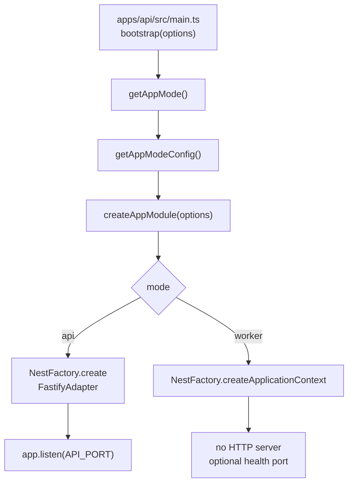

`apps/api` compiles to a single dist/main entry point. Which of the two processes it
becomes is decided by one command-line flag, read once at startup, before any
NestJS module is instantiated. Everything else — which modules are imported,
which providers resolve to an instance and which to `null` — follows from that
one decision.

## Selecting the mode

`getAppMode()` in `packages/nestjs-neo4jsonapi/src/bootstrap/defaults.ts` reads
`process.argv`:

| Argument | Result |
|---|---|
| `--mode=worker` | `AppMode.WORKER` |
| `--mode=api` | `AppMode.API` |
| `--worker` | `AppMode.WORKER` |
| `--api` | `AppMode.API` |
| none of the above | `AppMode.API` |

`--mode=` is checked first and wins; the bare flags are only consulted when no
`--mode=` argument is present. **The default is API.** A process started with no
flag at all serves HTTP, so a worker that loses its flag silently becomes a
second API rather than failing.

`getAppModeConfig(mode)` turns the enum into the three switches the rest of the
system reads:

| Field | API | Worker |
|---|---|---|
| `mode` | `api` | `worker` |
| `enableControllers` | `true` | `false` |
| `enableWorkers` | `false` | `true` |
| `enableCronJobs` | `false` | `true` |

An unknown mode throws. The shape is declared as `AppModeConfig` in
`packages/nestjs-neo4jsonapi/src/common/decorators/conditional-service.decorator.ts`
and re-exported from
`packages/nestjs-neo4jsonapi/src/core/appmode/constants/app.mode.constant.ts`.

`AppModeModule.forRoot(modeConfig)` publishes it globally under the
`APP_MODE_TOKEN` symbol, so any provider can inject it. Its default (used when
`forRoot` is not called) is the API configuration.

## What each mode builds



`bootstrap()` in `packages/nestjs-neo4jsonapi/src/bootstrap/bootstrap.ts`
initialises tracing, raises `EventEmitter.defaultMaxListeners` to 50, resolves
the mode, and branches.

**API mode** (`bootstrapAPI`) creates a `NestFastifyApplication` and then, in
order: raw-body capture for webhook routes, optional `@fastify/helmet`,
`@fastify/multipart`, the `application/vnd.api+json` content-type parser, the
logger and its `onSend` hook, `HttpExceptionFilter` and
`ThrottlerExceptionFilter`, a global `ValidationPipe` with `whitelist: true` and
`transform: true`, the tracing / cache / logging interceptors in that order,
CORS, OpenAPI, and finally `app.listen(port, "0.0.0.0")`.

**Worker mode** (`bootstrapWorker`) calls
`NestFactory.createApplicationContext`. There is no Fastify adapter, no port, no
pipe, no filter, no interceptor and no CORS — none of those apply to a process
that never receives a request. It logs "Worker process started", optionally
starts a tiny health server, and waits.

Both register SIGTERM/SIGINT handlers that close the application (and the health
server, if any) before exiting.

### Mode-dependent module wiring

`createAppModule()` in
`packages/nestjs-neo4jsonapi/src/bootstrap/app.module.factory.ts` reads
`modeConfig` at module-definition time:

| Wiring | Condition | Consequence |
|---|---|---|
| `ClsModule.forRoot({ middleware: { mount: modeConfig.enableControllers } })` | API only | the worker has no request to hang a CLS context on, so nothing mounts the middleware. Worker code must open its own context with `cls.run()` |
| `ScheduleModule.forRoot()` | `enableCronJobs` — worker only | without it, every `@Cron` method is inert |
| `NecordModule.forRootAsync(...)` + `DiscordModule` | `enableCronJobs` **and** `baseConfig.discord.token` is set | the Discord bot runs in exactly one process, and only when a token exists. Registered **after** `options.appModules` so Necord can discover decorated handlers |
| `APP_GUARD` → `CustomThrottlerGuard` | `rateLimit.enabled` | the `ThrottlerModule` always configures limits; only the enforcing guard is conditional |

Everything else — `CoreModule`, `FoundationsModule`, `AgentsModule`,
`OpenApiModule`, the app's own modules — is imported in **both** modes. The
queue module in particular is loaded in both: the API needs it to *add* jobs, the
worker to *process* them.

## Conditional providers

Module imports are coarse. Individual providers are switched with the helpers in
`packages/nestjs-neo4jsonapi/src/common/decorators/conditional-service.decorator.ts`:

| Helper | Behaviour |
|---|---|
| `createConditionalProvider(Class, modes)` | a factory provider that returns `new Class(...)` when the running mode is in `modes`, and `null` otherwise |
| `createWorkerProvider(Class)` | `createConditionalProvider(Class, [AppMode.WORKER])` |
| `createApiProvider(Class)` | `createConditionalProvider(Class, [AppMode.API])` |
| `createModeAwareProvider(Class)` | always constructs, then calls `setAppMode()` if the instance has it |

The helpers rebuild the constructor's injection list by hand, because wrapping a
class in a factory provider loses the metadata NestJS would otherwise read.
`resolveInjectionTokens()` merges three metadata keys: `design:paramtypes` for
the declared types, `self:paramtypes` for `@Inject()` / `@InjectQueue()`
overrides, and `optional:paramtypes` for `@Optional()` markers. The last matters:
a factory's `inject` array expresses optionality as `{ token, optional: true }`,
and a bare token is always required. Dropping the `@Optional()` markers would
crash boot with `UnknownDependenciesException` in any consumer that leaves an
optional seam such as `CREDIT_VALIDATOR` or `TOKEN_USAGE_RECORDER` unbound.

The consequence of the `null` return is worth stating plainly: in API mode the
provider still exists and still injects — it injects `null`. A consumer that
calls a method on a worker-only service from API mode gets a `TypeError`, not a
DI failure. `ModeAwareService`'s `isApiMode()`, `isWorkerMode()`,
`shouldRunCronJobs()` and `shouldProcessJobs()` are the guarded alternative for
services that must run in both and behave differently.

### What the package marks worker-only

| Provider | Module |
|---|---|
| `MigratorService` | `packages/nestjs-neo4jsonapi/src/core/migrator/migrator.module.ts` |
| `PresenceCronService` | `packages/nestjs-neo4jsonapi/src/core/websocket/websocket.module.ts` |
| `RbacReconcilerService` | `packages/nestjs-neo4jsonapi/src/foundations/rbac/rbac.module.ts` |
| `ChunkProcessor`, `ChunkEmbeddingProcessor` | `packages/nestjs-neo4jsonapi/src/foundations/chunk/chunk.module.ts` |
| `CompanyProcessor` | `packages/nestjs-neo4jsonapi/src/foundations/company/company.module.ts` |
| `HowToProcessor` | `packages/nestjs-neo4jsonapi/src/foundations/how-to/how-to.module.ts` |
| `KeyConceptEmbeddingProcessor` | `packages/nestjs-neo4jsonapi/src/foundations/keyconcept/keyconcept.module.ts` |
| `StripeWebhookProcessor` | `packages/nestjs-neo4jsonapi/src/foundations/stripe-webhook/stripe-webhook.module.ts` |
| `UserActivityProcessor` | `packages/nestjs-neo4jsonapi/src/foundations/user-activity/user-activity.module.ts` |
| `AssistantActionExpiryCron` | `packages/nestjs-neo4jsonapi/src/foundations/assistant-action/assistant-action.module.ts` |
| `CommunitySummariserCron` | `packages/nestjs-neo4jsonapi/src/agents/community.summariser/community.summariser.module.ts` |

## The two consequences that bite

**The Neo4j migrator runs in the worker, never in the API.**
`MigratorModule` provides `MigratorService` through `createWorkerProvider`. Start
the API alone against an empty database and the schema is never created: no
constraints, no indexes, no seeded administrator from
`apps/api/src/neo4j.migrations/20250901_004.ts`. The first sign is usually a
login that fails rather than an error at boot. Start the worker — `pnpm dev`
starts both — and the migrations run.

**The RBAC reconciler runs in the worker, never in the API.** `RbacModule.register()`
wires `RbacReconcilerService` the same way. The permission matrix declared in
`apps/api/src/rbac/permissions.ts` is written into the graph by the worker; an
API-only deployment serves whatever grants happen to be there already.

Both are deliberate: they are write-once, idempotent, start-up operations, and
running them from every API replica in a scaled deployment would be a race.

## The worker tsconfig and the `deleteOutDir` race

`apps/api/tsconfig.worker.json` extends `apps/api/tsconfig.build.json` and
changes exactly one thing:

```json
{ "compilerOptions": { "outDir": "./dist-worker" } }
```

`pnpm dev` runs `turbo run dev dev:worker`, so `apps/api` has two concurrent
`nest start --watch` processes. `apps/api/nest-cli.json` sets
`"deleteOutDir": true`, which makes each watcher wipe its output directory on
(re)start. Pointed at the same dist/ directory, each restart deletes the tree the other
process is executing from, and the survivor dies on a half-written directory —
`Cannot find module './load-env'` is the usual symptom, and a
`CircularDependencyException` inside `JsonApiModule` has been observed from the
same cause.

The window is narrow enough that five consecutive clean boots may not hit it,
which is precisely why it is designed out rather than measured away. A separate
`outDir` removes the shared state. The production build never uses this file:
`nest build` uses `apps/api/tsconfig.build.json` and emits the flat dist/main.js that
`start:prod` and the Docker `CMD` expect.

## The worker health port

`BootstrapOptions.worker.healthCheckPort` makes `bootstrapWorker` start a plain
`http.createServer` that answers `{"status":"ok"}` with 200 on every path, and
closes it on shutdown. **`apps/api/src/main.ts` does not pass it**, so the
template's worker listens on nothing.

`.env.e2e.example` declares `E2E_WORKER_HEALTH_PORT=4082` and `scripts/e2e.sh`
reserves and frees it, but nothing binds it and the runner does not poll it — the
migration check is the real readiness signal for the e2e worker.
`docker-compose.worker.yml` and `docker-compose.yml` both health-check the worker
with `pgrep -f "node.*dist/main.*worker"` for the same reason.

## Running both locally

`pnpm dev` → `bash scripts/dev.sh` → `turbo run dev dev:worker`.

| Script | Command |
|---|---|
| `apps/api` `dev` | `nodemon --watch ../../packages/nestjs-neo4jsonapi/dist --ext js --delay 2 --exec "nest start --watch -- --mode=api"` |
| `apps/api` `dev:worker` | the same, with `-p tsconfig.worker.json -- --mode=worker` |

Both nodemon wrappers watch the **compiled** package output, not its source — see
the monorepo page on why apps consume compiled output. The root also exposes
`pnpm dev:api`, `pnpm dev:web` and `pnpm dev:worker` to run one leg at a time.

`scripts/dev.sh` itself is about the web app's .next directory, not about modes: it clears a
`.next` left behind by an unclean exit or by a production `next build`, both of
which make `next dev` serve 404s on routes that exist.

## Production commands

| Where | Command |
|---|---|
| `Dockerfile`, `api-production` stage | `CMD ["node", "dist/main", "--mode=api"]` |
| `docker-compose.yml`, `worker` service | `command: [node, dist/main, --mode=worker]` |
| `docker-compose.worker.yml` | the same, with `target: api-production` |
| `apps/api` `start:prod` | `node --max-old-space-size=6144 dist/main --mode=api` |
| `apps/api` `start:worker:prod` | the same with `--mode=worker` |

The worker image **is** the API image — `docker-compose.worker.yml` builds
`target: api-production` and overrides only the command. Scaling workers is
`docker compose -f docker-compose.worker.yml up -d --scale worker=3`; each
replica consumes from the same BullMQ queues, so concurrency is additive and the
per-processor `concurrency` option multiplies by the replica count.

Heap size is set separately per process: `API_NODE_OPTIONS` and
`WORKER_NODE_OPTIONS` in `.env.example`, both defaulting to
`--max-old-space-size=6144`.

## Where to look

| File | What it tells you |
|---|---|
| `packages/nestjs-neo4jsonapi/src/bootstrap/defaults.ts` | `getAppMode()`, `getAppModeConfig()` and the Fastify defaults |
| `packages/nestjs-neo4jsonapi/src/bootstrap/bootstrap.ts` | the two boot paths, in order |
| `packages/nestjs-neo4jsonapi/src/bootstrap/app.module.factory.ts` | every mode-conditional import |
| `packages/nestjs-neo4jsonapi/src/common/decorators/conditional-service.decorator.ts` | the provider helpers and the metadata they rebuild |
| `packages/nestjs-neo4jsonapi/src/core/appmode/app.mode.module.ts` | `APP_MODE_TOKEN` and its default |
| `packages/nestjs-neo4jsonapi/src/core/migrator/migrator.module.ts` | the migrator's worker-only registration |
| `packages/nestjs-neo4jsonapi/src/foundations/rbac/rbac.module.ts` | the reconciler's worker-only registration |
| `apps/api/tsconfig.worker.json` | the separate `outDir` and the race it removes |
| `apps/api/nest-cli.json` | `deleteOutDir: true`, the other half of that race |
| `docker-compose.worker.yml` | the production worker command, healthcheck and scaling note |

## Gaps and drift

- The default mode is API. A worker process launched without its flag becomes a
  second API and will bind `API_PORT`.
- A worker-only provider injected in API mode resolves to `null`, not to a DI
  error. Nothing in the package asserts against that.
- `BootstrapOptions.worker.healthCheckPort` is supported by the package and
  unused by the template; `E2E_WORKER_HEALTH_PORT` is reserved but never bound.
- `createApiProvider` and `createModeAwareProvider` are exported but no module in
  the package uses either.
- `baseConfig.environment.appMode` is derived from an `APP_MODE` environment
  variable, not from `getAppMode()`; `.env.example` does not set `APP_MODE`, so
  the pre-built `baseConfig` export reports `api` even inside the worker process.
  Code that needs the real mode must inject `APP_MODE_TOKEN`.
- The `Dockerfile`'s `api-development` and `web-development` stages were read for
  their commands only.
- Migration contents and the RBAC matrix DSL are covered by the backend chapters,
  not here.
