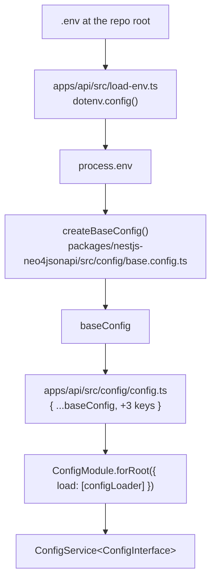

Configuration enters {{display}} at exactly two points — `process.env` on the
NestJS side and `process.env` on the Next.js side — and is read from exactly two
files. Everything else injects a typed object. This page covers the layers, the
ban that keeps them honest, and the full variable inventory.

## The backend layers



### Layer 1 — `.env` and `apps/api/src/load-env.ts`

`apps/api/src/load-env.ts` calls
`dotenv.config({ path: path.resolve(__dirname, "../../../.env") })` and exports
nothing. It is imported for its side effect as the **first import** of
`apps/api/src/main.ts`.

It is a module rather than three lines inside `apps/api/src/main.ts` because of module
semantics, not style. TypeScript's CommonJS emit preserves the interleaving of
`require` calls and statements, so an inline `dotenv.config()` between the
imports happened to run before `@carlonicora/nestjs-neo4jsonapi` was required.
Every ESM-correct transpiler — swc, esbuild — hoists all imports above such a
statement, loads the library before any variable exists, and kills boot with
`JwtStrategy requires a secret or key`. ESM guarantees the **order of imports**,
not the position of statements relative to them, so expressing the dependency as
an import is the only form that survives a change of compiler.

The relative path is the other constraint. `__dirname` is `apps/api/src` under a
source runner and the app's dist/ directory after a build; both are three levels below the
repository root, so the same relative path is correct either way. **Moving this
file deeper inside `apps/api/src` breaks it.**

Note what this implies: there is one `.env`, at the repository root, shared by
the API, the worker and (through `dotenv -e ../../.env`) the web app's `dev`,
`build` and `start` scripts.

### Layer 2 — `createBaseConfig()`

`packages/nestjs-neo4jsonapi/src/config/base.config.ts` is the only file in the
package that reads the environment. It returns a `BaseConfigInterface` with one
key per subsystem — `environment`, `api`, `app`, `neo4j`, `redis`, `cache`,
`cors`, `jwt`, `vapid`, `email`, `logging`, `tempo`, `s3`, `ai`, `credits`,
`rateLimit`, `encryption`, `stripe`, `discord`, `google`, `oauth`, `mcp`,
`modelManager`, `auth`, `twoFactor`, `prompts`, `responder`, `summariser`,
`operator`, `chunker`, `chunkQueues`, `contentTypes`, `jobNames` — and every
value already parsed: numbers through `parseInt`/`parseFloat`, booleans through
an explicit comparison, comma lists through `split(",")`, URLs normalised to a
trailing slash.

`baseConfig` is the module-level instance, created with no options at import
time. `createBaseConfig(options)` is the parameterised form; the options carry
`appName`, `environmentType`, `prompts`, `responder`, `summariser`, `operator`,
`chunkQueues`, `contentTypes` and `jobNames`.

### Layer 3 — `apps/api/src/config/config.ts`

The app's config is a **shallow merge over** `baseConfig`, adding exactly three
keys:

| Key | Value | Consumed by |
|---|---|---|
| `chunkQueues` | `{ queueIds: Object.values(QueueId) }` from `apps/api/src/config/enums/queue.id.ts` | `QueueModule` registration |
| `contentTypes` | `{ types: [] }` | multi-label content queries |
| `jobNames` | `JobName` from `apps/api/src/config/enums/job.name.ts` | processors matching incoming job names |

Because the merge is shallow, each of the three **replaces** the corresponding
`baseConfig` key wholesale. The function is passed to `bootstrap()` as
`config`, and `createAppModule` calls it once, merges it over `baseConfig` again,
and hands the result to `ConfigModule.forRoot({ load: [configLoader], isGlobal:
true, cache: true })`.

`apps/api/src/config/interfaces/config.interface.ts` is the extension point:

```ts
export interface ConfigInterface extends BaseConfigInterface {}
```

Add your own keys there, return them from `apps/api/src/config/config.ts`, and inject
`ConfigService<ConfigInterface>` to read them with types intact.

### The `process.env` ban

**Application code never reads `process.env`.** It injects
`ConfigService<ConfigInterface>` and calls `get()`. The reason is not purity: a
scattered `process.env.X || "…"` puts the default at the call site, where two
call sites drift apart silently.

The rule holds almost exactly. The package has one read site — the base config file —
and two documented exceptions to the single-read-site rule:

1. **`CHUNK_QUEUE_CONCURRENCY`**, a module-level constant exported from
   `packages/nestjs-neo4jsonapi/src/config/base.config.ts` itself. The
   `@Processor(queue, { concurrency })` options are
   evaluated at **decoration** time, when the class is first loaded, long before
   NestJS instantiates `ConfigService` — so the processor cannot inject the value
   it needs. Resolving it as a constant keeps the read inside the one permitted
   file. A non-numeric or non-positive value falls back to 50 rather than
   producing `NaN`, which BullMQ would treat as unbounded.
2. **A write, not a read**, in the LLM layer's model service: the Google auth
   library only accepts a credentials path through
   `process.env.GOOGLE_APPLICATION_CREDENTIALS`, so the service assigns it after
   materialising the decoded service-account JSON on disk.

`apps/api` itself reads `process.env` in two places, both before a `ConfigService`
exists: `apps/api/src/features/features.modules.ts` reads `NODE_ENV` to decide
`devMode` at module-definition time, and `apps/api/src/openapi/openapi.config.ts`
reads `NODE_ENV`, `ENABLE_SWAGGER`, `ENABLE_REDOC` and `npm_package_version` for
the object it hands to `bootstrap()`.

## The web layers

The browser has no `ConfigService`, and Next.js substitutes `NEXT_PUBLIC_*`
**textually at build time**, which constrains how the reads may be written.

### `apps/web/src/config/middleware-env.ts`

The library-free layer. It exports one `ENV` object and imports **nothing** —
Next.js middleware (`apps/web/src/proxy.ts`) runs in a restricted runtime where
an incidental import of a Node-only module is a build error, so this file must
stay importable from there. It carries `API_URL`, `APP_URL`,
`VAPID_PUBLIC_KEY`, `STRIPE_PUBLISHABLE_KEY`, `REGISTRATION_MODE`,
`DISCORD_CLIENT_ID`, `GOOGLE_CLIENT_ID`, `PUBLIC_API_URL`, `IS_PRODUCTION` and
`IS_DEVELOPMENT`.

Two of those deserve attention. `API_URL` prefers `API_INTERNAL_URL` when
`typeof window === "undefined"`, so server-side calls can take a private network
address. `PUBLIC_API_URL` deliberately skips that override: any URL the **browser**
will fetch or follow must use the public one, because the internal host is
unreachable from outside the network.

### `apps/web/src/config/instrumentation-env.ts` and `apps/web/src/config/env.ts`

The wiring layer, split in two. `apps/web/src/config/instrumentation-env.ts`
re-exports `ENV` from the middleware-safe file, runs `bootstrap()` from
`apps/web/src/config/Bootstrapper.ts` at import time so every module is in the
registry before a component asks, throws if `API_URL` or `APP_URL` is empty,
loads `apps/web/src/config/waitlist.config.ts`, and then calls `configureJsonApi`,
`configureAuth`, `configureRoles` and `configureLogin`. Those two throws are the
only fail-fast configuration checks on the web side.

`apps/web/src/config/env.ts` imports that file, re-exports its `ENV`, and adds the
one call left out of it: `configureI18n`, which takes next-intl's hooks, the
navigation from `apps/web/src/i18n/navigation.ts` and `getLocale`. App code keeps
importing `@/config/env`. `apps/web/src/instrumentation.ts` imports
`@/config/instrumentation-env` instead, because next-intl loads
`apps/web/src/i18n/request.ts`, which reads `next/root-params` — a module only
allowed inside the app directory.

### `packages/nextjs-jsonapi/src/core/env.ts`

The package's own single `process.env` reader, with two rules written into it:

**Literal reads.** Next.js replaces the exact expression
`process.env.NEXT_PUBLIC_FOO` with a string literal. A computed lookup —
`process.env[key]` — is not substituted and reads as `undefined` in the browser
bundle. Every entry therefore spells its variable out in full, and new entries
must do the same.

**Getters, not properties.** Every call site this replaced read `process.env` at
call time. A plain property would freeze the value at first import, which breaks
any consumer that assigns the variable after boot — the package's own tests do
exactly that. Getters keep the read lazy while leaving the expression literal.

Because the substitution happens before the code runs, no reference to `process`
survives into the client bundle, which is why the module carries no
`"use client"` directive and is safe to import from anywhere.

**No getter throws.** `API_URL`, `APP_URL`, `APP_URL_ALTERNATE`,
`VAPID_PUBLIC_KEY` and `GOOGLE_MAPS_API_KEY` return `""` when unset;
`PRIVATE_INSTALLATION`, `IS_PRODUCTION` and `IS_DEVELOPMENT` return booleans. The
throws live one layer up, in
`packages/nextjs-jsonapi/src/unified/JsonApiRequest.ts`: `getApiUrl()` throws
"API URL not configured…" and `getAppUrl()` throws "App URL not configured…" when
neither `configureJsonApi()` nor the environment supplied a value.

### Build-time baking

`NEXT_PUBLIC_*` values are embedded into the JavaScript bundle when
`next build` runs, not read at container start. Consequences:

- Changing one in production requires a **rebuild**, not a restart.
- `Dockerfile`'s `web-builder` stage declares them as `ARG`s and promotes them to
  `ENV` so the build sees them: `NEXT_PUBLIC_API_URL`, `NEXT_PUBLIC_ADDRESS`,
  `NEXT_PUBLIC_VAPID_PUBLIC_KEY`, `NEXT_PUBLIC_GOOGLE_MAPS_API_KEY`, plus the
  server-side `API_URL`, `API_INTERNAL_URL` and `IMAGE_SOURCES`.
- `docker-compose.yml` passes them as build args **and** repeats them in the
  runtime `environment` block, where they have no effect — the file says so.
- `turbo.json`'s `build` task lists `NEXT_PUBLIC_*` in its `env` array, so
  changing one busts the build cache instead of producing a stale bundle.

Only four `NEXT_PUBLIC_*` variables are wired through the Docker build. Others
that `.env.example` defines — `NEXT_PUBLIC_REGISTRATION_MODE`,
`NEXT_PUBLIC_STRIPE_PUBLISHABLE_KEY`, `NEXT_PUBLIC_TURNSTILE_SITE_KEY`,
`NEXT_PUBLIC_DISCORD_CLIENT_ID`, `NEXT_PUBLIC_GOOGLE_CLIENT_ID` — work in
development and need adding to the `Dockerfile` and the compose build args before
they reach a production bundle.

## Variable inventory

Grouped by subsystem. **In `.env.example`** marks the variables the shipped
example file lists; the rest are read by the package's base config and documented nowhere
else in the repository.

### Process and URLs

| Variable | Default | In `.env.example` |
|---|---|---|
| `API_URL` | `http://localhost:3000/` (trailing slash forced) | yes |
| `API_PORT` | `3000` | yes (`4050`) |
| `APP_URL` | `http://localhost:3000` | yes |
| `PORT` | — (Next.js) | yes (`4051`) |
| `API_INTERNAL_URL` | unset — falls back to `NEXT_PUBLIC_API_URL` | no (compose only) |
| `PUBLIC_HOSTNAME` | — | yes |
| `API_NODE_OPTIONS`, `WORKER_NODE_OPTIONS`, `WEB_NODE_OPTIONS` | — | yes |
| `NODE_ENV` | `""` | no |
| `ENV` | `development` — used as the api env and the Loki environment label | no |
| `APP_MODE` | `api` unless exactly `worker` | no |

### Neo4j

| Variable | Default | In `.env.example` |
|---|---|---|
| `NEO4J_URI` | `""` | yes |
| `NEO4J_USER` | `""` | yes |
| `NEO4J_PASSWORD` | `""` | yes |
| `NEO4J_DATABASE` | `""` | yes |

### Redis, cache and queues

| Variable | Default | In `.env.example` |
|---|---|---|
| `REDIS_HOST` | `""` | yes |
| `REDIS_PORT` | `6379` | yes |
| `REDIS_USERNAME`, `REDIS_PASSWORD` | `""` | yes |
| `REDIS_QUEUE` | `default` — the BullMQ key prefix **and** the pub/sub channel prefix | yes |
| `CACHE_ENABLED` | `true` unless exactly `false` | yes (`false`) |
| `CACHE_DEFAULT_TTL` | `600` | yes |
| `CACHE_SKIP_PATTERNS` | `/access,/auth,/notifications,/websocket,/version` | yes (empty) |
| `CACHE_VERSION` | `v1` | no |
| `CHUNK_QUEUE_CONCURRENCY` | `50` | no |

### Authentication, 2FA and registration

| Variable | Default | In `.env.example` |
|---|---|---|
| `JWT_SECRET` | `""` | yes |
| `JWT_EXPIRES_IN` | `1h` | yes (`1d`) |
| `ALLOW_REGISTRATION` | `true` unless `false` | no |
| `NEXT_PUBLIC_REGISTRATION_MODE` / `REGISTRATION_MODE` | `open` | yes (the public one) |
| `TOTP_ENCRYPTION_KEY` | `""` | yes |
| `TOTP_ISSUER` | falls back to `WEBAUTHN_RP_NAME`, then `Application` | commented out |
| `WEBAUTHN_RP_ID` | `localhost` | yes |
| `WEBAUTHN_RP_NAME` | `Application` | yes |
| `WEBAUTHN_ORIGIN` | `["http://localhost:3000"]`, comma-split | yes |
| `TWO_FACTOR_PENDING_TTL` | `300` | yes |
| `ENCRYPTION_KEY` | `""` — AES key for secrets stored in the graph | yes |
| `OAUTH_ENABLED` | `false` | no |
| `OAUTH_AUTHORIZATION_CODE_LIFETIME` | `600` | no |
| `OAUTH_ACCESS_TOKEN_LIFETIME` | `3600` | no |
| `OAUTH_REFRESH_TOKEN_LIFETIME` | `604800` | no |
| `OAUTH_REQUIRE_PKCE_FOR_PUBLIC_CLIENTS` | `true` unless `false` | no |
| `OAUTH_ROTATE_REFRESH_TOKENS` | `true` unless `false` | no |
| `NEXT_PUBLIC_DISCORD_CLIENT_ID`, `DISCORD_CLIENT_SECRET` | `""` | yes |
| `NEXT_PUBLIC_GOOGLE_CLIENT_ID` / `GOOGLE_CLIENT_ID`, `GOOGLE_CLIENT_SECRET` | `""` | partly — the plain `GOOGLE_CLIENT_ID` is not listed |
| `NEXT_PUBLIC_TURNSTILE_SITE_KEY`, `TURNSTILE_SECRET_KEY` | — | yes |

### CORS and rate limiting

| Variable | Default | In `.env.example` |
|---|---|---|
| `CORS_ORIGINS` | `["http://localhost:3000"]` | yes |
| `CORS_ORIGIN_PATTERNS` | `[]` | yes |
| `CORS_CREDENTIALS` | `true` unless `false` | yes |
| `CORS_METHODS` | `GET,HEAD,PUT,PATCH,POST,DELETE,OPTIONS` | yes |
| `CORS_ALLOWED_HEADERS` | `Content-Type,Authorization,X-Requested-With` | yes (adds `x-language`, `x-companyid`) |
| `CORS_MAX_AGE` | `86400` | yes |
| `CORS_PREFLIGHT_CONTINUE` | `false` | yes |
| `CORS_OPTIONS_SUCCESS_STATUS` | `204` | yes |
| `CORS_LOG_VIOLATIONS` | `true` unless `false` | yes (`false`) |
| `RATE_LIMIT_ENABLED` | `true` unless `false` | yes |
| `RATE_LIMIT_TTL` | `60000` | yes |
| `RATE_LIMIT_REQUESTS` | `100` | yes (`1000`) |
| `IP_RATE_LIMIT_REQUESTS` | `20` | yes (`200`) |

### Object storage

| Variable | Default | In `.env.example` |
|---|---|---|
| `S3_TYPE`, `S3_ENDPOINT`, `S3_BUCKET`, `S3_ACCESS_KEY_ID`, `S3_SECRET_ACCESS_KEY` | `""` | yes |
| `S3_REGION` | `us-east-1` | yes (empty) |
| `IMAGE_SOURCES` | — (web CSP headers) | yes |

### E-mail

| Variable | Default | In `.env.example` |
|---|---|---|
| `EMAIL_PROVIDER` | unset — cast to `sendgrid \| smtp \| brevo` | yes |
| `EMAIL_API_KEY`, `EMAIL_FROM` | `""` | yes |
| `EMAIL_HOST`, `EMAIL_USERNAME`, `EMAIL_PASSWORD` | `""` | no |
| `EMAIL_PORT` | `0` | no |
| `EMAIL_SECURE` | `false` | no |
| `EMAIL_DEFAULT_LOCALE` | `en` | no |

The SMTP provider needs the five unlisted variables; `.env.example` documents
only the API-key form.

### Logging and tracing

| Variable | Default | In `.env.example` |
|---|---|---|
| `CONSOLE_ENABLED` | `false` unless exactly `true` | yes (`true`) |
| `LOG_LEVEL` | `""` — each transport supplies its own default | no |
| `DEBUG_LOGGING_ENABLED` | `false` | yes |
| `DEBUG_LOG_PATH` | `./logs` | yes |
| `LOKI_ENABLED` | `false` unless `true` | yes (`true`) |
| `LOKI_HOST` | `http://localhost:3100` | yes |
| `LOKI_USERNAME`, `LOKI_PASSWORD` | `""` | commented out |
| `LOKI_APP_LABEL` | the `appName` option | yes |
| `LOKI_BATCHING` | `true` unless `false` | no |
| `LOKI_INTERVAL` | `30` | no |
| `TEMPO_ENABLED` | `false` unless `true` | yes (`true`) |
| `TEMPO_ENDPOINT` | `http://localhost:4318/v1/traces` | yes |
| `TEMPO_SERVICE_NAME` | the `appName` option | yes |
| `TEMPO_SERVICE_VERSION` | `1.0.0` | yes |

### AI

Three chat tiers share one resolution rule. `AI_*` is the normal tier;
`AI_*_LITE` and `AI_*_LARGE` inherit field-by-field from it **unless** they
declare a different `AI_PROVIDER<suffix>`, in which case nothing inherits,
because the base URL, key and costs would point at the wrong service.
`AI_REGION` and `AI_ALLOW_FALLBACKS` never inherit — they are per-model routing,
not provider-wide credentials.

| Variable | Default | In `.env.example` |
|---|---|---|
| `AI_PROVIDER`, `AI_API_KEY`, `AI_MODEL`, `AI_URL`, `AI_REGION`, `AI_SECRET`, `AI_INSTANCE`, `AI_API_VERSION` | `""` | yes |
| `AI_INPUT_COST_PER_1M_TOKENS`, `AI_OUTPUT_COST_PER_1M_TOKENS` | `0` | yes |
| `AI_CACHED_INPUT_COST_PER_1M_TOKENS` | omitted when unset | no |
| `AI_MAX_OUTPUT_TOKENS`, `AI_REASONING_EFFORT` | unset / `""` | no |
| `AI_ALLOW_FALLBACKS` | `true` unless exactly `false` | no |
| `AI_GOOGLE_CREDENTIALS_BASE64` | `""` | yes |
| the same names with `_LITE` and `_LARGE` | inherit per the rule above | no |
| `MOCK_AI` | `false` — fails closed: boot throws if `true` while `ENV` is `production` | no |
| `AI_REQUEST_TIMEOUT_MS` | `120000` | no |
| `AI_REQUEST_DEADLINE_ATTEMPTS` | `3` | no |
| `AI_REQUEST_WATCHDOG_MS` | `30000` | no |
| `AI_CONNECTION_COOLDOWN_MINUTES` | `5` | no |
| `AI_URL_ALLOWLIST` | `undefined` — unset skips the check entirely; an empty list would reject every URL | no |
| `ASSISTANT_DUMP_LLM_CALLS` | off unless exactly `1` | no |
| `ASSISTANT_DUMP_LLM_CALLS_DIR` | `<cwd>/.llm-dumps` | no |
| `ASSISTANT_DUMP_LLM_REDACT`, `ASSISTANT_DUMP_LLM_KEEP_FIELDS` | off / `[]` | no |
| `VISION_*` | falls back to the matching `AI_*` | yes (no `VISION_REASONING_EFFORT`) |
| `AUDIO_*` (incl. `AUDIO_COST_PER_MINUTE`, `AUDIO_DIRECT_*`, `AUDIO_LANGUAGE`) | falls back to `AI_*` | no |
| `IMAGE_*` | **no** `AI_*` fallback — a separate modality | no |
| `TRANSCRIBER_PROVIDER`, `_API_KEY`, `_MODEL`, `_URL`, `_API_VERSION` | `""` | yes |
| `DOCUMENT_AI_ENABLED` | `false` | no |
| `DOCUMENT_AI_PROVIDER` | `azure` | no |
| `DOCUMENT_AI_API_KEY`, `_MODEL`, `_URL`, `_API_VERSION` | `""` | no |
| `DOCUMENT_AI_COST_PER_PAGE` | `0` | no |

### Embeddings

| Variable | Default | In `.env.example` |
|---|---|---|
| `EMBEDDER_PROVIDER`, `_API_KEY`, `_URL`, `_MODEL`, `_INSTANCE`, `_API_VERSION`, `_REGION`, `_GOOGLE_CREDENTIALS_BASE64` | `""` | yes |
| `EMBEDDER_DIMENSIONS` | `0` | yes (`3072`) |
| `EMBEDDER_INPUT_COST_PER_1M_TOKENS` | `0` — unset means embeddings are not billed | no |
| `EMBEDDER_TPM_LIMIT` | `1000000` | no |
| `EMBEDDER_TPM_SAFETY` | `200000` | no |
| `EMBEDDER_MAX_BATCH_TOKENS` | `100000` | no |
| `EMBEDDER_MAX_CONCURRENT_REQUESTS` | `10` | no |
| `EMBEDDER_MAX_WAIT_MS` | `90000` | no |
| `EMBEDDER_MAX_ATTEMPTS` | `3` | no |
| `EMBEDDER_CHARS_PER_TOKEN` | `4` | no |

### Chunking and the model manager

| Variable | Default | In `.env.example` |
|---|---|---|
| `CHUNKER_STRATEGY` | `markdown-structural` (or `semantic`) | no |
| `CHUNKER_TARGET_CHARS` | `1500` | no |
| `OCR_LANGUAGE` | `eng` | no |
| `MODEL_CONFIG_PATH` | `<cwd>/config/models.config.yaml` — the image sets it explicitly | no |
| `MODELS_CACHE_DIR` | `<cwd>/.cache/models` | no |
| `MODEL_BASE_URL` | `https://huggingface.co` | no |
| `MODEL_VERIFY_HASH`, `MODEL_STRICT_HASH`, `MODEL_AUTO_UPDATE` | `true` unless `false` | no |
| `ONNX_INTRA_OP_NUM_THREADS` | `2` | no |
| `ONNX_INTER_OP_NUM_THREADS` | `1` | no |

The template ships `apps/api/config/models.config.yaml` empty, so nothing is
downloaded until you add a registry entry.

### Billing

| Variable | Default | In `.env.example` |
|---|---|---|
| `STRIPE_SECRET_KEY`, `STRIPE_WEBHOOK_SECRET` | `""` | yes |
| `STRIPE_API_VERSION` | unset — the SDK's own default applies | yes (pinned) |
| `STRIPE_PUBLISHABLE_KEY` | `""` — the **server-side** name | no; `.env.example` lists only `NEXT_PUBLIC_STRIPE_PUBLISHABLE_KEY` |
| `STRIPE_PORTAL_RETURN_URL` | falls back to `APP_URL` | no |
| `STRIPE_PORTAL_CONFIGURATION_ID` | `""` | no |
| `CREDIT_COST` | `0` — zero or unset disables credits entirely | yes |
| `CREDIT_MINIMUM` | `0.1` | yes |

Monetary values are euros throughout.

### Push, Discord and MCP

| Variable | Default | In `.env.example` |
|---|---|---|
| `VAPID_PUBLIC_KEY`, `VAPID_PRIVATE_KEY`, `VAPID_EMAIL` | `""` | yes |
| `NEXT_PUBLIC_VAPID_PUBLIC_KEY` | `""` | yes |
| `DISCORD_TOKEN` | `""` — non-empty is what wires the bot, worker-side only | no |
| `DISCORD_DEV_GUILD_ID` | `""` | no |
| `MCP_ENABLED` | `false` | no |
| `MCP_SERVER_NAME` | a hardcoded literal — override it if you enable MCP | no |
| `MCP_INSTRUCTIONS` | `undefined` | no |
| `MCP_PROMOTED_ENTITIES` | `[]`, comma-split | no |
| `NEXT_PUBLIC_GOOGLE_MAPS_API_KEY` | `""` | yes |
| `NEXT_PUBLIC_APP_URL`, `NEXT_PUBLIC_PRIVATE_INSTALLATION` | `""` / `false` — read by the web package only | no |
| `ENABLE_SWAGGER`, `ENABLE_REDOC` | off outside development | no |

## The e2e overrides

`.env.e2e.example` is copied to `.env.e2e`, which `scripts/e2e.sh` sources —
exporting everything it declares — **before** it boots anything. It is listed in
`turbo.json`'s `globalDependencies`, so editing it busts the turbo cache, and it
is gitignored.

The stack it boots is deliberately disjoint from the dev stack: different ports,
a different Neo4j database, a different Redis queue prefix, a different Next.js
build directory. That is what lets both run at once on one machine.

**Configurable:**

| Variable | Default | Note |
|---|---|---|
| `E2E_API_PORT` | `4080` | must not collide with `API_PORT` |
| `E2E_WEB_PORT` | `4081` | must not collide with `PORT` |
| `E2E_WORKER_HEALTH_PORT` | `4082` | reserved and freed; only bound if the app opts into `bootstrap({ worker: { healthCheckPort } })`, which the template does not |
| `E2E_NEO4J_DATABASE` | `{{name}}test` | **dropped and recreated empty at the start of every run** |
| `E2E_REDIS_QUEUE` | `{{name}}e2e` | must differ from `REDIS_QUEUE`; a shared prefix makes the two stacks consume each other's jobs |
| `PUBLIC_HOSTNAME` | read from `.env` | the api host is derived as `api.<PUBLIC_HOSTNAME>` |
| `E2E_ADMIN_EMAIL`, `E2E_ADMIN_PASSWORD` | the administrator seeded by migration `20250901_004` | change only if you changed that migration |

Connection details are deliberately **not** duplicated: the suite reads
`NEO4J_URI`, `NEO4J_USER` and `NEO4J_PASSWORD` from the root `.env`, so it always
talks to the same server the app does.

**Set by the runner, documented but not configurable:** `NEO4J_DATABASE`,
`REDIS_QUEUE`, `API_PORT`/`PORT`, `API_URL`/`API_INTERNAL_URL`/`NEXT_PUBLIC_API_URL`,
`APP_URL`/`NEXT_PUBLIC_ADDRESS`, `CORS_ORIGINS` (the web host **and**
`http://localhost:<port>`, because a service worker needs a secure context that a
custom `/etc/hosts` name over plain HTTP is not), `RATE_LIMIT_ENABLED=false` (the
login route's per-IP throttle cannot be raised by config, and a suite that logs
in repeatedly otherwise 429s), `E2E_BUILD=true` (so `createNextConfig`, which `apps/web/next.config.js` calls, uses
`distDir: ".next-e2e"` and never clobbers the dev server's `.next`) and
`E2E_INSECURE_COOKIES=true`.

## Where to look

| File | What it tells you |
|---|---|
| `apps/api/src/load-env.ts` | why the loader is an import and why its depth is fixed |
| `packages/nestjs-neo4jsonapi/src/config/base.config.ts` | every backend variable, its parse and its default |
| `apps/api/src/config/config.ts` | the three keys the app adds |
| `apps/api/src/config/interfaces/config.interface.ts` | the extension point |
| `.env.example` | the documented subset, grouped and commented per service |
| `.env.e2e.example` | every variable the e2e runner reads, plus the ones it sets itself |
| `apps/web/src/config/middleware-env.ts` | the library-free `ENV` and the internal/public URL split |
| `apps/web/src/config/instrumentation-env.ts` | the two fail-fast checks and four of the five `configure*` calls |
| `apps/web/src/config/env.ts` | `configureI18n`, and the import every app module uses |
| `packages/nextjs-jsonapi/src/core/env.ts` | the literal-read rule and the getter rule |
| `packages/nextjs-jsonapi/src/unified/JsonApiRequest.ts` | `getApiUrl()` / `getAppUrl()`, the only configuration throws in the package |

## Gaps and drift

- `packages/nestjs-neo4jsonapi/src/config/base.config.ts` reads roughly ninety
  variables that `.env.example` does not
  list — the whole `_LITE`/`_LARGE` tier system, every `IMAGE_*` and `AUDIO_*`,
  the embedder rate-limit block, the model manager, MCP, OAuth lifetimes, the
  SMTP fields, `DISCORD_TOKEN` and `MOCK_AI` among them. The defaults above are
  the only documentation of them in a generated app.
- `.env.example` lists `NEXT_PUBLIC_STRIPE_PUBLISHABLE_KEY` but the base config
  reads `STRIPE_PUBLISHABLE_KEY`, so the server-side value is empty unless you
  add it.
- Only four `NEXT_PUBLIC_*` variables are threaded through the `Dockerfile` and
  the compose build args; the rest are development-only until you add them.
- `LOKI_ENABLED` and `TEMPO_ENABLED` ship as `true` in `.env.example` while
  the base config defaults both to `false`, and no compose file starts either
  collector.
- `EMBEDDER_DIMENSIONS` defaults to `0` in code and `3072` in `.env.example`.
- `apps/api/src/config/interfaces/config.interface.ts` adds nothing to
  `BaseConfigInterface`, so `ConfigInterface` is currently an alias.
- The shallow merge in `apps/api/src/config/config.ts` replaces whole top-level
  keys; a future app config that sets a nested key must spread the base value
  itself.
- `apps/web/src/config/Bootstrapper.ts` and `apps/web/src/config/waitlist.config.ts`
  are imported by `apps/web/src/config/instrumentation-env.ts` but documented in the frontend
  chapter, not here.
- Secret handling and rotation is covered by the operations chapter.
