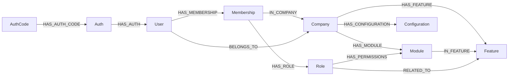
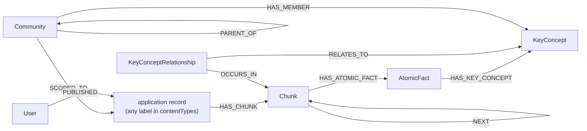

**This is a seed page.** It records the graph {{display}} already has on day
zero — the labels, relationship types, constraints and indexes the 43 foundation
modules and the four shipped migrations put in Neo4j before the application
stores a single record of its own. It does not, and cannot, describe your
domain.

What you add, as you build:

1. A row per label of your own in the **Labels this application declares** table
   at the bottom, naming the descriptor file and whether it is company-scoped.
2. A row per relationship type of your own in a second table, with its shape.
3. A Mermaid graph of your domain's core, beside the two here.
4. A note in **Gaps and drift** whenever your model departs from a convention
   this page states.

Everything above the "Labels this application declares" heading is derived from
the framework packages and should change only when they do.

## How this index was built

Every claim below comes from one of four sweeps over
`packages/nestjs-neo4jsonapi/src`:

- **Labels** — every `labelName:` declaration under `src/foundations`, then
  cross-checked against the Cypher that actually writes or matches each one, to
  separate stored labels from response-shaping metas.
- **Declared relationships** — the `relationships` block of every descriptor
  built with `defineEntity()`.
- **Cypher-only relationships** — every `[:TYPE]` pattern in a non-comment line
  under `src/foundations`, `src/core` and `src/agents`.
- **Schema** — the derivation in `src/common/helpers/define-entity.ts` and the
  reconciliation in `AbstractRepository.onModuleInit`.

## Global versus company-scoped

The rule is one line: `isCompanyScoped` decides whether an entity gets a
`(entity)-[:BELONGS_TO]->(:Company)` edge, and the default is `true`.

Set it to `false` when one of three things is true.

- The entity **is** the tenant, or precedes one. `Company`; `Auth` and
  `AuthCode`, because credentials are checked before a company is selected;
  `Waitlist`, because a signup has no company yet.
- The entity belongs to a **person rather than a tenant**: the second-factor
  labels, which follow the user across every company they belong to.
- The entity is **catalogue data identical for every tenant**: `Feature`,
  `HowTo`.

Two related cases look like exceptions and are not. `Membership` is
`isCompanyScoped: false` because it carries its own `IN_COMPANY` edge — scoping
it twice would be redundant and would let the two disagree. `AiConnection` is
`isCompanyScoped: false` because it attaches with a `CONFIGURES` edge instead,
which the generic `BELONGS_TO` loop would have got wrong.

The multi-tenancy page explains what the flag changes in the emitted Cypher.

## Labels the foundations declare

Stored labels — real nodes in Neo4j.

| Label | Declared in `packages/nestjs-neo4jsonapi/src/foundations/…` | Company-scoped |
|---|---|---|
| `Company` | `company/entities/company.meta.ts` | no — tenant root |
| `User` | `user/entities/user.meta.ts` | yes |
| `Membership` | `membership/entities/membership.meta.ts` | no — scoped by `IN_COMPANY` |
| `Role` | `role/entities/role.meta.ts` | yes |
| `Auth` | `auth/entities/auth.meta.ts` | no |
| `AuthCode` | `auth/entities/auth.code.meta.ts` | no |
| `DiscordUser` | `discord-user/entities/discord-user.ts` | yes |
| `GoogleUser` | `google-user/entities/google-user.ts` | yes |
| `Feature` | `feature/entities/feature.meta.ts` | no |
| `Module` | `module/entities/module.meta.ts` | five-file model — no flag |
| `Notification` | `notification/entities/notification.meta.ts` | yes |
| `PushSubscription` | written by `push/repositories/push.repository.ts` | no — see Gaps |
| `BackupCode` | `two-factor/entities/backup-code.meta.ts` | no |
| `Passkey` | `two-factor/entities/passkey.meta.ts` | no |
| `PendingTwoFactor` | `two-factor/entities/pending-two-factor.meta.ts` | no |
| `TotpAuthenticator` | `two-factor/entities/totp-authenticator.meta.ts` | no |
| `TwoFactorConfig` | `two-factor/entities/two-factor-config.meta.ts` | no |
| `OAuthClient` | `oauth/entities/oauth.client.meta.ts` | five-file model |
| `OAuthAccessToken` | `oauth/entities/oauth.access.token.entity.ts` | five-file model |
| `OAuthRefreshToken` | `oauth/entities/oauth.refresh.token.entity.ts` | five-file model |
| `OAuthAuthorizationCode` | `oauth/entities/oauth.authorization.code.entity.ts` | five-file model |
| `Chunk` | `chunk/entities/chunk.meta.ts` | yes |
| `AtomicFact` | `atomicfact/entities/atomic.fact.meta.ts` | five-file model |
| `KeyConcept` | `keyconcept/entities/key.concept.meta.ts` | five-file model |
| `Community` | `community/entities/community.meta.ts` | five-file model |
| `Assistant` | `assistant/entities/assistant.meta.ts` | yes |
| `AssistantMessage` | `assistant-message/entities/assistant-message.meta.ts` | yes |
| `AssistantAction` | `assistant-action/entities/assistant-action.meta.ts` | yes |
| `AiConnection` | `ai-connection/entities/ai-connection.meta.ts` | no — uses `CONFIGURES` |
| `AuditLog` | `audit/entities/audit.meta.ts` | five-file model |
| `UserActivity` | `user-activity/entities/user-activity.meta.ts` | yes |
| `HowTo` | `how-to/entities/how-to.meta.ts` | no |
| `Waitlist` | `waitlist/entities/waitlist.meta.ts` | no |
| `Referral` | `referral/entities/referral.meta.ts` | yes |
| `TokenUsage` | `tokenusage/entities/tokenusage.meta.ts` | yes |
| `StripeCustomer` | `stripe-customer/entities/stripe-customer.meta.ts` | five-file model |
| `StripeSubscription` | `stripe-subscription/entities/stripe-subscription.meta.ts` | five-file model |
| `StripeInvoice` | `stripe-invoice/entities/stripe-invoice.meta.ts` | five-file model |
| `StripePrice` | `stripe-price/entities/stripe-price.meta.ts` | five-file model |
| `StripeProduct` | `stripe-product/entities/stripe-product.meta.ts` | five-file model |
| `StripeUsageRecord` | `stripe-usage/entities/stripe-usage-record.meta.ts` | five-file model |
| `StripeWebhookEvent` | `stripe-webhook/entities/stripe-webhook-event.meta.ts` | five-file model |

Two more labels exist in Cypher with no declaring meta file at all:

| Label | Written or matched by | What it is |
|---|---|---|
| `Configuration` | `auth/repositories/auth.repository.ts`, `user/repositories/user.repository.ts` | per-company configuration, reached as `(:Company)-[:HAS_CONFIGURATION]->(:Configuration)`, read only |
| `KeyConceptRelationship` | `keyconcept/repositories/keyconcept.repository.ts`, `relevancy/queries/relevance.ts` | a reified edge between two `KeyConcept` nodes, so the relationship itself can carry chunks |

### Metas that declare a `labelName` but store nothing

These are response shapes. `defineEntity()` needs the four meta values to build
a serialiser, so they carry a `labelName` that no node ever has. Do not look for
them in the graph.

| Foundation | Metas |
|---|---|
| `two-factor` | `BackupCodesCount`, `BackupCodesGeneration`, `PasskeyAuthenticationOptions`, `PasskeyRegistrationOptions`, `TotpSetup`, `TwoFactorChallenge`, `TwoFactorStatus`, `TwoFactorVerification` |
| `tokenusage` | `TokenUsageAdminBreakdown`, `TokenUsageAdminSummary`, `TokenUsageAdminTimeline`, `TokenUsageReportBreakdown`, `TokenUsageReportSummary`, `TokenUsageReportTimeline` |
| `referral` | `ReferralCode`, `ReferralStats` — the code itself is a property on `Company` |
| `auth` | `PendingAuth`, documented in its own descriptor as never persisted |
| `rbac` | `ModulePaths`, `PermissionMapping` — projections over `Role`, `Module` and `Feature` |
| `s3` | `S3` — a shell for signed-URL responses |
| `stripe-customer` | `StripePaymentMethod` — read from Stripe, not stored |
| `stripe-promotion-code` | `StripePromotionCode` — read from Stripe, not stored |
| `content` | `Content` — a *view*. `ContentCypherService` matches `(:A\|B\|C)` over the labels an application lists in `contentTypes.types`, and the `contentType` attribute is computed from `data.labels[0]` |

## Relationship types declared in descriptors

These are written and read by the generic descriptor paths. Direction is read as
`out` = `(this)-[:TYPE]->(target)`.

| Type | Source | Target | Direction | Cardinality | Declared in `packages/nestjs-neo4jsonapi/src/foundations/…` |
|---|---|---|---|---|---|
| `BELONGS_TO` | `User` | `Company` | out | one | `user/entities/user.ts` |
| `BELONGS_TO` | every company-scoped entity | `Company` | out | one | derived by `defineEntity()`, not declared |
| `HAS_MEMBERSHIP` | `User` | `Role` | out | many | `user/entities/user.ts` (`dtoKey: "roles"`, `readOnly`) |
| `HAS_MEMBERSHIP` | `User` | `Membership` | in | one | `membership/entities/membership.ts` |
| `RELATED_TO` | `User` | `Module` | out | many | `user/entities/user.ts` (`dtoKey: "modules"`) |
| `RELATED_TO` | `Role` | `Feature` | out | one | `role/entities/role.ts` (`dtoKey: "requiredFeature"`) |
| `HAS_FEATURE` | `Company` | `Feature` | out | many | `company/entities/company.ts` (`dtoKey: "features"`) |
| `HAS_MODULE` | `Company` | `Module` | out | many | `company/entities/company.ts` (`dtoKey: "modules"`) |
| `IN_FEATURE` | `Module` | `Feature` | in | many | `feature/entities/feature.ts` (`dtoKey: "modules"`) |
| `HAS_AUTH` | `User` | `Auth` | in | one | `auth/entities/auth.ts` |
| `HAS_AUTH_CODE` | `Auth` | `AuthCode` | in | one | `auth/entities/auth.code.ts` |
| `HAS_DISCORD` | `User` | `DiscordUser` | in | one | `discord-user/entities/discord-user.ts` |
| `HAS_GOOGLE` | `User` | `GoogleUser` | in | one | `google-user/entities/google-user.ts` |
| `TRIGGERED_BY` | `Notification` | `User` | out | one | `notification/entities/notification.ts` |
| `HAS_CHUNK` | source record | `Chunk` | in | one | `chunk/entities/chunk.entity.ts` |
| `CREATED_BY` | `Assistant` | `User` | out | one | `assistant/entities/assistant.ts` |
| `HAS_MESSAGE` | `Assistant` | `AssistantMessage` | out | many | `assistant/entities/assistant.ts` |
| `BOUND_TO` | `Assistant` | the bound record | out | one | `assistant/entities/assistant.ts` |
| `HAS_MESSAGE` | `AssistantMessage` | `Assistant` | in | one | `assistant-message/entities/assistant-message.ts` |
| `REFERENCES` | `AssistantMessage` | referenced records | out | many | `assistant-message/entities/assistant-message.ts` |
| `CITES` | `AssistantMessage` | `Chunk` | out | many | `assistant-message/entities/assistant-message.ts` |
| `REQUESTED_IN` | `AssistantMessage` | `AssistantAction` | out | one | `assistant-message/entities/assistant-message.ts` |
| `HAS_ACTION` | `AssistantAction` | `Assistant` | in | one | `assistant-action/entities/assistant-action.ts` |
| `REQUESTED_IN` | `AssistantAction` | `AssistantMessage` | in | one | `assistant-action/entities/assistant-action.ts` |
| `CONFIGURES` | `AiConnection` | `Company` | out | one | `ai-connection/entities/ai-connection.ts` |
| `REFERRED_BY` | `Referral` | `Company` | out | one | `referral/entities/referral.ts` |
| `REFERS_TO` | `Referral` | `Company` | out | one | `referral/entities/referral.ts` |

## Relationship types written only in Cypher

No descriptor declares these; they are written by hand-written repository
methods, so the generic paths cannot see them.

| Type | Shape | Written or matched in `packages/nestjs-neo4jsonapi/src/…` |
|---|---|---|
| `IN_COMPANY` | `(:Membership)-[:IN_COMPANY]->(:Company)` | `foundations/membership/queries/membership.query.ts` |
| `HAS_ROLE` | `(:Membership)-[:HAS_ROLE]->(:Role)` | `foundations/membership/queries/membership.query.ts` |
| `HAS_PERMISSIONS` | `(:Role)-[:HAS_PERMISSIONS]->(:Module)`, edge property `permissions` | `foundations/rbac/repositories/rbac.repository.ts`, `foundations/rbac/services/rbac-reconciler.service.ts` |
| `HAS_CONFIGURATION` | `(:Company)-[:HAS_CONFIGURATION]->(:Configuration)` | `foundations/auth/repositories/auth.repository.ts` |
| `TRIGGERED_FOR` | `(:Notification)-[:TRIGGERED_FOR]->(:User)` | `foundations/notification/repositories/notification.repository.ts` |
| `REFERS_TO` | `(:Notification)-[:REFERS_TO]->(subject)` | `foundations/notification/repositories/notification.repository.ts` |
| `HAS_PUSH` | `(:User)-[:HAS_PUSH]->(:PushSubscription)` | `foundations/push/repositories/push.repository.ts` |
| `PERFORMED` | `(:User)-[:PERFORMED]->(:AuditLog \| :UserActivity)` | `foundations/audit/repositories/audit.repository.ts`, `foundations/user-activity/repositories/user-activity.repository.ts` |
| `AUDITED` | `(:AuditLog)-[:AUDITED]->(audited record)` | `foundations/audit/repositories/audit.repository.ts` |
| `PUBLISHED` | `(:User)-[:PUBLISHED]->(content record)` | `foundations/content/services/content.cypher.service.ts` |
| `AUTHORED_BY` | `(record)-[:AUTHORED_BY]->(:User)` | `foundations/relevancy/queries/relevance.ts` |
| `NEXT` | `(:Chunk)-[:NEXT]->(:Chunk)` | `foundations/chunk/repositories/chunk.repository.ts` |
| `HAS_ATOMIC_FACT` | `(:Chunk)-[:HAS_ATOMIC_FACT]->(:AtomicFact)` | `foundations/atomicfact/repositories/atomicfact.repository.ts` |
| `HAS_KEY_CONCEPT` | `(:AtomicFact)-[:HAS_KEY_CONCEPT]->(:KeyConcept)` | `foundations/keyconcept/repositories/keyconcept.repository.ts` |
| `RELATES_TO` | `(:KeyConceptRelationship)-[:RELATES_TO]->(:KeyConcept)` | `foundations/keyconcept/repositories/keyconcept.repository.ts` |
| `OCCURS_IN` | `(:KeyConceptRelationship)-[:OCCURS_IN]->(:Chunk)` | `foundations/keyconcept/repositories/keyconcept.repository.ts` |
| `HAS_MEMBER` | `(:Community)-[:HAS_MEMBER]->(:KeyConcept)` | `foundations/community/repositories/community.repository.ts` |
| `PARENT_OF` | `(:Community)-[:PARENT_OF]->(:Community)` | `foundations/community/repositories/community.repository.ts` |
| `SCOPED_TO` | `(:Community)-[:SCOPED_TO]->(scope root)` | `foundations/community/repositories/community.repository.ts` |
| `RELATED` | `(:HowTo)-[:RELATED]-(:HowTo)`, traversed undirected | `foundations/how-to/repositories/how-to.repository.ts` |
| `USED_FOR` | `(:TokenUsage)-[:USED_FOR]->(billed record)` | `foundations/tokenusage/repositories/tokenusage.repository.ts` |
| `HAS_OAUTH_CLIENT`, `OWNS_CLIENT`, `ISSUED_CODE`, `AUTHORIZED_CODE`, `ISSUED_ACCESS_TOKEN`, `HAS_ACCESS_TOKEN`, `LINKED_REFRESH` | the OAuth token graph | `foundations/oauth/repositories/oauth.repository.ts` |
| `HAS_BACKUP_CODE`, `HAS_PASSKEY`, `HAS_TOTP_AUTHENTICATOR`, `HAS_TWO_FACTOR_CONFIG`, `HAS_PENDING_TWO_FACTOR` | `(:User)-[:TYPE]->(second factor)` | the five repositories under `foundations/two-factor/repositories/` |
| `USES_PRICE` | `(:StripeSubscription)-[:USES_PRICE]->(:StripePrice)` | `foundations/stripe-subscription/repositories/stripe-subscription.repository.ts` |
| `FOR_SUBSCRIPTION` | `(:StripeInvoice)-[:FOR_SUBSCRIPTION]->(:StripeSubscription)` | `foundations/stripe-invoice/repositories/stripe-invoice.repository.ts` |

Note that the Stripe graph chains with `BELONGS_TO` rather than a bespoke type:
`StripeSubscription` and `StripeInvoice` both `BELONGS_TO` a `StripeCustomer`,
`StripeUsageRecord` `BELONGS_TO` a `StripeSubscription`, and `StripePrice`
`BELONGS_TO` a `StripeProduct`. Reading `BELONGS_TO` as "is company-scoped" is
therefore wrong in this subgraph.

## Constraints and indexes

`defineEntity()` derives exactly two things, and both are documented on the
entity-descriptors page:

- `constraints: [{ property: "id", type: "UNIQUE" }]`, always and only.
- one `FULLTEXT` index named `{nodeName}_search_index` over every `string` field
  not marked `excludeFromSearch`, or none if that set is empty.

`AbstractRepository.onModuleInit`
(`packages/nestjs-neo4jsonapi/src/core/neo4j/abstracts/abstract.repository.ts`)
applies them on every boot of every process that instantiates the repository:

```cypher
CREATE CONSTRAINT {nodeName}_{property} IF NOT EXISTS
FOR ({nodeName}:{Label}) REQUIRE {nodeName}.{property} IS UNIQUE
```

For each fulltext index it first runs `SHOW INDEXES` filtered to that name,
compares the live `labelsOrTypes` and `properties` against the derived ones, and
issues `CREATE FULLTEXT INDEX … IF NOT EXISTS` only when the index is missing or
either array differs. That comparison is the reconciliation: it is why adding a
string field to a descriptor is enough, and why **removing** `excludeFromSearch`
from a field does not shrink a live index — `IF NOT EXISTS` no-ops against an
index that already carries the name, so the old property list survives until the
index is dropped by hand.

A repository may override `onModuleInit` entirely.
`NotificationRepository` does: it adds a second uniqueness constraint on
`idempotencyKey` and deliberately creates no fulltext index.

## What the shipped migrations seed

Four files under `apps/api/src/neo4j.migrations`, applied by the worker before
the API accepts traffic. Their Cypher lives in
`apps/api/src/neo4j.migrations/queries/migration.queries.ts` and every statement
is a `MERGE`, so re-running is safe.

| File | Seeds |
|---|---|
| `apps/api/src/neo4j.migrations/20250901_001.ts` | two `Role` nodes — Administrators (not selectable) and Company Administrator (selectable) — and one `Feature`, "Common", marked `isCore` |
| `apps/api/src/neo4j.migrations/20250901_002.ts` | eight `Module` nodes — Auth, Company, Feature, Notification, Role, S3, User, HowTo — each with a JSON `permissions` property and an `IN_FEATURE` edge to "Common" |
| `apps/api/src/neo4j.migrations/20250901_003.ts` | `HAS_PERMISSIONS` edges from both roles to a subset of the modules, carrying the granted actions as an edge property |
| `apps/api/src/neo4j.migrations/20250901_004.ts` | one `User` — the platform administrator, `admin@{{name}}.com` — plus a `Membership` with **no** `IN_COMPANY` edge and a `HAS_ROLE` edge to Administrators, written through `grantPlatformRole` |

The shape of the fourth is load-bearing and its own comment says so: login
branches on "holds Administrator and has no company", and seeding the role any
other way sends the first login down the company branch and fails with a 500
before a token is issued.

A freshly migrated database therefore contains four labels — `Role`, `Feature`,
`Module`, `User` — plus one `Membership`, and no `Company` at all. The first
company is created through the application.

## The identity core



A membership with no `IN_COMPANY` edge is a platform membership: its roles apply
everywhere. `HAS_PERMISSIONS` carries the granted actions as an edge property.

## The content and knowledge chain



The chain is entered by writing `HAS_CHUNK` edges from one of your own records.
Which labels count as content is configuration, not code: `contentTypes.types`
in `apps/api/src/config/config.ts`, which the template ships empty.

## Inspecting the live graph

Run these against the database named by `NEO4J_DATABASE`.

```cypher
// every label, with a count
CALL db.labels() YIELD label
CALL { WITH label
  CALL apoc.cypher.run('MATCH (n:`'+label+'`) RETURN count(n) AS c', {})
  YIELD value RETURN value.c AS c }
RETURN label, c ORDER BY c DESC;

// every relationship type actually present
CALL db.relationshipTypes();

// the inferred schema, as a graph
CALL db.schema.visualization();

// what the framework created on boot
SHOW CONSTRAINTS;
SHOW INDEXES;

// is a label company-scoped in practice?
MATCH (n:YourLabel) WHERE NOT (n)-[:BELONGS_TO]->(:Company)
RETURN count(n) AS unscoped;

// the tenants
MATCH (c:Company) RETURN c.id, c.name ORDER BY c.name;

// one user's effective roles in one company
MATCH (u:User {id: $userId})-[:HAS_MEMBERSHIP]->(ms:Membership)
WHERE (ms)-[:IN_COMPANY]->(:Company {id: $companyId})
   OR NOT (ms)-[:IN_COMPANY]->(:Company)
MATCH (ms)-[:HAS_ROLE]->(r:Role)
RETURN r.name;
```

The first query needs APOC; without it, iterate `db.labels()` from a client. The
`unscoped` query is the one to keep: a non-zero count on a label you declared as
company-scoped means a write path skipped `initQuery()`, and those rows are
invisible to every generic read.

## Labels this application declares

Fill this in as you add entities. One row per label; name the descriptor file,
not the module.

| Label | Declared in | Company-scoped | Key relationships |
|---|---|---|---|
| — | — | — | — |

Add a second table below it for relationship types your descriptors declare,
with the same columns as the framework table above, and keep the Mermaid graph
of your domain next to it.

## Where to look

| File | What it settles |
|---|---|
| `packages/nestjs-neo4jsonapi/src/common/helpers/define-entity.ts` | what schema is derived from a descriptor |
| `packages/nestjs-neo4jsonapi/src/core/neo4j/abstracts/abstract.repository.ts` | constraint and index reconciliation, and the generic read/write Cypher |
| `packages/nestjs-neo4jsonapi/src/foundations/membership/queries/membership.query.ts` | the canonical membership shape and its invariant |
| `packages/nestjs-neo4jsonapi/src/foundations/notification/repositories/notification.repository.ts` | how to scope hand-written Cypher, and a custom `onModuleInit` |
| `packages/nestjs-neo4jsonapi/src/foundations/keyconcept/repositories/keyconcept.repository.ts` | the reified `KeyConceptRelationship` pattern |
| `packages/nestjs-neo4jsonapi/src/foundations/content/services/content.cypher.service.ts` | how the `Content` view is assembled from configured labels |
| `apps/api/src/neo4j.migrations/queries/migration.queries.ts` | the four seed statements |
| `apps/api/src/neo4j.migrations/20250901_004.ts` | the platform-administrator shape |
| `apps/api/src/config/config.ts` | `contentTypes.types`, which decides what counts as content |
| `packages/nestjs-neo4jsonapi/src/core/neo4j/services/neo4j.service.ts` | connection settings and the tenancy prefix |

## Gaps and drift

- `pushMeta` declares `labelName: "Push"` while
  `packages/nestjs-neo4jsonapi/src/foundations/push/repositories/push.repository.ts`
  writes and matches `:PushSubscription`. The stored label is
  `PushSubscription`; the meta value is unused by any query.
- `Configuration` and `KeyConceptRelationship` are real labels with no meta, no
  descriptor and no constraint. Nothing derives a uniqueness constraint on
  either.
- `BELONGS_TO` means two different things. On a company-scoped entity it is the
  tenancy edge; in the Stripe subgraph it is an ownership edge between billing
  records. A query that treats every `BELONGS_TO` as tenancy will be wrong.
- `AbstractRepository.buildDefaultMatch()` traverses the tenancy edge
  **undirected** (`-[:BELONGS_TO]-`), while `buildReturnStatement()` and every
  write use the directed form. A reversed edge would pass the filter and then
  vanish from the result.
- `apps/api/src/neo4j.migrations/20250901_003.ts` grants permissions against
  three module ids, two of which appear in no other file in the template.
- `apps/api/src/features/essentials/search/repositories/search.repository.ts`
  manages its own `search_index` from a constant list of labels that ships
  empty, so the shipped search endpoint indexes nothing until you fill it in.
- Not examined here: node properties, which the foundation chapters list per
  entity; edge properties beyond `HAS_PERMISSIONS.permissions`; vector indexes
  and embedding storage; and the per-foundation flows, which the foundations
  section owns.
