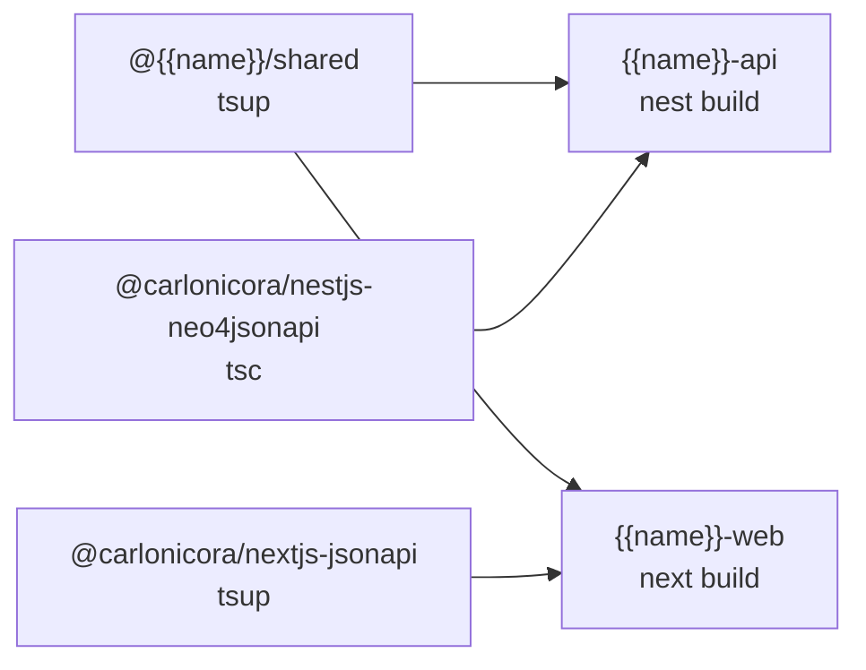

{{display}} is a pnpm workspace driven by Turborepo, with TypeScript project
references on top and a drift checker that refuses to let the dependency graph
rot. Five files carry almost all of the behaviour: `pnpm-workspace.yaml`,
`.pnpmfile.cjs`, `turbo.json`, `tsconfig.base.json` and
`scripts/check-dep-drift.js`.

## The workspace

`pnpm-workspace.yaml` declares two globs:

```yaml
packages:
  - 'apps/*'
  - 'packages/*'
```

which resolve to five projects:

| Directory | pnpm name | Private | Built by |
|---|---|---|---|
| `apps/api` | `{{name}}-api` | yes | `nest build` |
| `apps/web` | `{{name}}-web` | yes | `next build` |
| `packages/shared` | `@{{name}}/shared` | yes | `tsup` |
| `packages/nestjs-neo4jsonapi` | `@carlonicora/nestjs-neo4jsonapi` | no — git submodule | `tsc` |
| `packages/nextjs-jsonapi` | `@carlonicora/nextjs-jsonapi` | no — git submodule | `tsup` |

The last two are submodules declared in `.gitmodules`, not directories of this
repository. `.npmrc` sets `link-workspace-packages=true`, so `workspace:*`
dependencies resolve to the checkout rather than to npm.

### `catalog:`

The catalog is the single place a shared version is named. Every entry:

| Package | Range | Why it is shared |
|---|---|---|
| `eslint` | `^9.39.5` | one ESLint across every lint task |
| `@typescript-eslint/eslint-plugin` | `^8.68.0` | must stay on the same generation as `typescript-eslint` |
| `@typescript-eslint/parser` | `^8.68.0` | same |
| `eslint-config-prettier` | `^10.1.8` | shared lint config |
| `eslint-plugin-prettier` | `^5.5.6` | shared lint config |
| `vitest` | `^4.1.11` | one test runner across five projects |
| `@vitest/coverage-v8` | `^4.1.11` | must match `vitest` |
| `zod` | `^4.4.3` | schemas cross the api/shared/web boundary |
| `react` | `19.3.0` | a second React copy breaks hooks |
| `react-dom` | `19.3.0` | pinned with `react` |
| `@types/react` | `19.3.0` | types must match the runtime |
| `@types/react-dom` | `19.3.0` | same |
| `react-hook-form` | `7.86.0` | form context is instance-scoped |
| `next` | `16.4.0` | `next` is a peer of `next-intl`; see the override note below |
| `@nestjs/common` | `^12.0.1` | DI identity depends on a single copy |
| `@nestjs/core` | `^12.0.1` | same |
| `@nestjs/config` | `^12.0.0` | same |
| `@nestjs/platform-fastify` | `^12.0.1` | same |
| `@nestjs/platform-socket.io` | `^12.0.1` | same |
| `@nestjs/websockets` | `^12.0.1` | same |

The two submodules deliberately do **not** use `catalog:` references. They build
and publish from their own repositories, where `pnpm-workspace.yaml` does not
exist; `scripts/check-dep-drift.js` keeps their literal pins aligned with these
entries instead.

### `overrides:` and the failure each one prevents

A pnpm override **replaces** a declared range rather than intersecting it. That
is why several overrides point at `catalog:` rather than repeating a literal — a
stale literal silently resolves below a manifest's floor with no peer warning.

| Override | Class of failure it prevents |
|---|---|
| `next`, `react`, `react-dom`, `@types/react`, `@types/react-dom`, `react-hook-form` → `catalog:` | `next` is a peer of `next-intl`, so pnpm keys `next-intl`'s instance by the resolved `next`. A disagreement between `apps/web` and the submodule installs `next-intl` twice and a single `vi.mock("next-intl")` patches only one copy |
| `@floating-ui/core`, `-dom`, `-react`, `-react-dom`, `-utils` | `@blocknote/react` and `@base-ui/react` carry different `@floating-ui/*` ranges; two resolutions make structurally identical `Middleware` types nominally incompatible, so `flip()`/`shift()` from one copy is rejected by the other |
| `zod` → `catalog:` | one schema library across api, shared and web |
| `class-validator`, `class-transformer` | `class-validator` is part of `@nestjs/common`'s peer-resolution key; a mismatch spawns two `@nestjs/common` instances and breaks DI at runtime, invisibly to tests that mock services |
| `rxjs` | verified to resolve twice without it (7.8.1 and 7.8.2 side by side) |
| `reflect-metadata` | decorator metadata must live in one registry |
| `@nestjs/*` → `catalog:` | one `@nestjs/*` copy in the tree, with the version coming from the catalog rather than a repeated literal |
| `typescript` | one compiler |
| `typescript-eslint` | `eslint-config-next` depends on the `typescript-eslint` meta-package, which bundles its own parser and plugin. When the catalog moves ahead of it, ESLint loads `@typescript-eslint` twice and every lint task dies with `Cannot redefine plugin`. It is declared in no manifest, so a dependency sweep never sees it |
| `yjs` | two Yjs instances silently corrupt shared documents and print "Yjs was already imported" |
| `validator` | floor pin |
| `sharp` | two versions pull two `/sharp-libvips` copies and trigger the objc duplicate-class warning |
| `bullmq` | `@nestjs/bullmq` is declared by both `apps/api` and the nestjs submodule; without one `bullmq` version they resolve multiple `@nestjs/bullmq` instances, which forks `@nestjs/core` and crashes boot with DI "ModuleRef/Reflector not available" |

### `peerDependencyRules`

`allowAny: [reflect-metadata]`, plus two targeted `allowedVersions` silences:
`nestjs-redoc>@nestjs/swagger: '11'` (nestjs-redoc 2.x is unmaintained and still
peers on `^5`) and `@nestjs/bullmq>bullmq: '6'` (the wrapper still peers on
`^3||^4||^5`). Both are scoped to one dependency edge, not blanket rules.

### `ignoredBuiltDependencies` and `allowBuilds`

`autoInstallPeers: false` and `verifyDepsBeforeRun: warn` sit alongside them.
The first makes a missing peer a loud install problem rather than a silent
second copy. The second exists because pnpm 11 changed the default to `install`,
which in a production container needs the network, mutates a supposedly
immutable image and runs the root `prepare` script without devDependencies
(`sh: husky: not found`).

`ignoredBuiltDependencies` names three packages whose install scripts never run:
`@tensorflow/tfjs-node`, `canvas`, `core-js`. `allowBuilds` is the inverse — the
explicit allowlist of packages permitted to run install scripts: `@nestjs/core`,
`@parcel/watcher`, `@scarf/scarf`, `@swc/core`, `bcrypt`, `cpu-features`,
`esbuild`, `msgpackr-extract`, `msw`, `necord`, `onnxruntime-node`, `protobufjs`,
`sharp`, `ssh2`, tesseract.js and `unrs-resolver`.

### `.pnpmfile.cjs` and the `supports-color` strip

`.pnpmfile.cjs` has one `readPackage` hook, and it deletes `supports-color` from
every package's `peerDependenciesMeta` and `peerDependencies`.

`supports-color` is an *optional* peer of `debug`, and an optional peer still
enters the peer fingerprint of everything above it — `@nestjs/common`, `bullmq`,
`@nestjs/bullmq`, `@nestjs/core`. The submodule's devDependencies
(`semantic-release` → `chalk@2`) provide `supports-color@5.5.0` in its resolution
context while the apps do not, so the same packages materialise twice with
different fingerprints. Duplicate `@nestjs/core` / `@nestjs/bullmq` instances
crash boot with `UnknownDependenciesException ... ModuleRef ... BullModule` on
any **fresh** install; stale `node_modules` masks it.

Stripping the optional peer removes the variance. `debug` falls back to its
runtime `require` of `supports-color`, so colours still work. The check after any
change to this hook is a single command: `ls -d node_modules/.pnpm/@nestjs+core*`
must list exactly one directory.

## Apps consume dist/, never src/

`apps/api` and `apps/web` import `@carlonicora/nestjs-neo4jsonapi`,
`@carlonicora/nextjs-jsonapi` and `@{{name}}/shared` through their package
exports maps, which point at their dist/ output. `tsconfig.base.json` declares a
`@{{name}}/shared` path mapping, but both apps override `paths` in their own
tsconfig (`src/*` in `apps/api/tsconfig.json`, `@/*` in `apps/web/tsconfig.json`)
and `paths` replaces rather than merges — so the mapping does not apply inside
either app. The practical consequence: **edit a package, rebuild it, or the app
keeps seeing the old code.** `apps/api`'s `dev` script watches
the nestjs package's dist/ directory — not its src/ — for exactly this reason.

The one exception is Tailwind. `apps/web/src/app/globals.css` carries two
`@source` directives, one pointing at the workspace checkout and one at the
`node_modules` copy, so Tailwind scans the package's **source** for class names
that never appear in `apps/web`. Both lines are needed: the first works in
development, the second in a production image where the package came from npm.

## The Turborepo pipeline

`turbo.json` sets `cacheMaxAge: "7d"`, `cacheMaxSize: "10GB"`,
`globalDependencies` of `**/.env.*local`, `.env` and `.env.e2e` (so editing
either env file busts the whole cache), and a `globalEnv` of `NODE_ENV`, `PORT`,
`API_PORT`, `API_URL`, `NEXT_PUBLIC_API_URL`.

| Task | `dependsOn` | Outputs | Cached | Notes |
|---|---|---|---|---|
| `build` | `^build` | dist/** and .next/** minus cache and dev | yes | env `NODE_ENV`, `NEXT_PUBLIC_*` |
| `dev` | `^build` | — | no | persistent |
| `dev:worker` | `^build` | — | no | persistent |
| `start` | `build` | — | no | persistent |
| `start:prod` | `build` | — | no | persistent |
| `start:worker:dev` | `^build` | — | no | persistent |
| `test` | `^build` | none | yes | env `NODE_ENV` |
| `test:watch` | — | — | no | persistent |
| `test:e2e` | `build` | — | **no** | env `E2E_*`, `NEO4J_*`, `PUBLIC_HOSTNAME`, `PORT`, `NODE_ENV` |
| `test:cov` | `^build` | `coverage/**` | yes | |
| `lint` | — | none | yes | |
| `format` | — | none | no | |
| `clean` | — | — | no | |
| `typecheck` | `^build` | `*.tsbuildinfo` | yes | no project defines a `typecheck` script that runs `tsc` |
| `{{name}}-web#build` | `^build` **and** `@carlonicora/nextjs-jsonapi#build` | `.next/**` minus `cache` and `dev` | yes | |

The `{{name}}-web#build` override exists because `^build` alone is not enough.
Turbo's `^build` covers a project's *workspace dependencies*, and the web app's
Tailwind `@source` scan reaches into the `nextjs-jsonapi` checkout, so the web
build must not start before that package has produced its dist/ output. Naming the
package task explicitly makes the edge unconditional.

Root scripts wrap these: `pnpm dev` is `bash scripts/dev.sh`, which clears a
stale .next directory under `apps/web` and then runs `turbo run dev dev:worker` — API, web and
worker together. `pnpm lint` is `turbo run lint && node scripts/check-dep-drift.js`.

## TypeScript layout

`tsconfig.json` at the root is a **solution file**: `"include": []` and three
references to `./apps/api`, `./apps/web`, `./packages/shared`. It compiles
nothing itself.

`tsconfig.base.json` holds the shared compiler options:

| Group | Settings |
|---|---|
| Language | `target: ES2022`, `lib: [ES2022]`, `experimentalDecorators`, `emitDecoratorMetadata` |
| Modules | `module`/`moduleResolution: nodenext`, `resolveJsonModule`, `esModuleInterop`, `allowSyntheticDefaultImports`, `forceConsistentCasingInFileNames` |
| Checking | `strict` plus every individual strict flag, `noUnusedLocals`, `noUnusedParameters`, `noImplicitReturns`, `noFallthroughCasesInSwitch`, `skipLibCheck` |
| Emit | `declaration`, `declarationMap`, `sourceMap`, `removeComments`, `importHelpers` |
| Interop | `isolatedModules`, `allowJs: false` |
| Paths | `@{{name}}/shared` → `./packages/shared/src`, `@{{name}}/shared/*` → `./packages/shared/src/*` |

Each project narrows it:

| Project | Overrides |
|---|---|
| `apps/api/tsconfig.json` | `target: ES2021`, `outDir: ./dist`, `incremental`, `types: [vitest/globals, node]`, `paths: { "src/*": ["./src/*"] }`, and **`strict: false`** with every strict sub-flag, `noUnused*` and `noImplicitReturns` turned off |
| `apps/api/tsconfig.build.json` | extends the above, adds `rootDir: ./src` (TypeScript 6 requires it with `outDir`, or `tsc` emits to dist/src/ instead of a flat dist/ and still succeeds), excludes tests |
| `apps/api/tsconfig.worker.json` | extends `apps/api/tsconfig.build.json`, sets `outDir` to a separate dist-worker directory |
| `apps/web/tsconfig.json` | `target/module: esnext`, `moduleResolution: bundler`, `jsx: preserve`, `noEmit`, `allowJs`, the `next` plugin, `paths: { "@/*": ["./src/*"] }`, and **`strict: false`** with the same set of flags disabled |
| `packages/shared/tsconfig.json` | `composite: true`, `outDir: ./dist`, `rootDir: ./src`, `types: [node]` |

Both applications therefore run **unstrict** despite `tsconfig.base.json`
turning strict on. New code is not type-checked the way the base config implies.

## Build order

`turbo run build` derives the order from `workspace:*` edges:



`apps/api` depends on `@{{name}}/shared` and `@carlonicora/nestjs-neo4jsonapi`;
`apps/web` on `@{{name}}/shared` and `@carlonicora/nextjs-jsonapi`. The two
submodules depend on nothing in the workspace, so they build first, in parallel
with `packages/shared`.

## `scripts/check-dep-drift.js`

Run by `pnpm lint` and by `pnpm check:drift`. It reads every manifest, resolves
`catalog:` references to concrete ranges so comparisons are semantic, and
enforces five invariants. Any violation exits 1.

| # | Invariant | Why |
|---|---|---|
| 1 | An app provides every non-optional peer of the workspace library it consumes, with a range that satisfies the library's floor | `autoInstallPeers: false` means the host must provide them |
| 2 | A dependency declared by **both** an app and its library uses an identical range **and** appears on that app's overlap allowlist | drift here is how silent duplicate copies are born |
| 3 | A devDependency declared in two or more manifests uses identical ranges | two versions of a test runner or linter behave differently per project |
| 4 | A `pnpm-workspace.yaml` override neither contradicts **nor undercuts** a manifest declaration | an override replaces rather than intersects, so a low override resolves below a declared floor with no warning |
| 5 | `versions.production.json` matches the workspace packages' own versions | a stale pin builds a production image against a different library than the one you tested |

The overlap allowlist (`OVERLAP_ALLOWLIST` in the script) is where a justified
duplicate goes. For `api` it holds the LangChain entry points, `class-validator`,
`fastify` and `neo4j-driver` (imported by app source); `bullmq`, `rxjs`,
`passport` and `@opentelemetry/api` (required peers of app-declared packages);
and `reflect-metadata` and `tslib` (runtime requirements of the app's own
compiled output). For `web` it holds the UI and utility libraries the app
imports directly. Adding an entry requires matching the library's range exactly —
rule 2 still applies.

## Production versions

Development consumes the submodules through `workspace:*`. Production does not:
the Docker build replaces those specifiers with npm versions so the image never
needs the submodules.

| File | Role |
|---|---|
| `versions.production.json` | the pinned npm versions, one entry per publishable workspace package an app depends on via `workspace:*` |
| `scripts/sync-production-versions.js` | regenerates that file from the workspace packages themselves; `--check` exits 1 when stale. Private packages are skipped — they are copied into the image as source. Wired as `pnpm sync:versions` |
| `scripts/apply-production-versions.js` | rewrites `apps/api/package.json` and `apps/web/package.json` in place, swapping `workspace:*` for the pinned version. Run inside the `workspace-deps-prod` Docker stage |

`versions.production.json` keys are **derived, not hand-maintained**. Rule 5 of
the drift checker catches staleness; `pnpm sync:versions` is the fix.

## Docker build stages

`Dockerfile` builds every service from one file so the shared package is built
once. Eleven stages, in two lineages:

| Stage | Base | Purpose |
|---|---|---|
| `base` | `node:22-alpine` | pnpm via corepack, native-module build deps |
| `workspace-deps` | `base` | development install — uses the local submodules |
| `shared-builder` | `workspace-deps` | builds `@{{name}}/shared` once |
| `api-development` | `shared-builder` | hot-reload API target |
| `web-development` | `shared-builder` | hot-reload web target |
| `workspace-deps-prod` | `base` | production install — applies `versions.production.json`, strips the submodule entries from `pnpm-workspace.yaml`, fetches the libraries from npm |
| `shared-builder-prod` | `workspace-deps-prod` | builds `@{{name}}/shared` for production |
| `api-builder` | `shared-builder-prod` | `pnpm --filter {{name}}-api build` |
| `api-production` | `node:22-bookworm-slim` | the API and worker runtime — **Debian, not Alpine** |
| `web-builder` | `api-builder` | takes the `NEXT_PUBLIC_*` build args and runs `pnpm --filter {{name}}-web build` |
| `web-production` | `node:22-alpine` | the Next.js runtime |

`api-production` is glibc because the package's ONNX / model-manager
infrastructure uses `onnxruntime-node`, whose prebuilt binaries link against
glibc and have no musl build. The operations chapter's Docker page covers the
stages, the compose files and the `NEXT_PUBLIC_*` build-time bake in full;
`DOCKER.md` covers deployment strategies and scaling.

## Where to look

| File | What it tells you |
|---|---|
| `pnpm-workspace.yaml` | catalog, overrides, peer rules, build allowlist — each with the failure it prevents in a comment |
| `.pnpmfile.cjs` | the `supports-color` strip and the one-command check after changing it |
| `turbo.json` | every task, its inputs, outputs and cache policy |
| `tsconfig.base.json` | the shared compiler options and the `@{{name}}/shared` mapping |
| `tsconfig.json` | the solution file and its three references |
| `apps/api/tsconfig.build.json` | why `rootDir` must be explicit under TypeScript 6 |
| `scripts/check-dep-drift.js` | the five invariants and the overlap allowlist |
| `scripts/sync-production-versions.js` | how `versions.production.json` is derived |
| `Dockerfile` | the stage graph and the two dependency lineages |
| `package.json` | every root script, including `dev`, `lint`, `check:drift`, `sync:versions` |

## Gaps and drift

- Both `apps/api/tsconfig.json` and `apps/web/tsconfig.json` set `strict: false`
  and disable every individual strict flag, contradicting `tsconfig.base.json`.
- `apps/web/tsconfig.json` places `"composite": true` at the top level rather
  than inside `compilerOptions`, where it has no effect; `apps/api/tsconfig.json`
  declares no `composite` at all, although the root solution file references both.
- `apps/web/package.json` defines `"typecheck": "eslint ."`, so the `typecheck`
  turbo task runs a linter, not `tsc --noEmit`.
- `versions.production.json` pins `@carlonicora/nestjs-neo4jsonapi` 4.17.3 and
  `@carlonicora/nextjs-jsonapi` 4.0.4, the latest published releases, while
  `.gitmodules` tracks `master` — once `master` moves past a release, a fresh
  clone checks out newer versions than the production build uses, and rule
  5 of the drift checker will report it until `pnpm sync:versions` is run.
- `scripts/check-dep-drift.js` exits early with a clear message when the
  submodules are not initialised, so `pnpm lint` fails until
  `git submodule update --init` has run.
- The `Dockerfile` pins pnpm at `10.18.2` through corepack while
  `package.json` declares `packageManager: pnpm@11.24.0` and an engines floor of
  `>=11.0.0`.
- `scripts/find-duplicate-translations.js`, `scripts/validate-translations.js`,
  `scripts/check-update.sh` and `scripts/remove-worktree.sh` were not examined
  here; no root `package.json` script invokes the first two.
- The `Dockerfile`'s development stages (`api-development`, `web-development`)
  were read for their commands only, not line by line.
