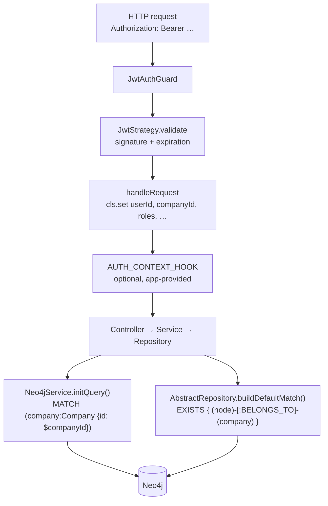

Every row {{display}} stores belongs to exactly one tenant, and the tenant is a
`Company` node. Nothing in the API asks the caller which company it is acting
for: the company id travels in the JWT, lands in CLS (continuation-local
storage) when a guard authenticates the request, and is injected into Cypher by
two framework functions. An application that writes its repositories the way the
framework intends never types a company filter by hand.

This page describes the mechanism that enforces that. It covers the API tier
only; the browser-side gate is a convenience, not a boundary.

## The tenancy predicate



The predicate has two halves and both must hold. `initQuery()` binds the
`company` variable from the CLS company id; `buildDefaultMatch()` requires the
entity node to reach that same bound variable over `BELONGS_TO`. A query that
skips either half is not scoped.

## Company as the tenant root

`Company` is the one entity that is not company-scoped —
`packages/nestjs-neo4jsonapi/src/foundations/company/entities/company.ts`
sets `isCompanyScoped: false`, because a company cannot belong to itself. Every
other scoped entity is written with `(entity)-[:BELONGS_TO]->(:Company)` and
every scoped read joins it.

Users are attached to companies through a membership node rather than a direct
edge, so that a user can hold different roles in different companies:

```
(user:User)-[:HAS_MEMBERSHIP]->(:Membership)-[:IN_COMPANY]->(company:Company)
(membership)-[:HAS_ROLE]->(role:Role)
```

The canonical Cypher for reading and writing that shape lives in
`packages/nestjs-neo4jsonapi/src/foundations/membership/queries/membership.query.ts`
as `membershipRoleMatch`, `membershipRoleMatchRequired`, `grantCompanyRoles` and
`grantPlatformRole`. A membership with **no** `IN_COMPANY` edge is a *platform*
membership: its roles apply everywhere and belong to no tenant. That file states
the invariant explicitly — deleting a company or a user's `BELONGS_TO` edge must
also delete the corresponding `Membership` node, because an orphaned membership
reads as a platform membership, which is a privilege escalation.

The seeded administrator in `apps/api/src/neo4j.migrations/20250901_004.ts` is
exactly such a platform account: it is granted through `grantPlatformRole` and
belongs to no company.

## How the CLS context is populated

Authentication is Passport JWT.
`packages/nestjs-neo4jsonapi/src/common/strategies/jwt.strategy.ts` verifies the
signature against `jwt.secret`, rejects a payload whose `expiration` is in the
past with a 401, sets `userId` in CLS and returns the payload. Everything else
is set by whichever guard ran the strategy.

`SecurityService.signJwt` in
`packages/nestjs-neo4jsonapi/src/core/security/services/security.service.ts`
mints the payload: `userId`, `roles`, `companyId`, `features`, `userName` and
`expiration`. Token lifetime is 24 hours; the refresh window is 7 days. The
service also mints three narrower tokens — a company-selection token and an
invitation-selection token (10 minutes each) and a pending-2FA token (5 minutes).

### Every CLS key in use

| Key | Set by | Read by |
|---|---|---|
| `userId` | `JwtStrategy`, all five HTTP guards, `JwtOrOAuthGuard`, worker processors | `initQuery()`, `buildDefaultMatch()`, `contextKey` relationships |
| `companyId` | `JwtAuthGuard`, `AdminJwtAuthGuard`, `OptionalJwtAuthGuard`, `JwtOrOAuthGuard` (from the token, falling back to the `x-companyid` header) | `initQuery()`, `buildDefaultMatch()` |
| `roles` | the same three JWT guards | `_validateRoles` in each guard |
| `language` | the same three JWT guards, from the `x-language` header | i18n resolution, email locale |
| `token` | `JwtAuthGuard`, `AnyScopeAuthGuard` (bearer prefix stripped) | outbound calls that re-present the caller's token |
| `ipAddress` | `JwtAuthGuard` | audit and activity writes |
| `isAutomatedJob` | queue processors, before `cls.run()` work | `SecurityService.userHasAccess` |
| `queryTotal` | `Neo4jService.readMany` after the COUNT query | `JsonApiService.serialise`, to emit `meta.total` |
| `requestUrl` | `LoggingInterceptor` | `JsonApiService.buildList`, for `links.self` |
| `logContext` | `AppLoggingService` | log enrichment, LLM call dumps |
| `currentSpan` | `TracingService` | nested span parenting |
| `oauthClientId`, `oauthScopes`, `authType` | `JwtOrOAuthGuard`, on the OAuth branch | scope checks |
| `assistantTurnContext` | the assistant service | LLM call attribution |
| `ragStatus` | the contextualiser agent | retrieval progress reporting |
| `companyConfigurations` | **not set by the package** — an application sets it, typically from the auth-context hook | `SecurityService.isCurrentUserCompanyAdmin` |

CLS middleware is mounted only when the process runs controllers —
`ClsModule.forRoot({ middleware: { mount: modeConfig.enableControllers } })` in
`packages/nestjs-neo4jsonapi/src/bootstrap/app.module.factory.ts`. In worker
mode there is no request, so there is no ambient context: worker code must open
one itself with `cls.run()` and set `userId`, `companyId` and `isAutomatedJob`
before touching a repository.

### The `AUTH_CONTEXT_HOOK` seam

An application that needs more in CLS than the guard puts there does **not**
fork the guard. It binds `AUTH_CONTEXT_HOOK`
(`packages/nestjs-neo4jsonapi/src/common/tokens.ts`) from a `@Global()` module
with an object implementing `onAuthenticated({ request, context })`. Both
`JwtAuthGuard` and `AdminJwtAuthGuard` call it after `super.canActivate()`
succeeds and `request.user` exists. Errors thrown from the hook propagate, so
throwing `HttpException("Unauthorised", 401)` inside it rejects the request.
With no provider bound, the guards behave exactly as they do today.

The seam exists because forks went stale. The comment in
`jwt.auth.admin.guard.ts` records the concrete failure it prevented: a
`return null` in `handleRequest` admitted unauthenticated requests, and the
forks that had copied the file were immune to the fix.

## The guard family

| Guard | File | Admits | CLS keys set |
|---|---|---|---|
| `JwtAuthGuard` | `packages/nestjs-neo4jsonapi/src/common/guards/jwt.auth.guard.ts` | a full session JWT | `userId`, `companyId`, `roles`, `language`, `token`, `ipAddress` |
| `AdminJwtAuthGuard` | `packages/nestjs-neo4jsonapi/src/common/guards/jwt.auth.admin.guard.ts` | a full session JWT **and** the administrator role, always, whether or not `@Roles` is present | `userId`, `companyId`, `language`, `roles` |
| `AnyScopeAuthGuard` | `packages/nestjs-neo4jsonapi/src/common/guards/jwt.auth.any-scope.guard.ts` | a full session JWT **or** a scoped selection token | `userId`, `token` |
| `OptionalJwtAuthGuard` | `packages/nestjs-neo4jsonapi/src/common/guards/jwt.auth.optional.guard.ts` | authenticated or anonymous; no header returns `null` rather than throwing | `userId`, `companyId`, `language`, `roles` when a token is present |
| `JwtOrOAuthGuard` | `packages/nestjs-neo4jsonapi/src/common/guards/jwt.or.oauth.guard.ts` | an OAuth access token first, falling back to `JwtAuthGuard` resolved through `ModuleRef` | `userId`, `companyId`, `oauthClientId`, `oauthScopes`, `authType` |
| `CustomThrottlerGuard` | `packages/nestjs-neo4jsonapi/src/common/guards/custom-throttler.guard.ts` | everything; counts requests per IP and adds the three `X-RateLimit-*` headers | — |
| `WsJwtGuard` | `packages/nestjs-neo4jsonapi/src/core/websocket/guards/ws.jwt.auth.guard.ts` | a socket handshake carrying a token in `auth.token`, the `token` query parameter or an `Authorization` header | none; it stores the payload on `client.data.user` |

Four behaviours are worth holding on to.

- Only `CustomThrottlerGuard` is global. It is registered as `APP_GUARD` by
  `app.module.factory.ts` when `rateLimit.enabled` is true. Every other guard is
  applied per controller or per route with `@UseGuards`.
- `AnyScopeAuthGuard` throws a 401 on a missing header rather than returning
  `false`, so a missing header and a malformed one produce the same status.
- `JwtAuthGuard` returns `false` (a 403) when the `Authorization` header is
  absent, and throws a 401 once a header is present but bad. The two paths
  differ.
- `CustomThrottlerGuard.shouldSkip` bails out on every non-HTTP execution
  context. Without it, the global guard would run on Discord command handlers,
  which have no HTTP response object.

## Roles

`@Roles(...ids)` (`packages/nestjs-neo4jsonapi/src/common/decorators/roles.decorator.ts`)
is `SetMetadata("roles", roles)` and nothing more. Each guard reads that
metadata in `_validateRoles`, appends the administrator role to the required
list, and requires the caller's `roles` array to intersect it.

The administrator role id comes from the optional `SYSTEM_ROLES` token
(`packages/nestjs-neo4jsonapi/src/common/tokens.ts`), an object of the shape
`{ Administrator: string; [key: string]: string }`. When no provider is bound
the guards fall back to the literal string `"administrator"`. The package's own
ids are UUIDs in
`packages/nestjs-neo4jsonapi/src/common/constants/system.roles.ts` —
`Administrator` and `CompanyAdministrator` — and those are the ids
`apps/api/src/neo4j.migrations/20250901_001.ts` seeds and that
`@Roles(RoleId.Administrator)` refers to.

Role membership itself is per company, so what ends up in the token's `roles`
array is the union of the caller's roles in the company being signed into and
their platform roles. `membershipRoleMatch` is the query that produces that
union.

## Where company scoping is enforced

Exactly two functions inject the tenant predicate. Everything else is
convention.

### `Neo4jService.initQuery()`

`packages/nestjs-neo4jsonapi/src/core/neo4j/services/neo4j.service.ts` reads
`companyId` and `userId` out of CLS, binds them as `$companyId` and
`$currentUserId`, and prefixes the query with the matches that make the
`company` and `currentUser` variables available to everything appended after it.
With both ids present it emits:

```cypher
MATCH (company:Company {id: $companyId})
MATCH (currentUser:User {id: $currentUserId})-[:BELONGS_TO]->(company)
```

With only a user id — a platform administrator with no company in scope — it
emits `MATCH (currentUser:User {id: $currentUserId})` alone. With neither it
emits nothing, and the `company` variable is unbound. This is why every
hand-written repository method must check `query.queryParams.companyId` before
writing a `BELONGS_TO` edge: a `CREATE` against an unbound variable produces an
orphan node.

### `AbstractRepository.buildDefaultMatch()`

`packages/nestjs-neo4jsonapi/src/core/neo4j/abstracts/abstract.repository.ts`
emits the entity match. For a descriptor with `isCompanyScoped: false`:

```cypher
MATCH (node:Label)
WITH node
```

For a company-scoped descriptor:

```cypher
MATCH (node:Label)
WHERE $companyId IS NULL
OR EXISTS {
  MATCH (node)-[:BELONGS_TO]-(company)
}
WITH node, company, currentUser
```

`node` and `Label` are the descriptor's `nodeName` and `labelName`. The trailing
`WITH` carries `company` only when a company id is in CLS and `currentUser` only
when a user id is, which is why the two functions are a pair: the `EXISTS`
subquery refers to the `company` variable `initQuery()` bound. The
`blockCompanyAndUser` option drops both from the `WITH`, for queries that
re-bind them later.

Read `WHERE $companyId IS NULL OR …` literally: when there is no company in CLS
the predicate is vacuously true and the match returns every node of that label
across every tenant. That is the shape platform-administrator reads rely on. A
repository method reachable by a normal user must therefore always run with a
company in CLS.

`buildReturnStatement()` re-matches the company for scoped entities as
`MATCH (node:Label)-[:BELONGS_TO]->(node_company:Company)` — a directed,
non-optional match, so a scoped node without a `BELONGS_TO` edge is invisible to
every generic read.

A repository that cannot use `buildDefaultMatch()` — because its Cypher is
hand-written — scopes by matching the CLS-bound variable instead:
`MATCH (entity:Label)-[:BELONGS_TO]->(company)`.
`packages/nestjs-neo4jsonapi/src/foundations/notification/repositories/notification.repository.ts`
documents that convention at length and is the model to copy.

## Global entities

`isCompanyScoped: false` opts an entity out of tenancy entirely: no `company`
token is derived, no `BELONGS_TO` edge is written, and `buildDefaultMatch()`
emits the bare match. The foundations that declare it:

| Foundation | Descriptor | Why it is global |
|---|---|---|
| `company` | `packages/nestjs-neo4jsonapi/src/foundations/company/entities/company.ts` | the tenant root itself |
| `feature` | `packages/nestjs-neo4jsonapi/src/foundations/feature/entities/feature.ts` | the product's feature catalogue, identical for every tenant |
| `membership` | `packages/nestjs-neo4jsonapi/src/foundations/membership/entities/membership.ts` | scoped by its own `IN_COMPANY` edge instead |
| `auth` | `auth.ts`, `auth.code.ts`, `pending-auth.ts` under `packages/nestjs-neo4jsonapi/src/foundations/auth/entities` | credentials precede company selection |
| `two-factor` | thirteen descriptors under `packages/nestjs-neo4jsonapi/src/foundations/two-factor/entities` | second factors belong to a person, not a tenant |
| `ai-connection` | `packages/nestjs-neo4jsonapi/src/foundations/ai-connection/entities/ai-connection.ts` | attached by a `CONFIGURES` edge rather than `BELONGS_TO` |
| `how-to` | `packages/nestjs-neo4jsonapi/src/foundations/how-to/entities/how-to.ts` | shared help content |
| `waitlist` | `packages/nestjs-neo4jsonapi/src/foundations/waitlist/entities/waitlist.ts` | signups predate any company |
| `referral` | `referral-code.ts`, `referral-stats.ts` under `packages/nestjs-neo4jsonapi/src/foundations/referral/entities` | a code is issued before the referred company exists |
| `tokenusage` reports | the six `tokenusage-*` descriptors under `packages/nestjs-neo4jsonapi/src/foundations/tokenusage/entities` | aggregate rows, not stored nodes |

The `role`, `module`, `rbac` and `stripe-*` foundations keep the default
(`true`).

## `userHasAccess` and `isAutomatedJob`

Repositories that need a per-user access predicate on top of tenancy do not
inline it. They call:

```ts
this.securityService.userHasAccess({ validator: () => this.buildUserHasAccess() })
```

`SecurityService.userHasAccess` reads `isAutomatedJob` from CLS and, when it is
truthy, returns the **empty string** — the validator is never invoked and the
predicate vanishes from the query. That is deliberate: a background job has no
user, so a user predicate would filter everything out. It also means that any
code path that sets `isAutomatedJob` runs with tenancy enforced but with every
ACL predicate blanked.

`AbstractRepository`'s default `buildUserHasAccess()` returns `WITH node`, i.e.
no restriction; foundations that need a real one override it
(`content`, `relevancy`, `tokenusage`, `assistant-action`, `user`).

Package processors that set the flag:

| Processor | File |
|---|---|
| chunk embedding | `packages/nestjs-neo4jsonapi/src/foundations/chunk/processors/chunk.embedding.processor.ts` |
| key-concept embedding | `packages/nestjs-neo4jsonapi/src/foundations/keyconcept/processors/keyconcept.embedding.processor.ts` |
| user activity | `packages/nestjs-neo4jsonapi/src/foundations/user-activity/processors/user-activity.processor.ts` |
| how-to | `packages/nestjs-neo4jsonapi/src/foundations/how-to/processors/how-to.processor.ts` |

Every one of them wraps its work in `cls.run()` first. Any worker code an
application adds must do the same, or `userHasAccess` runs without a context.

## Rate limiting

Two throttlers are configured in `app.module.factory.ts` from the `rateLimit`
config block:

| Throttler | Limit variable | Default in `.env.example` |
|---|---|---|
| `default` | `RATE_LIMIT_REQUESTS` | 1000 per window |
| `ip` | `IP_RATE_LIMIT_REQUESTS` | 200 per window |

Both share `RATE_LIMIT_TTL` (60000 ms). `RATE_LIMIT_ENABLED=false` skips the
`APP_GUARD` registration entirely while leaving the module configured.
`CustomThrottlerGuard` tracks by `req.ip` and writes `X-RateLimit-Limit`,
`X-RateLimit-Remaining` and `X-RateLimit-Reset` on every HTTP response.

Per-route overrides are decorators in
`packages/nestjs-neo4jsonapi/src/common/decorators/rate-limit.decorator.ts`:
`NoRateLimit()`, `StrictRateLimit(limit, ttl)` and `IPRateLimit(limit, ttl)`
target the `ip` throttler; `CustomRateLimit` and `HeavyOperationRateLimit`
target `default`.

A throttled request is rendered by `ThrottlerExceptionFilter`
(`packages/nestjs-neo4jsonapi/src/common/filters/throttler-exception.filter.ts`)
as a 429 with a `Retry-After: 60` header — a hard-coded 60, not the configured
TTL.

## CORS

`packages/nestjs-neo4jsonapi/src/core/cors/services/cors.service.ts` builds the
options object `bootstrap()` hands to `app.enableCors()`. `CORS_ORIGINS` is an
exact-match comma list; `CORS_ORIGIN_PATTERNS` is a comma list of regular
expressions tested against the origin. A request with no `Origin` header is
always allowed, which is standard and is what makes server-to-server calls work.

**If both lists are empty the service returns `true` — every origin allowed.**
It logs that as an error first, when `CORS_LOG_VIOLATIONS` is on, and
`validateConfiguration()` is called before `enableCors()` for the same reason.
`.env.example` ships `CORS_ORIGINS=http://{{name}}.test:4051`, so a fresh app is
not in that state; an app that clears the variable in production is.

`CORS_ALLOWED_HEADERS` must keep `x-companyid` and `x-language` — both guards
read those headers.

## Constraints `defineEntity()` derives

Schema is derived, never declared twice.
`packages/nestjs-neo4jsonapi/src/common/helpers/define-entity.ts` computes:

- `constraints: [{ property: "id", type: "UNIQUE" }]` — always exactly one.
- `indexes` — a single `FULLTEXT` entry named `{nodeName}_search_index` over
  every `type: "string"` field that is not marked `excludeFromSearch`. When no
  string field survives that filter, `indexes` is empty and `fulltextIndexName`
  is the empty string, which the search paths treat as "no index".

`AbstractRepository.onModuleInit` applies them on boot: it issues
`CREATE CONSTRAINT {nodeName}_id IF NOT EXISTS FOR (n:Label) REQUIRE n.id IS UNIQUE`,
then for each fulltext index runs `SHOW INDEXES` and compares the live labels
and properties against the derived ones, recreating only on a mismatch.

`excludeFromSearch` is a security-adjacent control, not only a relevance one:
without it, serialised config blobs, tokens and UUID references become
searchable text. Its documented limitation is that changing it does not rebuild
a live index — `CREATE … IF NOT EXISTS` no-ops — so the old property set
persists until the index is dropped by hand.

## Where to look

| File | What it settles |
|---|---|
| `packages/nestjs-neo4jsonapi/src/common/guards/jwt.auth.guard.ts` | the standard guard and every CLS key a request gets |
| `packages/nestjs-neo4jsonapi/src/common/guards/jwt.auth.admin.guard.ts` | admin-only routes, and why `handleRequest` must throw |
| `packages/nestjs-neo4jsonapi/src/common/strategies/jwt.strategy.ts` | signature and expiry verification |
| `packages/nestjs-neo4jsonapi/src/common/tokens.ts` | `SYSTEM_ROLES`, `AUTH_CONTEXT_HOOK`, `CREDIT_VALIDATOR`, `TOKEN_USAGE_RECORDER` |
| `packages/nestjs-neo4jsonapi/src/core/security/services/security.service.ts` | token minting, `userHasAccess`, password hashing |
| `packages/nestjs-neo4jsonapi/src/core/neo4j/services/neo4j.service.ts` | `initQuery()` and the exact tenancy prefix |
| `packages/nestjs-neo4jsonapi/src/core/neo4j/abstracts/abstract.repository.ts` | `buildDefaultMatch()`, `buildReturnStatement()`, schema reconciliation |
| `packages/nestjs-neo4jsonapi/src/foundations/membership/queries/membership.query.ts` | the membership shape and its deletion invariant |
| `packages/nestjs-neo4jsonapi/src/core/cors/services/cors.service.ts` | origin validation and the empty-configuration fallback |
| `packages/nestjs-neo4jsonapi/src/bootstrap/app.module.factory.ts` | throttler configuration and the global guard registration |

## Gaps and drift

- The template binds none of the four optional tokens. `SYSTEM_ROLES` is
  unbound, so the guards' administrator fallback is the literal
  `"administrator"` while the seeded administrator role is the UUID in
  `system.roles.ts`. That only matters for a route decorated with `@Roles` and
  no bound token; the package's own controllers pass `RoleId.Administrator`
  explicitly, so the intersection still succeeds through the caller's `roles`
  array. An application that adds its own roles should bind the token.
- `CREDIT_VALIDATOR` and `TOKEN_USAGE_RECORDER` both **fail open** when unbound,
  as their own documentation in `tokens.ts` states at length. An application
  that intends to enforce credits must bind `CREDIT_VALIDATOR` from a `@Global()`
  module; forgetting to is silent.
- `NotificationRepository.findByIdForUser` accepts a `userId`, binds it as a
  query parameter and never references it in Cypher. It is company-scoped but
  not user-scoped, so any user of a company can read another user's
  notification by id. The file records this as pre-existing and deliberate.
- `JwtAuthGuard` and `AdminJwtAuthGuard` both inject `Neo4jService` and never
  use it.
- `BootstrapOptions.rbac` is declared and never read.
- `JwtStrategy.validate` types its first parameter as the DOM `Request`, not a
  Fastify request.
- Not examined here: the RBAC permission engine (module ids, feature ids, the
  matrix DSL and worker-only reconciliation), which the backend section's
  RBAC chapter owns; the frontend permission gate; the OAuth authorisation-code
  flow; two-factor enrolment; and encryption at rest for TOTP secrets and API
  keys.
