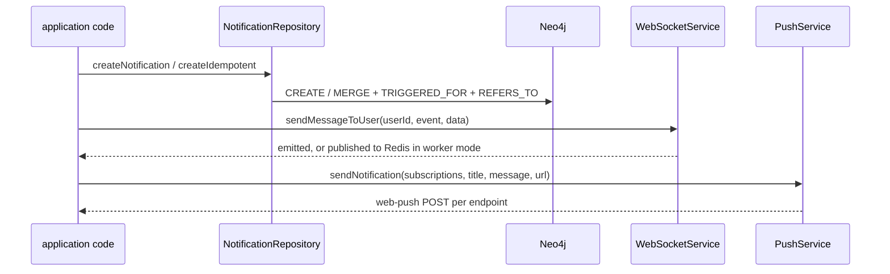

{{display}} can reach a person three ways: an in-app notification they see in
the bell, a browser push notification they see with the tab closed, and an
email. The three are separate mechanisms with separate storage, separate
configuration and separate failure modes, and the framework ships all three
as parts rather than as one pipeline — the application decides which of them a
given event uses.

## The `Notification` entity

`packages/nestjs-neo4jsonapi/src/foundations/notification/entities/notification.ts`

An in-app notification is a node addressed to exactly one recipient.

| Attribute | Type | Meaning |
|---|---|---|
| `notificationType` | string, required | the event that raised it, e.g. `"MENTION"`; drives the icon and the message text |
| `isRead` | boolean, required | whether the recipient has acknowledged it |
| `message` | string | pre-rendered text shown to the recipient |
| `actionUrl` | string | where acting on it sends them |

One declared relationship: `actor`, to-one, `dtoKey: "actor"`, over
`(notification)-[:TRIGGERED_BY]->(:User)`. The descriptor leaves
`isCompanyScoped` at its default, so every notification also carries
`BELONGS_TO`. Two more edges are written by hand and are not in the descriptor:

```
(notification)-[:TRIGGERED_FOR]->(recipient:User)
(notification)-[:REFERS_TO]->(subject)
```

**`REFERS_TO` is not optional in practice.**
`NotificationRepository.findForUser` filters on
`WHERE EXISTS { MATCH (notification)-[:REFERS_TO]->() }`, so a notification
created without a subject is invisible in the very list it was created for. That
is the single most common way to lose one.

Two properties are written by Cypher and are not in the descriptor either:
`isArchived`, set by `archive()` and used as the list filter, and
`idempotencyKey`, which backs at-most-once creation.

### Repository

`packages/nestjs-neo4jsonapi/src/foundations/notification/repositories/notification.repository.ts`
is entirely hand-written Cypher and documents why at length. It overrides
`onModuleInit` to create two uniqueness constraints — `id` and `idempotencyKey`
— and deliberately creates **no** fulltext index, so notifications are not
searchable.

| Method | What it does |
|---|---|
| `createNotification` | validates every related node exists, creates the node, writes `BELONGS_TO` (only when a company is in CLS), `TRIGGERED_FOR`, `TRIGGERED_BY` and one `REFERS_TO` per distinct target label |
| `createIdempotent` | the same, as a single `MERGE` on `idempotencyKey`, then a read-back that compares the stored id with the generated one to report `{ created: boolean }` |
| `findForUser` | company- **and** user-scoped list, newest first, cursor-paginated, `isArchived` filtered |
| `findByIdForUser` | company-scoped detail read |
| `markAsRead` | sets `isRead` on a list of ids, for one recipient |
| `archive` | sets `isArchived` |

Caller-supplied Neo4j labels are unavoidable here — a label cannot be a query
parameter — so every one is checked against `/^[A-Za-z_][A-Za-z0-9_]*$/` by
`assertSafeLabel` before interpolation. Ids and every other value stay bound.

The repository resolves its model through `modelRegistry` rather than capturing
`NotificationDescriptor.model`, so an application that registers an extended
notification descriptor under the same `nodeName` gets its own attributes
serialised without overriding a single query.

### Service and controller

`NotificationServices`
(`packages/nestjs-neo4jsonapi/src/foundations/notification/services/notification.service.ts`)
extends `AbstractService` and adds `findForUser`, `findByIdForUser`,
`markAsRead` and `archive`. The reads are named `…ForUser` because their
required parameters are incompatible overrides of the abstract signatures. They
build responses from `this.descriptor.model`, again so a subclass wins.

`NotificationController`
(`packages/nestjs-neo4jsonapi/src/foundations/notification/controllers/notification.controller.ts`)
is `@UseGuards(JwtAuthGuard)` at class level:

| Route | Purpose |
|---|---|
| `GET /notifications` | the bell list; `?isArchived=true` switches to the archive |
| `GET /notifications/:notificationId` | one notification |
| `PATCH /notifications` | mark a list read; 204 |
| `POST /notifications/:notificationId/archive` | archive one; 204 |

Both writes carry `@CacheInvalidate(notificationMeta, "notificationId")`. The
recipient is always `request.user.userId` — never a body field.

### Creating and delivering one



Read that diagram as a contract, not as a description of shipped behaviour:
**nothing in the package calls `createNotification`, and nothing calls
`PushService.sendNotification`.** The framework supplies the repository, the
socket transport and the push sender; composing them for a given event is
application code. The one piece that is wired end to end is the read path — the
controller, the guard, the list query and the bell.

`WebSocketService`
(`packages/nestjs-neo4jsonapi/src/core/websocket/services/websocket.service.ts`)
is the socket half. `sendMessageToUser`, `sendMessageToCompany` and `broadcast`
each branch on the process mode: in API mode they emit straight to the sockets
this process holds; in worker mode there are no sockets, so they publish to the
Redis channel `{REDIS_QUEUE}:websocket_notifications` instead, and every API
instance re-emits on `@OnEvent("redis.notification")`. That indirection is what
makes a notification raised by a background job reach a browser.

## The `push` foundation

`packages/nestjs-neo4jsonapi/src/foundations/push`

Browser push is Web Push with VAPID. Four moving parts.

**Configuration.** `PushService` reads the `vapid` config block in its
constructor and, if either key is missing, sets an internal `_isActive = false`
and returns. Every method then no-ops silently. No key, no push, no error. The
variables are `VAPID_PUBLIC_KEY`, `VAPID_PRIVATE_KEY` and `VAPID_EMAIL`, plus
`NEXT_PUBLIC_VAPID_PUBLIC_KEY` for the browser — all four are present and empty
in `.env.example`, so a fresh app has push switched off.

**Subscription, browser side.** `usePushNotifications`
(`packages/nextjs-jsonapi/src/hooks/usePushNotifications.ts`) registers the
service worker, requests permission only when it has not already been decided,
converts the base64url VAPID key to a `Uint8Array`, subscribes through
`pushManager`, and posts the result to the API. It hashes the subscription into
`sessionStorage` so a re-render does not re-register. It registers `/sw.js` in
production and `/sw-dev.js` in development — the dev worker has no `fetch`
handler, so it cannot cache stale bundler chunks, and both live at scope `/`, so
the subscription is identical either way. It skips registration entirely for a
platform administrator.

**Subscription, API side.** `POST /push` (`PushController`, `JwtAuthGuard`, 204)
hands the DTO to `PushService.registerSubscription`, which looks the endpoint up
and creates it only when absent. `PushRepository.create` is an **upsert keyed on
the endpoint**:

```cypher
MATCH (user:User {id: $currentUserId})
MERGE (push:PushSubscription {endpoint: $endpoint})
  ON CREATE SET push.id = $id, push.createdAt = datetime()
SET push.p256dh = $p256dh, push.auth = $auth, push.updatedAt = datetime()
MERGE (user)-[:HAS_PUSH]->(push)
```

The shape encodes a fact about Web Push: a subscription belongs to the
**browser**, not to the account. The same endpoint is shared by every account
signed in on that browser and survives across sessions, so one node per endpoint
and a `HAS_PUSH` edge per user is the only shape that does not accumulate dead
duplicates. It is not company-scoped, for the same reason.

**Sending.** `PushService.sendNotification` posts
`{ title, message, url }` to every endpoint through `web-push`, in parallel. A
`404` or `410` means the subscription is permanently gone, so it calls
`deleteByEndpoint` and stops retrying that endpoint; anything else is logged.
`deleteByEndpoint` is deliberately unscoped — endpoints are globally unique push
URLs, and a `410` often arrives in a worker with no CLS user, where a scoped
`MATCH` would no-op and leave the dead row forever.

**Receiving.** `apps/web/src/app/sw.ts` carries the three handlers. `push` shows
a notification with `data.title`, `data.message` and the 192-pixel icon from the web app
manifest, stashing `data.url` on the notification.
`notificationclick` focuses an existing window on that URL or opens one.
`pushsubscriptionchange` re-subscribes with the old application server key and
posts `PUSH_RESUBSCRIBED` to any open client, which re-registers it under the
user's auth; without that handler the rotated endpoint dies silently and the API
collects `410`s. `apps/web/public/sw-dev.js` carries the same handlers for
development and must be kept in step.

## Outbound email

`packages/nestjs-neo4jsonapi/src/core/email`

### The three providers

`EmailService.dispatch` switches on `email.emailProvider`:

| Value | Transport | Attachments |
|---|---|---|
| `brevo` | `@getbrevo/brevo`, `transactionalEmails.sendTransacEmail` | **dropped** — the Brevo path does not pass them |
| `sendgrid` | `@sendgrid/mail`, base64 attachments with `disposition: "attachment"` | supported |
| anything else | `nodemailer` SMTP, using `emailHost`/`emailPort`/`emailSecure`/`emailUsername`/`emailPassword` | supported |

SMTP is the fallback, not a named case: an unset `EMAIL_PROVIDER` gets SMTP.
Both `emailFrom` and every recipient may be written as `Name <address>`;
`convertToEmailAddressArray` splits that form for Brevo.

### `sendEmail` and `sendRendered`

`sendEmail(templateId, emailParams, locale)` loads a template, compiles it with
Handlebars, extracts the subject and dispatches. Four things happen in order.

1. **Template resolution**, in `loadTemplate`, tries four paths and takes the
   first that exists: the app's locale directory, the app's default-locale
   directory, the library's locale directory, then the library's `en`. App
   templates therefore override library ones by filename alone. The library
   fallback is always `en` because the library ships English only. If none
   exists it throws, naming both roots.
2. **Attachments are removed from the template parameters** before compiling.
   Handlebars must never see a `Buffer`; they are re-attached at dispatch.
3. `emailParams.url` defaults to the `app.url` config value when the caller did
   not set one.
4. **The subject** is `emailParams.subject` when given, and otherwise the
   contents of the rendered `<title>` element — which is why every shipped
   template has one.

`sendRendered({ to, subject, html, attachments })` skips steps 1 to 4 entirely
and dispatches an already-rendered body through the same three transports. It
exists so that a caller which renders its own HTML still shares the configured
provider rather than reimplementing it.

### Templates

The package ships eleven under
`packages/nestjs-neo4jsonapi/src/core/email/templates/en`, all billing and
lifecycle: `companyDeleted`, `deletionWarning`, `paymentFailure`,
`paymentSuccessAdmin`, `paymentSuccessCustomer`, `referralInvite`,
`referralReward`, `subscriptionCancelled`, `subscriptionStatusChange`,
`trialEndedWithoutPayment`, `trialEndingReminder`.

The application ships nine files under `apps/api/templates/email` — seven
locale templates plus two partials:

| File | Sent by |
|---|---|
| `apps/api/templates/email/en/activationEmail.hbs` | `AuthService` on registration, `UserService` when creating a user without an invitation |
| `apps/api/templates/email/en/invitationEmail.hbs` | `UserService`, when `sendInvitationEmail` is set |
| `apps/api/templates/email/en/resetEmail.hbs` | `AuthService`, password reset |
| `apps/api/templates/email/en/registrationAdminNotification.hbs` | `AuthService`, to every platform administrator on a new registration |
| `apps/api/templates/email/en/waitlistConfirmation.hbs` | `WaitlistService`, on signup |
| `apps/api/templates/email/en/waitlistInvitation.hbs` | `WaitlistService`, on invitation |
| `apps/api/templates/email/en/waitlistAdminNotification.hbs` | `WaitlistService`, to administrators on a new signup |
| `apps/api/templates/email/header.hbs` | partial, included as `{{> header}}` |
| `apps/api/templates/email/footer.hbs` | partial, included as `{{> footer}}` |

Those seven filenames are exactly the seven template ids the package's `auth`,
`user` and `waitlist` services ask for. Renaming one breaks a send at runtime,
not at build time.

**Partials.** `header.hbs` and `footer.hbs` are read and registered **once, in
the `EmailService` constructor**, from the app root only — the library ships no
fallback for either, and a missing file logs an error and leaves the partial
undefined, which makes every template that includes it fail to compile. A third
partial, `unsubscribe.hbs`, is optional and is re-registered per load when
present, app locale first then app default locale.

**The product name in the partials.** Both partials print the product name using
the scaffolder's own placeholder token, which happens to be Handlebars
interpolation syntax as well. The collision is resolved by ordering:
substitution runs when the app is scaffolded, so the files a generated app holds
contain the literal product name and Handlebars never sees a `display`
variable. Callers do not pass one, and adding one would have no effect. If you
reintroduce the token by hand into a template after scaffolding, it becomes a
genuine Handlebars expression that renders as the empty string.

**Helpers.** `packages/nestjs-neo4jsonapi/src/core/email/email.helpers.ts`
registers three: `eq`, `concat`, and `formatDateTime`, which renders a date as
`9 August 2026 at 14:32 UTC`. It defaults to UTC deliberately — the recipient's
zone is unknown at send time, and labelling the zone is honest where silently
using the server's is not — accepts an IANA zone as an argument, and falls back
to UTC rather than throwing on an unknown one. `registerEmailTemplateHelpers` is
exported so an application can register the identical set when rendering
templates outside the service.

### The `email` queue

`QueueId.EMAIL` (`"email"`, from
`packages/nestjs-neo4jsonapi/src/config/enums/queue.id.ts`) decouples sending
from the request that triggered it — critically, from Stripe webhook handling,
where a slow SMTP server would delay the acknowledgement.

Two package producers register it and push jobs:

| Producer | Job names |
|---|---|
| `packages/nestjs-neo4jsonapi/src/foundations/stripe-webhook/services/stripe-webhook-notification.service.ts` | `billing-notification`, with a `jobType` discriminator in the payload, three attempts and exponential backoff from 5 s |
| `packages/nestjs-neo4jsonapi/src/foundations/referral/services/referral.service.ts` | `referral-invite`, `referral-reward` |

**The package ships no processor for this queue.** Every other package queue has
one; `email` does not. Jobs accumulate in Redis until the application registers
a `@Processor(QueueId.EMAIL)` that reads `jobType` and calls
`EmailService.sendEmail`. That processor must open a CLS context with
`cls.run()` and set `isAutomatedJob` before touching a repository, like every
other worker.

The queue is available in a generated app because `apps/api/src/config/config.ts`
sets `chunkQueues.queueIds` to `Object.values(QueueId)` from
`apps/api/src/config/enums/queue.id.ts`, which re-exports the package's set.

## Configuration

| Variable | Read as | Default | Used by |
|---|---|---|---|
| `EMAIL_PROVIDER` | `email.emailProvider` | unset → SMTP | provider selection |
| `EMAIL_API_KEY` | `email.emailApiKey` | `""` | Brevo and SendGrid |
| `EMAIL_FROM` | `email.emailFrom` | `""` | every transport; accepts `Name <address>` |
| `EMAIL_HOST` | `email.emailHost` | `""` | SMTP |
| `EMAIL_PORT` | `email.emailPort` | `0` | SMTP |
| `EMAIL_SECURE` | `email.emailSecure` | `false` | SMTP |
| `EMAIL_USERNAME` | `email.emailUsername` | `""` | SMTP |
| `EMAIL_PASSWORD` | `email.emailPassword` | `""` | SMTP |
| `EMAIL_DEFAULT_LOCALE` | `email.defaultLocale` | `"en"` | the app-side fallback in `loadTemplate` |
| `VAPID_PUBLIC_KEY` | `vapid.publicKey` | `""` | `PushService`; empty disables push |
| `VAPID_PRIVATE_KEY` | `vapid.privateKey` | `""` | `PushService`; empty disables push |
| `VAPID_EMAIL` | `vapid.email` | `""` | the `mailto:` subject of `setVapidDetails` |
| `NEXT_PUBLIC_VAPID_PUBLIC_KEY` | `ENV.VAPID_PUBLIC_KEY` | `""` | the browser subscription; must match `VAPID_PUBLIC_KEY` |
| `REDIS_QUEUE` | `redis.queue` | `"default"` | prefixes both the BullMQ queues and the socket pub/sub channel |

All of them are declared in `.env.example`. Only `EMAIL_PROVIDER`,
`EMAIL_API_KEY` and `EMAIL_FROM` appear under its email heading; the SMTP and
locale variables are read by the package whether or not the file lists them.

Notification copy is translated, not hard-coded: `apps/api/src/i18n/en/notifications.json`
is the app's message catalogue, loaded by the i18n module `bootstrap()`
configures from `apps/api/src/main.ts`. The template ships it holding an empty
`notification` object.

## Where to look

| File | What it settles |
|---|---|
| `packages/nestjs-neo4jsonapi/src/foundations/notification/entities/notification.ts` | the attributes, the `actor` relationship, the extend pattern |
| `packages/nestjs-neo4jsonapi/src/foundations/notification/repositories/notification.repository.ts` | every query, the `REFERS_TO` requirement, idempotent creation, label safety |
| `packages/nestjs-neo4jsonapi/src/foundations/notification/controllers/notification.controller.ts` | the four routes and their guard |
| `packages/nestjs-neo4jsonapi/src/foundations/push/repositories/push.repository.ts` | the endpoint-keyed upsert and the unscoped delete |
| `packages/nestjs-neo4jsonapi/src/foundations/push/services/push.service.ts` | VAPID activation, the send loop, 404/410 pruning |
| `packages/nextjs-jsonapi/src/hooks/usePushNotifications.ts` | the browser subscription flow |
| `apps/web/src/app/sw.ts` | `push`, `notificationclick`, `pushsubscriptionchange` |
| `packages/nestjs-neo4jsonapi/src/core/email/services/email.service.ts` | template resolution, the three providers, `sendRendered` |
| `packages/nestjs-neo4jsonapi/src/core/email/email.helpers.ts` | the three Handlebars helpers |
| `packages/nestjs-neo4jsonapi/src/core/websocket/services/websocket.service.ts` | socket delivery and the Redis fan-out in worker mode |

## Gaps and drift

- `pushMeta` in
  `packages/nestjs-neo4jsonapi/src/foundations/push/entities/push.meta.ts`
  declares `labelName: "Push"`; the repository writes `:PushSubscription`. No
  query uses the meta value.
- No package code calls `NotificationRepository.createNotification`,
  `createIdempotent` or `PushService.sendNotification`. The write half of all
  three channels is application work.
- No `@Processor(QueueId.EMAIL)` exists in either the package or the app, so the
  two package producers enqueue jobs nothing consumes.
- The Brevo branch of `dispatch` accepts an `attachments` argument and never
  forwards it. Attachments are silently dropped on that provider.
- `EmailService` registers `header` and `footer` once in its constructor, so
  editing either partial requires a restart, and neither has a library fallback.
- `NotificationController.findById` passes `request.user.id`, while every other
  handler uses `request.user.userId`. The JWT payload carries `userId`.
- `PushService.sendNotification` logs non-410 failures with `console.error`
  rather than the logging service.
- `apps/api/src/i18n/en/notifications.json` ships an empty `notification`
  object, so there is no shipped copy for any notification type.
- Not examined here: the bell UI and its polling or socket subscription, which
  the frontend section owns; the Stripe billing events that produce the eleven
  package templates, which the billing foundation chapter owns; the queue
  runtime, retry and cron wiring; and email deliverability, SPF/DKIM and
  provider account setup.
