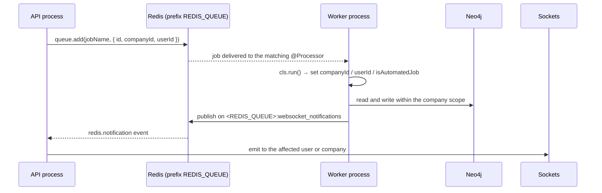

Background work in {{display}} is BullMQ over Redis, consumed by the worker
process. The package ships the queues, the processors and the crons; the app
contributes queue ids and job names through configuration. This page is mostly
about package behaviour, because that is where nearly all of it lives — the
template itself contributes one queue and no crons.

## The connection and the prefix

`QueueModule` in `packages/nestjs-neo4jsonapi/src/core/queue/queue.module.ts`
configures BullMQ from `ConfigService`:

```ts
connection: { host, port, password, username },   // from config.redis
prefix: redis.queue,                              // REDIS_QUEUE
defaultJobOptions: {
  removeOnComplete: true,
  removeOnFail: { age: 3600, count: 1000 },
}
```

`REDIS_QUEUE` becomes the BullMQ **key prefix**. Every queue's Redis keys are
namespaced under it, and the same value also prefixes the WebSocket pub/sub
channel in
`packages/nestjs-neo4jsonapi/src/core/redis/services/redis.messaging.service.ts`.

**A shared prefix is dangerous.** Redis is commonly one instance serving several
projects and several environments. Two stacks with the same `REDIS_QUEUE`
consume the *same* queues — a job enqueued by one is executed by the other,
against the other stack's Neo4j database, with the other stack's configuration.
Nothing detects it; the job simply succeeds in the wrong place. This is why
`.env.e2e.example` insists `E2E_REDIS_QUEUE` differ from the dev stack's
`REDIS_QUEUE`, and why the default is `default` — a value you are meant to
replace. `.env.example` sets it to `{{name}}`.

`defaultJobOptions` means completed jobs are removed immediately and failed jobs
are kept for an hour or 1000 entries, whichever comes first. A job that failed
two hours ago has left no trace except the log line.

## `forRoot()` versus `forRootWithQueues()`

`QueueModule` exposes two static factories.

| | `forRoot()` | `forRootWithQueues(queueIds)` |
|---|---|---|
| Registers | `chunk`, `company`, `howto`, `trial` | the same four plus everything in `queueIds`, de-duplicated through a `Set` |
| App queues | a `QUEUE_REGISTRATIONS` provider computes the extra ids but **registers nothing** — the comment in the file says so | registered as real `BullModule.registerQueue()` imports |
| Used by | nothing in the package | `CoreModule.getCoreModules()` |

`CoreModule` calls `QueueModule.forRootWithQueues(queueIds)`, so
`forRootWithQueues` is the path every application actually takes. `forRoot()` is
present for callers that want only the package's own queues; its
`QUEUE_REGISTRATIONS` provider is inert, because `BullModule.registerQueue()`
must appear in the `imports` array and cannot be produced by a factory.

Both are `@Global()`, so `@InjectQueue(...)` works anywhere without importing
`QueueModule`.

## Which queues exist

`packages/nestjs-neo4jsonapi/src/config/enums/queue.id.ts` declares nine ids:

| `QueueId` | Value | Registered by the package |
|---|---|---|
| `CHUNK` | `chunk` | always |
| `COMPANY` | `company` | always |
| `HOWTO` | `howto` | always |
| `TRIAL` | `trial` | always |
| `COMPANY_DELETION` | `company-deletion` | no |
| `COMMUNITY_SUMMARISER` | `community-summariser` | no |
| `BILLING_WEBHOOK` | `billing-webhook` | no |
| `EMAIL` | `email` | no |
| `USER_ACTIVITY` | `user-activity` | no |

Two more queue names are not in the enum at all — they are module-local
constants registered by the foundation that owns them: `embedding-chunks` (in
the chunk processor and controller) and `embedding-keyconcepts` (exported as
`KEYCONCEPT_EMBEDDING_QUEUE`).

The five enum members the package does not always register are registered by the
foundation modules that use them, or must be contributed by the app through
config. The distinction matters: an `@InjectQueue("email")` in a module that
never registered `email` fails at boot with an unresolved dependency.

### What the app contributes

`apps/api/src/config/enums/queue.id.ts`:

```ts
export enum QueueId {
  CHUNK = "chunk",
}
```

`apps/api/src/config/config.ts` passes `Object.values(QueueId)` as
`chunkQueues.queueIds`, and `createAppModule` reads that at module-definition
time and forwards it to `CoreModule.forRoot({ queueIds })`. So the template
contributes exactly one id, `chunk`, which the package already registers — a
no-op that exists as a worked example of the mechanism.

`ConfigChunkQueuesInterface` also carries a `concurrency` field. It is
**read-only reporting**: the value is filled from `CHUNK_QUEUE_CONCURRENCY`, and
setting it through `BaseConfigOptions.chunkQueues` cannot change the running
worker. See below.

## Job names

`packages/nestjs-neo4jsonapi/src/config/enums/job.name.ts` declares the shape and
one default:

```ts
export const JobName = {
  process: { trial: "process_trial" } as Record<string, string>,
  notifications: {} as Record<string, string>,
} as const;
```

`apps/api/src/config/enums/job.name.ts` overrides it:

```ts
export const JobName = {
  process: { chunk: "process_chunk" },
  notifications: {},
} as const;
```

Two string maps, `process` and `notifications`, each keyed by a content type.
A processor resolves its own job name from config and rejects anything else:

```ts
this.chunkJobName = configService.get("jobNames", { infer: true })?.process?.chunk ?? "process_chunk";
...
if (job.name !== this.chunkJobName) throw new Error(`Job ${job.name} not handled by ChunkProcessor`);
```

That is the whole contract. A queue can carry several job names; a processor
handles one and throws on the rest, which BullMQ records as a failure.

## `CHUNK_QUEUE_CONCURRENCY`

Declared in `packages/nestjs-neo4jsonapi/src/config/base.config.ts` as a
**module-level constant**, not a config field:

```ts
export const CHUNK_QUEUE_CONCURRENCY: number = (() => {
  const parsed = parseInt(process.env.CHUNK_QUEUE_CONCURRENCY || "", 10);
  return Number.isFinite(parsed) && parsed > 0 ? parsed : 50;
})();
```

`@Processor(queue, { concurrency })` options are evaluated at **decoration**
time — when the class is first loaded — long before NestJS instantiates
`ConfigService`. A processor therefore cannot inject the value it needs. Putting
the read inside the package's base config keeps the single-`process.env`-read-site rule
intact while making the value available at import time. The read is safe there
because `apps/api/src/load-env.ts` runs first.

The guard against `NaN` is deliberate: BullMQ would treat `NaN` concurrency as
unbounded and start every waiting job at once.

## The processors the package ships

| Processor | Queue | Concurrency | Lock | Opens a CLS context | Sets `isAutomatedJob` |
|---|---|---|---|---|---|
| `ChunkProcessor` | `chunk` | `CHUNK_QUEUE_CONCURRENCY` (50) | 1 min | yes | no |
| `ChunkEmbeddingProcessor` | `embedding-chunks` | 1 | 30 min | yes | **yes** |
| `KeyConceptEmbeddingProcessor` | `embedding-keyconcepts` | 1 | 30 min | yes | **yes** |
| `HowToProcessor` | `howto` | 10 | 1 min | yes | **yes** |
| `UserActivityProcessor` | `user-activity` | 4 | default | yes | **yes** |
| `CompanyProcessor` | `company` | 5 | 1 min | yes | no |
| `TrialProcessor` | `trial` | 5 | 1 min | yes | no |
| `StripeWebhookProcessor` | `billing-webhook` | 5 | 1 min | yes | no |
| `CommunitySummariserProcessor` | `community-summariser` | 1 | 5 min | yes | no |

Four set `isAutomatedJob`. The flag tells the security layer that there is no
human behind the request, so an ownership check that would otherwise reject a
context-free call passes. The four that set it are the ones whose work has no
single acting user: an embedding backfill, a how-to ingestion, an activity
rollup. The others carry a real `userId` and `companyId` from the job payload
and rely on those instead.

**Every processor opens its own CLS context.** The worker never mounts the CLS
middleware — `ClsModule.forRoot({ middleware: { mount: enableControllers } })`
and `enableControllers` is `false` in worker mode — so without `cls.run()` there
is no store to write to and the first `cls.set()` throws. The pattern is
invariable:

```ts
async process(job: Job): Promise<void> {
  if (job.name !== this.jobName) throw new Error(`Job ${job.name} not handled here`);
  await this.cls.run(async () => {
    this.cls.set("userId", job.data.userId);
    this.cls.set("companyId", job.data.companyId);
    this.cls.set("isAutomatedJob", true);   // when there is no acting user
    ...
  });
}
```

`TrialProcessor` is the one processor with no `createWorkerProvider` wrapper — it
is provided directly by its module. Every other processor in the table is
worker-only, so in API mode the provider resolves to `null` and no BullMQ worker
is started.

## The crons the package ships

Three cron services, all registered with `createWorkerProvider`, all inert unless
`ScheduleModule.forRoot()` is imported — which happens only when
`enableCronJobs` is true, that is, only in worker mode.

| Service | Schedule | What it does |
|---|---|---|
| `PresenceCronService.markIdleUsers` | `*/5 * * * *` | moves idle users to `away`/`offline` and broadcasts `user:presence` |
| `PresenceCronService.cleanupExpiredClients` | `0 * * * *` | removes socket ids from Redis whose client keys have expired |
| `CommunitySummariserCron` | `EVERY_10_MINUTES` | enqueues community-summarisation work |
| `AssistantActionExpiryCron` | `EVERY_HOUR` | expires pending assistant actions |

**The template app declares no crons of its own.** `apps/api/src` contains no
`@Cron` decorator. Adding one means creating an `@Injectable()` class with a
`@Cron` method, registering it in a feature module with
`createWorkerProvider(MyCron)`, and remembering that it will run in every worker
replica unless you guard it.

## The end-to-end path



The last three steps are why a worker can "send a WebSocket message" despite
holding no sockets: `WebSocketService.broadcast` /
`sendMessageToCompany` / `sendMessageToUser` check the injected app mode and, in
worker mode, publish to Redis instead of emitting. The API process subscribes and
re-emits. See the realtime page.

## Adding a queue and a processor in an app

Four steps, none of them optional.

**1. Add the id.** `apps/api/src/config/enums/queue.id.ts`:

```ts
export enum QueueId {
  CHUNK = "chunk",
  REPORT = "report",
}
```

`apps/api/src/config/config.ts` already passes `Object.values(QueueId)`, so the
queue is registered on the next boot — of **both** processes, because the API
needs it to add jobs and the worker to consume them.

**2. Add the job name.** `apps/api/src/config/enums/job.name.ts`:

```ts
export const JobName = {
  process: { chunk: "process_chunk", report: "process_report" },
  notifications: {},
} as const;
```

**3. Write the processor**, following
`packages/nestjs-neo4jsonapi/src/foundations/how-to/processors/how-to.processor.ts`:
extend `WorkerHost`, decorate with `@Processor(QueueId.REPORT, { concurrency, lockDuration })`,
resolve the job name from `ConfigService` in the constructor, reject any other
job name, and wrap the body in `cls.run()`. Add `@OnWorkerEvent("active")`,
`"completed"` and `"failed"` handlers that log — they are the only visibility you
get once `removeOnComplete` has deleted the job.

**4. Register it worker-only** in the feature module:

```ts
@Module({
  imports: [BullModule.registerQueue({ name: QueueId.REPORT })],
  providers: [ReportService, createWorkerProvider(ReportProcessor)],
})
export class ReportModule {}
```

`createWorkerProvider` keeps the API process from starting a second consumer for
the same queue. The `BullModule.registerQueue` import is what makes
`@InjectQueue(QueueId.REPORT)` resolvable inside this module; the global
registration from `QueueModule` covers injection elsewhere.

**Enqueue** from a service or controller:

```ts
constructor(@InjectQueue(QueueId.REPORT) private readonly queue: Queue) {}
...
await this.queue.add(this.reportJobName, { id, companyId, userId });
```

Pass `companyId` and `userId` in the payload. The worker has no request context
to inherit them from — the payload is the only channel.

One caution the chunk service records from experience: do **not** give a job a
deterministic `jobId` to collapse a fan-out. BullMQ drops an `add()` whose
`jobId` already exists in *any* state, including `completed` and `active`, so an
early-returning first job can swallow the enqueue that would have done the work.
De-duplicate in your own code — a claim query, a status flag — not through the
job id.

## Watching a job

There is no queue dashboard in the template. The tools you have:

| Signal | Where |
|---|---|
| `@OnWorkerEvent("active"/"completed")` | `debug`-level log lines; raise `LOG_LEVEL` to see them |
| `@OnWorkerEvent("failed")` | `error`-level, includes `job.id` and `job.failedReason` |
| Redis keys | `KEYS <REDIS_QUEUE>:<queue>:*` — `wait`, `active`, `failed` and `delayed` lists |
| BullMQ API | inject the queue and call `getJobCounts()`, `getFailed()`, `getJob(id)` from a temporary admin route |
| Neo4j | the durable evidence — most jobs leave a status field or a written node |

Because `removeOnComplete: true`, a successful job is gone from Redis the moment
it finishes. Failures survive for one hour or 1000 entries. If you need a
persistent audit of background work, write it to the graph.

Locally, `pnpm dev` runs the worker alongside the API, so job logs appear in the
same terminal. `pnpm dev:worker` runs the worker alone.

## Where to look

| File | What it tells you |
|---|---|
| `packages/nestjs-neo4jsonapi/src/core/queue/queue.module.ts` | the connection, the prefix, the default job options, both factories |
| `packages/nestjs-neo4jsonapi/src/config/enums/queue.id.ts` | the nine package queue ids |
| `apps/api/src/config/enums/queue.id.ts` | the one id the app contributes |
| `apps/api/src/config/enums/job.name.ts` | the job-name map's shape |
| `packages/nestjs-neo4jsonapi/src/config/base.config.ts` | `CHUNK_QUEUE_CONCURRENCY` and why it is a constant |
| `packages/nestjs-neo4jsonapi/src/foundations/how-to/processors/how-to.processor.ts` | the cleanest processor to copy |
| `packages/nestjs-neo4jsonapi/src/foundations/chunk/processors/chunk.processor.ts` | concurrency from the constant, credit gating, the `jobId` warning nearby |
| `packages/nestjs-neo4jsonapi/src/core/websocket/services/presence.cron.service.ts` | a two-method cron service |
| `packages/nestjs-neo4jsonapi/src/core/core.module.ts` | where `forRootWithQueues` is actually called |
| `.env.e2e.example` | why the queue prefix must differ between stacks |

## Gaps and drift

- `QueueModule.forRoot()`'s `QUEUE_REGISTRATIONS` provider computes a list of
  additional queue ids and registers none of them; its own comment says the
  registration "happens via `BullModule.registerQueue()` imports below", and
  there are none. Nothing in the package calls `forRoot()`.
- Five of the nine `QueueId` members are not registered by `QueueModule` in
  either form; `embedding-chunks` and `embedding-keyconcepts` are real queues
  that are not in the enum at all.
- The template's `chunkQueues.queueIds` contributes `chunk`, which the package
  already registers, so the app's queue contribution is currently a no-op.
- `apps/api/src/config/enums/job.name.ts` declares `process.chunk` but the app
  ships no content type, so no job is ever enqueued onto the chunk queue by
  template code.
- `chunkQueues.concurrency` is surfaced through `ConfigService` but cannot change
  the running worker; only `CHUNK_QUEUE_CONCURRENCY` can.
- The template declares no cron job; the four shipped by the package are the
  complete set.
- Retry and backoff policies are not configured anywhere — `defaultJobOptions`
  sets only removal behaviour, so jobs use BullMQ's defaults.
- The processors' internals (what each one actually does to the graph) belong to
  the foundation chapters and were read only for their decorators, CLS handling
  and job-name checks.
