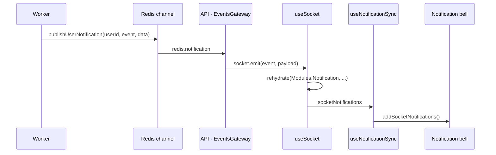

{{display}} keeps one socket.io connection per browser tab, opened against the
API process and authenticated with the same JWT as every HTTP call. It carries
presence, server-pushed notifications and per-feature progress events. The worker
participates through Redis pub/sub, because it holds no sockets of its own.

## The server side

Everything lives under
`packages/nestjs-neo4jsonapi/src/core/websocket`, wired by `WebsocketModule`,
which is `@Global()` and imported by `CoreModule` in both process modes.

### The gateway

`packages/nestjs-neo4jsonapi/src/core/websocket/gateways/event.gateway.ts`
declares `EventsGateway`:

```ts
@WebSocketGateway({
  path: "/socket.io",
  cors: { origin: "*", credentials: true },
  transports: ["websocket"],
})
@UseInterceptors(ClsInterceptor)
```

`transports: ["websocket"]` means no HTTP long-polling fallback. The CORS block
is `origin: "*"` — the gateway's own CORS, independent of the API's
`CORS_ORIGINS`; authentication, not origin, is what protects it.

| Hook | Behaviour |
|---|---|
| `afterInit` | hands the socket.io `Server` to `WebSocketService.setServer()` |
| `handleConnection` | extracts and verifies the token; on success stores the payload on `client.data.user`, registers the client, marks the user online, broadcasts `user:presence`, and attaches the `onAny` re-emitter |
| `handleDisconnect` | deregisters the client, marks it offline, and broadcasts `user:presence` **only if no other socket for that user remains** |
| `onModuleDestroy` | sets a shutting-down flag so disconnects during shutdown skip Redis work |

Token extraction tries three places in order: `client.handshake.auth.token`,
`client.handshake.query.token`, then an `Authorization: Bearer` handshake header.

A connection with **no** token is not refused. `client.data.user` is set to
`{ userId: null }` and the socket stays open — it receives broadcasts but is
registered nowhere, has no presence, and never emits onto the event bus. A
connection with a *bad* token is treated the same way after an error log.

### The two message handlers

| Event | Handler | Effect | Acknowledgement |
|---|---|---|---|
| `heartbeat` | `handleHeartbeat` | `presenceService.updateActivity(userId)` when the socket is authenticated | `{ event: "heartbeat", data: { status: "ok" } }` |
| `message` | `handleMessage` | `webSocketService.handleIncomingMessage(companyId, userId, data)` — requires **both** `userId` and `companyId` on the token | `{ event: "message", data: { status: "received" } }` |

`handleIncomingMessage` does not interpret the payload. It emits
`message.type` — a client-supplied string — on the Nest `EventEmitter2` bus with
`{ companyId, userId, message }`. A feature listens with `@OnEvent("<type>")`.

### Re-emission as `ws:<event>`

Inside `handleConnection`, after a successful verification:

```ts
const WS_BUILTIN_EVENTS = new Set(["message", "heartbeat"]);
...
client.onAny((event, eventPayload) => {
  if (WS_BUILTIN_EVENTS.has(event)) return;
  this.eventEmitter.emit(`ws:${event}`, { user: client.data.user, payload: eventPayload, client });
});
```

Every inbound socket event **except** the two built-ins is republished on the
Nest event bus under a `ws:` prefix, carrying the decoded JWT payload, the raw
payload and the socket itself. That is the extension point: a feature that wants
to answer a custom client event declares `@OnEvent("ws:my-event")` and needs no
gateway change. The `client` handle in the payload lets the handler reply
directly to that one socket.

The prefix is what keeps a client from spoofing an internal event name: a socket
emitting `redis.notification` arrives on the bus as `ws:redis.notification`.

**The package subscribes to no `ws:*` event.** The mechanism ships with zero
consumers; it exists entirely for applications.

### `WebSocketService`

`packages/nestjs-neo4jsonapi/src/core/websocket/services/websocket.service.ts`
owns delivery. It keeps an in-memory `Map<userId, Socket[]>` — one process's view
— and mirrors registration into Redis so other processes can see it.

| Method | API mode | Worker mode |
|---|---|---|
| `broadcast(event, data)` | `server.emit` to every socket | publishes a `broadcast` notification to Redis |
| `sendMessageToCompany(companyId, event, data)` | resolves the company's users from Redis, emits to each one's local sockets | publishes a `company` notification to Redis |
| `sendMessageToUser(userId, event, data)` | emits to that user's local sockets | publishes a `user` notification to Redis |

The branch is `this.appModeConfig.mode === AppMode.WORKER`, read from the
injected `APP_MODE_TOKEN`. `RedisClientStorageService` and
`RedisMessagingService` are both `@Optional()`, so the service degrades to local
emission when Redis is absent rather than crashing.

The return path is one handler:

```ts
@OnEvent("redis.notification")
async handleRedisNotification(notification: NotificationMessage) { ... }
```

`RedisMessagingService` subscribes to `<REDIS_QUEUE>:websocket_notifications`,
parses each message and emits `redis.notification` locally;
`WebSocketService` dispatches on `notification.type` — `user`, `company` or
`broadcast` — to the corresponding `…Direct` method. **This is also how a
multi-instance API fans out**: an emit from replica A reaches a socket held by
replica B only through this channel.

`onModuleInit` additionally starts a five-minute interval calling
`redisClientStorage.cleanupExpiredClients()`, cleared in `onModuleDestroy`.

### Presence

`packages/nestjs-neo4jsonapi/src/core/websocket/services/presence.service.ts`
stores one JSON blob per user at `presence:<userId>`:

```ts
{ status: "online" | "away" | "offline", lastActivity, socketIds[], userName }
```

| Constant | Value |
|---|---|
| `PRESENCE_TTL` | 35 minutes |
| `ONLINE_THRESHOLD` | 2 minutes |
| `AWAY_THRESHOLD` | 30 minutes |

`setUserOnline` appends the socket id; `setUserOffline` removes it and only flips
the status when the last one is gone, so multiple tabs and devices behave
correctly. Every method checks `redisClientStorage.isConnected()` first and logs
and returns rather than throwing when Redis is down.

Socket registration is tracked separately by `RedisClientStorageService` under
three key families, all prefixed with `REDIS_QUEUE`:

| Key | Contents | TTL |
|---|---|---|
| `<prefix>:ws_client:<socketId>` | a hash with the user and company | 24 h |
| `<prefix>:user_clients:<userId>` | a set of socket ids | 24 h |
| `<prefix>:company_users:<companyId>` | a set of user ids | 24 h |

`sendMessageToCompanyDirect` reads the third to find recipients.

### The presence cron

`packages/nestjs-neo4jsonapi/src/core/websocket/services/presence.cron.service.ts`
is registered with `createWorkerProvider`, so it runs **only in the worker**:

| Schedule | Method | Effect |
|---|---|---|
| `*/5 * * * *` | `markIdleUsers` | marks idle users away or offline and broadcasts `user:presence` for each change |
| `0 * * * *` | `cleanupExpiredClients` | drops socket ids from `user_clients` sets whose `ws_client` key has expired |

Because it runs in the worker, its broadcasts take the Redis pub/sub path back to
the API process. A deployment running the API alone has no idle detection: users
stay `online` until their presence key expires after 35 minutes.

### `WsJwtGuard`

`packages/nestjs-neo4jsonapi/src/core/websocket/guards/ws.jwt.auth.guard.ts` is a
`CanActivate` for WebSocket contexts. It extracts the token from the handshake
using the same three-place search, verifies it, writes the payload to
`client.data.user`, and returns `true`; anything else returns `false`.

It is exported by `WebsocketModule` and applied to **no handler in the package**.
`EventsGateway` authenticates in `handleConnection` instead. Use it with
`@UseGuards(WsJwtGuard)` on a `@SubscribeMessage` handler that must refuse
unauthenticated sockets — which, given that the gateway accepts tokenless
connections, is the only way to close that door per-handler.

## What emits

| Event | Emitted from | Target |
|---|---|---|
| `user:presence` | `EventsGateway` on connect and disconnect; `PresenceCronService` on idle transitions | broadcast |
| `assistant:message` | the assistant foundation's service | user |
| `assistant:status` | the responder agent's graph node | user |
| `contextualiser` | four contextualiser agent nodes, one per pipeline stage | user |
| `graph_creation` | the how-to foundation's service | user |
| `company:credits_updated` | the company foundation's service | company |
| `company:subscription_updated` | the company service and the Stripe webhook processor | company |
| `company:ai_backlog_updated` | the community-summariser processor | company |
| `llm:dump` | the LLM call dumper, when `ASSISTANT_DUMP_LLM_CALLS=1` | user |

Half of these originate in the worker and therefore travel through Redis.

## The client side

### `useSocket`

`packages/nextjs-jsonapi/src/hooks/useSocket.ts` takes `{ token }` and returns
`socket`, `isConnected`, `messages`, `socketNotifications`, `sendMessage` and
four list-mutation helpers. It connects to `ENV.API_URL` with
`{ auth: { token }, transports: ["websocket"], timeout: 20000 }` and no token
means no connection attempt at all.

**The window-pinned socket.** The connection is stored on `window` under a key
derived from the API URL:

```ts
const globalSocketKey = `__socket_${ENV.API_URL.replace(/[^a-zA-Z0-9]/g, "_")}`;
```

On mount the hook looks for an existing socket at that key. If it is connected,
the hook reuses it; if it is not, it disconnects it and deletes the key. Reuse
survives React remounts and Fast Refresh, which is what keeps a hot reload from
opening a new connection every time.

**The `removeAllListeners` guard.** Reuse comes with a hazard: the previous mount
left its handlers attached, so an event would be handled twice, then three times.
Before adopting an existing socket the hook calls
`existingSocket.removeAllListeners()`, with the comment "CRITICAL: Clear existing
listeners to prevent accumulation". It is a blunt instrument — it removes
listeners attached by *any* code, not only this hook's — so anything that
subscribes to the shared socket must re-subscribe after a remount.

A `shouldConnect` ref guards against React StrictMode's double mount: it is
cleared before creating a socket and restored in cleanup.

Cleanup differs by environment. In development the four handlers are detached and
the socket is **left connected** on `window` for the next mount. In production the
handlers are detached, the socket is disconnected and the `window` key deleted.

The hook attaches exactly four listeners: `connect`, `disconnect`, `message` and
`notification`. `message` appends the raw payload to `messages`. `notification`
maps the incoming document — the socket sends `{ data, included }`, `rehydrate`
expects `{ jsonApi, included }` — warns and returns on an unexpected shape, then
rehydrates through `Modules.Notification` and appends to `socketNotifications`.

`sendMessage(event, data)` emits only when `isConnected` is true; there is no
queue for messages sent while disconnected.

### `SocketProvider`

`packages/nextjs-jsonapi/src/contexts/SocketContext.tsx` wraps the hook in a
context with a complete no-op default, so `useSocketContext()` outside a provider
returns inert functions rather than throwing. The provider takes an optional
`token` or, as {{display}} uses it, the `session` promise from
`ServerSession.read()`. It resolves the promise in an effect, so it never
suspends and its children render at once; the socket connects when the promise
settles. `useSocket` is called unconditionally and returns early while the token
is empty.

In {{display}} it wraps three route groups — `(main)` and `(admin)` through
`apps/web/src/features/common/components/session/AppShell.tsx`, which both
layouts render, and `(public-help)` through
`apps/web/src/app/[locale]/(public-help)/help/layout.tsx` — always alongside
`CurrentUserProvider` and `NotificationContextProvider`. The `(auth)` group has
no socket.

### `useNotificationSync`

`packages/nextjs-jsonapi/src/hooks/useNotificationSync.ts` is nine lines and
bridges the two contexts: whenever `socketNotifications` is non-empty it calls
`addSocketNotifications()` on the notification context and then
`clearSocketNotifications()`, inside a `try`/`catch` that logs rather than
breaking the effect. Without it, pushed notifications accumulate in the socket
context and never reach the bell.

{{display}} calls it in
`apps/web/src/features/common/components/details/LayoutDetails.tsx`, which is the
shared client wrapper `AppShell` mounts for `(main)` and `(admin)`.

### The flow



## Configuration

Realtime reads no variables of its own. It inherits four:

| Variable | Effect |
|---|---|
| `JWT_SECRET` | verifies the handshake token — the same secret as HTTP |
| `REDIS_HOST` / `REDIS_PORT` / `REDIS_USERNAME` / `REDIS_PASSWORD` | presence, client registry and pub/sub |
| `REDIS_QUEUE` | prefixes the pub/sub channel and all three client-registry key families; two stacks sharing it will cross-deliver socket messages |
| `NEXT_PUBLIC_API_URL` | the URL the browser connects to, and the source of the `window` socket key |

There is no variable to disable the gateway, change its path, or restrict its
CORS origin.

## Where to look

| File | What it tells you |
|---|---|
| `packages/nestjs-neo4jsonapi/src/core/websocket/gateways/event.gateway.ts` | connection, the two handlers, the `ws:` re-emitter |
| `packages/nestjs-neo4jsonapi/src/core/websocket/services/websocket.service.ts` | the mode branch, the three send methods, `redis.notification` |
| `packages/nestjs-neo4jsonapi/src/core/websocket/services/presence.service.ts` | the presence blob, its thresholds and TTL |
| `packages/nestjs-neo4jsonapi/src/core/websocket/services/presence.cron.service.ts` | the two schedules |
| `packages/nestjs-neo4jsonapi/src/core/websocket/guards/ws.jwt.auth.guard.ts` | the per-handler guard nothing applies |
| `packages/nestjs-neo4jsonapi/src/core/websocket/websocket.module.ts` | what is global, what is exported, what is worker-only |
| `packages/nestjs-neo4jsonapi/src/core/redis/services/redis.messaging.service.ts` | the channel name and the message envelope |
| `packages/nestjs-neo4jsonapi/src/core/redis/services/redis.client.storage.service.ts` | the three key families and their TTLs |
| `packages/nextjs-jsonapi/src/hooks/useSocket.ts` | the window-pinned socket and the listener guard |
| `packages/nextjs-jsonapi/src/hooks/useNotificationSync.ts` | the bridge to the notification context |

## Gaps and drift

- The gateway accepts tokenless connections instead of refusing them; such a
  socket receives broadcasts. `WsJwtGuard` exists to close that per handler but is
  applied nowhere in the package.
- The gateway's CORS is hardcoded `origin: "*"` and ignores `CORS_ORIGINS`.
- `useSocket` listens for a `notification` event, and **no server code in the
  package emits one**. Notifications reach the bell only if application code
  emits that event name.
- `removeAllListeners()` on an adopted socket removes every listener, including
  ones attached by other code sharing the connection.
- `handleMessage` emits a client-supplied string directly onto the Nest event bus
  with no allowlist; only the `ws:` prefix on the `onAny` path is namespaced.
- `WebSocketService.handleIncomingGoogleMeetPart` emits a `googlemeet` event and is
  called from nowhere in the package.
- Reconnection and backoff are socket.io defaults; nothing in either package
  configures them.
- The individual emitting subsystems were located by their call sites; what each
  event's payload contains belongs to the foundation and AI chapters.
