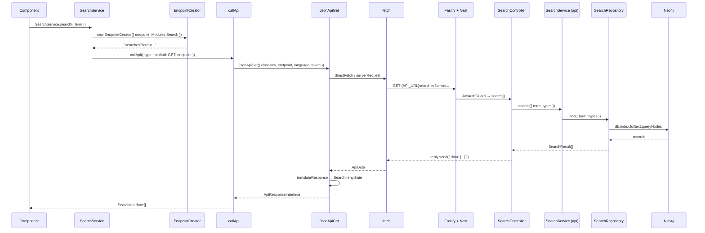
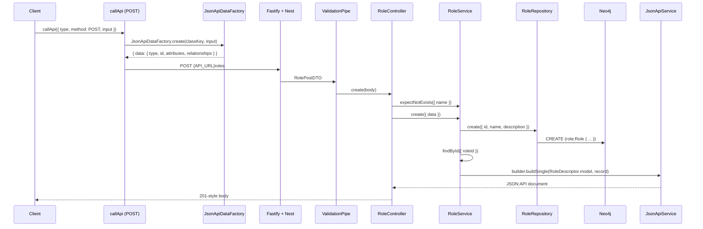

Two traces, end to end. The GET uses `searches`, the only endpoint
`apps/api/src/features` ships. The POST uses `roles`, a foundation with full
CRUD, because the template itself contains no write endpoint of its own.

## GET: searching

### The chain



### Hop by hop

**1. The feature service.**
`apps/web/src/features/essentials/search/data/SearchService.ts` extends
`AbstractService` from `@carlonicora/nextjs-jsonapi/core`. It is a static class
with one method; it never touches `fetch`.

**2. `EndpointCreator`.** `packages/nextjs-jsonapi/src/core/endpoint/EndpointCreator.ts`
builds the path. Given `{ endpoint: Modules.Search }` it emits the module's
`name` (`searches`, from `apps/web/src/features/essentials/search/SearchModule.ts`),
then `/:id`, then a child endpoint and child id if present, then `?` and the
additional params joined with `&`. `SearchService` adds `term` and, when types
were requested, a comma-joined `types`. The result is a **relative** path.

**3. `callApi`.** `packages/nextjs-jsonapi/src/core/abstracts/AbstractService.ts`
dynamically imports the request layer, resolves the language (on the server via
the `getLocale` handed to `configureI18n()` — next-intl's own, passed in by
`apps/web/src/config/env.ts` — in the browser from the URL pathname),
dispatches on the HTTP method, and turns the result into either typed data or an
error. `type: Modules.Search` is what lets the response be rehydrated; without
it the registry lookup fails.

**4. `JsonApiGet`.** `packages/nextjs-jsonapi/src/unified/JsonApiRequest.ts` runs
the registered bootstrapper (so every module is in the registry), resolves the
token — `packages/nextjs-jsonapi/src/server/token.ts` reads the `token` cookie on
the server, `packages/nextjs-jsonapi/src/client/token.ts` on the client — and
calls `buildUrl()`. `buildUrl` passes an absolute `http…` endpoint through
unchanged; otherwise it prefixes `getApiUrl()`, which is the `apiUrl` given to
`configureJsonApi()` in `apps/web/src/config/instrumentation-env.ts`, falling back to
`NEXT_PUBLIC_API_URL`.

**5. The transport.** `typeof window` decides.
`packages/nextjs-jsonapi/src/client/request.ts` is a plain browser `fetch`;
`packages/nextjs-jsonapi/src/server/request.ts` is a plain server fetch, except
that a GET naming a `cache` goes through `cachedServerGet`, a token-free
`"use cache"` function. Both set `Accept: application/json`, `x-language`, `x-companyid`
when a company id was passed, and `Authorization: Bearer <token>` (the cached
path excepted). Both swallow network errors into `{ ok: false, status: 503 }`
rather than throwing.

**6. The Fastify pipeline.** In order, as wired by `bootstrapAPI`:

| Stage | What it does here |
|---|---|
| Content-type parser | `application/vnd.api+json` is parsed as JSON |
| `TracingInterceptor` | opens a span |
| `CacheInterceptor` | consults Redis; `CACHE_SKIP_PATTERNS` exempts `/access`, `/auth`, `/notifications`, `/websocket`, `/version` by default |
| `LoggingInterceptor` | records the request |
| `CustomThrottlerGuard` | only registered when `RATE_LIMIT_ENABLED` is not `false` |
| `JwtAuthGuard` | verifies the bearer token, then writes `userId`, `companyId`, `roles`, `language`, `token`, `ipAddress` into CLS |
| `ValidationPipe` | validates `@Body()` DTOs — this route has none |

**7. The controller.**
`apps/api/src/features/essentials/search/controllers/search.controller.ts` is
guarded by `JwtAuthGuard` at class level, routes on `searchMeta.endpoint` from
`apps/api/src/features/essentials/search/entities/search.meta.ts`, and injects
`@Res() reply` — so it must call `reply.send()` itself. An empty `term`
short-circuits to `{ data: [] }`.

**8. Service and repository.**
`apps/api/src/features/essentials/search/services/search.service.ts` is a
one-line pass-through. `apps/api/src/features/essentials/search/repositories/search.repository.ts`
reads `companyId` out of CLS, escapes the Lucene special characters in the term,
wraps it in `*…*`, and runs:

```cypher
MATCH (company:Company {id: $companyId})
CALL db.index.fulltext.queryNodes("search_index", $term)
YIELD node, score
WHERE (node)-[:BELONGS_TO]->(company)
WITH node, score, head(labels(node)) AS label
RETURN node.id AS id, COALESCE(...) AS name, label AS type, score
ORDER BY score DESC LIMIT 25
```

The company match is the tenancy boundary; the `BELONGS_TO` filter is what keeps
one company's nodes out of another's results. `onModuleInit` maintains the
`search_index` fulltext index, comparing the live index's labels and properties
against the expected lists and recreating it when they differ.

**9. Back up.** The controller maps each `SearchResult` into a JSON:API resource
object by hand: `type` is the lower-cased label plus `s`, and the attributes are
`name`, `entityType` and `score`. `translateResponse` in
`packages/nextjs-jsonapi/src/core/utils/translateResponse.ts` looks the model
class up in `DataClassRegistry`, constructs one instance per element and calls
`rehydrate({ jsonApi, included, allData })`.
`apps/web/src/features/essentials/search/data/Search.ts` reads the three
attributes off `data.jsonApi.attributes`. `callApi` returns
`apiResponse.data` — a `SearchInterface[]`.

### Two things the search path does not do

It does not go through the serialiser: the controller builds the JSON:API
document itself rather than calling `JsonApiService.buildSingle`/`buildList`. And
it does not paginate: the `LIMIT 25` is literal, there is no `{CURSOR}`
placeholder and the response carries no `links`. Both are properties of this one
endpoint, not of the framework — see the POST trace for the generic path.

## POST: creating a role

`packages/nestjs-neo4jsonapi/src/foundations/role` is the reference for a write.



**The body.** `callApi` with `method: POST` hands the raw input to
`JsonApiDataFactory.create(classKey, body)` unless `overridesJsonApiCreation` is
set. The model's `createJsonApi()` produces the resource object — which is why
every model must implement it, and why
`apps/web/src/features/essentials/search/data/Search.ts` throws from it: search
is read-only.

**The DTO.** `packages/nestjs-neo4jsonapi/src/foundations/role/dtos/role.post.dto.ts`
declares three nested classes. `RolePostDTO` has `data` (validated nested) and an
optional `included`. `RolePostDataDTO` pins `type` with `@Equals(roleMeta.endpoint)`,
requires `id` to be a UUID, and validates `attributes` against
`RolePostAttributesDTO`. The global `ValidationPipe` runs this before the
controller method body; `whitelist: true` strips anything not declared.

**The controller.**
`packages/nestjs-neo4jsonapi/src/foundations/role/controllers/role.controller.ts`
calls `roleService.expectNotExists()` first — a 409 on a duplicate name — then
`roleService.create()`. `@CacheInvalidate(roleMeta)` clears the cached list
responses for the type.

**The generic CRUD path.** `RoleController` calls its service directly.
Controllers that need no extra logic delegate to
`packages/nestjs-neo4jsonapi/src/common/handlers/crud.handlers.ts` instead:
`createCrudHandlers(() => this.service)` returns `findAll`, `findById`, `create`,
`update`, `patch` and `delete`, each of which calls the matching
`AbstractService` method and `reply.send()`s the result.
`packages/nestjs-neo4jsonapi/src/foundations/how-to/controllers/how-to.controller.ts`
is a foundation that uses it.

`createCrudHandlers().create` calls
`AbstractService.createFromDTO({ data, included })` in
`packages/nestjs-neo4jsonapi/src/core/neo4j/abstracts/abstract.service.ts`, which
is two lines: `mapDTOToParams(data)` then `create(params, included)`.
`mapDTOToParams` walks the descriptor — every declared field takes its value from
`data.attributes`, else the descriptor default, else `null`; every relationship
takes its value from CLS when it declares a `contextKey`, otherwise from
`data.relationships[dtoKey ?? key]`, collapsing a to-one to an id and a to-many
to an array of ids. `AbstractService.create` then calls
`this.repository.create(params)`, writes an audit entry when an `AuditService` is
bound, and returns `findById()`.

`AbstractRepository.create` in
`packages/nestjs-neo4jsonapi/src/core/neo4j/abstracts/abstract.repository.ts`
validates that every referenced related node exists, merges the descriptor's
field defaults, drops `undefined` fields, and emits a `CREATE` whose property
assignments are cast by declared type — `datetime($x)`, `date(left($x, 10))`,
`toInteger($x)` for money fields — with `createdAt` and `updatedAt` set to
`datetime()`.

**The serialiser.** `RoleService.findById` calls
`JsonApiService.buildSingle(RoleDescriptor.model, record)` in
`packages/nestjs-neo4jsonapi/src/core/jsonapi/services/jsonapi.service.ts`, which
resolves the serialiser through `SerialiserFactory`, throws a 404 when the record
is null, and serialises to a document with `links.self` built from
`api.url` + the model's endpoint + the id. Lists go through `buildList`, which
prefers the request URL held in CLS so pagination links reflect the real query
string.

`RoleModule` is what makes this work: it provides `RoleDescriptor.model.serialiser`
and calls `modelRegistry.register(RoleDescriptor.model)` in `onModuleInit`. A
resource without both is invisible to `include:` and to the serialiser factory.

## The error path

### 401

`JwtAuthGuard.canActivate` returns `false` immediately when there is no
`Authorization` header. When the header is present but the token is bad, its
`handleRequest` throws `HttpException("Token expired", 401)` for an expired
token and `HttpException("Unauthorised", 401)` otherwise. `_validateRoles`
throws the same 401 when a `@Roles` requirement is not met — note that this is a
401, not a 403.

On the browser side, `apps/web/src/proxy.ts` gets there first for page
navigations: a missing or nearly-expired `token` triggers a refresh against
`auth/refreshtoken/<refreshToken>` first, and then no `refreshToken` cookie, or a
refresh that failed, on a non-public path is a redirect to `/login`. A 401 reaching
`callApi` therefore means the refresh itself failed or the call was made with an
explicitly passed token.

### Validation failure

`ValidationPipe` throws a `BadRequestException` whose response object carries a
`message` **array**. `HttpExceptionFilter`
(`packages/nestjs-neo4jsonapi/src/common/filters/http-exception.filter.ts`)
detects that array shape and logs each message on its own line at `warn` level
with the full request context, then sends the standard envelope. The client
sees a 400.

### The envelope

Every error, validation or not, leaves the API in one shape:

```json
{
  "message": "...",
  "errors": [{
    "status": "400",
    "title": "BAD_REQUEST",
    "detail": "...",
    "source": { "pointer": "/roles" },
    "meta": { "timestamp": "...", "path": "...", "method": "POST", "requestId": "..." }
  }]
}
```

`/health*` routes are the exception — Terminus's own `{ status, info, error,
details }` body is passed through untouched. In production a 5xx `detail` is
replaced with "An internal error occurred. Please try again later.", stack traces
have absolute paths stripped, and structured exception payloads are omitted.
`requestId` is the only context ever returned; `userId` and `companyId` are
logged, never sent.

### How `callApi` reacts

`translateResponse` copies `ok` and `status` onto its result and, when not ok,
sets `error` from `data.message ?? data.error ?? statusText` — the body is the
only reliable source because HTTP/2 dropped the reason phrase — and puts the raw
body on `raw`. `callApi` then takes one of two branches:

| Condition | Behaviour |
|---|---|
| a global error handler is registered **and** `typeof window !== "undefined"` **and** `suppressGlobalError` is not set | calls `globalErrorHandler(status, error)` and returns `undefined` |
| otherwise | throws `new Error("<status>:<error>")` with `.status`, `.digest = "HTTP_<status>"` and `.body` (the raw response body) |

`.digest` is what a Next.js error boundary sees on the server; `.status` is what
application code should branch on. The handler is installed with
`setGlobalErrorHandler` from
`packages/nextjs-jsonapi/src/core/abstracts/AbstractService.ts`.

In the template, **nothing installs one**. `apps/web/src/features/common/contexts/ErrorContext.tsx`
defines an `ErrorProvider` that would — it renders `<Logout />` on a 401 and an
`ErrorDetails` page otherwise — but it is imported by no layout and it `require`s
a module path that does not exist in this repository. So every non-ok response
throws, and the throw is what your error boundaries will catch.

Two more silent behaviours worth knowing: `translateResponse` wraps rehydration
in `try`/`catch` and only `console.error`s a failure, so a model whose
`rehydrate()` throws yields an empty `data` rather than an error; and both
transports turn a network-level failure into `{ ok: false, status: 503 }` with no
body, which reaches you as a thrown `Error` with `.status === 503`.

## Where to look

| File | What it tells you |
|---|---|
| `apps/web/src/features/essentials/search/data/SearchService.ts` | the smallest complete client-side call |
| `packages/nextjs-jsonapi/src/core/abstracts/AbstractService.ts` | `callApi`, the method switch and both error branches |
| `packages/nextjs-jsonapi/src/unified/JsonApiRequest.ts` | URL resolution, token lookup, the five verb helpers |
| `packages/nextjs-jsonapi/src/core/utils/translateResponse.ts` | rehydration, pagination links, the swallowed error |
| `packages/nextjs-jsonapi/src/core/endpoint/EndpointCreator.ts` | exactly how a path is assembled |
| `packages/nestjs-neo4jsonapi/src/bootstrap/bootstrap.ts` | the Fastify pipeline in wiring order |
| `apps/api/src/features/essentials/search/controllers/search.controller.ts` | the one shipped endpoint, `@Res()` and all |
| `packages/nestjs-neo4jsonapi/src/common/handlers/crud.handlers.ts` | the generic CRUD delegation |
| `packages/nestjs-neo4jsonapi/src/core/neo4j/abstracts/abstract.service.ts` | `createFromDTO` and `mapDTOToParams` |
| `packages/nestjs-neo4jsonapi/src/common/filters/http-exception.filter.ts` | the error envelope and its production redactions |

## Gaps and drift

- `apps/api/src/features/essentials/search/dtos/search.dto.ts` declares
  `SearchQueryDTO`, and the controller does not use it — the query parameters are
  read as raw strings through `@Query()`.
- `EXPECTED_SEARCH_LABELS` in the search repository is empty, so index
  management logs "skipped", the fulltext index is never created, and a real call
  to `db.index.fulltext.queryNodes("search_index", …)` fails until you add labels.
- The search endpoint is not paginated and does not use the serialiser; it is not
  representative of the framework's read path.
- `ErrorProvider` in `apps/web/src/features/common/contexts/ErrorContext.tsx` is
  wired into no layout and requires a path that does not exist, so
  `globalErrorHandler` is never installed.
- `EndpointCreator.generate()` does not URL-encode parameter values; a term
  containing `&` or `#` corrupts the query string.
- `JwtAuthGuard._validateRoles` answers a missing role with 401 rather than 403.
- The cache interceptor, tracing interceptor and `CustomThrottlerGuard` were read
  for their position in the pipeline, not their internals.
- `JsonApiPaginator` and the `{CURSOR}` expansion are named here but documented in
  the JSON:API contract page, not traced.
