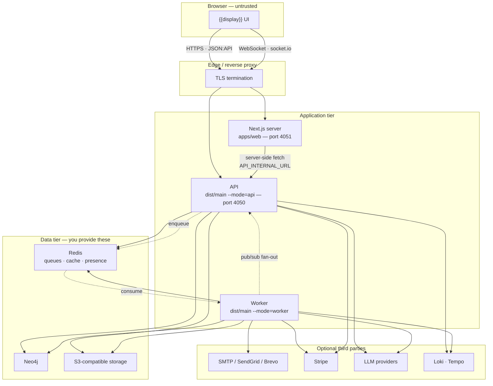
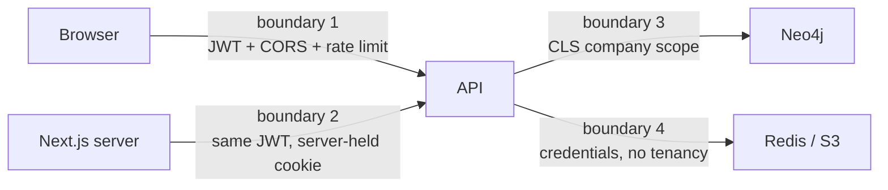

{{display}} runs as **three processes built from two binaries**, against **three
external stores that nothing in this repository starts for you**, plus a set of
optional third-party services that stay dormant until you configure them.

## The processes

| Process | Built from | Started by | Listens on | Role |
|---|---|---|---|---|
| API | `apps/api`, compiled to dist/main | `node dist/main --mode=api` | `API_PORT` (4050) | HTTP + WebSocket; serves every request |
| Worker | the **same** dist/main | `node dist/main --mode=worker` | nothing by default | BullMQ consumers, cron jobs, the Neo4j migrator, the RBAC reconciler |
| Web | `apps/web` | `next start` / `next dev` | `PORT` (4051) | Next.js server (SSR, route handlers, static assets) |

The API and the Worker are one compiled artefact selected by a command-line
flag. `getAppMode()` in `packages/nestjs-neo4jsonapi/src/bootstrap/defaults.ts`
reads `--mode=` from `process.argv`; `bootstrap()` in
`packages/nestjs-neo4jsonapi/src/bootstrap/bootstrap.ts` then either creates a
Fastify HTTP application or a bare application context with no HTTP server at
all. The page *API and worker modes* covers what each mode wires.

There is no fourth service. The template ships no separate ingestion daemon, no
second database process and no sidecar.

## The external stores

None of these is defined in `docker-compose.yml`, `docker-compose.api.yml`,
`docker-compose.web.yml` or `docker-compose.worker.yml` — those files declare
only `api`, `worker` and `web`. You supply all three yourself, locally and in
production.

| Store | Used by | Configured by | Failure mode |
|---|---|---|---|
| **Neo4j** | API, Worker | `NEO4J_URI`, `NEO4J_USER`, `NEO4J_PASSWORD`, `NEO4J_DATABASE` | `/health/ready` returns 503 |
| **Redis** | API, Worker | `REDIS_HOST`, `REDIS_PORT`, `REDIS_USERNAME`, `REDIS_PASSWORD`, `REDIS_QUEUE` | `/health/ready` returns 503; queues and presence stop |
| **S3-compatible object storage** | API, Worker | `S3_TYPE`, `S3_ENDPOINT`, `S3_BUCKET`, `S3_ACCESS_KEY_ID`, `S3_SECRET_ACCESS_KEY`, `S3_REGION` | `/health` returns 503; `/health/ready` still passes |

Redis carries three distinct workloads on one connection family: the BullMQ
queues (key-prefixed by `REDIS_QUEUE`), the response cache, and the WebSocket
presence and pub/sub channel `<REDIS_QUEUE>:websocket_notifications` declared in
`packages/nestjs-neo4jsonapi/src/core/redis/services/redis.messaging.service.ts`.
`REDIS_QUEUE` is therefore the only thing separating two deployments that share
a Redis server.

## The optional external services

Every one of these is inert until its variables are set. Nothing fails to boot
because a key is missing.

| Service | Enabled by | Reached from |
|---|---|---|
| E-mail (SMTP, SendGrid or Brevo) | `EMAIL_PROVIDER` plus `EMAIL_API_KEY` / `EMAIL_HOST` | Worker and API |
| Stripe | `STRIPE_SECRET_KEY`, `STRIPE_WEBHOOK_SECRET` | API (checkout, portal, webhook receipt), Worker (webhook processing) |
| LLM providers | `AI_PROVIDER` + `AI_API_KEY` + `AI_URL`; separately `EMBEDDER_*`, `VISION_*`, `TRANSCRIBER_*`, `IMAGE_*`, `AUDIO_*` | API and Worker |
| Loki (log shipping) | `LOKI_ENABLED=true`, `LOKI_HOST` | API and Worker |
| Tempo / OTLP (tracing) | `TEMPO_ENABLED=true`, `TEMPO_ENDPOINT` | API and Worker |
| Discord bot | `DISCORD_TOKEN` | **Worker only** — `NecordModule` is wired only when cron jobs are enabled and a token exists |
| OAuth providers (Discord, Google) | `NEXT_PUBLIC_DISCORD_CLIENT_ID` / `NEXT_PUBLIC_GOOGLE_CLIENT_ID` plus the secrets | API, with the browser redirected there |
| Cloudflare Turnstile | `NEXT_PUBLIC_TURNSTILE_SITE_KEY`, `TURNSTILE_SECRET_KEY` | Browser and API |

## Deployment diagram

## The hops a request takes

A page load in {{display}} is two round trips, not one.

1. The browser asks the Next.js server for a route. `apps/web/src/proxy.ts` runs
   first: it normalises the locale prefix, checks the `refreshToken` cookie and,
   when the access token is missing or close to expiry, calls
   `auth/refreshtoken/<token>` on the API and rewrites the cookie before the
   route renders.
2. Server components call the API through `callApi()`. On the server the request
   goes through `packages/nextjs-jsonapi/src/server/request.ts`, with the token
   read from the `token` cookie. A GET that names a `cache` goes through
   `cachedServerGet` instead — a `"use cache"` function that never sends the
   token; everything else is an uncached `fetch` carrying it. The base URL
   comes from `API_INTERNAL_URL` when set, so the server-side hop can take a
   private network address the browser could never reach.
3. Client components call the same `callApi()`, which resolves to
   `packages/nextjs-jsonapi/src/client/request.ts` — a plain `fetch` straight
   from the browser to `NEXT_PUBLIC_API_URL`. This hop never passes through the
   Next.js server.
4. The API answers. Fastify → global filters → `ValidationPipe` → interceptors
   (tracing, cache, logging) → guard → controller → service → repository →
   Cypher.
5. Separately, the browser opens a socket.io connection to the API at path
   `/socket.io`, authenticated by the same JWT. See the *Realtime* page.

Background work adds a fourth actor: the API enqueues a BullMQ job into Redis
and returns; the Worker consumes it, writes to Neo4j, and publishes a
notification onto the Redis channel that the API re-emits to the connected
sockets.

## Trust boundaries

**Boundary 1 — browser to API.** The only boundary with an adversary on the
other side. It is enforced by four independent mechanisms:

- `JwtAuthGuard` (`packages/nestjs-neo4jsonapi/src/common/guards/jwt.auth.guard.ts`)
  rejects a request with no `Authorization` header and, on success, writes
  `userId`, `companyId`, `roles`, `language`, `token` and `ipAddress` into CLS.
- CORS, configured from `CORS_ORIGINS` / `CORS_ORIGIN_PATTERNS` and validated at
  boot by `CorsService.validateConfiguration()`.
- Throttling: two named throttlers, `default` (`RATE_LIMIT_REQUESTS`) and `ip`
  (`IP_RATE_LIMIT_REQUESTS`), registered as a global guard only when
  `RATE_LIMIT_ENABLED` is not `false`.
- `ValidationPipe` with `whitelist: true`, so undeclared DTO properties are
  stripped rather than passed through.

**Boundary 2 — Next.js server to API.** The Next.js server holds the `token` and
`refreshToken` cookies and is the only party that can mint a new access token.
The API treats it exactly like a browser: same JWT, same guard. Being inside the
perimeter buys it nothing except network reachability through
`API_INTERNAL_URL`.

**Boundary 3 — API to Neo4j.** Tenancy, not authentication. `initQuery()` in
`packages/nestjs-neo4jsonapi/src/core/neo4j/services/neo4j.service.ts` reads
`companyId` and `userId` out of CLS and prefixes every query with the matching
`MATCH (company:Company {id: $companyId})`. A repository that builds a query
without `initQuery()` / `buildDefaultMatch()` has left the tenancy boundary
behind — which is why the architecture rules forbid it.

**Boundary 4 — API and Worker to Redis and S3.** Credentials only. Neither store
understands companies, so the key prefix (`REDIS_QUEUE`) and the bucket
(`S3_BUCKET`) are the whole isolation story. Two deployments sharing a Redis
instance with the same `REDIS_QUEUE` will execute each other's jobs.

The Worker sits **inside** the perimeter and authenticates nothing: it has no
HTTP surface at all unless you opt into the health port. Anything that can enqueue
a job onto its queue has already crossed boundary 1 or owns the Redis credentials.

## Ports

| Port | Process | Set by |
|---|---|---|
| 4050 | API | `API_PORT` in `.env.example` |
| 4051 | Web | `PORT` in `.env.example` |
| 4080 | e2e API | `E2E_API_PORT` in `.env.e2e.example` |
| 4081 | e2e Web | `E2E_WEB_PORT` in `.env.e2e.example` |
| 4082 | e2e worker health | `E2E_WORKER_HEALTH_PORT` — reserved and freed, never listened on unless the app opts in |
| 4084 | e2e dashboard | `E2E_DASH_PORT`, default in `scripts/e2e-dashboard.mjs` |

The hostnames are `{{name}}.test` (web) and `api.{{name}}.test` (API), both
expected in `/etc/hosts` pointing at `127.0.0.1`. The e2e stack reuses the same
hostnames on its own ports, which is why it can run beside the dev stack: it
differs in port, Neo4j database, Redis queue prefix and Next.js build directory.

## Health and readiness

`packages/nestjs-neo4jsonapi/src/core/health/controllers/health.controller.ts`
exposes three unauthenticated, throttle-exempt endpoints on the API:

| Endpoint | Checks | Use |
|---|---|---|
| `GET /health` | Neo4j, Redis, storage, disk | dashboards |
| `GET /health/live` | nothing — process is up | liveness probe |
| `GET /health/ready` | Neo4j and Redis | readiness probe; `docker-compose.yml` uses it |

The Worker has no health endpoint in the template. `docker-compose.worker.yml`
checks it with `pgrep -f "node.*dist/main.*worker"` instead. The package supports
`bootstrap({ worker: { healthCheckPort } })`, but `apps/api/src/main.ts` does not
pass it.

## Where to look

| File | What it tells you |
|---|---|
| `packages/nestjs-neo4jsonapi/src/bootstrap/bootstrap.ts` | the two boot paths and everything the API wires around Fastify |
| `packages/nestjs-neo4jsonapi/src/bootstrap/defaults.ts` | `getAppMode()` and the Fastify/multipart defaults |
| `apps/api/src/main.ts` | the whole API entry point — 29 lines |
| `.env.example` | every port, host and credential, grouped by subsystem |
| `docker-compose.yml` | the three services, their healthchecks and the shared env anchor |
| `docker-compose.worker.yml` | how the worker is deployed and scaled on its own |
| `packages/nestjs-neo4jsonapi/src/core/health/controllers/health.controller.ts` | what each probe actually checks |
| `packages/nestjs-neo4jsonapi/src/common/guards/jwt.auth.guard.ts` | boundary 1, and what lands in CLS |
| `packages/nestjs-neo4jsonapi/src/core/neo4j/services/neo4j.service.ts` | boundary 3 — `initQuery()` and the company match |
| `packages/nestjs-neo4jsonapi/src/core/redis/services/redis.messaging.service.ts` | the worker-to-API pub/sub channel and its prefix |

## Gaps and drift

- Network-level topology below the reverse proxy (subnets, security groups,
  which host runs what) is deployment-specific and outside the template. See
  `DOCKER.md` for deployment strategies.
- `docker-compose.api.yml`, `docker-compose.web.yml` and
  `docker-compose.worker.yml` were read for their service definitions only, not
  for their full environment blocks.
- The web service's healthcheck fetches `/` without a session, which the proxy
  rewrites to the static landing; it accepts any status below 500, so it would
  pass on a redirect as well.
- The worker health port is reserved in `.env.e2e.example` and freed on teardown
  by `scripts/e2e.sh`, but nothing listens on it, because `apps/api/src/main.ts`
  never passes `worker.healthCheckPort`.
- `LOKI_ENABLED` and `TEMPO_ENABLED` default to `true` in `.env.example` while
  the hosts they point at are not started by any compose file here.
