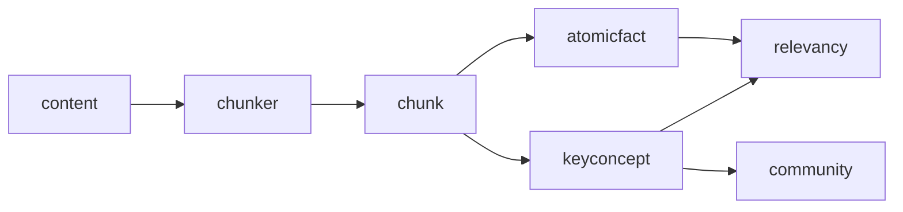

`@carlonicora/nestjs-neo4jsonapi` ships nine agents and the retrieval layer they
run on. They are wired by default: unless `apps/api/src/main.ts` passes
`bootstrap({ agents: false })`, `AgentsModule` is part of the application module
graph from the first boot.

This page describes the package's **shape** — which agents exist, how they are
mounted, what data they read, and where an app plugs in. The LLM layer under
them — `LLMService`, the provider adapters, model tiers, `AiConnection`
fallback chains — is covered by `06-ai/llm-layer.md`, and is not repeated here.

## `AgentsModule` and the module that is not in it

`packages/nestjs-neo4jsonapi/src/agents/agents.modules.ts` imports and exports
exactly eight modules:

| Module | Directory |
|---|---|
| `GraphModule` | `packages/nestjs-neo4jsonapi/src/agents/graph` |
| `CommunityDetectorModule` | `packages/nestjs-neo4jsonapi/src/agents/community.detector` |
| `CommunitySummariserModule` | `packages/nestjs-neo4jsonapi/src/agents/community.summariser` |
| `ContextualiserModule` | `packages/nestjs-neo4jsonapi/src/agents/contextualiser` |
| `DriftModule` | `packages/nestjs-neo4jsonapi/src/agents/drift` |
| `GraphCreatorModule` | `packages/nestjs-neo4jsonapi/src/agents/graph.creator` |
| `ResponderModule` | `packages/nestjs-neo4jsonapi/src/agents/responder` |
| `SummariserModule` | `packages/nestjs-neo4jsonapi/src/agents/summariser` |

`OperatorModule` is the ninth agent. It is exported from
`packages/nestjs-neo4jsonapi/src/agents/index.ts`, along with its controller,
service, context, checkpointer, prompts, tool registry and the `OPERATOR_TOOLS`
token — but `AgentsModule` does **not** import it. Nothing in the package
mounts it.

An app that wants the operator must import `OperatorModule` into one of its own
modules. Two consequences follow from doing so: `OperatorController` is mounted
(that is the point), and the module's `forwardRef(() => AssistantModule)` cycle
is pulled in, because the operator controller needs `AssistantService` while
`AssistantModule` needs `OperatorService`.

Several agent modules carry a deliberate non-import that is worth knowing before
you add one of your own: `DriftModule`, `ResponderModule`,
`CommunitySummariserModule` and `ContextualiserModule` all avoid importing
`CompanyModule` and provide `CompanyRepository` directly where they need it.
`CompanyModule` declares `CompanyController`, and importing it would mount
`companies/*` into every consumer — crashing any app that replaces the company
foundation with its own controller.

## The nine agents

### Graph

`packages/nestjs-neo4jsonapi/src/agents/graph`. Not a conversational agent but
the retrieval substrate the others sit on: the entity catalogue, the five graph
tools, and the tiered search behind them. `GraphSearchService.resolveEntity()`
runs three tiers — exact, fulltext (fuzzy) and semantic — returning candidates
from the highest-confidence tier that matched anywhere, with per-tier result
caps and a semantic score floor exported as `GRAPH_EXACT_MAX_RESULTS`,
`GRAPH_FUZZY_MAX_RESULTS`, `GRAPH_SEMANTIC_MAX_RESULTS` and
`GRAPH_SEMANTIC_MIN_SCORE`. The module is `@Global()` so that core-layer
retrieval can resolve the scope-predicate source without importing it.

### GraphCreator

`packages/nestjs-neo4jsonapi/src/agents/graph.creator`. The extraction agent:
one LLM call per chunk producing atomic facts, key-concept relationships and
key-concept descriptions in a single structured output. The schema is exported
as `graphCreatorOutputSchema` / `buildGraphCreatorOutputSchema`, and
`isValidKeyConcept` is the post-extraction gate. Because all three fields come
from one prompt, an app overriding `prompts.graphCreator` must **compose** on
top of the default rather than replace it — a facts-only replacement leaves the
other two fields uninstructed and they come back empty.

### Contextualiser

`packages/nestjs-neo4jsonapi/src/agents/contextualiser`. A LangGraph agent that
turns a question into retrieved context. Its entry node depends on history: a
first turn goes straight to the rational plan, every later turn is first
rewritten against the conversation by the question refiner. Its nodes pull from
atomic facts, key concepts and chunks; `RETRIEVAL_SOURCES` and
`CONTEXTUALISER_TOOLS` describe what each contributed.

### Drift

`packages/nestjs-neo4jsonapi/src/agents/drift`. DRIFT search: a HyDE step, a
community search, a primer answer, follow-up questions and a synthesis, as
LangGraph nodes. `DriftSearchService.search()` is the full run and
`quickSearch()` the short one. `DriftMigrationService` moves existing data into
the shape DRIFT needs.

### CommunityDetector

`packages/nestjs-neo4jsonapi/src/agents/community.detector`.
`detectCommunities()` projects the key-concept graph into Neo4j GDS and runs
Louvain at several levels. It checks GDS availability first and degrades rather
than failing when the plugin is absent, and it iterates scope roots so
detection is per-scope rather than global.

### CommunitySummariser

`packages/nestjs-neo4jsonapi/src/agents/community.summariser`. Turns a detected
community into a written summary, one LLM call per community, driven by a queue
(`community-summariser`) so a large graph does not block a request. Its credit
gate goes through the optional `CREDIT_VALIDATOR` seam.

### Responder

`packages/nestjs-neo4jsonapi/src/agents/responder`. The composition agent: a
planner node plus three retrieval branches — graph, contextualiser and drift —
and an answer node. Each branch is toggleable in two places, and
`resolveAllowedBranches()` allows a branch only when **both** the deployment
config (`responder.branches`) and the per-call flag say so. It emits
`EntityReference`s and a `UnifiedTrace`.

### Summariser

`packages/nestjs-neo4jsonapi/src/agents/summariser`. Map-reduce summarisation
over a document's chunks. The map phase is bounded to eight concurrent LLM
calls, because an unbounded fan-out over a long document opens hundreds of
simultaneous provider requests and holds every prompt in the heap at once.

### Operator

`packages/nestjs-neo4jsonapi/src/agents/operator`. The tool-using agent: a
LangGraph agent⇄tools loop capped at fifteen iterations before it is forced to
finalise, with a checkpointer for interrupted runs and destructive actions
gated behind an approval card. `OperatorCheckpointerService` carries
`OPERATOR_DEFAULT_APPROVAL_TTL_DAYS`. This is the agent that is exported but not
wired.

## The GraphRAG data layer

The agents do not invent their storage. Six foundations form one pipeline, and
the chain runs left to right:

| Stage | Foundation | What happens |
|---|---|---|
| source | `content` | the polymorphic record anything publishable is exposed as |
| extraction | `chunker` | loaders for pdf, docx, xlsx, pptx, email, markdown, csv, json; then splitting |
| storage | `chunk` | `Chunk` nodes; `ChunkProcessor` on the `chunk` queue drives the rest |
| facts | `atomicfact` | `AtomicFact` nodes written from the GraphCreator output |
| entities | `keyconcept` | `KeyConcept` nodes and the relationships between them, with weights |
| clustering | `community` | Louvain communities over the key-concept graph, then summaries |
| lookup | `relevancy` | the "related to this" query used across entity types |

`ChunkService` injects `GraphCreatorService` directly: persisting a chunk and
extracting its graph are one flow, not two. Embeddings are separate, on their
own queues with `concurrency: 1` and a thirty-minute lock, because embedding is
rate-limited by the provider rather than by the database:

| Processor | Queue |
|---|---|
| `ChunkEmbeddingProcessor` in `packages/nestjs-neo4jsonapi/src/foundations/chunk/processors/chunk.embedding.processor.ts` | `embedding-chunks` |
| `KeyConceptEmbeddingProcessor` in `packages/nestjs-neo4jsonapi/src/foundations/keyconcept/processors/keyconcept.embedding.processor.ts` | `embedding-keyconcepts` |

Neither queue name is in the `QueueId` enum; both are module-local constants.

## The entity catalogue

The agents do not carry a hand-written list of what your app contains. They read
it from the entity descriptors.

Every descriptor may declare a top-level `description` and an optional `chat`
block — see
`packages/nestjs-neo4jsonapi/src/common/interfaces/entity.schema.interface.ts`:

| Key | Effect on the catalogue |
|---|---|
| *(top-level)* `description` | **required for the entity to be visible to the LLM at all** |
| `chat.summary` | the one-line renderer used in search and traverse results |
| `chat.textSearchFields` | which described string fields the `text` parameter of `search_entities` searches |
| `chat.list` | the stage-one field set; everything else moves to `availableOnRead` |
| `chat.scope` | `"self"`, or the key of a relationship one hop closer to the scope root |
| `chat.writable` | whether the operator's generic write tools may mutate this type |
| `chat.related` | compiles a polymorphic chat-only `RELATES_TO` traversal in both directions |

`GraphCatalogService` in
`packages/nestjs-neo4jsonapi/src/agents/graph/services/graph.catalog.service.ts`
compiles those at application bootstrap into `CatalogEntity` records: filterable
and sortable field lists derived from field types, relationship descriptions,
money-unit markers, and — walking `chat.scope` hop by hop — a `CatalogScope`
chain per entity. `GraphDescriptorRegistry` is the source it loads from.

Five tools are built from the compiled catalogue, each a class in
`packages/nestjs-neo4jsonapi/src/agents/graph/tools` whose `.build(ctx,
recorder)` returns a LangChain `DynamicStructuredTool`:

| Tool | Purpose |
|---|---|
| `resolve_entity` | resolve a user-named thing across every visible type, returning ranked candidates from the best tier that matched |
| `search_entities` | find records of a known type by filter and sort |
| `describe_entity` | return the described fields and relationships of a type |
| `read_entity` | fetch one record by id, optionally pulling related records |
| `traverse` | walk a relationship from a known record, with filtering and sorting |

The tool descriptions chain them deliberately: `resolve_entity` says to call it
first whenever the user names a record, and `search_entities` says to resolve
first when a specific record is meant. `RelatedEdgesService` and
`ToolFieldFormatterService` shape what comes back, and bridge entities declared
with `bridge.materialiseTo` have their listed relationships auto-inlined with a
`__materialised` marker.

## Scope enforcement

An agent run may be confined to a scope root — one tenant-like subgraph. Four
pieces enforce it, and they are deliberately not in one place.

| Piece | File | Role |
|---|---|---|
| `ScopeGuard` | `packages/nestjs-neo4jsonapi/src/agents/graph/services/scope.guard.ts` | builds the `AND EXISTS { MATCH … }` clause and answers "is this node in scope" |
| `ScopePredicateService` | `packages/nestjs-neo4jsonapi/src/agents/graph/services/scope.predicate.service.ts` | supplies compiled predicates to the core layer |
| `AgentScopeFilterService` | `packages/nestjs-neo4jsonapi/src/common/repositories/agent-scope.filter.ts` | applies the predicate at each retrieval call site |
| `AI_SOURCE_QUERY` | `packages/nestjs-neo4jsonapi/src/common/repositories/ai-source-query.provider.ts` | the app's override point for the Cypher that binds the retrievable set |

`ScopeGuard` is **fail-closed**: in a scoped run, a type with no compiled scope
chain is treated as out of scope, because the alternative is a cross-scope leak.

The division of labour between the last two is the security property. An app can
replace the source query entirely through `AI_SOURCE_QUERY`. If the scope
predicate lived inside the default provider, replacing the provider would
silently drop scope enforcement — a fail-open seam guarding a security boundary.
Instead `AgentScopeFilterService` applies the filter at the call sites, on top of
whatever the provider returned. **An app's override cannot remove scope
enforcement.** The reasoning is written out in the header of
`packages/nestjs-neo4jsonapi/src/common/repositories/agent-scope.filter.ts`.

The scope for a turn is published through CLS, under `AGENT_SCOPE_CLS_KEY` in
`packages/nestjs-neo4jsonapi/src/common/types/agent.scope.ts`.

## Where an app plugs in

| Seam | Token or base class | Built |
|---|---|---|
| Operator tools | `OPERATOR_TOOLS`, a multi-provider token taking `OperatorToolContribution` factories | once per operator turn, with the request context and the per-turn recorder |
| MCP tools | `MCP_TOOLS`, taking `McpToolContribution` factories | once per MCP request, with the authenticated user context |
| Ad-hoc tools | subclass `AbstractTools` and decorate methods with `@Tool({ name, description, schema })` | `this.myTools.tools.someMethod` for one, `getTools()` for all |
| Prompts | `baseConfig.prompts`, typed by `packages/nestjs-neo4jsonapi/src/config/interfaces/config.prompts.interface.ts` | read by the agents at call time |
| Retrieval scope | `AI_SOURCE_QUERY` | at module registration |

Both tool tokens are built per-turn rather than once at startup, so a
contributed tool can apply company scoping and RBAC filtering from the request
context and record its calls into the same audit trail as the built-ins. An
`OperatorToolDefinition` marked `destructive` must supply a `summarise()`
function — that string is the approval card the user sees.

Prompts are configuration, not code. `ConfigPromptsInterface` carries
`graphCreator`, `contextualiser` (four sub-prompts), `responder` and the
structured-output field-description overrides for the graph creator and the
responder. Those description overrides matter more than they look: the strings
travel inline with the output contract, so a model weighs them at least as
heavily as a rule stated a thousand tokens earlier in the system prompt. An app
that overrides a prompt and leaves the schema descriptions alone has a prompt
arguing with its own schema. Two `contextualiser` keys, `chunk` and
`chunkVector`, are declared and documented as no longer read.

## The two bootstrap switches

| Option | Default | Effect |
|---|---|---|
| `bootstrap({ agents: false })` | agents on | `AgentsModule` is not imported. The app supplies its own AI, and loses the `community` foundation too, since nothing else registers it |
| `bootstrap({ mcp: true })` | MCP off | mounts `McpModule` at `POST /mcp`, OAuth-authenticated and RBAC-gated |

`McpModule` imports `OAuthModule`, `RbacPermissionModule` and `AgentsModule`,
and provides `SearchDocumentsTool` locally rather than importing
`OperatorModule` — importing it would drag in the `forwardRef` cycle.
`packages/nestjs-neo4jsonapi/docs/mcp-server.md` is the package's own write-up.

## The retrieval eval harness

`packages/nestjs-neo4jsonapi/src/eval/retrieval` is a self-contained harness for
measuring retrieval quality: `QuestionSetLoader` reads a question set,
`RetrievalSweepService` and `EndToEndSweepService` run it, `EvidenceMatcher`
scores whether the expected evidence came back, `RubricJudgeService` runs an
LLM-as-judge pass, `TokenAccountingChecker` verifies that what was billed
matches what was spent, and `renderSweepReport` formats the result.
`RetrievalEvalModule` wires them.

It is **not exported from the root barrel**, and `src/eval` has no entry in the
`exports` map. Nothing in an app can import it as shipped — it is reachable only
from inside the package, where its own specs under
`packages/nestjs-neo4jsonapi/src/eval/retrieval/__tests__` exercise it.
`06-ai/eval-and-cost.md` covers what it measures.

## Where to look

| File | Why |
|---|---|
| `packages/nestjs-neo4jsonapi/src/agents/agents.modules.ts` | the eight modules, and the absence of the ninth |
| `packages/nestjs-neo4jsonapi/src/agents/index.ts` | the full agent surface, including `OperatorModule` |
| `packages/nestjs-neo4jsonapi/src/agents/graph/services/graph.catalog.service.ts` | how a descriptor becomes a catalogue entry |
| `packages/nestjs-neo4jsonapi/src/common/interfaces/entity.schema.interface.ts` | the `chat` block, key by key |
| `packages/nestjs-neo4jsonapi/src/agents/graph/tools/tool.factory.ts` | `UserContext`, `ToolCallRecord` and the capture wrapper |
| `packages/nestjs-neo4jsonapi/src/common/repositories/agent-scope.filter.ts` | why scope is applied at the call site, not in the provider |
| `packages/nestjs-neo4jsonapi/src/agents/graph/services/scope.guard.ts` | the fail-closed rule |
| `packages/nestjs-neo4jsonapi/src/agents/operator/interfaces/operator.tool.interface.ts` | `OPERATOR_TOOLS` and the destructive-tool contract |
| `packages/nestjs-neo4jsonapi/src/mcp/interfaces/mcp.tool.interface.ts` | `MCP_TOOLS` and the tool definition shape |
| `packages/nestjs-neo4jsonapi/src/config/interfaces/config.prompts.interface.ts` | every prompt an app may override |

## Gaps and drift

- `OperatorModule` is exported from the agents barrel but imported by no package
  module. An app that expects `POST` operator routes to exist after `bootstrap()`
  gets nothing.
- `bootstrap({ agents: false })` also removes the `community` foundation, because
  `CommunityModule` is registered only by three agent modules and never by
  `FoundationsModule`.
- `src/eval` is not in the `exports` map and not re-exported by the root barrel,
  so the harness cannot be run from an app without changing the package.
- Two `prompts.contextualiser` keys, `chunk` and `chunkVector`, are declared and
  documented as ignored. Setting them changes nothing.
- The LLM layer itself — providers, model tiers, `AiConnection` fallback,
  mocking — is out of scope here and lives in `06-ai/llm-layer.md`.
- Agent behaviour is described from module wiring, service method signatures and
  the inline documentation. The LangGraph node-by-node execution of the
  contextualiser, DRIFT and responder graphs was not traced end to end.
