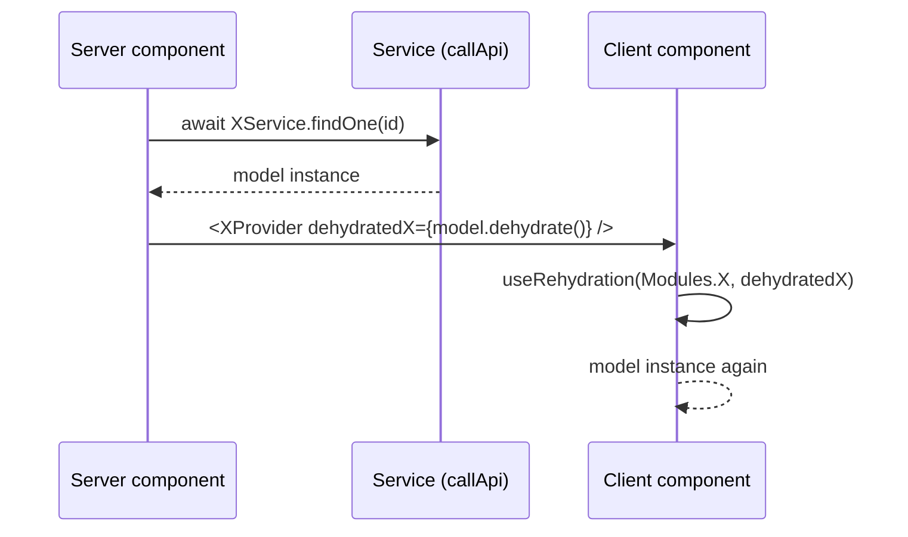

Everything the web app knows about the API passes through this layer: a model
class per resource, a service class per resource, two registries that connect
them, and one request path that works identically on the server and in the
browser. Written against `@carlonicora/nextjs-jsonapi` 4.0.4; a generated app
tracks `master`, not the pin in `versions.production.json`.

## AbstractApiData

`packages/nextjs-jsonapi/src/core/abstracts/AbstractApiData.ts` is the base class
every model extends. It implements `ApiDataInterface`
(`packages/nextjs-jsonapi/src/core/interfaces/ApiDataInterface.ts`).

| Member | Kind | Behaviour |
|---|---|---|
| `static identifierFields` | static field | defaults to `["name"]`; the attribute names joined to form `identifier` |
| `identifier` | getter | joins the values of `identifierFields` read off `_jsonApi.attributes`, skipping null and empty, with a single space |
| `_jsonApi` | protected field | the raw JSON:API resource object this instance was rehydrated from |
| `_included` | protected field | the raw `included` array of the response |
| `_id`, `_type`, `_createdAt`, `_updatedAt`, `_self` | protected fields | the backing values for the five base getters |
| `type` | getter | throws `Type is not set.` when `_type` is falsy |
| `id` | getter | throws `Id is not set.` when `_id` is falsy |
| `self` | getter | `_self` or `undefined`; taken from `links.self` |
| `createdAt`, `updatedAt` | getters | parsed from `meta.createdAt` / `meta.updatedAt`, falling back to `new Date()` |
| `included` | getter | `_included` or `[]` |
| `jsonApi` | getter | `_jsonApi` |
| `ingestJsonApi(data)` | method | empty hook a subclass may override |
| `generateApiUrl(params?)` | method | throws `Method not implemented.` unless overridden |
| `createJsonApi(data?)` | method | throws `Method not implemented.` unless overridden |
| `_readIncluded(data, type, dataType)` | protected | resolves one relationship from `included` |
| `_readIncludedPolymorphic(data, key, candidates)` | protected | resolves a relationship whose target class varies |
| `_readIncludedWithMeta(data, type, dataType)` | protected | resolves a relationship and merges its relationship-level meta |
| `dehydrate()` | method | returns `{ jsonApi, included }` — the wire form |
| `rehydrate(data)` | method | assigns `_jsonApi`/`_included`, derives `_type`, `_id`, `_createdAt`, `_updatedAt`, `_self`, returns `this` |

### The five-point contract

Every app model must honour all five. Four of the five fail loudly; the last
fails silently.

1. **Extend `AbstractApiData` and implement the matching interface.** The
   interface declares the getters; the class provides them. Nothing registers a
   model that does not extend the base — `DataClassRegistry` constructs it with
   `new` and calls `rehydrate` on the result.
2. **Private backing fields with throwing getters for required values.** The
   base class sets the pattern with `id` and `type`: a private `_x`, a getter
   that throws when the value is missing. A required attribute read before
   rehydration must fail at the read, not produce `undefined` three components
   later.
3. **`rehydrate()` calls `super.rehydrate(data)` first and returns `this`.**
   The base populates `_jsonApi`, `_included` and the five derived fields; the
   subclass then reads its own attributes and relationships off `data`. Skipping
   the `super` call leaves `id`, `type` and `identifier` throwing. The return
   type is `this`, and `RehydrationFactory` uses the return value, not the
   instance it constructed.
4. **`createJsonApi()` is overridden, or the base throws.** The base
   implementation is `throw new Error("Method not implemented.")`. Any POST,
   PUT or PATCH through `callApi()` without `overridesJsonApiCreation` runs
   `JsonApiDataFactory.create()`, which constructs the model and calls
   `createJsonApi(body)` — an un-overridden model turns every write into that
   error.
5. **`static identifierFields`.** This is the silent one. The default is
   `["name"]`; a model whose display field is not `name` gets an empty
   `identifier` and renders blank in selectors, breadcrumbs and table cells with
   no error anywhere.

### The three `_readIncluded*` helpers

All three take the hydrated `{ jsonApi, included, allData? }` shape and return
`undefined` when the relationship is absent, so a model can assign the result
straight to an optional field.

| Helper | Resolves | Extra behaviour |
|---|---|---|
| `_readIncluded` | one relationship to a single known model class, or an array of them | for a to-one miss, falls back to searching `data.allData` — the sibling resources of the same list page — before giving up |
| `_readIncludedPolymorphic` | a relationship whose target may be any of several classes | builds a `Map` from each candidate module's `name` to the module, then picks the module matching each included resource's `type`; unmatched entries are skipped; an empty array result becomes `undefined` |
| `_readIncludedWithMeta` | the same as `_readIncluded`, plus relationship meta | for arrays, merges each `relationships[type].data[].meta` into the corresponding entity; for a to-one, merges `relationships[type].meta`; also carries the `allData` fallback |

`allData` is set by `translateData` and `translateResponse`
(`packages/nextjs-jsonapi/src/core/utils/translateResponse.ts`) when the payload
is a list, and is what lets a list item resolve a sibling that the API returned
as primary data rather than as an inclusion.

## Crossing the server-to-client boundary

A model instance cannot be passed from a server component to a client component:
it is a class instance and React only serialises plain data. `dehydrate()` and
`rehydrate()` are the crossing.



The prop is named `dehydratedX` by convention, and every provider the package
ships follows it: `dehydratedCompany` on `CompanyProvider`, `dehydratedRole` on
`RoleProvider`, `dehydratedUser` on `UserProvider`, `dehydratedHowTo` on
`HowToProvider`. The client side rehydrates with `useRehydration` or
`useRehydrationList` (`packages/nextjs-jsonapi/src/client/hooks/useRehydration.ts`),
both of which are `useMemo` wrappers over `RehydrationFactory`.

### The two factories

| Factory | Method | What it does |
|---|---|---|
| `RehydrationFactory` | `rehydrate(classKey, data)` | looks the constructor up in `DataClassRegistry`, constructs it, calls `rehydrate(data)`, returns the result |
| | `rehydrateList(classKey, data[])` | the same, once per element |
| `JsonApiDataFactory` | `create(classKey, data)` | looks the constructor up, constructs an empty instance, calls `createJsonApi(data)` on it, returns the payload |

Both live in `packages/nextjs-jsonapi/src/core/factories/`. Note that
`JsonApiDataFactory.create` constructs a *throwaway* instance purely to reach the
model's serialisation method — `createJsonApi` must therefore work on an instance
that has never been rehydrated.

## AbstractService

`packages/nextjs-jsonapi/src/core/abstracts/AbstractService.ts`. Every service
extends it and exposes typed methods that assemble an endpoint and delegate to
`callApi`.

### `callApi()` parameters

| Parameter | Type | Purpose |
|---|---|---|
| `type` | `ApiRequestDataTypeInterface` | the module — supplies the model class for rehydration and the `cache` value. Always `Modules.X` |
| `method` | `HttpMethod` | `GET`, `POST`, `PUT`, `PATCH` or `DELETE` |
| `endpoint` | `string` | the path built by `EndpointCreator`, or a full `http…` URL (passed through unchanged) |
| `companyId` | `string?` | sent as the `x-companyid` header |
| `input` | `any?` | the request body, serialised through the model unless overridden |
| `overridesJsonApiCreation` | `boolean?` | skips `JsonApiDataFactory.create` and sends `input` as-is; honoured on POST and PATCH only |
| `next` / `previous` / `self` | ref objects | mutated in place with `links.next` / `links.prev` / `links.self` |
| `total` | ref object | mutated in place with `meta.total` |
| `responseType` | `ApiRequestDataTypeInterface?` | rehydrate the response as a different module than the request |
| `files` | `File`, `Blob`, or a keyed map | switches the request to `FormData` |
| `token` | `string?` | overrides the ambient token; ignored by a cached server GET, which never sends one |
| `suppressGlobalError` | `boolean?` | throw instead of routing the failure to the global handler |
| `baseUrl` | `string?` | per-call API base; ignored when `endpoint` starts with `http` |

### The five things `callApi()` does

1. **Dynamically imports** `packages/nextjs-jsonapi/src/unified/JsonApiRequest.ts`.
   The import is dynamic so the server-only branch of that module is never
   statically bundled into a client chunk — the same reason
   `packages/nextjs-jsonapi/tsup.config.ts` sets `splitting: true`.
2. **Resolves the language.** On the server it awaits the `getLocale` function
   the app passed to `configureI18n` (next-intl's, in this template), and throws
   `i18n not configured` when none was passed; the library itself no longer
   imports next-intl. In the browser it reads the first path segment, then
   `navigator.language`, then falls back to `"en"`. The result is sent as the
   `x-language` header.
3. **Dispatches on `method`** to `JsonApiGet`, `JsonApiPost`, `JsonApiPut`,
   `JsonApiPatch` or `JsonApiDelete`, each of which runs the bootstrapper, gets a
   token, builds the URL, makes the request and translates the response. An
   unknown method throws `Method not found`.
4. **Handles failure.** In the browser, with a global error handler registered
   and `suppressGlobalError` unset, it calls the handler and returns `undefined`.
   Otherwise it throws an `Error` whose message is `"<status>:<message>"` and
   which carries `status`, `digest` (`HTTP_<status>`, which Next.js preserves
   across the server boundary) and `body` (the raw error payload).
5. **Publishes pagination and meta on success.** It copies `next`, `prev` and
   `self` into whichever ref objects the caller passed, writes `meta.total` to
   the `total` ref, records the whole top-level `meta` (and its `total`) through
   `setLastApiResponse`, and returns `apiResponse.data`.

The last-response store lives in
`packages/nextjs-jsonapi/src/core/abstracts/lastApiResponse.ts`, a file with no
imports so both `AbstractService` and `ClientAbstractService` can write to it. It is
read by `getLastApiTotal()` and `getLastApiMeta()`, which is how
`useDataListRetriever` obtains a total and per-list aggregates without the service
signature carrying them. Both bases record **every** response, including one
without `meta`, so a list whose API returns no total never shows the previous
entity's.

### The other three entry points

| Method | Returns | Differences from `callApi` |
|---|---|---|
| `callApiWithMeta<T>` | `{ data, meta }` | no `next`/`previous`/`self`/`total` refs, no `token`, no `baseUrl`; returns the response meta instead of stashing it |
| `getRawData` | the untranslated response body | GET only; no rehydration, no model involvement — for endpoints that do not return JSON:API |
| `next<T>` / `previous<T>` | the next or previous page | public wrappers that call `callApi` with `GET` and the pagination URL the API returned |

`next` and `previous` are identical in body; both simply issue a GET against the
URL handed to them. The direction is entirely in which link the caller passes.

### ClientAbstractService

`packages/nextjs-jsonapi/src/core/abstracts/ClientAbstractService.ts` is a
`"use client"` near-copy of `AbstractService`: the same `next`/`previous`/
`callApi` shape, its own `ClientHttpMethod` enum, its own
`ClientNextRef`/`ClientPreviousRef`/`ClientSelfRef`/`ClientTotalRef` types, and
its own `setClientGlobalErrorHandler`/`getClientGlobalErrorHandler` pair.

The duplication is deliberate, and the file says so: *"Duplicated to avoid
importing from AbstractService which pulls in server code"*. `AbstractService`
reaches the server locale and the server request path; a client module that
imported it would drag that into the browser bundle. `ClientAbstractService`
instead calls `ClientJsonApiGet` and its siblings from
`packages/nextjs-jsonapi/src/client/JsonApiClient.ts` directly. It resolves the
locale from the URL only — there is no server branch to fall back on.

`useDataListRetriever` uses `ClientAbstractService` for every page turn.

## EndpointCreator

`packages/nextjs-jsonapi/src/core/endpoint/EndpointCreator.ts`. Never hand-write
an endpoint string; build it here.

| Member | Effect |
|---|---|
| `new EndpointCreator({ endpoint, id?, childEndpoint?, childId?, additionalParams? })` | seeds the query; `endpoint` may be a module or a raw string |
| `.endpoint(value)` | replaces the root segment |
| `.id(value)` | sets the root resource id |
| `.childEndpoint(value)` | appends a nested collection |
| `.childId(value)` | sets the nested resource id |
| `set additionalParams(list)` | replaces the query-parameter list wholesale |
| `.addAdditionalParam(key, value)` | appends one query parameter; `value` may be an array |
| `.limitToType(selectors)` | appends `include=<comma-joined>` |
| `.limitToFields(selectors)` | appends one `fields[<type>]=<comma-joined>` per `FieldSelector`; a no-op for an empty list |
| `.generate()` | assembles `root[/id][/child][/childId][?params]` |

Everything except `generate()` and the setter returns `this`, so the whole thing
chains.

**`generate()` does not URL-encode.** It interpolates each key and value
directly into `key=value` pairs joined with `&`. A parameter value containing
`&`, `=`, `#`, `?` or a space produces a malformed URL. Callers that pass free
text — a search term, a file name — must encode it themselves before handing it
over.

## Field selection and `inclusions`

`packages/nextjs-jsonapi/src/core/fields/FieldSelector.ts` holds three symbols:

| Symbol | What it is |
|---|---|
| `GetterKeys<T>` | a mapped type that keeps only the non-function keys of `T` — the data getters of a model interface |
| `FieldSelector<T>` | `{ type: string; fields: ReadonlyArray<GetterKeys<T>> }` |
| `createJsonApiInclusion<T>(dataType, fields)` | builds a `FieldSelector<T>` |

`GetterKeys` is what makes a sparse-fieldset list typo-proof: the field names are
checked against the model interface at compile time.

A module declares its selectors under `inclusions`, keyed by a scenario name.
The convention across the package is a key called `lists`, meaning "the fields
and inclusions a list view needs":

```ts
inclusions: {
  lists: {
    fields: [
      createJsonApiInclusion("users", [`name`, `email`, `avatar`, `title`]),
    ],
  },
},
```

Services apply it with the same two lines every time, guarded because
`inclusions` is optional:

```ts
if (Modules.Content.inclusions?.lists?.fields) endpoint.limitToFields(Modules.Content.inclusions.lists.fields);
if (Modules.Content.inclusions?.lists?.types) endpoint.limitToType(Modules.Content.inclusions.lists.types);
```

The idiom appears in the content, user, how-to and assistant-message services
under `packages/nextjs-jsonapi/src/features/`. `lists` is a convention, not a
framework-recognised key: `inclusions` is `Record<string, …>` in
`packages/nextjs-jsonapi/src/core/interfaces/ApiRequestDataTypeInterface.ts`, so
a service that reads a different key gets nothing and silently sends an
unrestricted request.

## The registries

### DataClassRegistry

`packages/nextjs-jsonapi/src/core/registry/DataClassRegistry.ts` maps a module to
its model constructor. Two details are load-bearing, and the file explains both
in comments:

- **Keyed by `key.name`, a string, not by object identity.** A `WeakMap` keyed on
  the module object was tried and failed: Next.js re-evaluates modules during
  navigation, producing new object instances with different identity, and the
  lookup missed. String keys survive HMR and re-evaluation.
- **Last registration wins.** An earlier version skipped re-registration, which
  pinned the registry to the first constructor the process ever saw. In
  development that made a long-lived `next dev` server keep rehydrating with the
  pre-edit class after any model change, so SSR produced a different tree from
  the freshly bundled client and React threw a hydration mismatch. Production is
  unaffected either way, because bootstrap runs once per process.

The class also offers `get` (throws `Class not registered for key: …. Ensure
bootstrap() was called.`), `getByJsonApiType` for polymorphic lookups,
`bootstrap(modules)` which registers every entry of a modules object, and
`clear()` for tests. `DataClass` is an alias of the same class kept for
compatibility.

`ModuleRegistrar` (same directory) is the older entry point: it reflects over a
class's static getters and registers each one's model. It guards itself with a
private `_isBootstrapped` flag and exposes `reset()`.

### ModuleRegistry, `Modules`, and the two interfaces

`packages/nextjs-jsonapi/src/core/registry/ModuleRegistry.ts` holds the module
objects themselves.

- **`FoundationModuleDefinitions`** declares every module the *package* ships —
  `S3`, `Auth`, `User`, `Company`, `Role`, the nine Stripe modules, the fourteen
  two-factor modules, the three RBAC modules, the six token-usage modules, and
  the rest.
- **`AppModuleDefinitions`** is declared **empty**. An app fills it by
  declaration merging; the template does so in `apps/web/src/types/modules.d.ts`,
  which reopens the `@carlonicora/nextjs-jsonapi/core` module and extends
  `AppModuleDefinitions` with `Omit<AllModuleDefinitions, keyof FoundationModuleDefinitions>`
  — the type derived from the app's own `allModules` object in
  `apps/web/src/config/Bootstrapper.ts`, so there is no second hand-maintained
  list.
- **`ModuleDefinitions`** is the intersection of the two, and is what `Modules.X`
  autocompletes against.

The map itself is pinned to `globalThis` under `Symbol.for("nextjs-jsonapi:modules")`.
The symbol avoids collisions with other globals; `globalThis` keeps the registry
alive across HMR and Turbopack module re-evaluation, which would otherwise drop
it and produce "Module not registered" errors during navigation.

`Modules` is a `Proxy` over an empty object. Reading `Modules.User` calls
`ModuleRegistry.get("User")`. Three property names are intercepted and return
functions instead: `findByName`, `findByModelName` and `findByFeature`. The
registry also offers `getAllPageUrls()` and `getAll()`.

Because the proxy resolves on *read*, `Modules.X` at module scope — a top-level
`const` in a file that is evaluated before bootstrap — throws. Read it inside a
function, a component body or a hook.

### The self-healing path

`get`, `findByName`, `findByModelName`, `getAllPageUrls` and `getAll` all call
`tryBootstrap()` when the lookup misses or the map is empty, then retry. The
error raised after a failed retry is specific:

- bootstrapper registered → *"Bootstrap was called but module still not found.
  Check module registration."*
- no bootstrapper → *"No bootstrapper registered. Ensure
  configureJsonApi({ bootstrapper }) is called before accessing modules."*

### The bootstrap store

`packages/nextjs-jsonapi/src/core/registry/bootstrapStore.ts` has no imports at
all, which is what keeps `ModuleRegistry` free of a circular dependency. It pins
two values to `globalThis` under `Symbol.for("nextjs-jsonapi:bootstrapper")` and
`Symbol.for("nextjs-jsonapi:bootstrapAttempted")`, and exports `setBootstrapper`,
`getBootstrapper`, `tryBootstrap`, `hasBootstrapper` and `resetBootstrapStore`.
`tryBootstrap()` returns `false` immediately once it has been attempted with no
bootstrapper available, so a missing configuration costs one attempt, not one per
lookup. The bootstrapper is expected to be idempotent; the template's
`bootstrap()` guards itself with a module-level `bootstrapped` flag and registers
itself via `setBootstrapper(bootstrap)` at the bottom of
`apps/web/src/config/Bootstrapper.ts`.

## Pagination

The API returns `links.self`, `links.next` and `links.prev`.
`translateResponse` copies them onto the response and, when a
`paginationHandler` was supplied, also attaches `nextPage()` / `prevPage()`
closures that re-issue the same request against the new URL. `callApi` then
copies the raw link strings into the caller's ref objects.

`useDataListRetriever` (`packages/nextjs-jsonapi/src/hooks/useDataListRetriever.ts`)
is the hook that drives a list. It returns:

| Field | Purpose |
|---|---|
| `data`, `isLoaded`, `total`, `meta` | the current page and its aggregates |
| `next(onlyNewRecords?)`, `previous(onlyNewRecords?)` | turn the page via `ClientAbstractService.next`/`.previous` |
| `search(term)`, `isSearch` | refine the list |
| `refresh()` | re-run the current query |
| `addAdditionalParameter(key, value)`, `removeAdditionalParameter(key)` | mutate the query parameters |
| `setRefreshedElement(el)`, `removeElement(el)` | patch one row without a round trip |
| `ready`, `setReady` | defer the first fetch |
| `pageInfo` | `{ startItem, endItem, pageSize }` |

`pageInfo` is derived rather than reported: the hook parses `page[offset]` and
`page[size]` out of the `next` and `prev` URLs and works the current window
backwards from them, defaulting `pageSize` to 25 when neither link exists.
`removeElement` correspondingly rewrites the stored pagination URLs by a delta so
the following page does not skip a row. The hook also guards against concurrent
fetches and concurrent page turns with two refs, and stamps each request with an
incrementing id so a late response cannot overwrite a newer one.

## Error handling

| Layer | Behaviour |
|---|---|
| `serverRequest` / `directFetch` | a thrown fetch (the API unreachable) returns `{ ok: false, status: 503, statusText: "Service Unavailable", data: undefined }` rather than propagating, so it is distinguishable from a 500 the API returned |
| `cachedServerGet` | a non-OK response or an unreachable API **throws**, so Next does not store the entry; the status rides in `error.digest` as `HTTP_<status>`. `serverRequest` catches it outside the cache scope and turns it back into `{ ok: false, status }` with `statusFromDigest`, defaulting to 503 |
| `translateResponse` | on `!ok`, sets `error` from `data.message`, then `data.error`, then `statusText` — the body is the only reliable source because HTTP/2 removed the reason phrase — and returns early with `raw` set |
| `translateResponse` | a 204, and a success with a null or undefined body, translate to an empty success rather than crashing on `.included` |
| `callApi` | global handler, or a throw carrying `status`, `digest` and `body` (see above) |

**`translateResponse` swallows rehydration failures.** The whole translation
block — link extraction, the list loop, the single-resource branch — is wrapped
in a `try`/`catch` whose body is `console.error(e)`. A model whose `rehydrate()`
throws therefore produces a **successful** response with `data` still at its
initial `[]`, and the only trace is a line in the console. A list that renders
empty with a stack trace in the terminal and a 200 in the network tab is this,
every time.

## Caching

Caching is server-side only, and since 4.0 it is Cache Components caching
(`"use cache"`), not `fetch` options. `makeRequest` in
`packages/nextjs-jsonapi/src/unified/JsonApiRequest.ts` branches on
`typeof window`: the browser goes to `directFetch`
(`packages/nextjs-jsonapi/src/client/request.ts`), which has **no caching at
all**; the server goes to `serverRequest`
(`packages/nextjs-jsonapi/src/server/request.ts`).

`serverRequest` splits on two conditions:

- **A GET whose module declares `cache`** goes to `cachedServerGet`
  (`packages/nextjs-jsonapi/src/server/cachedGet.ts`), a `"use cache"` function.
  Its arguments are the cache key — URL, `cache`, language, company id, static
  headers — so it **never carries the token**. `JsonApiGet` does not even read the
  token cookie on that path, because the read would make a public page dynamic.
- **Everything else** — an uncached GET, every POST, PUT, PATCH and DELETE — is a
  plain uncached `fetch` that sends the token.

Inside `cachedServerGet` the `cache` value is read like this:

| `cache` value | Applied |
|---|---|
| `"seconds"`, `"minutes"`, `"hours"`, `"days"`, `"weeks"`, `"max"`, `"default"` | `cacheLife(<that profile>)` |
| any other string | `cacheTag(<that string>)` and `cacheLife("max")` |
| unset | not cached: the plain `fetch` path, with the token |

The seven profile names are `CACHE_PROFILES` in
`packages/nextjs-jsonapi/src/server/cacheProfiles.ts`. So a module declaring
`cache: "help"` is not asking for a profile — it is declaring a **cache tag**,
kept for the `max` life until something invalidates it. That is how the template's
help pages cache their reads (see `docs/handbook/04-frontend/app-shell-and-routing.md`,
which also explains why those reads wait for `connection()`).

**Only set `cache` on a module whose GETs are the same for every user.** The
cached call goes out without `Authorization`, so an endpoint that needs a token
fails on it, and the result is shared by every caller that sends the same key.

Tagged entries are invalidated from a server action or route handler with
`invalidateCacheTag(tag, profile?)` or `invalidateCacheTags(tags, profile?)` from
`packages/nextjs-jsonapi/src/server/cache.ts`. Both wrap `revalidateTag` and
default the profile to `"max"`, which Next.js 16 requires. With `"max"` the entry
is marked stale and served stale-while-revalidate: the next request still gets the
old data. A Server Action that must read its own write uses `updateCacheTag(tag)`,
which wraps `updateTag` and expires the entry at once (Server Actions only).

The route-segment exports that used to control caching (`export const revalidate`,
`dynamic` and the rest) are errors under Cache Components; caching is declared on
the module instead.

## Where to look

| File | Why |
|---|---|
| `packages/nextjs-jsonapi/src/core/abstracts/AbstractApiData.ts` | the model base class and the three `_readIncluded*` helpers |
| `packages/nextjs-jsonapi/src/core/abstracts/AbstractService.ts` | `callApi`, `callApiWithMeta`, `getRawData`, the global error handler |
| `packages/nextjs-jsonapi/src/core/abstracts/ClientAbstractService.ts` | the deliberate client-side duplicate |
| `packages/nextjs-jsonapi/src/unified/JsonApiRequest.ts` | `configureJsonApi`, `buildUrl`, the five verb functions, the server/client branch |
| `packages/nextjs-jsonapi/src/core/utils/translateResponse.ts` | response translation, and the `catch` that swallows rehydration errors |
| `packages/nextjs-jsonapi/src/core/registry/ModuleRegistry.ts` | the module map, the `Modules` proxy, the two definition interfaces |
| `packages/nextjs-jsonapi/src/core/registry/DataClassRegistry.ts` | the model map and the two comments that explain its design |
| `packages/nextjs-jsonapi/src/core/registry/bootstrapStore.ts` | the self-healing bootstrap path |
| `packages/nextjs-jsonapi/src/server/request.ts` | the split between the cached GET and the plain `fetch` |
| `packages/nextjs-jsonapi/src/server/cachedGet.ts` | `cachedServerGet`: the `"use cache"` scope, profile versus tag |
| `packages/nextjs-jsonapi/src/server/cache.ts` | `invalidateCacheTag(s)` and `updateCacheTag` |
| `apps/web/src/config/Bootstrapper.ts` | the app's registration of every module and its `setBootstrapper` call |

## Gaps and drift

- The `cache` values that are not one of the seven reserved names become cache
  tags with the `max` life. The type of `cache` in
  `packages/nextjs-jsonapi/src/core/interfaces/ApiRequestDataTypeInterface.ts` is
  a plain `string` and does not say so, nor that a cached GET is sent without the
  token. `packages/nextjs-jsonapi/README.md` documents both since 4.0.3; the type
  still does not.
- `AbstractService.getClientLocale` and its twin in `ClientAbstractService`
  validate against a hard-coded `supportedLocales = ["en"]`. An app that adds a
  locale must change the package, not its own configuration — the array is not
  read from `configureI18n`.
- `translateResponse` reports success for a payload it failed to rehydrate. No
  caller can distinguish that from an empty result set.
- Not examined: `packages/nextjs-jsonapi/src/server/ServerSession.ts` and the
  token modules on both sides (covered by the frontend auth chapter); the
  internals of `useJsonApiGet` and `useJsonApiMutation` beyond their result
  types; the D3 and BlockNote helpers re-exported through `./core`.
