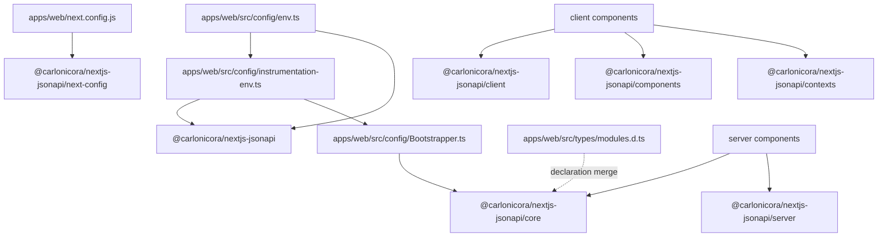

`@carlonicora/nextjs-jsonapi` is the Next.js half of the framework. It is consumed
as `workspace:*` from `apps/web/package.json` and lives in the repository as a git
submodule at `packages/nextjs-jsonapi`. This page was written against version
4.0.4 of the package; `.gitmodules` tracks `master`, so a freshly scaffolded app
gets whatever `master` holds rather than the version pinned in
`versions.production.json`.

The package has **one** public surface: the `exports` map in
`packages/nextjs-jsonapi/package.json`. Nothing else is importable. Fifteen
subpaths resolve to JavaScript bundles, and a sixteenth resolves to a stylesheet.
Deep imports (`@carlonicora/nextjs-jsonapi/src/…`, `…/dist/…`) are not exports
and will not resolve.

## The entry points

`onSuccess` in `packages/nextjs-jsonapi/tsup.config.ts` prepends `"use client"`
to the built files of nine entries (both the `.js` and `.mjs` output of each).
An entry that carries the banner may only be imported from a client component or
from another client module; an entry without it is safe in a server component,
a route handler and `apps/web/src/proxy.ts`.

| Subpath | Barrel source | Banner | What it is for |
|---|---|---|---|
| `.` | `packages/nextjs-jsonapi/src/index.ts` | server-safe | app-wide configuration calls and the `/core` re-export |
| `./core` | `packages/nextjs-jsonapi/src/core/index.ts` | server-safe | models, services, registries, interfaces, module factories |
| `./server` | `packages/nextjs-jsonapi/src/server/index.ts` | server-safe | session, token, cache invalidation, `Server*Service` aliases |
| `./cached-get` | `packages/nextjs-jsonapi/src/server/cachedGet.ts`, or `packages/nextjs-jsonapi/src/server/cachedGet.stub.ts` outside the `react-server` condition | server-safe | `cachedServerGet`, the token-free `"use cache"` GET, and `statusFromDigest` |
| `./client` | `packages/nextjs-jsonapi/src/client/index.ts` | `"use client"` | the provider, every hook, the browser request path |
| `./components` | `packages/nextjs-jsonapi/src/components/index.ts` | `"use client"` | the whole component library, including the UI primitives |
| `./contexts` | `packages/nextjs-jsonapi/src/contexts/index.ts` | `"use client"` | every React provider and the Jotai atoms |
| `./contexts/styles.css` | emitted from the `contexts` entry | n/a | the CSS the onboarding tour imports |
| `./testing` | `packages/nextjs-jsonapi/src/testing/index.ts` | `"use client"` | mock providers, factories, matchers, RTL re-exports |
| `./billing` | `packages/nextjs-jsonapi/src/billing/index.ts` | `"use client"` | the Stripe component set, kept off `./components` |
| `./help` | `packages/nextjs-jsonapi/src/features/help/index.ts` | `"use client"` | the help-centre client primitives |
| `./help/server` | `packages/nextjs-jsonapi/src/features/help/server-entry.ts` | server-safe | `HELP_MODES` and the article types, for server pages |
| `./tokenusage` | `packages/nextjs-jsonapi/src/features/tokenusage/index.ts` | `"use client"` | the token-usage dashboards and their charts |
| `./analytics` | `packages/nextjs-jsonapi/src/features/analytics/index.ts` | `"use client"` | the first-party analytics tracker, admin containers and charts |
| `./analytics/server` | `packages/nextjs-jsonapi/src/features/analytics/server-entry.ts` | server-safe | `AnalyticsAdminPage` and `AnalyticsJourneyPage`, async server pages |
| `./next-config` | `packages/nextjs-jsonapi/src/next-config/index.ts` | server-safe | `createNextConfig`, `buildCsp` and the `CspService`/`CspDirective` types, for `apps/web/next.config.js` |

The `./contexts/styles.css` subpath exists because
`packages/nextjs-jsonapi/src/features/onboarding/contexts/OnboardingContext.tsx`
imports `shepherd.js/dist/css/shepherd.css` and
`packages/nextjs-jsonapi/src/features/onboarding/styles/onboarding.css`. tsup
collects both into the `contexts` entry's stylesheet, and the app imports that
path to get the tour styling.

`./cached-get` is the one subpath with a conditional export. Under the
`react-server` condition it resolves to the real `"use cache"` function; every
other bundle (client components, their SSR pass, plain Node) gets a stub that
throws. `serverRequest` imports it through the package's own export rather than a
relative path for exactly this reason: a relative import would put `"use cache"`
into the client bundles that reach the shared request code.

`./next-config` is loaded by `next.config.js` through `require` at runtime under
`next start`, in an image installed with `--prod`. It therefore imports nothing but
Node built-ins: never next-intl, `@next/mdx`, serwist or any devDependency.

### The `/core` rule

The rule that matters most in day-to-day work: **a module registration file must
import from `./core`, never from `.` or a feature barrel.** The app's
`apps/web/src/config/Bootstrapper.ts` is evaluated on the server as well as the
client, and every symbol it needs — the module factories, `ModuleRegistry`,
`DataClassRegistry`, `setBootstrapper` — is exported from `./core` precisely so
that file never pulls a client bundle. Five comments in
`packages/nextjs-jsonapi/src/core/index.ts` record the same reasoning for
`ai-connection`, `tokenusage-admin.module`, `tokenusage.modules`,
`analytics.modules` and `lib/config`: the administrative modules are exported from `core` rather than only from their client-marked
feature barrel, because a bootstrapper needs them and must not drag their
charting code in.

Two features go further and are deliberately **absent** from the main barrel:

- `help` — `packages/nextjs-jsonapi/src/index.ts` states that consumers must
  reach it through `@carlonicora/nextjs-jsonapi/help`, to keep the client
  contexts and the server-only utilities out of the main client bundle.
- `tokenusage` — kept off the main barrel so `recharts` stays out of it, with
  `configureTokenUsage()` escaping to `./core` because it is called from the
  app's bootstrap file.
- `analytics` — off the main barrel for the same chart reason; its module
  bundle, `analyticsModules`, is exported from `./core` so a bootstrapper can
  register it. The feature is inert until the app mounts `AnalyticsTracker`; this
  template registers the modules but does not mount the tracker.

`./unified` is likewise not exported. The main barrel's opening comment says why:
it holds dynamic imports of server code that cannot be bundled with client
components. Services reach it through relative imports instead.

## What each entry point exports

### `.` — configuration

| Kind | Symbols | Declaring file |
|---|---|---|
| Re-export | everything in `./core` and `./permissions` | `packages/nextjs-jsonapi/src/core/index.ts` |
| API config | `configureJsonApi`, `getApiUrl`, `getPublicApiUrl`, `getAppUrl`, `getTrackablePages`, `getStripePublishableKey` | `packages/nextjs-jsonapi/src/client/config.ts` |
| i18n config | `configureI18n`, type `I18nConfig` | `packages/nextjs-jsonapi/src/i18n/index.ts` |
| Login config | `configureLogin`, type `LoginConfig` | `packages/nextjs-jsonapi/src/login/index.ts` |
| Roles config | `configureRoles`, `getRoleId`, `isRolesConfigured`, type `RoleIdConfig` | `packages/nextjs-jsonapi/src/roles/index.ts` |
| Auth config | `configureAuth`, `getTokenHandler`, types `TokenHandler`, `TokenParams` | `packages/nextjs-jsonapi/src/features/auth/config.ts` |
| Waitlist config | `configureWaitlist`, `getWaitlistConfig`, types `WaitlistConfig`, `QuestionnaireField`, `QuestionnaireFieldType`, `QuestionnaireOption` | `packages/nextjs-jsonapi/src/features/waitlist/config/waitlist.config.ts` |
| Referral config | `configureReferral`, `getReferralConfig`, `isReferralEnabled`, type `ReferralConfig` | `packages/nextjs-jsonapi/src/features/referral/config.ts` |
| Toasts | `showToast`, `showError`, `dismissToast`, `showCustomToast`, type `ToastOptions` | `packages/nextjs-jsonapi/src/utils/toast.ts` |
| Feature data | the RBAC, assistant and assistant-message data classes and modules | `packages/nextjs-jsonapi/src/features/rbac/data/index.ts` and siblings |

Two files in the app call this surface. `apps/web/src/config/instrumentation-env.ts`
runs `bootstrap()`, then `configureJsonApi`, `configureAuth`, `configureRoles` and
`configureLogin`, and imports `apps/web/src/config/waitlist.config.ts` for its side
effect. `apps/web/src/config/env.ts` re-exports `ENV` from it and adds only
`configureI18n`.

The split exists because of a 4.0 breaking change: `configureI18n` now requires
`getLocale`, which the app passes from `next-intl/server`. The library no longer
imports next-intl for the server locale; `callApi` reads it through that function.
next-intl's `getLocale` reaches the app's `apps/web/src/i18n/request.ts`, which reads
`next/root-params`, a module Next allows only inside the app directory. So
`apps/web/src/instrumentation.ts` imports `instrumentation-env.ts`, never `env.ts`.

### `./core` — the data layer

| Kind | Symbols | Declaring file |
|---|---|---|
| Environment | `ENV` | `packages/nextjs-jsonapi/src/core/env.ts` |
| Interfaces | `ApiData`, `ApiDataInterface`, `ApiRequestDataTypeInterface`, `ApiResponseInterface`, `JsonApiHydratedDataInterface` | `packages/nextjs-jsonapi/src/core/interfaces/index.ts` |
| Abstracts | `AbstractApiData`, `AbstractService`, `HttpMethod`, `ClientAbstractService`, `ClientHttpMethod`, the four ref types | `packages/nextjs-jsonapi/src/core/abstracts/index.ts` |
| Factories | `JsonApiDataFactory`, `RehydrationFactory` | `packages/nextjs-jsonapi/src/core/factories/index.ts` |
| Registries | `DataClassRegistry`, `ModuleRegistry`, `Modules`, `ModuleRegistrar`, `FoundationModuleDefinitions`, `AppModuleDefinitions`, `setBootstrapper`, `tryBootstrap` | `packages/nextjs-jsonapi/src/core/registry/index.ts` |
| Endpoints | `EndpointCreator`, type `EndpointQuery` | `packages/nextjs-jsonapi/src/core/endpoint/index.ts` |
| Field selection | `FieldSelector`, `GetterKeys`, `createJsonApiInclusion` | `packages/nextjs-jsonapi/src/core/fields/FieldSelector.ts` |
| Translation | `translateData`, `translateResponse`, `rehydrate`, `rehydrateList` | `packages/nextjs-jsonapi/src/core/utils/index.ts` |
| Shared interfaces | breadcrumb and D3 node/link types | `packages/nextjs-jsonapi/src/interfaces/index.ts` |
| Utilities | `cn`, `formatDate`, `formatLocalDate`, `exists`, `getInitials`, `useIsMobile` with `MOBILE_BREAKPOINT` and `VIEWPORT_COOKIE_NAME`, `entityObjectSchema`, `userObjectSchema`, the icon helpers, the BlockNote diff helpers | `packages/nextjs-jsonapi/src/utils/index.ts` |
| Permissions | `Action`, `ModuleFactory`, `ModuleWithPermissions`, `PermissionConfig`, `PermissionUser`, `checkPermissions`, `checkPermissionsFromServer` | `packages/nextjs-jsonapi/src/permissions/index.ts` |
| Foundation modules | every `*Module` factory and its data classes for the 40-odd foundations the package ships | `packages/nextjs-jsonapi/src/core/index.ts` re-exports each feature's `*.module.ts` and `data/` barrel |

### `./server`

| Kind | Symbols | Declaring file |
|---|---|---|
| Cache | `invalidateCacheTag`, `invalidateCacheTags`, `updateCacheTag`, `CACHE_PROFILES`, type `CacheProfile` | `packages/nextjs-jsonapi/src/server/cache.ts` |
| Request | `serverRequest`, `ServerRequestParams` | `packages/nextjs-jsonapi/src/server/request.ts` |
| Session | `ServerSession`, type `SessionSnapshot` | `packages/nextjs-jsonapi/src/server/ServerSession.ts` |
| Token | `getServerToken` and friends | `packages/nextjs-jsonapi/src/server/token.ts` |
| Request verbs | `ServerJsonApiGet`, `ServerJsonApiPost`, `ServerJsonApiPut`, `ServerJsonApiPatch`, `ServerJsonApiDelete` | `packages/nextjs-jsonapi/src/server/JsonApiServer.ts` |
| Service aliases | `ServerAuthService`, `ServerUserService`, `ServerCompanyService`, `ServerRoleService`, `ServerContentService`, `ServerNotificationService`, `ServerFeatureService`, `ServerPushService`, `ServerS3Service` | aliased from each feature's `data/*.service.ts` |

The nine `Server*Service` names are aliases of the same isomorphic service
classes the client uses, not separate implementations. They exist so a server
component can name the server intent at the import site.

`ServerSession.read()` is new in 4.0. It returns a `Promise<SessionSnapshot>` —
`{ isLogged, isAdministrator, token?, sidebarOpen, isMobile }`, built from the
cookies, the viewport cookie and the user agent — and is meant to be called, never
awaited, in a synchronous shell component. The promise goes to `SessionProvider`,
`ViewportProvider`, `SocketProvider` and `SidebarProvider`; see
`docs/handbook/04-frontend/app-shell-and-routing.md` for how the template uses it.

### `./client`

| Kind | Symbols | Declaring file |
|---|---|---|
| Provider | `JsonApiProvider`, `JsonApiContext` | `packages/nextjs-jsonapi/src/client/context/index.ts` |
| Data hooks | `useJsonApiGet`, `useJsonApiMutation`, `useRehydration`, `useRehydrationList` | `packages/nextjs-jsonapi/src/client/hooks/index.ts` |
| Request verbs | `ClientJsonApiGet` and the four siblings, `directFetch` | `packages/nextjs-jsonapi/src/client/JsonApiClient.ts`, `packages/nextjs-jsonapi/src/client/request.ts` |
| Token | `getClientToken` and friends | `packages/nextjs-jsonapi/src/client/token.ts` |
| Config | the same configuration getters the main barrel re-exports | `packages/nextjs-jsonapi/src/client/config.ts` |
| All hooks | everything in `packages/nextjs-jsonapi/src/hooks/index.ts` | see the components page |
| Feature hooks | the content, role, user, OAuth and subscription-status hooks | `packages/nextjs-jsonapi/src/features/*/hooks/` |

Importing `./client` has a **side effect**: the barrel registers six table
generators (`roles`, `users`, `companies`, `stripe-products`, `stripe-prices`,
`waitlists`) with `registerTableGenerator`. A table for one of those modules only renders
because something in the tree imported `./client` first.

### `./components`, `./contexts`, `./billing`, `./testing`, `./help`, `./tokenusage`, `./analytics`

These are covered in detail on the components-and-hooks and tooling pages. In
outline: `./components` re-exports thirteen local component groups plus eighteen
feature component barrels, four RBAC components and the whole UI primitive set;
`./contexts` re-exports nine feature contexts, twelve local contexts (including
`SessionProvider`/`useSession` and `ViewportProvider`) and the Jotai atoms; `./billing` is
nine Stripe component barrels split out so Stripe.js is not loaded globally;
`./testing` is the mock kit; `./help`, `./tokenusage` and `./analytics` are
self-contained feature surfaces with their own i18n key constants.

## How the app consumes it

## Where to look

| File | Why |
|---|---|
| `packages/nextjs-jsonapi/package.json` | the `exports` map — the definition of the public surface |
| `packages/nextjs-jsonapi/tsup.config.ts` | the 16 entries and the `"use client"` banner list |
| `packages/nextjs-jsonapi/src/index.ts` | the main barrel, with the comments on what it deliberately omits |
| `packages/nextjs-jsonapi/src/core/index.ts` | the server-safe surface and the five comments explaining placements |
| `packages/nextjs-jsonapi/src/client/index.ts` | the client surface and its six table-generator registrations |
| `packages/nextjs-jsonapi/src/server/index.ts` | the server surface and the nine `Server*Service` aliases |
| `packages/nextjs-jsonapi/src/components/index.ts` | the component surface |
| `packages/nextjs-jsonapi/src/contexts/index.ts` | every provider the package ships |
| `packages/nextjs-jsonapi/src/server/ServerSession.ts` | `read()` and the `SessionSnapshot` shape |
| `packages/nextjs-jsonapi/src/next-config/index.ts` | what `createNextConfig` sets |
| `packages/nextjs-jsonapi/docs/migrating-to-4.0.md` | the 4.0 breaking changes and the session-shell recipe |
| `apps/web/src/config/instrumentation-env.ts` | the app's call site for every configuration function but `configureI18n` |
| `apps/web/src/config/env.ts` | `configureI18n`, with `getLocale` |
| `apps/web/src/config/Bootstrapper.ts` | the `/core`-only import that keeps bootstrap server-safe |

## Gaps and drift

- `packages/nextjs-jsonapi/CLAUDE.md` describes a package structure with
  `components/table/`, `components/form/` and `components/dialog/` directories.
  The real directories are `components/tables/`, `components/forms/` and the
  dialog primitives under `shadcnui/ui/`.
- `ServerAbstractService` is declared in
  `packages/nextjs-jsonapi/src/core/abstracts/ServerAbstractService.ts` but is
  not re-exported by `packages/nextjs-jsonapi/src/core/abstracts/index.ts` or by
  any barrel, so it is unreachable from outside the package.
- `configureClientConfig` in `packages/nextjs-jsonapi/src/client/config.ts`
  carries a `@deprecated` marker and is still exported through `./client`.
- `packages/nextjs-jsonapi/README.md` lists every subpath in the `exports` map;
  `packages/nextjs-jsonapi/CLAUDE.md` and
  `packages/nextjs-jsonapi/docs/migrating-to-4.0.md` cover all but `./analytics`.
- Not examined: the individual symbol lists of the eighteen feature component
  barrels re-exported by `./components`, and the runtime behaviour of the
  `./contexts/styles.css` emission. Both were read at barrel level only.
