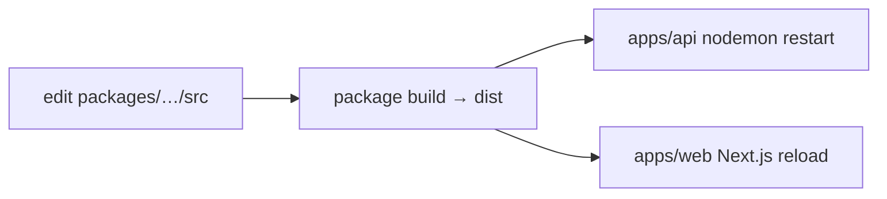

`{{display}}` is built on two published libraries that live inside the repository
as git submodules:

| Package | Workspace path | Version read for this page |
|---|---|---|
| `@carlonicora/nestjs-neo4jsonapi` | `packages/nestjs-neo4jsonapi` | 4.2.0 |
| `@carlonicora/nextjs-jsonapi` | `packages/nextjs-jsonapi` | 4.0.4 |

A generated app tracks the packages' `master` branches, not the versions pinned
in `versions.production.json`, so the numbers above are the versions at the time
this page was written, not a contract. Read each package's own `package.json`
for the version your checkout actually has.

## What each side owns

The split is not "library versus app". It is "everything that is the same in
every app the framework generates" versus "the parts only this app knows".

| Owned by the packages | Owned by `apps/api`, `apps/web`, `packages/shared` |
|---|---|
| The boot sequence, the module graph, the DI container wiring | The list of feature modules handed to `bootstrap()` |
| The {json:api} wire format in both directions | The entity descriptors that say what this app's data looks like |
| Neo4j query building, company scoping, cursor pagination | The Cypher that is specific to a feature |
| 43 foundation modules — identity, tenancy, RBAC, billing, storage, notifications, the knowledge graph | Which foundations are excluded and which are extended |
| The LLM layer, nine agents and the MCP server | Prompts, model choices and tool contributions passed as configuration |
| The React data layer, the model/service/module-factory contract, the UI kit | Routes, pages, translations, theme tokens |
| The three code generators and the runtime Neo4j migrator | The migration files under `apps/api/src/neo4j.migrations` |
| Module and role identifier *types* | The module and role identifier *values*, in `packages/shared` |

The boundary is enforced by the import direction: app code imports from the
packages, and no package imports from an app. Everything an app needs to change
inside the framework is reached through a configuration option, an injection
token, or a subclass — never by editing the package in place.

## Which package supplies which subsystem

| Subsystem | Package | Entry point |
|---|---|---|
| Application bootstrap, app mode, worker providers | nestjs-neo4jsonapi | `bootstrap()` |
| Neo4j access, query building, entity mapping | nestjs-neo4jsonapi | `AbstractRepository` |
| {json:api} serialisation (server) | nestjs-neo4jsonapi | `AbstractJsonApiSerialiser` |
| {json:api} deserialisation and rehydration (client) | nextjs-jsonapi | the model contract |
| HTTP calls from the browser and from React server components | nextjs-jsonapi | `callApi()` |
| Entity descriptors, constraints, fulltext indexes | nestjs-neo4jsonapi | `defineEntity()` |
| Multi-tenancy and company scoping | nestjs-neo4jsonapi | `SecurityService` + CLS |
| Authentication, two-factor, OAuth | nestjs-neo4jsonapi | the `auth`, `two-factor` and `oauth` foundations |
| RBAC engine and matrix reconciliation | nestjs-neo4jsonapi | the `rbac` foundation |
| Client-side permission gating | nextjs-jsonapi | the session and access-control layer |
| Queues, processors, crons | nestjs-neo4jsonapi | `QueueModule` and the foundation processors |
| Realtime sockets and web push | nestjs-neo4jsonapi | `WebsocketModule`, the `push` foundation |
| Email transports and templates | nestjs-neo4jsonapi | `EmailModule` |
| Object storage | nestjs-neo4jsonapi | the `s3` foundation |
| LLM calls, embeddings, vision, audio | nestjs-neo4jsonapi | `LLMService` |
| Agents and GraphRAG retrieval | nestjs-neo4jsonapi | `AgentsModule` |
| Stripe billing and token accounting | both | the `stripe*` foundations; the billing entry point on the web side |
| UI components, theming, typography | nextjs-jsonapi | the components entry point |
| Module and role identifiers | `packages/shared` | the enums both apps import |

The per-package detail lives in the four pages under `nestjs-neo4jsonapi/` and
the four under `nextjs-jsonapi/`.

## Submodules, and the pin that is not used in development

`.gitmodules` declares both packages:

```
[submodule "packages/nestjs-neo4jsonapi"]
	path = packages/nestjs-neo4jsonapi
	url = https://github.com/carlonicora/nestjs-neo4jsonapi

[submodule "packages/nextjs-jsonapi"]
	path = packages/nextjs-jsonapi
	url = https://github.com/carlonicora/nextjs-jsonapi
```

Each entry carries a path and a URL. Neither carries a `branch` key, so the
checkout follows each repository's default branch, `master`. The scaffolder
clones both and builds them before the first `pnpm install`, which is why
`apps/api` and `apps/web` can declare `"@carlonicora/nestjs-neo4jsonapi":
"workspace:*"` and `"@carlonicora/nextjs-jsonapi": "workspace:*"` and resolve to
the local working trees rather than to npm.

`versions.production.json` is a separate mechanism with a separate audience:

```json
{
  "@carlonicora/nestjs-neo4jsonapi": "4.17.3",
  "@carlonicora/nextjs-jsonapi": "4.0.4"
}
```

Those two pins are read by `scripts/apply-production-versions.js`, which
rewrites every `workspace:*` reference in `apps/api/package.json` and
`apps/web/package.json` into a concrete npm version. It runs in exactly three
places, all of them builds that do not have the submodules:

| Caller | What it does |
|---|---|
| `Dockerfile`, stage `workspace-deps-prod` | applies the pins, deletes the two submodule lines from `pnpm-workspace.yaml`, then installs from npm |
| `.github/workflows/pull-request.yml` | the same three steps before building and testing a pull request |
| `.github/workflows/dev.yml` | the same three steps on every push to `dev` |

**The drift is real and deliberate.** The pins say 4.17.3 and 4.0.4, the latest
published releases when this page was last checked; the generator's
`production-versions` check compares them against the npm registry. A freshly
scaffolded app gets **`master`** for both, because it resolves through the
submodules. Only the Docker production image and the two CI workflows get the
pins. Once `master` moves past a release, local development and the CI build are
compiling different library versions.

Two scripts keep the pins from rotting:

- `scripts/sync-production-versions.js` regenerates `versions.production.json`
  from the workspace packages' own `package.json` versions. Run with `--check`
  it exits non-zero when the file is stale; the `pnpm sync:versions` script
  rewrites it.
- `.github/workflows/check-library-updates.yml` runs daily, compares each pin
  against the latest npm release, and opens a pull request against `dev` when
  they differ.

Rule 5 of `scripts/check-dep-drift.js` fails `pnpm lint` when a pin disagrees
with the workspace package's version — which is the failure you will see if you
bump a submodule and forget `pnpm sync:versions`.

## Changing a package and seeing the change in an app

Both apps consume the packages' **`dist`**, never their `src`. Editing a
`.ts` file under `packages/*/src` changes nothing until that package is rebuilt.



The api side:

```bash
pnpm --filter @carlonicora/nestjs-neo4jsonapi dev   # tsc --watch → dist
```

`apps/api`'s own `dev` script runs `nodemon --watch
../../packages/nestjs-neo4jsonapi/dist`, so each emit restarts the API with a
two-second debounce. Without the watcher running, use `pnpm --filter
@carlonicora/nestjs-neo4jsonapi build` after each change.

The web side:

```bash
pnpm --filter @carlonicora/nextjs-jsonapi dev       # tsup --watch → dist
```

`turbo.json` declares `dev` with `"dependsOn": ["^build"]`, so `pnpm dev` builds
both packages once before starting either app. That covers the first run; it
does not cover subsequent edits, which is what the two watch commands above are
for.

**The Tailwind exception.** `apps/web/src/app/globals.css` carries two `@source`
directives pointing at the web package's **source**, not its `dist`:

```css
@source "../../../../packages/nextjs-jsonapi/src/**/*.{ts,tsx}";
@source "../../node_modules/@carlonicora/nextjs-jsonapi/src/**/*.{ts,tsx}";
```

The first line covers the submodule; the second covers the npm install used in
the Docker and CI paths, which is why the published tarball ships `src`
alongside `dist`. Class names used inside the package are therefore scanned from
TypeScript source and appear in the generated stylesheet without a package
rebuild — but the component code behind them still comes from `dist`, so a
rebuild is still required for anything other than a new utility class. Delete
either `@source` line and every package-supplied class silently disappears from
the build.

## Bumping a submodule

A submodule bump is two commits: one inside the submodule, one in the
superproject that moves the recorded SHA.

```bash
cd packages/nestjs-neo4jsonapi
git fetch origin && git checkout master && git pull
cd ../..
pnpm install
pnpm --filter @carlonicora/nestjs-neo4jsonapi build
pnpm sync:versions        # realign versions.production.json
pnpm lint && pnpm build && pnpm test
git add packages/nestjs-neo4jsonapi versions.production.json pnpm-lock.yaml
```

Two ordering rules, both from `DEPENDENCY_UPGRADE_GUIDE.md`:

1. If you changed anything **inside** the submodule, commit there first. The
   superproject stores a SHA, and that SHA has to exist.
2. When pushing, push the submodule before the superproject, for the same
   reason — otherwise anyone who fetches the superproject gets a pointer they
   cannot resolve.

`DEPENDENCY_UPGRADE_GUIDE.md` at the repository root is the long-form procedure
for a full dependency sweep, including the peer-floor reconciliation that
follows a version bump.

## The peer-dependency contract

Neither package bundles NestJS, React or Next.js. Both declare them as
`peerDependencies` and expect the consuming app to provide exactly one copy.

`@carlonicora/nestjs-neo4jsonapi` declares sixteen peers — the `@nestjs/*`
runtime packages it builds on, plus `@fastify/multipart`, `nestjs-cls`,
`nestjs-i18n` and `zod`. All sixteen are non-optional: `zod` is listed in
`peerDependenciesMeta` explicitly as `optional: false`.

`@carlonicora/nextjs-jsonapi` declares eight peers, of which `next`, `react` and
`react-dom` are required and the remaining five — `react-hook-form`,
`next-intl`, `@tanstack/react-table` and the two Stripe packages — are marked
optional, so an app that does not use those features does not have to install
them.

`pnpm-workspace.yaml` sets `autoInstallPeers: false`. A missing peer is
therefore an install-time error rather than a second, silently-resolved copy of
the library. The same file carries a `catalog:` block that is the single place
the NestJS, React and Next versions are named, and an `overrides:` block
forcing `next`, `react` and `react-dom` to that catalog entry so no second copy
can appear through a transitive peer.

### Why `scripts/check-dep-drift.js` exists

A duplicate copy of a library is invisible until it breaks something specific —
a `vi.mock` that patches one instance, a decorator whose metadata is read
through a different `reflect-metadata`, a NestJS DI token that is a different
symbol in the second copy. The script turns each of those failure modes into a
lint failure. It runs as the second half of `pnpm lint` and has no external
dependencies by design. Its five rules:

| Rule | Check |
|---|---|
| 1 | every non-optional peer of a package is provided by the app that consumes it, at or above the declared floor |
| 2 | a dependency declared by both an app and its package uses an identical range, and appears on that app's justified-overlap allowlist |
| 3 | a devDependency declared in two or more workspace manifests uses identical ranges everywhere |
| 4 | a `pnpm-workspace.yaml` override neither contradicts nor **undercuts** a declared range — an override replaces a range rather than intersecting it, so an override below a declared floor resolves under it with no peer warning |
| 5 | `versions.production.json` matches the workspace packages' own versions |

The overlap allowlist in the script is the record of which shared dependencies
an app is allowed to declare for itself and why — imported directly by app
source, a required peer of an app-declared package, or a runtime requirement of
the app's compiled output. Adding an entry is a deliberate act, not a way to
silence rule 2.

The script also fails early, before any rule runs, when either submodule
directory has no `package.json` — the reminder to run `git submodule update
--init`.

## Where to look

| File | Why |
|---|---|
| `.gitmodules` | the two submodule declarations, path and URL |
| `versions.production.json` | the npm pins used by Docker and CI only |
| `scripts/check-dep-drift.js` | the five dependency invariants, with the reasoning in its header |
| `scripts/sync-production-versions.js` | regenerates the pins from the workspace |
| `scripts/apply-production-versions.js` | rewrites `workspace:*` into the pins |
| `pnpm-workspace.yaml` | the catalog, the overrides, `autoInstallPeers: false` |
| `turbo.json` | `dev` and `build` both depend on `^build` |
| `apps/api/package.json` | the `dev` script's nodemon watch on the package's `dist` |
| `apps/web/src/app/globals.css` | the two Tailwind `@source` lines |
| `DEPENDENCY_UPGRADE_GUIDE.md` | the full sweep and submodule push order |

## Gaps and drift

- `versions.production.json` pins 4.17.3 and 4.0.4 while both submodules track
  `master`. Development and the Docker/CI path compile different library versions
  whenever `master` is ahead of the last release. The daily
  `.github/workflows/check-library-updates.yml` run narrows the gap but does not
  close it, because it follows the npm registry rather than the submodule SHA.
- `.gitmodules` carries no `branch` key. The tracked branch is the remote's
  default, which is `master` for both repositories, but nothing in the
  repository states it.
- `packages/nestjs-neo4jsonapi/CLAUDE.md` describes the package's entry points
  and lists `AbstractController` among them. No such class exists; see
  [the public surface page](nestjs-neo4jsonapi/public-surface.md). That file also shows a five-entry
  exports table where `package.json` declares nine.
- The two apps' build and lint scripts are not examined here; `01-architecture`
  covers the monorepo build.
- Only the two framework packages are covered. `packages/shared` has its own
  page in this section.
