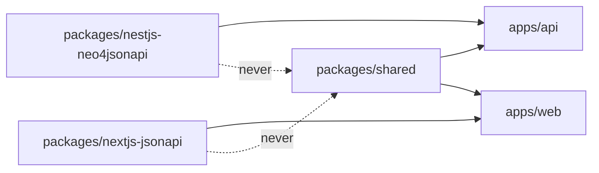

`packages/shared` is the third workspace package and by far the smallest: four
source files, no runtime logic, no tests. It exists for one reason — the API and
the web app must agree on the same UUIDs, and neither may import the other.

It is published as `@{{name}}/shared`, is `private: true`, and is depended on as
`workspace:*` by both apps.

## What it exports

`packages/shared/src/index.ts` is three lines:

| Export | Kind | Source |
|---|---|---|
| `ModuleId` | `const` object | `packages/shared/src/const/module.id.ts` |
| `ModuleIdValue` | type alias | the union of `ModuleId`'s values, re-exported under a second name so the value and the type can be imported side by side |
| `RoleId` | `const` object | `packages/shared/src/const/roles.id.ts` |

`SystemRoles` (`packages/shared/src/const/system.roles.id.ts`) is **not** in the
barrel. It holds the two built-in role UUIDs — `Administrator` and
`CompanyAdministrator` — and `RoleId` spreads it:

```ts
export const RoleId = {
  ...SystemRoles,
} as const;
```

So a fresh app's `RoleId` and `SystemRoles` are the same two entries. The split
is the extension point: app-specific roles are added to `RoleId` beside the
spread, and `SystemRoles` keeps naming only the two the framework seeds.

## The three const files

| File | Holds | Rule |
|---|---|---|
| `packages/shared/src/const/module.id.ts` | eight framework module UUIDs — `Auth`, `Company`, `Feature`, `Notification`, `Role`, `S3`, `User`, `HowTo` — plus the `ModuleId` type | must stay in sync with the seed migration |
| `packages/shared/src/const/roles.id.ts` | the app's role catalogue | extend here, not in `system.roles.id.ts` |
| `packages/shared/src/const/system.roles.id.ts` | the two framework role UUIDs | do not edit |

`module.id.ts` names its own source of truth in a header comment: the `(Module)`
nodes are seeded by `apps/api/src/neo4j.migrations/20250901_002.ts`, and this
file mirrors them.

### Descriptors register by id, not by name

The rule the file states, verbatim: *"Feature modules register their entity
descriptors using these IDs — NOT by name — so renames in the migration never
silently desync the catalog."*

A module's identity in the graph is its UUID. A label or a display name may
change; the UUID does not. `apps/api/src/rbac/permissions.ts` is the clearest
evidence — the whole permission matrix is keyed by `[ModuleId.Feature]`,
`[ModuleId.User]` and so on, never by a string:

```ts
export const rbac = defineRbac<typeof MODULE_USER_PATHS>({
  [ModuleId.Feature]: {
    default: [perm.read],
    [RoleId.Administrator]: perm.full,
  },
  …
});
```

`apps/api/scripts/build-module-id-map.ts` turns the same object into a
`labelName → UUID` JSON map for the RBAC path generator, relying on the
convention that `ModuleId`'s keys are PascalCase and match each entity's
`labelName` one-to-one.

### After adding an entry

Adding a module means three edits, in order: the migration that seeds the
`(Module)` node, then a matching entry in `packages/shared/src/const/module.id.ts`,
then — from `apps/api` — the two commands the file's own comment names:

```bash
pnpm build-module-id-map
pnpm generate:rbac-paths
```

Both are declared in `apps/api/package.json`. The first rewrites
`apps/api/src/rbac/module-id.map.json`; the second runs the first and then the
framework's `generate-rbac-paths` CLI over the API's compiled feature tree,
rewriting
`apps/api/src/features/rbac/module-relationships.map.ts`. Skipping them leaves
the RBAC layer unable to resolve the new module's ownership paths.

## The build

`packages/shared/tsup.config.ts` emits both module formats from one entry:

| Setting | Value | Why |
|---|---|---|
| `entry` | `packages/shared/src/index.ts` | one barrel |
| `format` | `["cjs", "esm"]` | the NestJS API consumes CommonJS, the Next.js app ESM |
| `splitting` | `false` | a single small bundle; nothing to split |
| `sourcemap` | `true` | — |
| `clean` | `true` | unlike `packages/nextjs-jsonapi`, nothing races this package's `dist/` |
| `dts.compilerOptions.composite` | `false` | the package's own tsconfig sets `composite: true` for project references; the declaration bundle must not inherit it |
| `dts.compilerOptions.ignoreDeprecations` | `"6.0"` | the tsup workaround, below |

`packages/shared/package.json` mirrors the two formats in its `exports` map:

```json
"exports": {
  ".": {
    "types": "./dist/index.d.ts",
    "import": "./dist/index.mjs",
    "require": "./dist/index.js"
  }
}
```

### The `ignoreDeprecations` workaround

tsup's dts build sets `baseUrl: compilerOptions.baseUrl || "."` unconditionally,
and TypeScript 6 makes `baseUrl` a hard error (TS5101). No tsconfig in this
repository sets `baseUrl` any more, so the suppression belongs to the tool that
reintroduces it and is scoped to the tsup config rather than put back into a
tsconfig. The comment adds that this is removable once tsup stops injecting
`baseUrl`, and that tsup must be replaced before TypeScript 7 regardless, because
7 deleted the JavaScript compiler API the dts build depends on.
`packages/nextjs-jsonapi/tsup.config.ts` carries the identical workaround.

## The path mapping

`tsconfig.base.json` at the repository root maps the package name to its
**source**, not its build output:

```json
"paths": {
  "@{{name}}/shared": ["./packages/shared/src"],
  "@{{name}}/shared/*": ["./packages/shared/src/*"]
}
```

So TypeScript type-checks against `src/` while the runtimes resolve
`workspace:*` through the `exports` map to `dist/`. The practical consequence:
after editing the package, `tsc` is immediately correct but a running process is
not — rebuild, or let `turbo.json`'s `dependsOn: ["^build"]` do it on the next
`pnpm dev`, `pnpm test` or `pnpm build`.

## Who imports it

Twelve source files across the two apps, plus one web test that mocks the
package, and nothing else in the repository.

### `apps/api` — 3 files

| File | Imports |
|---|---|
| `apps/api/src/rbac/permissions.ts` | `RoleId`, `ModuleId` |
| `apps/api/scripts/rbac-dump.ts` | `ModuleId`, `RoleId` |
| `apps/api/scripts/build-module-id-map.ts` | `ModuleId` |

### `apps/web` — 9 files

| File | Imports |
|---|---|
| `apps/web/src/config/instrumentation-env.ts` | `RoleId` — handed to `configureRoles()` |
| `apps/web/src/features/common/components/session/requireAdministrator.ts` | `RoleId` — the administration gate every `(admin)` page awaits |
| `apps/web/src/app/[locale]/(main)/page.tsx` | `RoleId` |
| `apps/web/src/app/[locale]/(admin)/administration/rbac/page.tsx` | `ModuleId`, `RoleId` |
| `apps/web/src/app/[locale]/(admin)/administration/rbac/roles/page.tsx` | `ModuleId`, `RoleId` |
| `apps/web/src/features/common/components/details/LayoutDetails.tsx` | `RoleId` |
| `apps/web/src/features/common/components/navigations/CommonSidebar.tsx` | `RoleId` |
| `apps/web/src/features/common/components/navigations/UserSidebarFooter.tsx` | `RoleId` |
| `apps/web/src/features/common/components/containers/SettingsContainer.tsx` | `RoleId` |

`apps/web/src/features/common/components/session/__tests__/requireAdministrator.test.ts`
mocks the package rather than importing it.

Seven of the nine web files want only `RoleId`, and they want it for the same
purpose: gating a route or a menu entry on `ServerSession.hasRole` or the
current user's roles. The `(admin)` pages no longer import it themselves; they
call `requireAdministrator`, which does. `apps/web/src/config/instrumentation-env.ts`
is the one that matters most — it passes the whole `RoleId` object to
`configureRoles()`, which is how the package's `getRoleId()` resolves role names
without knowing the app's catalogue.



## The framework packages never depend on it

Neither `packages/nestjs-neo4jsonapi` nor `packages/nextjs-jsonapi` declares
`@{{name}}/shared` in its `package.json`, and neither imports it anywhere in
`src/`. That is not an accident — the two are published npm libraries, and a
dependency on a private, app-named workspace package would make them
unpublishable.

The framework reaches the app's identifiers by **injection** instead. On the web
side `configureRoles(RoleId)` hands the catalogue over at boot; the RBAC context
takes UUID-to-name maps as props. On the API side `RbacModule.register({ rbac,
moduleUserPaths })` in `apps/api/src/features/features.modules.ts` hands over the
matrix the app built from `ModuleId` and `RoleId`. The arrow always points from
the app to the framework, never back.

This is also the rule for anything you put here. `packages/shared` may hold
identifiers, enums and plain types that both apps need. It must not hold
anything either framework package would want, because it can never be a
dependency of one.

## Tests

The package ships **no tests**, deliberately.
`packages/shared/vitest.config.ts` sets `passWithNoTests: true` and explains why
in a comment: a freshly scaffolded app has this package with no tests yet, and
Vitest exits 1 on "No test files found" by default — which failed `pnpm test` at
the shared package in every generated app before a single line was written.
`apps/api` and `apps/web` set the same flag for the same reason (the web app
now ships nine specs of its own; the API still ships none).

`include` is `["src/**/*.test.ts"]` and the environment is `node`. Note the
pattern: a file named `*.spec.ts` under `packages/shared/src` will never run.
That differs from `apps/web/vitest.config.ts`, which matches both `.test` and
`.spec`, so the two conventions are not interchangeable across the repository.

## Where to look

| File | Why |
|---|---|
| `packages/shared/src/index.ts` | the entire public surface, three lines |
| `packages/shared/src/const/module.id.ts` | the module UUIDs, the register-by-id rule and the two follow-up commands |
| `packages/shared/src/const/roles.id.ts` | where app roles are added |
| `packages/shared/src/const/system.roles.id.ts` | the two framework roles |
| `packages/shared/tsup.config.ts` | the dual-format build and the `ignoreDeprecations` workaround |
| `packages/shared/package.json` | the `exports` map and the two-script build |
| `packages/shared/vitest.config.ts` | `passWithNoTests` and the comment explaining it |
| `tsconfig.base.json` | the `@{{name}}/shared` path mapping to `src` |
| `apps/api/src/rbac/permissions.ts` | the largest consumer: the matrix keyed by `ModuleId` and `RoleId` |
| `apps/web/src/config/instrumentation-env.ts` | `configureRoles(RoleId)` — how the web package learns the catalogue |

## Gaps and drift

- `packages/shared/src/index.ts` does not export `SystemRoles`. It is reachable
  only through `RoleId`'s spread, so an app that wants to distinguish framework
  roles from its own must import the file by path or re-export it.
- `apps/api/scripts/rbac-dump.ts` calls `dumpRbacMatrix` without the
  `importLines` option, so regenerating `apps/api/src/rbac/permissions.ts`
  overwrites its header with the framework serialiser's default import lines —
  which name a different organisation's shared package, not `@{{name}}/shared`.
  The regenerated file will not compile until the first import line is corrected
  by hand, or `importLines` is supplied to the call.
- `packages/shared/package.json` declares `zod` as a dependency, but nothing
  under `packages/shared/src` imports it.
- `packages/shared/tsconfig.json` sets `composite: true` and lists `src/**/*`
  twice in `include` (once as a glob and once as `src/**/*.ts`).
- `packages/shared/CLAUDE.md` is a few lines pointing at the architecture skill
  and at this page; it documents no rule about what may live in this package.
- Not examined: the seed migration that creates the `(Module)` nodes, beyond the
  reference in `module.id.ts`'s header comment; the `generate-rbac-paths` CLI
  that consumes the module-id map — both belong to the backend chapters.
