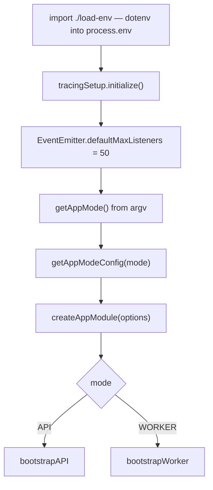

`apps/api/src/main.ts` is twenty-nine lines. Everything the API does before its
first request — Fastify, CLS, i18n, rate limiting, the foundation modules, the
worker branch — happens inside `bootstrap()`, which lives in
`packages/nestjs-neo4jsonapi/src/bootstrap/bootstrap.ts`. This page reads the
entry point line of reasoning by line of reasoning, then the option surface,
then the exact order the two modes boot in, then the four things `bootstrap()`
deliberately leaves to somebody else.

## The first import

```ts
// MUST stay the first import: it populates process.env for everything below.
import "./load-env";
```

`apps/api/src/load-env.ts` calls `dotenv.config()` on the repo-root `.env` and
exports nothing. It is imported for its side effect, and it is a **module**
rather than three lines at the top of `main.ts` for a reason the file itself
records.

The original form was `dotenv.config()` written as a statement between
`main.ts`'s imports. That worked only because TypeScript's CommonJS emit
preserves the interleaving of `require` calls and statements, so the statement
ran before `@carlonicora/nestjs-neo4jsonapi` was required. Every ESM-correct
transpiler — swc, esbuild — hoists all imports above such a statement instead.
The library then loads with no environment at all, and the boot dies on
`JwtStrategy requires a secret or key` before a single route is registered.

ESM guarantees the *order of imports*, not the position of statements relative
to them. Expressing the dependency as an import is the only form that survives a
change of compiler or module system. The same rule applies to any other
entrypoint you add: `apps/api/scripts/rbac-dump.ts` repeats the `dotenv.config()`
call itself for exactly this reason, because it is a standalone `tsx` script
with no library import to protect.

`load-env.ts` resolves `../../../.env` from `__dirname`. That is `apps/api/src`
under a source runner and the api's `dist` directory after a build — both three
levels below the repo root, so one path is correct in either case. Moving the
file deeper into `src/` changes that depth and breaks it silently.

## What `main.ts` passes

```ts
bootstrap({
  appModules: [FeaturesModules],
  i18n: { fallbackLanguage: "en", path: path.join(__dirname, "i18n") },
  config: config,
  contentExtension: { additionalRelationships: [] },
  howTo: { publicRoutes: true },
  openApi: getOpenApiConfig(),
});
```

Six of the available options. Everything else takes its default.

`howTo: { publicRoutes: true }` is there for the web app, not the API: the
`(public-help)` pages read `GET public/howtos/*` without a token, at request
time. The comment beside it in `apps/api/src/main.ts` records that without these
routes every help page answers 404. The web build does not call them: its help
reads wait for `connection()`.
The cost is that every guide not marked draft becomes world-readable.

## `BootstrapOptions`

Declared in `packages/nestjs-neo4jsonapi/src/bootstrap/bootstrap.options.ts`.

| Field | Type | Default | Effect |
|---|---|---|---|
| `appModules` | `(Type \| DynamicModule)[]` | required | Imported after the library modules and **before** `NecordModule`, so Necord can discover decorated handlers. The template passes `FeaturesModules`. |
| `i18n.fallbackLanguage` | `string` | `"en"` | Passed straight to `I18nModule.forRoot`. |
| `i18n.path` | `string` | `./i18n` from `process.cwd()` | Absolute paths are used as given; relative ones resolve against `process.cwd()`. The template passes an absolute `__dirname`-based path, which is correct under both `src` and `dist`. |
| `config` | `() => Record<string, any>` | none | Called once at module-definition time. Its result is spread over `baseConfig` and loaded into `ConfigModule`. Queue ids are read from `chunkQueues.queueIds` on the same object. |
| `contentExtension` | `ContentExtensionConfig` | none | Adds relationships to the `content` foundation's queries and serialisation. The template passes an empty list. |
| `referral` | `ReferralModuleConfig` | none | Enables referral tracking in the `referral` foundation. |
| `userActivity` | `UserActivityModuleConfig` | none | Queue id, job name and whether the global recording interceptor is installed. Defaults: queue `user-activity`, job `userActivity:record`, interceptor off. |
| `howTo` | `HowToModuleConfig` | none | Forwarded to `FoundationsModule.forRoot`. `publicRoutes: true` mounts `HowToPublicController` and its unauthenticated `public/howtos/*` routes; omitted, only the authenticated controller exists. The template passes `{ publicRoutes: true }`. |
| `openApi` | `OpenApiOptions` | none | See below. When neither `enableSwagger` nor `enableRedoc` is true, `setupOpenApiDocs` returns immediately. |
| `rbac` | `RbacMatrix` | none | **Declared and never read.** See the next section. |
| `securityService` | `Type<SecurityService>` | base `SecurityService` | Injected into `CoreModule.forRoot`. A subclass lets an app widen JWT claims or role checks. |
| `aiSourceQuery` | `Type<AiSourceQueryProvider>` | none | App-supplied source scoping for AI retrieval over chunks, atomic facts and key concepts. |
| `migrator` | `boolean` | `true` | `false` skips `MigratorModule` inside `CoreModule`, for an app that runs its own migrations. |
| `foundations.exclude` | `Type[]` | `[]` | Foundation module classes to drop from `FoundationsModule.forRoot`. |
| `foundations.disabled` | `boolean` | `false` | `true` skips the library `FoundationsModule` entirely. Used by apps that provide all their own foundations and would otherwise hit transitive controller collisions. |
| `agents` | `boolean` | `true` | `false` skips `AgentsModule`. |
| `mcp` | `boolean` | `false` | `true` mounts the Model Context Protocol server module. |
| `worker.healthCheckPort` | `number` | none | When set, worker mode starts a bare `http` server answering `{ status: "ok" }` on that port. The template sets nothing, so the worker exposes no health endpoint. |
| `security.helmet` | `object \| false` | none | When an object, `@fastify/helmet` is registered in API mode with it. The template passes nothing, so **no security headers are added by the API process**. |

### `rbac` is declared but never read

`bootstrap()` never touches `options.rbac`, and neither does `createAppModule`
in `packages/nestjs-neo4jsonapi/src/bootstrap/app.module.factory.ts`. The only
code that reads an RBAC matrix is `RbacModule.register(...)`
(`packages/nestjs-neo4jsonapi/src/foundations/rbac/rbac.module.ts`), which binds
it to `RBAC_MATRIX_TOKEN`; `RbacReconcilerService` injects that token
optionally.

So the matrix reaches the reconciler through one route only: the
`RbacModule.register({ moduleUserPaths, rbac, devMode })` call inside
`apps/api/src/features/features.modules.ts`, which arrives via `appModules`.
Passing `rbac` to `bootstrap()` instead would compile, would look correct, and
would do nothing. Do not.

## `OpenApiOptions`

| Field | Default | Effect |
|---|---|---|
| `enableSwagger` | `false` | Mounts Swagger UI with `persistAuthorization`, `docExpansion: "none"`, filtering and request duration. |
| `swaggerPath` | `/api-docs` | Mount path for Swagger UI. |
| `enableRedoc` | `false` | Dynamically imports `nestjs-redoc` and mounts it. A failed import logs a warning instead of failing the boot. |
| `redocPath` | `/docs` | Mount path for Redoc. |
| `title` | `"API Documentation"` | Document title. |
| `description` | `"Auto-generated API documentation"` | Document description. |
| `version` | `"1.0.0"` | Document version. |
| `bearerAuth` | `true` | Adds a JWT bearer scheme named `JWT-auth`. |
| `contactEmail` | none | Sets an `API Support` contact. |
| `license` / `licenseUrl` | none | Sets the licence block. |
| `entityDescriptors` | none | Registered with `OpenApiService`, whose generated schemas are merged into `document.components.schemas`. |

`apps/api/src/openapi/openapi.config.ts` fills it:

- Swagger and Redoc are both on whenever `NODE_ENV !== "production"`, and in
  production only when `ENABLE_SWAGGER` / `ENABLE_REDOC` is the string `"true"`.
- `title` is `"{{name}} API"`; `version` comes from `npm_package_version`, which
  npm sets to the version of `apps/api/package.json`, not the repo root's.
- `entityDescriptors` is an empty array, so the generated document carries only
  the schemas `OpenApiService` already knows. Add your descriptors here as you
  create them.
- `contactEmail` and `licenseUrl` are `example.com` placeholders the author is
  expected to replace.

## Boot order



`tracingSetup.initialize()` runs before anything else so OpenTelemetry can
instrument the modules that load after it. It reads `baseConfig.tempo` and
returns immediately when tracing is disabled.

`getAppMode()` in `packages/nestjs-neo4jsonapi/src/bootstrap/defaults.ts` scans
`process.argv` for `--mode=api`, `--mode=worker`, `--api` or `--worker`, and
defaults to API. `getAppModeConfig()` turns that into three booleans:

| Mode | `enableControllers` | `enableWorkers` | `enableCronJobs` |
|---|---|---|---|
| `api` | true | false | false |
| `worker` | false | true | true |

Every failure inside either branch is caught in `bootstrap()`, logged with
`console.error("Failed to start application:", …)` and followed by
`process.exit(1)`.

### Module import order inside `GeneratedAppModule.forRoot`

The order in `app.module.factory.ts` is load-bearing in two places, flagged
below.

1. `EventEmitterModule.forRoot()`
2. `AppModeModule.forRoot(modeConfig)`
3. `ConfigModule.forRoot({ load: [configLoader], isGlobal: true, cache: true })`
4. `ThrottlerModule.forRootAsync(...)` — two throttlers, `default` and `ip`, from `rateLimit.ttl`, `rateLimit.limit` and `rateLimit.ipLimit`
5. `ClsModule.forRoot({ global: true, middleware: { mount: modeConfig.enableControllers } })` — the CLS middleware mounts in API mode only, which is why worker code must open its own context
6. `I18nModule.forRoot(...)` — query resolver (`lang`, `locale`, `l`), then `x-language` header, then `Accept-Language`
7. `ScheduleModule.forRoot()` — **only when `enableCronJobs`**, i.e. worker mode
8. `CoreModule.forRoot({ queueIds, securityService, migrator, aiSourceQuery })`
9. `FoundationsModule.forRoot(...)` — unless `foundations.disabled`
10. `AgentsModule` — unless `agents === false`
11. `McpModule` — only when `mcp === true`
12. `OpenApiModule`
13. **`...options.appModules`** — must come before Necord so Necord can discover decorated handlers
14. `NecordModule.forRootAsync(...)` + `DiscordModule` — only in worker mode and only when a Discord token is configured

`GeneratedAppModule` is declared `global: true`. Its only provider is a
conditional `APP_GUARD` bound to `CustomThrottlerGuard`, registered **only** when
the merged config has `rateLimit.enabled`. The `ThrottlerModule` above always
configures the limits; the guard is what enforces them.

### The API branch, step by step

`bootstrapAPI` in `bootstrap.ts`:

1. `NestFactory.create<NestFastifyApplication>(AppModule.forRoot(modeConfig), new FastifyAdapter(defaultFastifyOptions), { logger: ["error", "warn"] })`. `defaultFastifyOptions` sets `routerOptions.ignoreTrailingSlash` and a 100 MB `bodyLimit`.
2. Resolve `ConfigService` and `AppLoggingService`.
3. `setupRawBodyCapture(app)` — **before any route is registered**. It adds a Fastify `preParsing` hook that drains the payload into a Buffer, stores it as `request.rawBody` and returns a fresh `Readable` for the JSON parser. It fires only for URLs starting with an entry of `RAW_BODY_ROUTES` in `packages/nestjs-neo4jsonapi/src/bootstrap/raw-body.config.ts`, which today contains exactly one prefix: `/stripe-webhooks`. Raw-body capture is memory-intensive, hence the allowlist.
4. `@fastify/helmet` — registered only when `options.security.helmet` is set. The template does not set it.
5. `@fastify/multipart` with `defaultMultipartOptions`: 100 MB per file, 10 MB per field, 10 files, 20 fields, `attachFieldsToBody: false`.
6. A content-type parser for `application/vnd.api+json`, delegating to Fastify's default JSON parser. Without it every {json:api} request body would arrive unparsed.
7. `app.useLogger(loggingService)` and `setupFastifyLoggingHook`, an `onSend` hook that reads `request.raw["requestStartTime"]`, computes the response time and payload size, calls `logHttpRequest`, logs an `HTTP_SUCCESS` context line and then clears the request context.
8. Global filters, in order: `HttpExceptionFilter(loggingService)`, then `ThrottlerExceptionFilter`.
9. Global `ValidationPipe({ whitelist: true, transform: true, validateCustomDecorators: true })`. `whitelist: true` is why an unknown attribute in a DTO body is stripped rather than rejected.
10. A log line saying whether rate limiting is enabled and at what limit.
11. Global interceptors, registered in this order: `TracingInterceptor`, then `CacheInterceptor` (constructed by hand from `CacheService`, `Reflector` and the logger), then `LoggingInterceptor`.
12. CORS: `corsService.validateConfiguration()` then `app.enableCors(corsService.getCorsConfiguration())`. When neither `cors.origins` nor `cors.originPatterns` is configured, `CorsService` returns `origin: true` — every origin allowed — and logs `CORS: No origins or patterns configured, allowing all origins (insecure)`.
13. `setupOpenApiDocs(app, options, loggingService)`.
14. `app.listen(port, "0.0.0.0")`, with `port` from `config.api.port` (`API_PORT`, `4050` in `env.example`).
15. `setupGracefulShutdown(app)`.

### The worker branch

`bootstrapWorker` is much shorter:

1. `NestFactory.createApplicationContext(AppModule.forRoot(modeConfig), { logger: ["error", "warn"] })` — no HTTP server, no Fastify, no filters, no pipes, no interceptors.
2. `app.useLogger(loggingService)` and two log lines.
3. If `options.worker.healthCheckPort` is set, a bare Node `http` server answering `{ status: "ok" }`. The template sets no port.
4. `setupGracefulShutdown(app, healthServer)`.

### Graceful shutdown

`setupGracefulShutdown` registers handlers for `SIGTERM` and `SIGINT`. Each
closes the optional health server, then `app.close()`, then `process.exit(0)`; a
failure logs and exits `1`. That is what makes `app.close()` run every
`OnModuleDestroy` hook — the socket gateway's included — on a container stop.

## What `bootstrap()` does not wire

Four systems people expect to find in `bootstrap.ts` and will not.

| System | Where it actually comes from |
|---|---|
| The socket gateway | `EventsGateway` is a provider of `WebsocketModule` (`packages/nestjs-neo4jsonapi/src/core/websocket/websocket.module.ts`), which `CoreModule` imports. The `@WebSocketGateway` decorator on `packages/nestjs-neo4jsonapi/src/core/websocket/gateways/event.gateway.ts` carries the path and CORS; `bootstrap()` never calls `useWebSocketAdapter` or registers the gateway. |
| Migrations | `MigratorService` (`packages/nestjs-neo4jsonapi/src/core/migrator/services/migrator.service.ts`) runs from its own `onModuleInit`. `MigratorModule` provides it through `createWorkerProvider`, so it exists only in worker mode, and `CoreModule.forRoot` imports that module unless `migrator: false`. See [Migrations](migrations.md). |
| RBAC reconciliation | `RbacReconcilerService` runs from `onApplicationBootstrap`, is registered by `RbacModule.register(...)` — an app call, not a bootstrap option — and is likewise wrapped in `createWorkerProvider`. See [RBAC and permissions](rbac-and-permissions.md). |
| Health endpoints | `HealthController` (`packages/nestjs-neo4jsonapi/src/core/health/controllers/health.controller.ts`) declares `GET /health`, `GET /health/live` and `GET /health/ready` and reaches the app through `HealthModule` inside `CoreModule`. The worker's optional health port in `bootstrap()` is a separate, much smaller thing and is off by default. |

The pattern is consistent: `bootstrap()` owns the process — transport, global
middleware, shutdown — and the module graph owns everything with a lifecycle
hook.

## The app's aggregator

`apps/api/src/features/features.modules.ts` is the single module the template
hands to `appModules`, and it registers exactly two things:

```ts
@Module({
  imports: [
    SearchModule,
    RbacModule.register({
      moduleUserPaths: MODULE_USER_PATHS,
      rbac,
      devMode: process.env.NODE_ENV !== "production",
    }),
  ],
})
export class FeaturesModules {}
```

`SearchModule` is the only feature module the template ships — see
[Module anatomy](module-anatomy.md). `RbacModule.register` binds the matrix and
the module-user paths, and `devMode` adds the `_dev/rbac/matrix` controller
outside production. Every module you generate goes into this `imports` array;
nothing else in the app reaches `bootstrap()`.

## `apps/api/src/config/`

Four files, all thin.

| File | Contents |
|---|---|
| `apps/api/src/config/config.ts` | The default-exported loader `bootstrap()` calls. Spreads `baseConfig`, then sets `chunkQueues.queueIds` from `QueueId`, `contentTypes.types` to `[]`, and `jobNames` to `JobName`. |
| `apps/api/src/config/interfaces/config.interface.ts` | `ConfigInterface extends BaseConfigInterface` with no members of its own. Widen it when you add app-specific config blocks. |
| `apps/api/src/config/enums/queue.id.ts` | One entry: `CHUNK = "chunk"`. This is what `createAppModule` reads to decide which BullMQ queues to register. |
| `apps/api/src/config/enums/job.name.ts` | `{ process: { chunk: "process_chunk" }, notifications: {} }`. |

Everything else — Neo4j, Redis, S3, JWT, AI, CORS, credits, Stripe — lives in
the package's `baseConfig` and is driven by environment variables. Adding an app
config block means adding a key here and a field to `ConfigInterface`, not
reading `process.env` at the point of use.

## API-side i18n

The API translates notification copy, not UI copy — the web app owns its own
messages. The tree is `apps/api/src/i18n/`, with one file:
`apps/api/src/i18n/en/notifications.json`, which ships as `{ "notification": {} }`.

Two mechanics matter:

- `main.ts` passes an absolute `path.join(__dirname, "i18n")`, so the loader
  reads `apps/api/src/i18n` under a source runner and the copied `i18n` directory
  inside the api's `dist` after a build.
- `apps/api/nest-cli.json` lists `i18n/**/*.json` as an asset with
  `watchAssets: true`, which is what copies the JSON into `dist` and reloads it
  in watch mode. A new locale directory needs no config change; a new file
  extension does.

`I18nModule` is configured with `watch: true` and `logging: false`, and resolves
the language from `?lang`/`?locale`/`?l`, then the `x-language` header, then
`Accept-Language`, falling back to `en`.

## Where to look

| File | Why |
|---|---|
| `apps/api/src/main.ts` | The whole entry point; six options and one call. |
| `apps/api/src/load-env.ts` | Why the env load is an import, with the failure it prevents. |
| `packages/nestjs-neo4jsonapi/src/bootstrap/bootstrap.ts` | Both branches, the filters, pipes, interceptors and shutdown. |
| `packages/nestjs-neo4jsonapi/src/bootstrap/bootstrap.options.ts` | Every option, with its JSDoc default. |
| `packages/nestjs-neo4jsonapi/src/bootstrap/app.module.factory.ts` | The module import order and the conditional throttler guard. |
| `packages/nestjs-neo4jsonapi/src/bootstrap/defaults.ts` | Mode parsing, mode config, Fastify and multipart defaults. |
| `packages/nestjs-neo4jsonapi/src/bootstrap/raw-body.config.ts` | The `preParsing` hook and the route allowlist. |
| `apps/api/src/openapi/openapi.config.ts` | How the app fills `OpenApiOptions`. |
| `apps/api/src/features/features.modules.ts` | The app aggregator: one feature plus RBAC registration. |
| `apps/api/src/config/config.ts` | The config loader merged over `baseConfig`. |

## Gaps and drift

- `BootstrapOptions.rbac` is declared, documented and never read by
  `bootstrap()` or `createAppModule`. The matrix only takes effect through
  `RbacModule.register(...)`.
- The JSDoc example on `bootstrap()` shows a `queueIds: ["chunk"]` option that
  `BootstrapOptions` does not declare. Queue ids come from
  `config().chunkQueues.queueIds`, as `apps/api/src/config/config.ts` does.
- `apps/api/src/openapi/openapi.config.ts` reads `process.env` directly, outside
  the `ConfigService` layer every other consumer uses. It runs before the Nest
  container exists, so there is no injector to read from, but it means
  `ENABLE_SWAGGER`, `ENABLE_REDOC` and `NODE_ENV` are not part of the typed
  config surface.
- The template passes no `security.helmet`, so the API sends no
  helmet-managed security headers, and no `worker.healthCheckPort`, so the
  worker exposes no health endpoint. Both are opt-in by design; neither is
  wired here.
- `contactEmail: "api@example.com"` and `licenseUrl: "https://example.com/terms"`
  are placeholders.
- Not examined: the internals of `CoreModule`, `FoundationsModule` and
  `AgentsModule` beyond their position in the import list; `OpenApiService`'s
  schema generation; `HttpExceptionFilter`'s response shaping; the three
  interceptors' implementations; `TracingSetup`'s exporter configuration. Each
  is covered by its own chapter.
