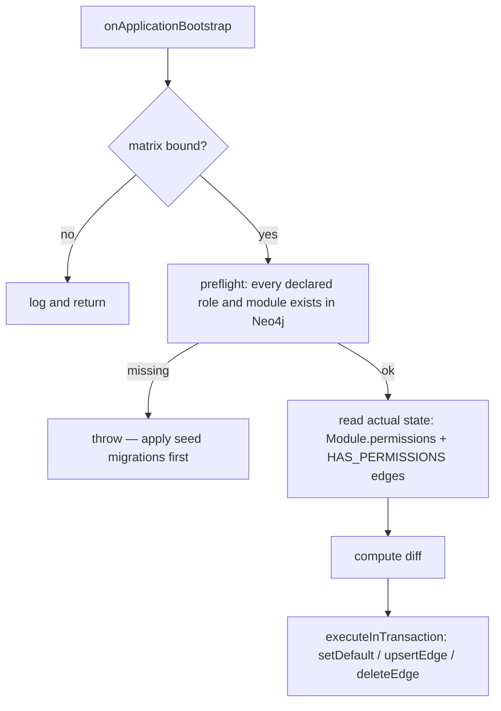
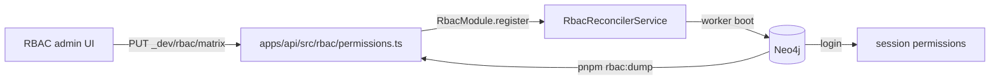

Role-based access control (RBAC) in this stack is declarative: a TypeScript
matrix in the app is the source of truth, a reconciler writes it into Neo4j at
worker boot, and login bakes the resulting effective permissions into the
session the client reads. This page covers the identifier spaces, the matrix
DSL, registration, reconciliation, enforcement, and the two directions data
flows between the file and the database.

## Three identifier spaces

They are three different things with three different lifetimes, and confusing
them is the usual source of a permission that silently does nothing.

| Space | Shape | Declared in | Meaning |
|---|---|---|---|
| Module ids | UUID | `packages/shared/src/const/module.id.ts`, mirrored to `apps/api/src/rbac/module-id.map.json` | A `(:Module)` node — a unit of functionality permissions are granted on. |
| Role ids | UUID | `packages/shared/src/const/system.roles.id.ts`, re-exported by `packages/shared/src/const/roles.id.ts` | A `(:Role)` node a user holds through a membership. |
| Feature ids | string | `apps/web/src/enums/feature.ids.ts` (web), seeded as `(:Feature)` nodes by `apps/api/src/neo4j.migrations/20250901_001.ts` | A licensable capability. A module belongs to a feature; a company either has the feature or does not. |

### Module ids

`ModuleId` is a `const` object of eight UUIDs with a matching type export. Its
docblock states the contract plainly: the ids are the authoritative identity of
the `(:Module)` nodes, feature modules register against them **by id and never
by name**, so renaming a module in a migration cannot silently desync the
catalog.

`apps/api/src/rbac/module-id.map.json` is the same map as JSON, keyed by
PascalCase name. It is generated — `pnpm --filter {{name}}-api build-module-id-map`
runs `apps/api/scripts/build-module-id-map.ts`, which inverts `ModuleId` into a
`labelName → UUID` file. The convention that makes it work is that entity
`labelName` values are PascalCase and match the `ModuleId` keys one to one, so
no case conversion is needed.

### Role ids

`SystemRoles` holds two entries, `Administrator` and `CompanyAdministrator`.
`RoleId` spreads `SystemRoles` and adds nothing, so today the two are identical;
the indirection exists so an app can add its own roles in `roles.id.ts` without
touching the system set. The package keeps its own copy of the same two UUIDs in
`packages/nestjs-neo4jsonapi/src/common/constants/system.roles.ts` — that is the
one `RbacReconcilerService` and the guards compare against.

`Administrator` is the **platform** administrator and is special everywhere: the
reconciler never writes an `HAS_PERMISSIONS` edge for it, the guards always
admit it regardless of `@Roles`, and the seeded administrator user holds it on a
membership with no company.

### Feature ids

`apps/web/src/enums/feature.ids.ts` ships one entry, `Core = "core"`. It is a
web-side enum used to gate navigation and components; the API side works from
the `(:Feature)` nodes and the `IN_FEATURE` edges the migrations create.

Note the two do not currently line up: the seeded feature is named `Common` with
id `17036fb0-060b-4c83-a617-f32259819783`, while the web enum's only value is the
string `core`. Recorded in Gaps and drift.

## The matrix

`apps/api/src/rbac/permissions.ts` is the declaration. Its first line —
`// Auto-maintained by the RBAC UI. Edit via pnpm dev + UI, or by hand.` — is the
whole workflow in one sentence.

```ts
export const rbac = defineRbac<typeof MODULE_USER_PATHS>({
  [ModuleId.User]: {
    default: [perm.read, perm.update("id")],
    [RoleId.CompanyAdministrator]: [perm.create, perm.update, perm.delete],
    [RoleId.Administrator]: perm.full,
  },
  …
});
```

### `defineRbac`

`packages/nestjs-neo4jsonapi/src/foundations/rbac/dsl/define-rbac.ts` is an
identity function. Its only job is to bind the matrix literal to a concrete
`MODULE_USER_PATHS` shape so the module keys are checked against the known
module set. It returns its argument unchanged.

### `PermToken`

The unit of the DSL, from
`packages/nestjs-neo4jsonapi/src/foundations/rbac/dsl/types.ts`:

```ts
export type PermToken<PathSet extends string = string> =
  { action: Action; scope: true } | { action: Action; scope: PathSet };
```

`Action` is the closed set `"read" | "create" | "update" | "delete"`. `scope` is
either `true` — unconditional — or a string expression naming what the
permission is limited to.

`packages/nestjs-neo4jsonapi/src/foundations/rbac/dsl/perm.ts` builds each token
as a callable hybrid: `perm.read` is a function with `action` and `scope: true`
attached as own properties. So `perm.read` used bare is the unconditional token,
and `perm.update("id")` calls it to produce the scoped one. `perm.full` is a
plain array of all four unconditional tokens.

That hybrid shape has one consequence worth knowing: `JSON.stringify` drops
functions, so serialising a matrix produces `null` entries. The dev controller
normalises every token to a plain `{ action, scope }` object before sending it.

### Scope path expressions

A scoped token's string is a dotted path evaluated against the resource on the
client side. Two kinds appear:

- **Self scope** — `perm.update("id")` on the User module means "update the
  record whose `id` is your own user id".
- **Relationship paths** — a dotted traversal from the entity to a user, such as
  `warehouse.managedBy`. These are the values `MODULE_USER_PATHS` enumerates.

`RbacMatrix` deliberately types scope strings as plain `string` rather than
narrowing them per module. The type comment gives both reasons: many modules
have no discovered relationship paths at all, so per-module narrowing would
collapse the scope type to `never` and reject every scoped token; and self-scope
and attribute paths are valid at runtime but are not part of the relationship
set. Action names stay strictly typed.

### `ModuleBlock`

```ts
export type ModuleBlock<PathSet extends string = string> = {
  default: PermToken<PathSet>[];
} & Record<string, PermToken<PathSet>[]>;
```

`default` is mandatory and is the **floor**: it applies to every role on that
module. Each role key declares *additions* on top of the floor, never a
replacement. `resolveForRole` in
`packages/nestjs-neo4jsonapi/src/foundations/rbac/dsl/resolver.ts` computes
`[...block.default, ...roleTokens]` and serialises the union.

`toPermissionsJson` merges the union per action with a fixed precedence —
`true` beats a scope string, a scope string beats absent — and emits a
JSON-stringified array of `{ type, value }` in the fixed order read, create,
update, delete. That string is what lands on `Module.permissions` and on the
`HAS_PERMISSIONS` edge.

### The shipped matrix

Eight modules, three columns. `default` applies to every role; the two role
columns are additions on top of it.

| Module | `default` | `CompanyAdministrator` adds | `Administrator` |
|---|---|---|---|
| `Feature` | read | — | full |
| `Auth` | full | — | full |
| `User` | read, update scoped to `id` | create, update, delete | full |
| `HowTo` | read | — | full |
| `Notification` | read, update | — | full |
| `Role` | read | — | full |
| `S3` | read | create, update, delete | full |
| `Company` | read | create, update, delete | full |

`Administrator` is declared as `perm.full` on every module, matching the
convention `apps/api/scripts/rbac-dump.ts` emits. The reconciler never writes
those edges — the security layer short-circuits for the role — so the entries
exist to make the file readable, not to produce data.

## Registration

`apps/api/src/features/rbac/module-relationships.map.ts` and the matrix meet in
`apps/api/src/features/features.modules.ts`:

```ts
RbacModule.register({
  moduleUserPaths: MODULE_USER_PATHS,
  rbac,
  devMode: process.env.NODE_ENV !== "production",
})
```

`RbacModule.register` in
`packages/nestjs-neo4jsonapi/src/foundations/rbac/rbac.module.ts` binds:

| Provider | Token |
|---|---|
| `options.moduleUserPaths` | `MODULE_USER_PATHS_TOKEN` (`packages/nestjs-neo4jsonapi/src/foundations/rbac/rbac.constants.ts`) |
| `options.rbac ?? null` | `RBAC_MATRIX_TOKEN` (`packages/nestjs-neo4jsonapi/src/foundations/rbac/rbac.tokens.ts`) |
| `RbacRepository`, `RbacService`, two serialisers | by class |
| `createWorkerProvider(RbacReconcilerService)` | by class, worker-only |

and mounts `RbacController` and `RbacModulePathsController` always, plus
`RbacDevController` when `devMode`.

This registration is the **only** path by which a matrix reaches the reconciler.
`BootstrapOptions` also declares an `rbac` field, but nothing reads it — see the
Bootstrap chapter.

### `MODULE_USER_PATHS`

```ts
export const MODULE_USER_PATHS = {
  "035fe8a6-d467-40c0-9d1d-6a87f0dd286e": [],
  …
} as const;
export type ModuleUserPathsType = typeof MODULE_USER_PATHS;
```

Eight keys, one per module id, **every one of them an empty array**. The map
exists to type the scope strings in the matrix and to answer the
`rbac/module-paths` endpoint; with every entry empty, no relationship-based
scope path is offered anywhere. `perm.update("id")` still works, because self
scope is not part of this set.

The file is generated. `pnpm --filter {{name}}-api generate:rbac-paths` runs
`build-module-id-map` first, then the package's `generate-rbac-paths` CLI
(`packages/nestjs-neo4jsonapi/tools/generate-rbac-paths/index.ts`) with
`--dir dist/features --output src/features/rbac/module-relationships.map.ts
--module-id-map src/rbac/module-id.map.json`.

The CLI requires **compiled** descriptors: it `require`s every `.js` file under
`dist/features`, keeps any export carrying both `model.labelName` and
`relationships`, builds a graph of label-to-label edges, breadth-first searches
each entity for a path to `User` up to `--max-depth` (default 4), and maps the
resulting `labelName` keys to UUIDs through the module-id map. Labels in its
skip list — `Entity`, `Auth`, `AuthCode`, `Push`, `S3`, `OneTimeToken`,
`Configuration`, `Module`, `Feature`, `Role`, `Company`, `Audit`,
`Notification`, `Webhook` — are excluded.

So the map being empty is the correct output for this template: the only app
feature is `search`, which declares no descriptor and therefore no
relationships. Run the generator after adding entities, and re-run it whenever
you change a relationship, because the matrix's scope strings are checked
against whatever it last wrote. Build the API first — an empty `dist/features`
produces an empty map.

## Reconciliation

`RbacReconcilerService`
(`packages/nestjs-neo4jsonapi/src/foundations/rbac/services/rbac-reconciler.service.ts`)
implements `OnApplicationBootstrap` and is registered through
`createWorkerProvider`. That means it **runs in the worker process at every
boot and never in the API process**. Start only the API and the matrix is never
applied; the database keeps whatever the migrations seeded.

It injects `RBAC_MATRIX_TOKEN` with `@Optional()`, so an unbound matrix logs
`RBAC reconciler: no matrix configured, skipping` and returns.



Rules the diff follows:

- **Defaults** are written to `Module.permissions` when the serialised
  expectation differs from what is stored.
- **Edges** are upserted on `(Role)-[:HAS_PERMISSIONS]->(Module)` for every
  declared `(role, module)` pair except Administrator.
- **Deletions are scoped to declared modules.** An edge on a module the matrix
  does not mention is left alone; an edge on a declared module that the matrix
  no longer declares is deleted. That is what makes the file authoritative for
  what it covers without it destroying anything it does not.
- **Administrator is never managed** — never upserted, never deleted.
- **Preflight aborts the boot** with a message naming the missing roles and
  modules if any referenced entity is absent, rather than creating them.

Every operation is applied in a single `executeInTransaction`, and the run logs
`RBAC reconcile: N defaults changed, N edges upserted, N edges removed` or
`RBAC reconcile: no changes`.

## How a request is authorised

Authorisation is split: the API enforces authentication and role membership, and
the fine-grained per-module permission check happens client-side against the
permissions baked into the session.

`JwtAuthGuard`
(`packages/nestjs-neo4jsonapi/src/common/guards/jwt.auth.guard.ts`) does four
things per request:

1. Rejects a request with no `Authorization` header.
2. Validates the JWT through Passport; `jwt expired` becomes a 401 `Token expired`.
3. `_validateRoles` reads the `roles` metadata set by `@Roles(...)`. If a route
   declares any, the Administrator role is appended to the required list and the
   user must hold at least one of them; otherwise 401. A route with no `@Roles`
   requires only a valid token.
4. Populates CLS with `userId`, `companyId` (from the claim, falling back to the
   `x-companyid` header), `roles`, `language`, `token` and `ipAddress`.

That CLS company id is what `AbstractRepository.buildDefaultMatch()` uses to
scope every query on a company-scoped entity — which is the real tenancy
boundary. `AdminJwtAuthGuard` is the same guard with the Administrator role
always required.

Both guards `throw` rather than return `null` from `handleRequest`, and the
admin guard carries a long comment explaining why: `@nestjs/passport` assigns
whatever `handleRequest` returns to `request.user` and then returns `true`
unconditionally, so returning `null` **admitted** the request with no user and
skipped the role check entirely.

## How permissions reach the client

At login, `AuthRepository.createSession`
(`packages/nestjs-neo4jsonapi/src/foundations/auth/repositories/auth.repository.ts`)
computes each module's **effective** permissions in Cypher and returns them as
virtual nodes:

1. Match the user's roles through their memberships.
2. Parse `module.permissions` into the four defaults.
3. Collect the `HAS_PERMISSIONS` edges those roles hold on the module and parse
   them.
4. Per action, union default and role values with the precedence `true` beats a
   scope string beats `false`.
5. `apoc.create.vNode` a copy of the module carrying the merged permissions.

The result travels in the session, is written into the auth cookies by
`updateToken` and is read on the client by
`packages/nextjs-jsonapi/src/features/user/contexts/CurrentUserContext.tsx`,
which exposes `hasPermissionToModule`, `hasPermissionToModules` and
`hasPermissionToPath`. Each first checks the module's feature against the
company's feature list, then evaluates the action against the merged
permissions — resolving a scope string as a path into the supplied `data`.

`hasPermissionToPath` maps a URL to a module and returns the read answer. It
returns `true` for `#` and `/`, and **`true` when no module matches the path** —
an unmapped route is open, not closed. Gate a new route by mapping it to a
module, not by assuming the default protects it.

The two read endpoints that back the admin UI:

| Route | Controller | Guard |
|---|---|---|
| `GET rbac/permission-mappings` | `RbacController` | `AdminJwtAuthGuard` + `JwtAuthGuard`, `@Roles(Administrator)` |
| `GET rbac/module-paths` | `RbacModulePathsController` | same |

## The `_dev/rbac/matrix` endpoints

`RbacDevController`
(`packages/nestjs-neo4jsonapi/src/foundations/rbac/controllers/rbac-dev.controller.ts`)
is mounted **only** when `RbacModule.register` receives `devMode: true`, which
the template sets to `process.env.NODE_ENV !== "production"`. It carries no
guard at all, which is exactly why it must never be enabled in production.

| Route | Does |
|---|---|
| `GET _dev/rbac/matrix` | Returns the in-memory matrix (normalised to plain `{ action, scope }` objects) and the module paths, as a single {json:api} resource of type `rbac-matrix`, id `singleton`. |
| `PUT _dev/rbac/matrix` | Takes `{ matrix, roleNames, moduleNames, outputPath }`, runs `serializeMatrixToTs`, and **writes a TypeScript source file to disk**. A relative `outputPath` resolves against the nearest ancestor containing `pnpm-workspace.yaml`, because the API process runs with its cwd at `apps/api`. |

The `PUT` is what makes `permissions.ts`'s opening comment true: the RBAC admin
screen edits the matrix in the browser and saves it back into your working tree.
The file then has to be committed like any other source change, and the worker
restarted for the reconciler to apply it.

## `pnpm rbac:dump` — the other direction

`apps/api/scripts/rbac-dump.ts` reads the **live database** and emits
`apps/api/src/rbac/permissions.ts`. Run it with
`pnpm --filter {{name}}-api rbac:dump`.

The script is thin: it loads `.env`, opens a `neo4j-driver`, inverts `RoleId` and
`ModuleId` into UUID-to-PascalCase maps so the output reads `RoleId.X` and
`ModuleId.Y` instead of raw UUIDs, and calls `dumpRbacMatrix`
(`packages/nestjs-neo4jsonapi/src/foundations/rbac/dump.ts`). `dumpRbacMatrix`
writes `[RoleId.Administrator]: perm.full` for every declared module, matching
the convention the reconciler expects.

Two occasions to run it, from its own docblock: first-time setup of a new
environment with no `permissions.ts` worth keeping, and after making manual
permission edits in Neo4j during development — otherwise the worker reconciler
reverts them at its next boot. It writes a source file into the repo, so it is a
developer tool only: never a runtime endpoint, never part of a deploy pipeline.



## The seed migrations

The reconciler refuses to create roles or modules, so the migrations must run
first. All four are in `apps/api/src/neo4j.migrations/` and all use the shared
MERGE fragments from
`apps/api/src/neo4j.migrations/queries/migration.queries.ts`.

| Migration | Seeds |
|---|---|
| `apps/api/src/neo4j.migrations/20250901_001.ts` | The two roles — `Administrators` (`isSelectable: false`) and `Company Administrator` (`isSelectable: true`) — and the `Common` feature. |
| `apps/api/src/neo4j.migrations/20250901_002.ts` | The eight modules, each with its default `permissions` JSON and an `IN_FEATURE` edge to `Common`. |
| `apps/api/src/neo4j.migrations/20250901_003.ts` | The `HAS_PERMISSIONS` grants. |
| `apps/api/src/neo4j.migrations/20250901_004.ts` | The platform administrator user. |

The module defaults in `20250901_002.ts` match the matrix's `default` rows
exactly — read everywhere, plus update on Notification, plus
`{ type: Update, value: "id" }` on User, plus full CRUD on Auth. That is not a
coincidence: the reconciler would rewrite `Module.permissions` on the next
worker boot if they disagreed, and the migration is what makes the first boot a
no-op.

`20250901_003.ts` writes three groups of grants:

1. Administrator gets full CRUD on Company, S3 and User.
2. CompanyAdministrator gets full CRUD on the same three.
3. CompanyAdministrator gets full CRUD on `78567a47-baa8-47ed-890f-de48574a9cba`
   and `e029e271-2896-43ad-87ef-19ab35363936`.

**The two ids in the third group appear in no module map** — not in `ModuleId`,
not in `module-id.map.json`, and not in any module seeded by `20250901_002.ts`.
`permissionQuery` opens with `MATCH (module:Module {id: $moduleId})`, so the
`MERGE` never runs and the two entries write nothing. They are inert, not
broken, but they are also unexplained; delete them or seed the modules they
name.

The Administrator grants in group 1 are equally redundant, for a different
reason: the reconciler never manages Administrator edges and the guards
short-circuit for the role, so the edges exist without being consulted.

### Why the seeded administrator has no company

`20250901_004.ts` carries the longest comment in the migrations directory, and
it is worth reading before you touch the seed. The administrator is a
**platform** administrator: it holds the Administrator role on a membership with
**no `IN_COMPANY` edge**, and therefore belongs to no company.

`AuthRepository.createSession` branches on exactly that shape — "holds
Administrator and has no company" — to build a session with no company in scope.
Seeding the role any other way sends login down the company branch, which
dereferences `auth.user.company.id` on a company-less user and fails with a 500
before a token is ever issued.

The edge is therefore granted with the library's own `grantPlatformRole` helper
rather than hand-written Cypher, so the seed cannot drift from the membership
model the rest of the codebase reads through `membershipRoleMatch`.

The seeded credentials are `admin@{{name}}.com` with a bcrypt hash in the file.
Change the password on first login.

## Where to look

| File | Why |
|---|---|
| `apps/api/src/rbac/permissions.ts` | The matrix: eight modules, the shipped grants. |
| `apps/api/src/features/rbac/module-relationships.map.ts` | The generated scope-path map, currently all empty. |
| `apps/api/src/features/features.modules.ts` | The one `RbacModule.register` call that binds both. |
| `packages/shared/src/const/module.id.ts` | Module UUIDs and the rule that modules register by id. |
| `packages/shared/src/const/system.roles.id.ts` | The two role UUIDs. |
| `packages/nestjs-neo4jsonapi/src/foundations/rbac/dsl/types.ts` | `PermToken`, `ModuleBlock`, `RbacMatrix` and why scope is typed loosely. |
| `packages/nestjs-neo4jsonapi/src/foundations/rbac/services/rbac-reconciler.service.ts` | Preflight, diff and the deletion-scoping rule. |
| `packages/nestjs-neo4jsonapi/src/foundations/rbac/controllers/rbac-dev.controller.ts` | The dev matrix endpoints and the file write. |
| `apps/api/scripts/rbac-dump.ts` | Database-to-file, with the two occasions to run it. |
| `apps/api/src/neo4j.migrations/20250901_004.ts` | Why the platform administrator must have no company edge. |

## Gaps and drift

- Two grants in `apps/api/src/neo4j.migrations/20250901_003.ts` target module
  ids (`78567a47-baa8-47ed-890f-de48574a9cba`,
  `e029e271-2896-43ad-87ef-19ab35363936`) that exist in no module map and are
  seeded by no migration. `permissionQuery` starts with a `MATCH`, so both write
  nothing.
- Every entry in `MODULE_USER_PATHS` is an empty array, so no relationship-scoped
  permission is expressible today. Correct for a template with no descriptors,
  but it means the `typeof MODULE_USER_PATHS` generic currently constrains
  nothing but the key set.
- `apps/web/src/enums/feature.ids.ts` declares `Core = "core"` while the seeded
  feature is named `Common` with a UUID id. Nothing joins the two.
- `RbacDevController` carries no guard. It is gated purely on
  `devMode: process.env.NODE_ENV !== "production"`, and `PUT _dev/rbac/matrix`
  writes a file to the server's filesystem.
- `hasPermissionToPath` returns `true` when no module matches the path. An
  unmapped route is open.
- `BootstrapOptions.rbac` is declared and never read; only
  `RbacModule.register` binds the matrix.
- Not examined: `RbacRepository`'s Cypher for the two read endpoints;
  `serializeMatrixToTs`'s output formatting; the `rbac-permission` sub-module
  used by the MCP server; the membership query helpers
  (`membershipRoleMatch`, `grantCompanyRoles`); the client-side
  `checkPermissions` scope-path evaluator. The frontend gate is covered by the
  `04-frontend/access-control.md` chapter and the module and feature entities by
  `05-foundations/modules-features-and-rbac.md`.
