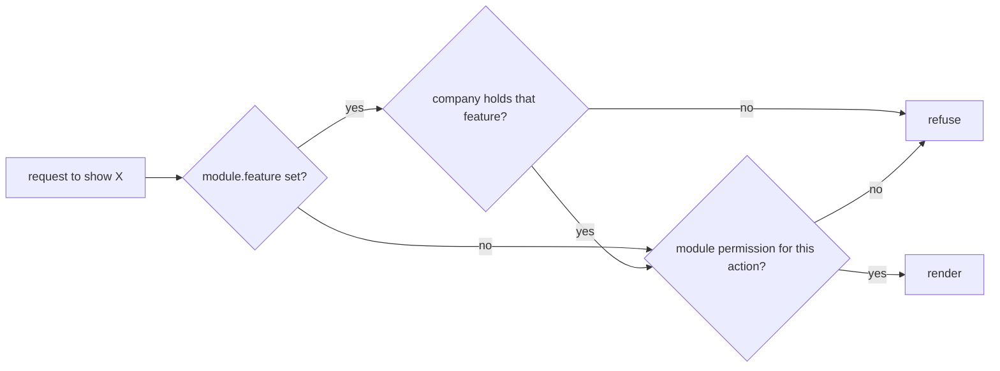

The frontend applies two gates to every protected surface, always in the same order:
a **feature** gate, then a **module** gate. Both are advisory — the API enforces the same
rules independently — but they decide what the UI draws, and a mistake here advertises
destinations that answer 403.



## Gate one: the feature gate

A registry entry may carry `feature`, a feature identifier. On the client the check is
`hasAccesToFeature` — note the spelling; it is the public API name in
`CurrentUserContextType` and cannot be corrected without a breaking change.

```ts
const hasAccesToFeature = (featureIdentifier: string): boolean => {
  if (hasRole(getRoleId().Administrator)) return true;
  if (!company) return false;
  return company.features.some((feature) => feature.id === featureIdentifier);
};
```

Three behaviours follow. An administrator passes every feature gate unconditionally. A
user with no resolved company fails every one — which is why the sidebar's feature groups
are skipped for administrators, who have no company. And the comparison is an exact id
match against the company's feature list, not a substring test.

On the server the same gate is the first branch of
`ServerSession.hasPermissionToModule`: it reads the `features` cookie and returns `false`
when the raw string does not contain the feature id. There is no administrator
short-circuit on the server.

## Gate two: the module gate

Both gates converge on `checkPermissions` (client) and `checkPermissionsFromServer`
(server), which are the same algorithm over different sources of the permission list:

1. Find the entry whose `id` equals `module.moduleId`. Not found → `false`.
2. Read `permissions[action]`, where `action` is one of `read`, `create`, `update`,
   `delete`. Falsy → `false`.
3. A boolean → return it.
4. A string, with no `data` argument → **`true`**. A path expression cannot be evaluated
   without a subject, and the call is treated as a list-level check.
5. Otherwise split the string on `|`, trim each branch, and return true if any branch's
   `getValueFromPath(data, branch, userId)` is truthy.

The permission value is therefore a three-state thing: `true`, `false`, or a path
expression meaning "only when this record belongs to you".

### Path expressions and `getValueFromPath`

A path is a dot-separated traversal of the data object, compared against the current
user's id. `apps/api/src/rbac/permissions.ts` writes them with `perm.update("id")`, which
grants update only when `data.id` equals the user id — the rule that lets a user edit
their own record and nobody else's.

`getValueFromPath` handles four shapes:

| Shape at the end of the path | Comparison |
|---|---|
| A primitive | `current.toString() === userId` |
| An object with an `id` | `current.id.toString() === userId` |
| An array of objects | true when any element's `id` matches |
| An array encountered mid-path | recurses into each element with the remaining path and returns true on the first match |

A missing segment returns `false` rather than throwing, so a path that does not fit the
data denies rather than crashes.

## Where each gate is enforced

### Client

Everything goes through `useCurrentUserContext`, which exposes `hasPermissionToModule`,
`hasPermissionToModules`, `hasPermissionToPath`, `hasAccesToFeature`, `hasRole` and
`matchUrlToModule`. In the template's own code:

| File | Uses |
|---|---|
| `apps/web/src/features/common/components/navigations/CommonSidebar.tsx` | `hasRole`, `hasAccesToFeature`, `hasPermissionToModule`, `hasPermissionToPath` — the favourites group, the feature groups, the administration group, and a per-item filter in the render loop |
| `apps/web/src/features/common/components/containers/SettingsContainer.tsx` | `hasRole` plus `hasPermissionToModule` on `Company` (read and update), `User`, `Billing` and `StripeProduct` — one gate per rail section |
| `apps/web/src/features/common/components/navigations/UserSidebarFooter.tsx` | `hasRole` only — hides the notification bell from administrators and the settings link from anyone below company administrator |

The client user comes from an `atomWithStorage` persisted in localStorage. The first
client render sees `null`, and the real value arrives on the mount effect — which is why
`SettingsContainer` mirrors `company` into state and re-syncs it in an effect.

### Server

`apps/web/src/proxy.ts` is the login gate: it redirects a visitor without a session to
`/login` before any layout runs (see the app shell page). Past it, `ServerSession` is the
only server-side gate, and the template uses three of its methods to refuse. `isLogged`
appears only where a signed-out visitor must be told apart from a refused one
(`requireAdministrator` and the OAuth authorize page), and `read()` only hands the session
to the providers:

| Call | Where |
|---|---|
| `hasRole(RoleId.Administrator)` | `apps/web/src/features/common/components/session/requireAdministrator.ts` (the real gate, awaited first by every `(admin)` page) and `apps/web/src/app/[locale]/(main)/page.tsx` |
| `hasPermissionToModule(...)` | `apps/web/src/app/[locale]/(main)/(foundations)/users/[id]/page.tsx` and two administration detail routes — all three in `generateMetadata`, to decide whether the page title may name the record |
| `checkPermission(...)` | `apps/web/src/app/[locale]/(main)/(foundations)/users/page.tsx` and `apps/web/src/app/[locale]/(main)/(foundations)/roles/[id]/page.tsx` |

`checkPermission` is `hasPermissionToModule` plus `redirect("/401")`. It is `async` and
**must be awaited**: an un-awaited call lets the page render its JSX before the redirect
is raised.

## Three behaviours to know before you rely on a gate

**`hasPermissionToPath` returns `true` for an unmapped route.**

```ts
const selectedModule = matchUrlToModule({ path });
if (!selectedModule) return true;
```

The rationale is that a link to a route with no backing module — a dashboard, a static
page — should not disappear. The consequence is that the sidebar filter is open by
default: a navigation entry is hidden only when its URL resolves to a module the user
cannot read. A typo in a `pageUrl` turns the gate off silently.

**`matchUrlToModule` ignores its argument.** Its parameter is named `_params` and never
read; the match runs against `usePathname()`. So `hasPermissionToPath(someOtherUrl)`
evaluates the module of the page currently being rendered, not of the URL passed in.

**`hasRole` and `hasFeature` on the server are substring tests.**

```ts
const roles = cookieStore.get("roles")?.value;
if (!roles || !roles.includes(roleId)) return false;
```

The cookie is a JSON array string and the test is `String.includes`, not a parse plus an
element comparison. It is correct for UUIDs, which cannot appear as a substring of a
different UUID, but it is a structural risk: any future role or feature identifier that is
a prefix of another would grant the wrong role, and a value appearing anywhere in the
cookie — including inside a longer identifier — passes. The client-side `hasRole` in
`CurrentUserContext` does not share the flaw: it compares `role.id` values from the
rehydrated user.

## `FeatureIds`

`apps/web/src/enums/feature.ids.ts` ships as a one-member stub:

```ts
export enum FeatureIds {
  Core = "core",
}
```

It is the type of the `feature` parameter in the `moduleFactory` inside
`apps/web/src/config/Bootstrapper.ts`, and of
`FeatureSidebarItem.feature` in
`apps/web/src/features/common/components/navigations/sidebar.items.tsx`. An app extends
the enum with the feature ids its own migrations seed; no module the template registers
sets `feature`, so no feature gate currently fires.

## Adding a module to the permission system, end to end

The module id is the joint. It is a UUID that must be identical in five places, and the
frontend registry entry is only the last of them.

| Step | File | What changes |
|---|---|---|
| 1 | `packages/shared/src/const/module.id.ts` | Add `MyThing: "<uuid>"` to `ModuleId`. This is the authoritative identity, and the file's own comment says to keep it in sync with the migration |
| 2 | `apps/api/src/neo4j.migrations/` | A new migration seeding the `(Module)` node, following the `moduleQuery` shape in `apps/api/src/neo4j.migrations/20250901_002.ts` |
| 3 | `apps/api/src/neo4j.migrations/` | Role grants for the new module, following the `permissionQuery` shape in `apps/api/src/neo4j.migrations/20250901_003.ts` |
| 4 | `apps/api/src/rbac/permissions.ts` | A `[ModuleId.MyThing]` entry in the `defineRbac` matrix: a `default` and one line per role that differs |
| 5 | `apps/api/src/rbac/module-id.map.json` | Regenerated — `pnpm build-module-id-map` inside `apps/api` |
| 6 | `apps/api/src/features/rbac/module-relationships.map.ts` | Regenerated — `pnpm generate:rbac-paths` inside `apps/api`, which runs the map build first. This file is what types the path expressions in step 4 |
| 7 | `apps/web/src/features/<domain>/<Entity>Module.ts` | `moduleId: ModuleId.MyThing`, imported from `@{{name}}/shared` — never a literal |
| 8 | `apps/web/src/config/Bootstrapper.ts` | One import and one key in `allModules` |
| 9 | `apps/web/src/enums/feature.ids.ts` | Only when the module is feature-gated: add the feature id and pass `feature` in the module factory call |
| 10 | `apps/web/messages/en.json` | `entities.<module.name>`, or the sidebar's `t.has` check drops the entry |

`pnpm rbac:dump` inside `apps/api` prints the resolved matrix, which is the quickest way
to confirm steps 1 to 6 agree. The administration UI at `/administration/rbac` edits the
same matrix and writes back to `apps/api/src/rbac/permissions.ts` — the path is passed to
`RbacProvider` as `outputPath` by both RBAC routes.

## Where to look

| File | Why |
|---|---|
| `apps/web/src/enums/feature.ids.ts` | The stub an app extends |
| `apps/web/src/config/Bootstrapper.ts` | Where `moduleId` and `feature` are attached to a registry entry |
| `apps/web/src/features/common/components/navigations/CommonSidebar.tsx` | Every client gate in one file |
| `apps/web/src/features/common/components/containers/SettingsContainer.tsx` | Per-section gates, one per rail entry |
| `apps/web/src/features/common/components/session/requireAdministrator.ts` | The only role gate that matters |
| `apps/web/src/app/[locale]/(main)/(foundations)/users/page.tsx` | The `checkPermission` pattern |
| `packages/shared/src/const/module.id.ts` | The authoritative module identities |
| `apps/api/src/rbac/permissions.ts` | The matrix and the path-expression syntax |
| `apps/api/src/features/rbac/module-relationships.map.ts` | The generated paths that type the matrix |

## Gaps and drift

- `matchUrlToModule` never reads its `path` argument, so `hasPermissionToPath(url)`
  checks the current pathname instead of `url`. Every sidebar item in a given render
  therefore gets the same answer.
- `hasPermissionToPath` returning `true` for an unmapped route means the client gate
  fails open. Treat it as cosmetic; the server and the API are the enforcement.
- `ServerSession.hasRole` and `hasFeature` substring-match the raw cookie string.
- Every entry in `apps/api/src/features/rbac/module-relationships.map.ts` is an empty
  array, so no path expression in the matrix is currently typed against a real
  relationship chain.
- `apps/api/src/neo4j.migrations/20250901_003.ts` grants full permissions on
  `78567a47-baa8-47ed-890f-de48574a9cba` and `e029e271-2896-43ad-87ef-19ab35363936` to the
  company administrator. Neither UUID appears in `packages/shared`'s `ModuleId`, in
  `apps/api/src/rbac/module-id.map.json`, or in `apps/api/src/neo4j.migrations/20250901_002.ts`.
- `apps/web/src/features/essentials/search/SearchModule.ts` carries a placeholder
  `moduleId` that is in no map, so a permission check against `Modules.Search` always
  denies.
- `ModuleId` holds eight entries while `apps/web/src/config/Bootstrapper.ts` registers 55
  modules. The other 47 registry entries carry whatever `moduleId` the package's module
  functions set, and the template seeds `(Module)` nodes for only the eight.
- I did not examine the API-side guard that enforces the same matrix, the `perm` DSL's
  full surface, or `checkPermissionsFromServer`'s `try`/`catch` fallback branch, which is
  unreachable because `String.prototype.split` does not throw.
