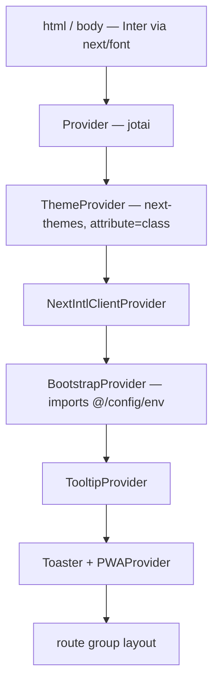

The web app is a Next.js App Router project under `apps/web/src/app`. It runs with
Cache Components on: every route is prerendered as far as it can be, and anything that
depends on the request streams in behind a `<Suspense>` boundary. Every page a visitor
can reach lives under one dynamic locale segment, `apps/web/src/app/[locale]`, split
into five route groups. Five modules sit outside the locale segment because they are
served at fixed URLs.

## The one rule the shell is built around

**Nothing on the path from a layout to its `{children}` may await.** A layout that
awaits the session, a cookie or a header turns every page below it into a dynamic,
blocking render and leaves nothing to prerender. So the layouts are synchronous, the
session is read once as a promise with `ServerSession.read()`, and that promise is
handed to the providers. Only leaf components unwrap it, each behind its own
`<Suspense>`. The same rule forbids the old segment exports (`dynamic`, `revalidate`
and the rest); caching is declared on the data instead (see `cachedServerGet` and
`"use cache"`).

What a visitor sees on a cold load is therefore the prerendered frame — the sidebar
skeleton and the page skeleton — followed by the real sidebar and page as they stream.

## The locale-independent modules

| File | Serves | Notes |
|---|---|---|
| `apps/web/src/app/robots.ts` | `/robots.txt` | Allows `/`, disallows fifteen authenticated prefixes, and advertises two sitemaps |
| `apps/web/src/app/sitemap.ts` | `/sitemap.xml` | Two entries only: `""` and `/help` |
| `apps/web/src/app/help/sitemap.xml/route.ts` | `/help/sitemap.xml` | The database-driven help sitemap; outside `[locale]` because the proxy never rewrites a dotted path (see the help table below) |
| `apps/web/src/app/sw.ts` | the Serwist service worker | Compiled by the route below, published at the public worker URL by a rewrite |
| `apps/web/src/app/serwist/[path]/route.ts` | the built worker | `createSerwistRoute` needs a `[path]` segment, so it cannot live at a static route. It exports only `generateStaticParams` and `GET` |
| `apps/web/src/app/globals.css` | the stylesheet | Imported by the root layout |

Both `apps/web/src/app/robots.ts` and `apps/web/src/app/sitemap.ts` import `ENV` from `apps/web/src/config/middleware-env.ts`
rather than `apps/web/src/config/env.ts`: they are build-time route modules and have no
reason to pull in the library or run `bootstrap()` as a side effect. Both fall back to a
scheme-carrying origin with `||`, because `ENV.APP_URL` is the empty string — not
`undefined` — when `NEXT_PUBLIC_ADDRESS` is unset.

## The root layout and its provider stack

`apps/web/src/app/[locale]/layout.tsx` declares `generateStaticParams` over
`routing.locales`, so every locale is prerendered. It validates the locale with
`hasLocale` (404 on a miss), loads the messages, and renders this stack — the order
matters, because each layer reads from the one above it:



It no longer calls `setRequestLocale`. `apps/web/src/i18n/request.ts` resolves the
locale itself, in this order: an explicit override, the `[locale]` root param read
through `next/root-params`, the deprecated `requestLocale`, then the default. The root
param throws in Server Actions and Route Handlers, so it is read inside a try/catch and
those callers fall through.

The layout also imports `@/config/env` directly at module scope, which is what registers
the module registry on the **server** side; `BootstrapProvider` does the same for the
client bundle. It declares the `viewport` (theme colours, `viewportFit: "cover"`,
`userScalable: false`) and the `metadata` block that wires the manifest, the Apple
touch icon and the five startup images under `apps/web/public/splash`.

## The five route groups and the gate each applies

| Group | Layout | Gate |
|---|---|---|
| `(admin)` | `apps/web/src/app/[locale]/(admin)/layout.tsx` | The proxy sends a visitor without a session to login. The layout reads nothing; every page calls `requireAdministrator(locale)` as its first statement |
| `(main)` | `apps/web/src/app/[locale]/(main)/layout.tsx` | The proxy only. The layout reads nothing |
| `(marketing)` | none | None. Holds `/home`, the static landing the proxy shows on `/` to a visitor without a session |
| `(auth)` | `apps/web/src/app/[locale]/(auth)/layout.tsx` | None. `CurrentUserProvider` plus a centred `h-svh` wrapper, inside a `Suspense` with `SessionFallback` |
| `(public-help)` | `apps/web/src/app/[locale]/(public-help)/help/layout.tsx` | None, deliberately. Mounts the session-aware providers without awaiting the session; the user footer appears only for a logged-in reader |

`(main)/(foundations)` is a nested group with no layout of its own: the login gate it
used to carry now lives in the proxy.

### The session shell

`(admin)` and `(main)` render the same thing:

```tsx
<Suspense fallback={<AppFrameSkeleton />}>
  <AppShell>{children}</AppShell>
</Suspense>
```

`AppShell` in `apps/web/src/features/common/components/session/AppShell.tsx` is a
synchronous server component. It calls `ServerSession.read()` once and mounts:
`SessionProvider` → `ViewportProvider` → `SocketProvider` → `CurrentUserProvider` →
`OnboardingProviderWrapper` → `PushNotificationProvider` →
`NotificationContextProvider` → `SidebarProvider` → `RefreshUser` + `LayoutDetails`.
`SessionProvider`, `ViewportProvider`, `SocketProvider` and `SidebarProvider` each take
the session promise. `ViewportProvider` is why a phone gets the mobile layout from the
first paint, and `SidebarProvider` opens the sidebar unless the `sidebar_state` cookie
says `false`.

`LayoutDetails` in `apps/web/src/features/common/components/details/LayoutDetails.tsx`
draws the frame:

- `PageTracker`, a leaf behind `Suspense` with no fallback, because it reads the pathname.
- `AppSidebar`, behind `Suspense` with `SidebarSkeleton`. It unwraps the session with
  `useSession()` and sends the visitor to `/login` if the session has gone.
- The content column: `TrialExpiringBanner`, then `TrialBlockingWrapper` around
  `{children}`. The wrapper covers only that column with a `PageSkeleton` overlay
  while the subscription status loads or blocks, so the sidebar stays visible.

**The administration gate is per page.** `requireAdministrator` in
`apps/web/src/features/common/components/session/requireAdministrator.ts` redirects to
`/<locale>/login` when there is no session and calls `notFound()` for anyone who is not
an administrator. Every `page.tsx` under `(admin)` awaits it before anything else, and
the generator's `admin-gate` integrity check (`check:template`) fails if one
does not. `apps/web/src/app/[locale]/(admin)/not-found.tsx` sits under the `(admin)`
layout, so a refused member sees the 404 inside the app frame.

## The route table

### `(admin)` — everything under `/administration`

Every page below starts with `await requireAdministrator(locale)`.

| Route | Page file | Renders |
|---|---|---|
| `/administration` | `apps/web/src/app/[locale]/(admin)/administration/page.tsx` | `AdminIndexContainer`, which brings its own `RoundPageContainer` |
| `/administration/ai-connections` | `apps/web/src/app/[locale]/(admin)/administration/ai-connections/page.tsx` | `AdministrationProvider` → `AiConnectionsContainer` |
| `/administration/companies` | `apps/web/src/app/[locale]/(admin)/administration/companies/page.tsx` | `CompaniesListContainer`, which owns `CompanyProvider` and the shell |
| `/administration/companies/[id]` | `apps/web/src/app/[locale]/(admin)/administration/companies/[id]/page.tsx` | `CompanyProvider` → `RoundPageContainer` → `AdminCompanyContainer` |
| `/administration/howtos` | `apps/web/src/app/[locale]/(admin)/administration/howtos/page.tsx` | `HowToProvider` → `HowToListContainer` |
| `/administration/howtos/[id]` | `apps/web/src/app/[locale]/(admin)/administration/howtos/[id]/page.tsx` | `HowToProvider` → `HowToContainer` |
| `/administration/prices/[id]` | `apps/web/src/app/[locale]/(admin)/administration/prices/[id]/page.tsx` | `PriceProvider` → `PriceContainer`. There is no `/administration/prices` index |
| `/administration/products` | `apps/web/src/app/[locale]/(admin)/administration/products/page.tsx` | `ProductsListContainer` |
| `/administration/products/[id]` | `apps/web/src/app/[locale]/(admin)/administration/products/[id]/page.tsx` | `ProductProvider` → `ProductContainer` |
| `/administration/rbac` | `apps/web/src/app/[locale]/(admin)/administration/rbac/page.tsx` | `RbacProvider` → `RbacContainer`, with the inverted `RoleId`/`ModuleId` maps |
| `/administration/rbac/roles` | `apps/web/src/app/[locale]/(admin)/administration/rbac/roles/page.tsx` | `RbacProvider` → `RbacByRoleContainer` |
| `/administration/token-usage` | `apps/web/src/app/[locale]/(admin)/administration/token-usage/page.tsx` | `AdministrationProvider` → `TokenUsageAdminProvider` → `TokenUsageAdminContainer` |
| `/administration/users` | `apps/web/src/app/[locale]/(admin)/administration/users/page.tsx` | `PlatformUsersContainer` — lists across all companies, not the company-scoped list |
| `/administration/waitlist` | `apps/web/src/app/[locale]/(admin)/administration/waitlist/page.tsx` | `PageContainer` → `WaitlistList` |

### `(auth)`

| Route | Page file | Renders |
|---|---|---|
| `/login` | `apps/web/src/app/[locale]/(auth)/login/page.tsx` | `AuthContainer` with `AuthComponent.Login` |
| `/register` | `apps/web/src/app/[locale]/(auth)/register/page.tsx` | `AuthContainer` with `AuthComponent.Register` |
| `/activation/[code]` | `apps/web/src/app/[locale]/(auth)/activation/[code]/page.tsx` | `AuthComponent.ActivateAccount`, code passed through `params` |
| `/invitation/[code]` | `apps/web/src/app/[locale]/(auth)/invitation/[code]/page.tsx` | `AuthComponent.AcceptInvitation` |
| `/reset/[code]` | `apps/web/src/app/[locale]/(auth)/reset/[code]/page.tsx` | `AuthComponent.ResetPassword` |
| `/logout` | `apps/web/src/app/[locale]/(auth)/logout/page.tsx` | `Logout` |
| `/auth` | `apps/web/src/app/[locale]/(auth)/auth/page.tsx` | Exchanges `?code=` through `AuthService.findToken`, then `Cookies` writes the session and navigates to `/` |
| `/auth/consent` | `apps/web/src/app/[locale]/(auth)/auth/consent/page.tsx` | GDPR consent form; posts `AuthService.completeOAuthRegistration` and forwards to `/auth?code=` |
| `/oauth/authorize` | `apps/web/src/app/[locale]/(auth)/oauth/authorize/page.tsx` | Redirects to `/login?callbackUrl=` when signed out; otherwise `OAuthAuthorizeClient` |
| `/oauth/success` | `apps/web/src/app/[locale]/(auth)/oauth/success/page.tsx` | The manual authorisation-code copy card |
| `/oauth/error` | `apps/web/src/app/[locale]/(auth)/oauth/error/page.tsx` | Maps ten known OAuth error codes to translated copy |

### `(marketing)`

| Route | Page file | Renders |
|---|---|---|
| `/home` | `apps/web/src/app/[locale]/(marketing)/home/page.tsx` | `CurrentUserProvider` → a centred `AuthContainer componentType={AuthComponent.Landing}`. Fully static: its metadata passes `path: "/"`, so it never reads the request headers. Visitors reach it as `/`, through the proxy rewrite |

### `(main)` and `(main)/(foundations)`

| Route | Page file | Renders |
|---|---|---|
| `/` | `apps/web/src/app/[locale]/(main)/page.tsx` | Logged in only (the proxy rewrites a visitor without a session to `/home`). Administrator → `CompanyProvider` → `CommonProvider` → `AdminIndexContainer`; everyone else → `CommonProvider` → `IndexContainer` |
| `/notifications` | `apps/web/src/app/[locale]/(main)/(foundations)/notifications/page.tsx` | `PageContainer` → `NotificationsListContainer` |
| `/roles` | `apps/web/src/app/[locale]/(main)/(foundations)/roles/page.tsx` | `RoleProvider` → `PageContainer` → `RolesList` |
| `/roles/[id]` | `apps/web/src/app/[locale]/(main)/(foundations)/roles/[id]/page.tsx` | `ServerSession.checkPermission`, then `RoleProvider` → `RoleContainer` |
| `/settings` | `apps/web/src/app/[locale]/(main)/(foundations)/settings/page.tsx` | `SettingsContainer`, seeded from `?section=` and defaulting to the profile section |
| `/settings/<segment>` | `apps/web/src/app/[locale]/(main)/(foundations)/settings/[module]/page.tsx` | Redirects to `/settings?section=<segment>`, preserving the query string |
| `/settings/oauth` | `apps/web/src/app/[locale]/(main)/(foundations)/settings/oauth/page.tsx` | `PageContainer` → `OAuthClientListContainer` |
| `/settings/oauth/new` | `apps/web/src/app/[locale]/(main)/(foundations)/settings/oauth/new/page.tsx` | `OAuthClientForm` plus the one-time `OAuthClientSecretDisplay` |
| `/settings/oauth/[clientId]` | `apps/web/src/app/[locale]/(main)/(foundations)/settings/oauth/[clientId]/page.tsx` | Detail view, or the edit form when `?edit=true` |
| `/tokenusage` | `apps/web/src/app/[locale]/(main)/(foundations)/tokenusage/page.tsx` | `TokenUsageReportProvider` → `TokenUsageReportContainer` |
| `/users` | `apps/web/src/app/[locale]/(main)/(foundations)/users/page.tsx` | `ServerSession.checkPermission`, then `UserProvider` → `UsersListContainer` |
| `/users/[id]` | `apps/web/src/app/[locale]/(main)/(foundations)/users/[id]/page.tsx` | `CompanyProvider` → `UserProvider` → `UserContainer` |

`apps/web/src/app/[locale]/(main)/(foundations)/settings/layout.tsx` is a client layout
that imports `StripeProvider` statically. It used `next/dynamic` with `ssr: false`
before, which rendered nothing on the server: every settings page was missing from the
prerendered shell. The layout is only loaded on settings routes, so Stripe.js still
stays out of every other page's bundle.

### `(public-help)` and the offline fallback

| Route | Page file | Renders |
|---|---|---|
| `/help` | `apps/web/src/app/[locale]/(public-help)/help/page.tsx` | Three featured tutorials plus one card per `HELP_MODES` entry |
| `/help/[mode]` | `apps/web/src/app/[locale]/(public-help)/help/[mode]/page.tsx` | The articles of one mode, ordered by `order`; unknown modes 404. `generateStaticParams` over `HELP_MODES` prerenders every mode |
| `/help/[mode]/[slug]` | `apps/web/src/app/[locale]/(public-help)/help/[mode]/[slug]/page.tsx` | `HelpArticleBody` with previous/next siblings and related links, body through `BlockNoteViewerContainer` |
| `/help/sitemap.xml` | `apps/web/src/app/help/sitemap.xml/route.ts` | Database-driven sitemap, XML-escaped, built per request after `connection()`. It sits outside `[locale]`: the proxy matcher skips any path with a dot, so nothing rewrites `/help/sitemap.xml` to a locale, and a route under `[locale]` would only answer at `/en/help/sitemap.xml`. `robots.ts` advertises `/help/sitemap.xml` |
| `/offline` | `apps/web/src/app/[locale]/offline/page.tsx` | The PWA fallback document. Sits directly under `[locale]`, in no group |

All four help surfaces read through `apps/web/src/app/[locale]/(public-help)/help/_data/publicHowTo.ts`,
which fetches with `cache: "help"`: `cachedServerGet` runs it under `"use cache"`,
without a token, tagged `help`.

**The build never calls the API.** Docker and CI build with no API reachable, and a
cached call that fails during `next build` fails the page's prerender even when the
caller catches the error. So every API read sits in a component that awaits
`connection()` behind its own `<Suspense>` (the featured tutorials on `/help`, the
article list on `/help/[mode]`), and the sitemap route calls `connection()` first.
The chrome, headings and mode links stay in the prerendered shell; the reads happen
per request and are still cached. Check it by building with the API stopped. At run
time the help pages need the public help routes, which `apps/api/src/main.ts` turns
on with `howTo: { publicRoutes: true }`; without them every help page answers 404.

**Links never carry the default locale.** With `localePrefix: "as-needed"` the proxy
redirects `/en/x` to `/x`, and a client navigation cannot read the page data across
that redirect. Help links use `Link` from `apps/web/src/i18n/navigation.ts` with
locale-free paths, breadcrumbs pass locale-free hrefs (the package's `Link` adds the
prefix), and the sitemap and the server redirects build their paths with
`getPathname`.

The module dereferences `Modules.HowTo` at **module scope**. The sitemap route therefore
imports `@/config/env` first: Next collects a route handler's config during the
production build without running `apps/web/src/instrumentation.ts`, and without that
import the build fails with an unregistered-module error.

The help layout follows the same rule as the session shell: it is synchronous, calls
`ServerSession.read()` and feeds the promise to `SessionProvider` and
`SocketProvider`. `HelpSidebar` sits behind `Suspense` with `SidebarSkeleton`, and its
user footer unwraps the session behind its own boundary and renders nothing for a
visitor without one.

## Error boundaries, not-found pages and loading states

| File | Scope |
|---|---|
| `apps/web/src/app/[locale]/(main)/error.tsx` | The whole `(main)` group. Parses `error.status` or a `"403:message"` string, renders `Logout` for 401 and an `ErrorDetails` card for 403/404/500/503 |
| `apps/web/src/app/[locale]/(main)/(foundations)/users/[id]/error.tsx` | The user detail route. Parses a JSON error message into `{ code, message }` |
| `apps/web/src/app/[locale]/(admin)/not-found.tsx` | Every administration page. Renders the `errors.404` copy inside the app frame |

There is no root error boundary, no global error boundary, and no not-found page
outside `(admin)`.

**Every segment that fetches data has its own `loading.tsx`.** Without one, a
navigation into the segment has nothing to show until the server answers, and the
Navigation Inspector flags it. Two fallbacks are used:

- `PageSkeleton` (`apps/web/src/features/common/components/skeletons/PageSkeleton.tsx`)
  inside the app frame: every administration segment, `(main)`, `(main)/(foundations)`,
  `roles/[id]`, `settings`, `settings/[module]`, `settings/oauth/[clientId]`, `users`,
  `users/[id]`, and the three help segments.
- `SessionFallback` (`apps/web/src/features/common/components/session/SessionFallback.tsx`)
  outside it: `(auth)`, `auth`, `auth/consent`, `oauth/authorize`, `activation/[code]`,
  `invitation/[code]` and `reset/[code]`.

Add one in the same style whenever you add a segment that fetches.

## The proxy

Next 16 renamed the middleware module to a proxy module. The file is
`apps/web/src/proxy.ts` — there is no middleware file; nothing in this app is called middleware any more.

The proxy is the login gate for the whole app: no layout checks the session any more.
It does seven things, in this order.

**1. Public-path matching.** `PUBLIC_PATHS` lists what a visitor without a session may
reach: `/` and `/home`, the eight `(auth)` prefixes (`/activation`, `/auth`,
`/invitation`, `/login`, `/logout`, `/oauth`, `/register`, `/reset`), `/help` and
`/offline`. `isPublicPath` matches `"/"` by equality and every other entry as itself or
anything below it — prefix-matching `"/"` would make every path public. `/offline` is
listed explicitly because it carries no dot and the matcher therefore does not skip it;
an auth-gated `/offline` would precache a redirect and the offline page would never
render.

**2. `stripLocalePrefix`.** Removes a leading locale segment, but only when the segment
is a configured locale, and it accepts a bare locale (`/en` → `/`). A naive regex would
eat any two-letter route segment.

**3. Token refresh, first.** This is the only place in the app that refreshes a token;
the package never does. When a `refreshToken` exists and the `token` cookie is absent
or `isTokenCloseToExpiry` reports fewer than 300 seconds — five minutes — until the
JWT's `exp`, the proxy POSTs to `${ENV.PUBLIC_API_URL}auth/refreshtoken/${refreshToken}`.
That `PUBLIC_API_URL` is `NEXT_PUBLIC_API_URL`, deliberately not the server-only
`API_INTERNAL_URL` override. It runs before any decision, so a dead refresh token
counts as no session.

**4. The login redirect.** No session and a non-public path →
`NextResponse.redirect` to `/login`, with `callbackUrl` set to the requested path and
query (the name the package's login form reads on success). The `token` and
`refreshToken` cookies are cleared on the way, if present.

**5. The next-intl pass and the landing rewrite.** `createMiddleware(routing)` runs and
its response becomes the response the proxy decorates. For a visitor without a session
on `/`, the proxy rewrites to `/<locale>/home` on top of that response, so the URL stays
`/` and the static landing is served. A logged-in visitor with a fresh token gets the
new `token` cookie (`httpOnly: false`, 24 hours) and `reloadData=true`.

**6. `x-full-url`.** The request URL with `http:` rewritten to `https:`, set as a
response header. `generateSpecificMetadata` in `apps/web/src/utils/metadata.ts` reads it
back through `headers()` to build the canonical and Open Graph URLs, unless the page
passes `path`, as the static landing does.

**7. The matcher.** `"/((?!api|trpc|_next|_vercel|.*\\..*).*)"` — everything except the
API prefixes, the build output, and any path containing a dot.

## ServerSession

`ServerSession` (exported from `@carlonicora/nextjs-jsonapi/server`) is the server-side
half of the session and reads nothing but cookies:

| Method | Cookie | Behaviour |
|---|---|---|
| `read()` | all of the below | Returns the session as a promise, without awaiting. The shell layouts call it and hand the promise to the providers; `useSession()` unwraps it on the client |
| `isLogged()` | `token` | True when the cookie exists and is non-empty. It does not verify the signature |
| `userId()` / `companyId()` | `userId`, `companyId` | Returns the value or `""` |
| `hasRole(roleId)` | `roles` | `String.includes` against the raw JSON array string |
| `hasFeature(featureId)` | `features` | Same substring test |
| `hasPermissionToModule({module, action, data})` | `features` + `modules` | Feature test first, then `ungzip` + base64 decode of `modules`, then `checkPermissionsFromServer` |
| `checkPermission(...)` | as above | Calls `hasPermissionToModule` and `redirect("/401")` on failure |

Every method but `read()` awaits cookies, so call them in pages and leaves, never in a
layout. The gates themselves are the subject of the access-control page in this section.

## Where to look

| File | Why |
|---|---|
| `apps/web/src/proxy.ts` | The public paths, the login redirect, the token refresh, the landing rewrite, the matcher |
| `apps/web/src/app/[locale]/layout.tsx` | The provider stack, fonts, viewport and metadata |
| `apps/web/src/features/common/components/session/AppShell.tsx` | The session shell shared by `(admin)` and `(main)` |
| `apps/web/src/features/common/components/details/LayoutDetails.tsx` | The frame: sidebar, banner, trial overlay |
| `apps/web/src/features/common/components/session/requireAdministrator.ts` | The administration gate every admin page calls |
| `apps/web/src/app/[locale]/(marketing)/home/page.tsx` | The static landing |
| `apps/web/src/app/[locale]/(public-help)/help/layout.tsx` | The deliberately public shell |
| `apps/web/src/app/[locale]/(main)/error.tsx` | Status parsing and the error cards |
| `apps/web/src/i18n/request.ts` | How the locale is resolved without `setRequestLocale` |
| `apps/web/src/app/robots.ts` | The disallow list to extend as routes are added |
| `apps/web/src/app/serwist/[path]/route.ts` | Why the worker lives under a dynamic segment |
| `apps/web/src/utils/metadata.ts` | The consumer of `x-full-url` |

## Gaps and drift

- `ServerSession.checkPermission` redirects to `/401`. No `/401` route exists anywhere
  under `apps/web/src/app`, so a refused permission lands on the Next.js 404 page rather
  than an explanatory one. `/roles/[id]` does this to the platform administrator.
- `TrialBlockingWrapper` in `apps/web/src/features/common/components/wrappers/TrialBlockingWrapper.tsx`
  redirects a blocked subscription to `/trial-expired`. That route does not exist either.
- `apps/web/src/app/[locale]/(auth)/oauth/error/page.tsx` links to `/waitlist` for the
  `waitlist_required` error code. The template ships no `/waitlist` route; the only
  waitlist surface is `/administration/waitlist`.
- An administration page sets its own title before the gate runs, so a refused member
  sees the 404 under that page's title (for example "Employees").
- The root layout sets `lang` but never `dir`, and mounts no `DirectionProvider`. The
  package documents the direction contract as app-owned; see the i18n and theme page.
- I did not examine the `apps/web/src/app/[locale]/(admin)` containers' internals (they
  live in the package), or the MDX pipeline that `apps/web/mdx-components.tsx` and the
  `pageExtensions` entry enable but no shipped page uses.
