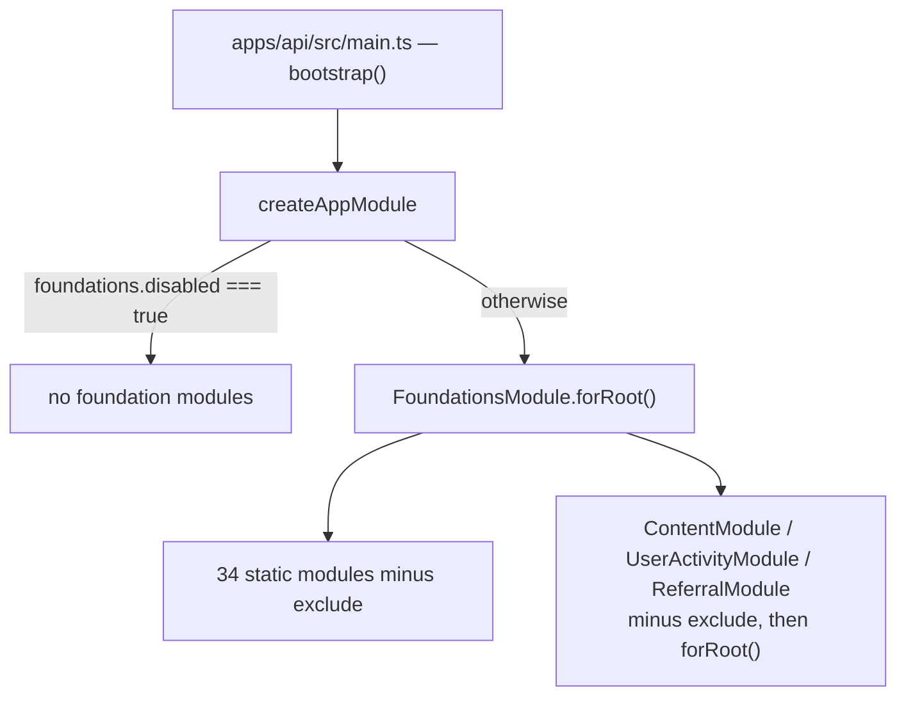

{{display}} has no domain of its own yet. It does have 43 foundation modules,
wired and serving HTTP the first time you run `pnpm dev`. This section is the
map of what you already own, so that you extend rather than rebuild.

## What a foundation is

A foundation is a complete vertical slice shipped inside
`@carlonicora/nestjs-neo4jsonapi` — entity descriptor, repository, service,
controller, DTOs and NestJS module — living in one directory under
`packages/nestjs-neo4jsonapi/src/foundations/`. It behaves exactly like a
feature module you would write yourself: it extends `AbstractRepository` and
`AbstractService`, declares its entity through `defineEntity()`, registers its
model with `modelRegistry` in `onModuleInit`, and mounts its controller on the
same Fastify instance as your own code. The only difference is that you did not
write it and you do not maintain it.

Most foundations have a counterpart in
`packages/nextjs-jsonapi/src/features/`: a model, a service, a module factory
and a set of components. The backend half is wired by
`FoundationsModule.forRoot()`; the frontend half is wired by name in
`apps/web/src/config/Bootstrapper.ts`, and the two halves are registered
independently. A foundation can be live on the API and absent from the web app.

## FoundationsModule.forRoot()

`packages/nestjs-neo4jsonapi/src/foundations/foundations.modules.ts` declares
`STATIC_FOUNDATION_MODULES` — 34 module classes imported unconditionally — plus
three dynamic modules assembled inside `forRoot()`. `FoundationsModuleConfig`
takes four keys and no others:

| Key | Type | Effect |
|---|---|---|
| `contentExtension` | `ContentExtensionConfig` | Extra relationships grafted onto the `Content` descriptor by `ContentModule.forRoot()` |
| `referral` | `ReferralModuleConfig` | Configuration handed to `ReferralModule.forRoot()` |
| `userActivity` | `UserActivityModuleConfig` | Configuration handed to `UserActivityModule.forRoot()` |
| `exclude` | `Type<any>[]` | Foundation module classes to leave unregistered; defaults to `[]` |

`forRoot()` filters `STATIC_FOUNDATION_MODULES` against `exclude`, then filters
the three dynamic entries — `ContentModule`, `UserActivityModule`,
`ReferralModule` — against the same set. **Dynamic modules are excluded by the
same class reference as static ones.** The dynamic list is an array of
`{ classRef, factory }` pairs precisely so the `exclude` check runs against the
class before the factory is called, which means `exclude: [ContentModule]` both
skips the import and never evaluates `ContentModule.forRoot()`.

## How bootstrap() reaches it

`BootstrapOptions.foundations` in
`packages/nestjs-neo4jsonapi/src/bootstrap/bootstrap.options.ts` carries two
keys:

| Key | Default | Effect |
|---|---|---|
| `exclude` | `[]` | Passed straight through to `FoundationsModule.forRoot({ exclude })` |
| `disabled` | `false` | When `true`, `FoundationsModule` is never imported at all |

`createAppModule` in
`packages/nestjs-neo4jsonapi/src/bootstrap/app.module.factory.ts` reads both. On
`disabled: true` the entire foundation set is dropped, which is what an
application that supplies all 43 slices itself needs in order to avoid
transitive controller collisions — `CompanyModule` is imported by the agents and
by several Stripe modules, so it arrives whether or not you asked for it.
`contentExtension`, `referral` and `userActivity` are top-level
`BootstrapOptions` fields, forwarded into the same `forRoot()` call.

`apps/api/src/main.ts` calls `bootstrap()` with `appModules`, `i18n`, `config`,
`contentExtension` and `openApi`. It passes **no `foundations` key at all**, so
{{display}} starts life with every one of the 37 auto-registered foundations
mounted and nothing excluded.

## The 43 directories

Ten chapters cover all 43 with no overlap and no gap. "Auto" means the class is
in `STATIC_FOUNDATION_MODULES` or in the dynamic trio, so
`FoundationsModule.forRoot()` registers it without you doing anything.

| Directory | Auto | Chapter |
|---|---|---|
| `ai-connection` | yes | [assistant-and-actions.md](assistant-and-actions.md) |
| `assistant` | yes | [assistant-and-actions.md](assistant-and-actions.md) |
| `assistant-action` | no | [assistant-and-actions.md](assistant-and-actions.md) |
| `assistant-message` | no | [assistant-and-actions.md](assistant-and-actions.md) |
| `atomicfact` | yes | [knowledge-graph-and-retrieval.md](knowledge-graph-and-retrieval.md) |
| `audit` | yes | [audit-and-activity.md](audit-and-activity.md) |
| `auth` | yes | [identity-and-tenancy.md](identity-and-tenancy.md) |
| `chunk` | yes | [content-and-storage.md](content-and-storage.md) |
| `chunker` | yes | [content-and-storage.md](content-and-storage.md) |
| `community` | no | [knowledge-graph-and-retrieval.md](knowledge-graph-and-retrieval.md) |
| `company` | yes | [identity-and-tenancy.md](identity-and-tenancy.md) |
| `content` | yes (dynamic) | [content-and-storage.md](content-and-storage.md) |
| `discord` | no | [growth-and-help.md](growth-and-help.md) |
| `discord-user` | yes | [identity-and-tenancy.md](identity-and-tenancy.md) |
| `feature` | yes | [modules-features-and-rbac.md](modules-features-and-rbac.md) |
| `google-user` | no | [identity-and-tenancy.md](identity-and-tenancy.md) |
| `how-to` | yes | [growth-and-help.md](growth-and-help.md) |
| `keyconcept` | yes | [knowledge-graph-and-retrieval.md](knowledge-graph-and-retrieval.md) |
| `membership` | yes | [identity-and-tenancy.md](identity-and-tenancy.md) |
| `module` | yes | [modules-features-and-rbac.md](modules-features-and-rbac.md) |
| `notification` | yes | [notifications-and-push.md](notifications-and-push.md) |
| `oauth` | yes | [two-factor-and-oauth.md](two-factor-and-oauth.md) |
| `push` | yes | [notifications-and-push.md](notifications-and-push.md) |
| `rbac` | no | [modules-features-and-rbac.md](modules-features-and-rbac.md) |
| `referral` | yes (dynamic) | [growth-and-help.md](growth-and-help.md) |
| `relevancy` | yes | [knowledge-graph-and-retrieval.md](knowledge-graph-and-retrieval.md) |
| `role` | yes | [identity-and-tenancy.md](identity-and-tenancy.md) |
| `s3` | yes | [content-and-storage.md](content-and-storage.md) |
| `stripe` | yes | [billing-and-token-usage.md](billing-and-token-usage.md) |
| `stripe-customer` | yes | [billing-and-token-usage.md](billing-and-token-usage.md) |
| `stripe-invoice` | yes | [billing-and-token-usage.md](billing-and-token-usage.md) |
| `stripe-price` | yes | [billing-and-token-usage.md](billing-and-token-usage.md) |
| `stripe-product` | yes | [billing-and-token-usage.md](billing-and-token-usage.md) |
| `stripe-promotion-code` | yes | [billing-and-token-usage.md](billing-and-token-usage.md) |
| `stripe-subscription` | yes | [billing-and-token-usage.md](billing-and-token-usage.md) |
| `stripe-trial` | yes | [billing-and-token-usage.md](billing-and-token-usage.md) |
| `stripe-usage` | yes | [billing-and-token-usage.md](billing-and-token-usage.md) |
| `stripe-webhook` | yes | [billing-and-token-usage.md](billing-and-token-usage.md) |
| `tokenusage` | yes | [billing-and-token-usage.md](billing-and-token-usage.md) |
| `two-factor` | yes | [two-factor-and-oauth.md](two-factor-and-oauth.md) |
| `user` | yes | [identity-and-tenancy.md](identity-and-tenancy.md) |
| `user-activity` | yes (dynamic) | [audit-and-activity.md](audit-and-activity.md) |
| `waitlist` | yes | [growth-and-help.md](growth-and-help.md) |

## The six that are not auto-registered

Absent from `STATIC_FOUNDATION_MODULES` does not mean absent from the running
app. Five of the six arrive as a transitive import; the sixth is the app's own
call.

| Directory | How it reaches the app |
|---|---|
| `assistant-action` | Imported by `AssistantModule` (`packages/nestjs-neo4jsonapi/src/foundations/assistant/assistant.module.ts`) |
| `assistant-message` | Imported by `AssistantModule` |
| `community` | Imported by the community-detector, community-summariser and drift agent modules under `packages/nestjs-neo4jsonapi/src/agents/` |
| `discord` | Imported by `createAppModule` only in worker mode and only when `baseConfig.discord.token` is set, alongside `NecordModule.forRootAsync` |
| `google-user` | Imported by `AuthModule` (`packages/nestjs-neo4jsonapi/src/foundations/auth/auth.module.ts`) |
| `rbac` | A dynamic module the app registers itself: `RbacModule.register({ moduleUserPaths, rbac, devMode })` in `apps/api/src/features/features.modules.ts` |

The consequence for `exclude` is direct: excluding `AssistantModule` also
removes the only importer of `AssistantActionModule` and `AssistantMessageModule`,
and excluding `AuthModule` removes the only importer of `GoogleUserModule`.
`exclude` operates on the list, not on the import graph.

## Writing a chapter for a domain of your own

When you add a domain — a set of entities that belong together — give it a
chapter here. The reader who inherits the codebase then finds your domain
described in the same shape as everything else.

1. Copy `_template.md` to a new file in this directory named after the domain,
   not after a directory.
2. Keep all twelve H2 headings, in order, with no others and none missing. A
   heading with nothing under it gets one honest sentence ("This domain runs no
   background work."), never an omission.
3. Fill the tables the template already provides. Every path you cite must
   exist: `scripts/check-handbook.mjs` extracts each backticked path token and
   fails the run on a miss.
4. Add a row for the chapter in the index at `docs/handbook/README.md`.

The heading check is not advisory. The checker enforces the twelve-heading
skeleton on **every** file added to this directory except this `README.md`, so a
chapter that drops a heading fails the build rather than shipping half-shaped.

## Where to look

| File | Why |
|---|---|
| `packages/nestjs-neo4jsonapi/src/foundations/foundations.modules.ts` | The 34 static modules, the three dynamic ones, and the `exclude` filter |
| `packages/nestjs-neo4jsonapi/src/bootstrap/bootstrap.options.ts` | `BootstrapOptions.foundations` and every sibling option |
| `packages/nestjs-neo4jsonapi/src/bootstrap/app.module.factory.ts` | Where `foundations.disabled` is honoured and where `DiscordModule` is conditionally wired |
| `packages/nestjs-neo4jsonapi/src/foundations/index.ts` | The public barrel: `foundations.modules` plus 34 directory re-exports; the nine `stripe-*` directories are not listed there and reach consumers through other paths |
| `apps/api/src/main.ts` | The app's single `bootstrap()` call and the options it actually passes |
| `apps/api/src/features/features.modules.ts` | The app's own modules, including `RbacModule.register()` |
| `apps/web/src/config/Bootstrapper.ts` | The frontend half: which package feature modules this app registers |
| `packages/nextjs-jsonapi/src/features/` | The frontend half: 27 feature directories, models, services and module factories |
| `_template.md` | The twelve-heading skeleton to copy for a new chapter |
| `docs/handbook/README.md` | The handbook index a new chapter has to be listed in |

## Gaps and drift

- The count of frontend feature directories (27 under
  `packages/nextjs-jsonapi/src/features/`) does not match the 43 backend
  foundations, and the names do not line up one-to-one: `billing`, `help`,
  `onboarding`, `administration`, `audit-log` and `search` have no
  same-named backend foundation, while `membership`, `chunker`, `community`,
  `relevancy`, `atomicfact`, `keyconcept`, `stripe-*` and `discord-user` have no
  same-named frontend feature. Each chapter records its own mapping.
- `exclude` is documented and typed but the template exercises neither it nor
  `disabled`, so neither path has a shipped example in this repository.
- This page does not examine what each foundation does; that is the job of the
  ten chapters. It also does not cover the RBAC engine, the queue infrastructure
  or the AI layer, which live in `03-backend`, `01-architecture` and `06-ai`.
