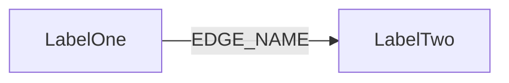

*Copy this file to a new chapter in `docs/handbook/05-foundations/`, named after
the domain rather than after a directory. Keep all twelve H2 headings below, in
this order, with none added and none removed —
`scripts/check-handbook.mjs` enforces the list and the order on every file in
this directory except `README.md`. Replace each italicised line with prose; keep
each table and delete rows that do not apply. A heading with nothing to say gets
one honest sentence, never an omission.*

## Purpose

*Two to four sentences: what this domain does for {{display}}, and what breaks if
it is removed. Name the foundation directories or app feature directories the
chapter covers.*

## Vocabulary

*Terms specific to this chapter, each expanded on first use. Framework-wide
terms belong in `docs/handbook/00-start-here/glossary.md`, not here.*

| Term | Meaning |
|---|---|
|  |  |

## Graph model

*Every Neo4j label this domain declares, with the file that declares it. State
for each whether it is company-scoped or global — `defineEntity()` defaults
`isCompanyScoped` to `true`, and turning it off is a deliberate decision worth
recording. Follow the table with a Mermaid graph of the labels and edges.*

| Label | Key fields | Relationships | Declaring file |
|---|---|---|---|
|  |  |  |  |

## Backend

*One row per module. Cite the controller, service and repository by path.
"Endpoints beyond CRUD" is where the interesting behaviour hides — list the
routes that `createCrudHandlers()` would not have produced. Note any Cypher
worth reading, and any query helper other modules are expected to reuse.*

| Endpoint | Controller | Service | Repository | DTOs | Guards |
|---|---|---|---|---|---|
|  |  |  |  |  |  |

## Frontend

*One row per frontend module. "Wired" means the module factory is called in
`apps/web/src/config/Bootstrapper.ts`; a package feature that is not called
there has no registry entry and `Modules.X` is undefined at runtime. The feature
id is the `feature` key on the module factory, and gates the module behind a
company's `HAS_FEATURE` edge.*

| Model | Service | Module factory | Routes | Components | Feature id |
|---|---|---|---|---|---|
|  |  |  |  |  |  |

## Flows

*Numbered sequences for each key action, naming the file at every hop: the
component, the service, the endpoint, the controller, the service, the
repository, the Cypher, and back. Include queue jobs, socket events and
notifications where they fire. A Mermaid sequence diagram earns its place when a
flow crosses more than two processes.*

## Background jobs

*Queues, processors and cron jobs this domain touches, with the queue id from
`packages/nestjs-neo4jsonapi/src/config/enums/queue.id.ts` and the job name the
processor matches on. Note that workers run only in worker mode. If there is
nothing, say so in one line.*

| Queue | Job name | Processor | Trigger |
|---|---|---|---|
|  |  |  |  |

## Permissions and gating

*The module ids from `packages/shared/src/const/module.id.ts`, the feature ids,
the roles from `packages/shared/src/const/system.roles.id.ts`, and the guards.
Say what an unauthenticated caller, an ordinary member and a company
administrator each see. Cross-reference `docs/handbook/03-backend/rbac-and-permissions.md`
rather than restating the engine.*

## Configuration

*Every environment variable and config key this domain reads, with the file that
declares the default. Keys come from `.env.example` and
`packages/nestjs-neo4jsonapi/src/config/base.config.ts`; app overrides live in
`apps/api/src/config/config.ts`. Never read `process.env` directly in domain
code.*

| Variable | Config key | Default | Read by |
|---|---|---|---|
|  |  |  |  |

## Tests

*Where the specs are, and — more usefully — what is not covered. Package specs
are `*.spec.ts` beside the code they test; the web app's own suite is jsdom plus
React Testing Library. Name the behaviours a reader should not assume are
protected.*

## Where to look

*The ten most useful files for this domain, one line each on why a reader would
open it. Paths only, no line numbers.*

| File | Why |
|---|---|
|  |  |

## Gaps and drift

*What you did not examine, and anything in the code that contradicts a shipped
document. The code wins; record the contradiction here and mirror it into
`docs/handbook/08-workflow/known-drift.md`. Never fix template code to match a
document.*
