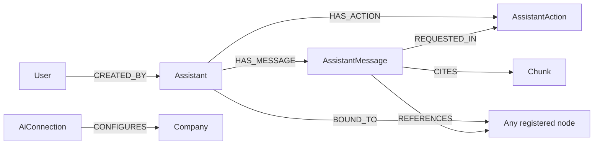

## Purpose

Four foundations under `packages/nestjs-neo4jsonapi/src/foundations/` give
{{display}} a conversational surface and the plumbing behind it: `assistant` is
the thread, `assistant-message` is the turn, `assistant-action` is a destructive
tool call waiting for a human to approve it, and `ai-connection` is the
database-backed list of LLM providers every one of those turns resolves through.
Remove the first three and there is no chat; remove the fourth and the app falls
back to whatever the environment variables say, which is exactly what it does on
a fresh install.

## Vocabulary

| Term | Meaning |
|---|---|
| Thread | One `:Assistant` node. Owned by a user, scoped to a company, optionally bound to one content record |
| Turn | One `:AssistantMessage`. `role` is `user`, `assistant` or `system`; `position` orders them |
| Engine | The `engine` field on a thread. `operator` marks a thread created through the operator endpoints; absent means the ordinary responder |
| Bound content | The `BOUND_TO` edge from a thread to any registered resource, so a conversation can be *about* a record |
| Reference / citation | `REFERENCES` points at any registered entity; `CITES` points specifically at a `:Chunk`. Both carry `relevance` and `reason` on the edge |
| Pending action | An `:AssistantAction` in status `pending`: the agent asked to do something destructive and the run is frozen until a human answers |
| Connection type | One of nine model roles: `ai`, `aiLite`, `aiLarge`, `vision`, `audio`, `image`, `embedder`, `transcriber`, `documentAi` |
| Fallback chain | The ordered `AiConnection` rows for one `(connectionType, companyId \| null)` pair, plus the `.env` candidate always appended last |
| Cooldown | A window during which a connection that just failed transiently is skipped |

## Graph model

| Label | Key fields | Relationships | Declaring file |
|---|---|---|---|
| `Assistant` | `title`, `engine` | `CREATED_BY` → `User` as `owner` (one, immutable, filled from CLS `userId`), `HAS_MESSAGE` → `AssistantMessage` (many), `BOUND_TO` → any registered node (one, immutable, polymorphic) | `packages/nestjs-neo4jsonapi/src/foundations/assistant/entities/assistant.ts` |
| `AssistantMessage` | `role`, `content`, `position`, `suggestedQuestions`, `inputTokens`, `outputTokens`, `trace`, `messageType` | `HAS_MESSAGE` ← `Assistant` (one, required, immutable), `REFERENCES` → any registered node (many, polymorphic, edge fields `relevance`/`reason`), `CITES` → `Chunk` (many, edge fields `relevance`/`reason`), `REQUESTED_IN` → `AssistantAction` (one, immutable) | `packages/nestjs-neo4jsonapi/src/foundations/assistant-message/entities/assistant-message.ts` |
| `AssistantAction` | `status`, `toolName`, `toolArgs`, `summary`, `threadId`, `userModuleIds`, `contentScope`, `resolvedAt`, `expiresAt` | `HAS_ACTION` ← `Assistant` (one, required, immutable), `REQUESTED_IN` ← `AssistantMessage` (one, immutable) | `packages/nestjs-neo4jsonapi/src/foundations/assistant-action/entities/assistant-action.ts` |
| `AiConnection` | `name`, `connectionType`, `provider`, `position`, `enabled`, `model`, `url`, `apiKey` (encrypted, never serialised), `region`, `instance`, `apiVersion`, `googleCredentialsBase64` (encrypted, never serialised), `allowFallbacks`, `reasoningEffort`, `maxOutputTokens`, `dimensions`, the five cost fields, `directUrl`, `language`, `directFormat`, `directProvider` | `CONFIGURES` → `Company` (one, optional, immutable) | `packages/nestjs-neo4jsonapi/src/foundations/ai-connection/entities/ai-connection.ts` |

`Assistant`, `AssistantMessage` and `AssistantAction` all set
`isCompanyScoped: true`. `AiConnection` sets `isCompanyScoped: false` — a
deliberate exception, because platform administrators manage every chain and the
resolver queries by company explicitly rather than relying on an injected
filter. A connection with no `CONFIGURES` edge is the global chain; one with an
edge is that company's override. The computed `companyId` field reads the edge's
target id, and two virtual fields — `hasApiKey` and `hasGoogleCredentials` —
let the admin UI show that a secret exists without ever receiving it.

`AssistantAction.toolArgs`, `userModuleIds` and `contentScope` are stored as
JSON strings, not as structured properties. `requestedAt` is deliberately absent:
the framework's `createdAt` covers it.

Two of these relationships are polymorphic in different ways. `Assistant.content`
resolves its target at read time by walking the node's labels through
`modelRegistry`. `AssistantMessage.references` instead has its candidate list
filled at `onApplicationBootstrap`: every registered model with a serialiser,
minus `assistant-messages` and `assistants` themselves. It has to be bootstrap
time rather than module-init time, because the list is only complete once every
other module has registered.

## Backend

| Endpoint | Controller | Service | Repository | DTOs | Guards |
|---|---|---|---|---|---|
| `POST /assistants`, `POST /assistants/:assistantId/assistant-messages`, `GET /assistants`, `GET /assistants/:assistantId`, `PATCH /assistants/:assistantId`, `DELETE /assistants/:assistantId` | `packages/nestjs-neo4jsonapi/src/foundations/assistant/controllers/assistant.controller.ts` | `packages/nestjs-neo4jsonapi/src/foundations/assistant/services/assistant.service.ts` | `packages/nestjs-neo4jsonapi/src/foundations/assistant/repositories/assistant.repository.ts` | `assistant-post.dto.ts`, `assistant-append.dto.ts`, `assistant-patch.dto.ts` | `JwtAuthGuard` on the class |
| `GET /assistants/:assistantId/assistant-messages`, `GET /assistant-messages/:id`, `DELETE /assistant-messages/:id` | `packages/nestjs-neo4jsonapi/src/foundations/assistant-message/controllers/assistant-message.controller.ts` | `packages/nestjs-neo4jsonapi/src/foundations/assistant-message/services/assistant-message.service.ts` | `packages/nestjs-neo4jsonapi/src/foundations/assistant-message/repositories/assistant-message.repository.ts` | `assistant-message.dto.ts` | `JwtAuthGuard` on the class |
| `GET /assistant-actions/:actionId`, `POST /assistant-actions/:actionId/approve`, `POST /assistant-actions/:actionId/deny` | `packages/nestjs-neo4jsonapi/src/foundations/assistant-action/controllers/assistant-action.controller.ts` | `packages/nestjs-neo4jsonapi/src/foundations/assistant-action/services/assistant-action.service.ts` | `packages/nestjs-neo4jsonapi/src/foundations/assistant-action/repositories/assistant-action.repository.ts` | none — the id is the whole request | `JwtAuthGuard` on the class |
| `GET /ai-connections`, `GET /ai-connections/:id` | `packages/nestjs-neo4jsonapi/src/foundations/ai-connection/controllers/ai-connection.controller.ts` | `packages/nestjs-neo4jsonapi/src/foundations/ai-connection/services/ai-connection.service.ts` | `packages/nestjs-neo4jsonapi/src/foundations/ai-connection/repositories/ai-connection.repository.ts` | none | `JwtAuthGuard` + `@Roles(RoleId.Administrator)` |
| `POST /ai-connections`, `POST /ai-connections/reorder`, `PUT /ai-connections/:id`, `DELETE /ai-connections/:id` | same | same | same | `ai-connection.post.dto.ts`, `ai-connection.put.dto.ts`, `ai-connection.reorder.dto.ts` | `AdminJwtAuthGuard` + `@Roles(RoleId.Administrator)` |
| `POST /operator`, `POST /operator/:assistantId/assistant-messages` | `packages/nestjs-neo4jsonapi/src/agents/operator/controllers/operator.controller.ts` | `AssistantService` | — | — | `JwtAuthGuard` |

### Which modules `FoundationsModule` registers

`STATIC_FOUNDATION_MODULES` in
`packages/nestjs-neo4jsonapi/src/foundations/foundations.modules.ts` lists
`AssistantModule` and `AiConnectionModule`. It does **not** list
`AssistantMessageModule` or `AssistantActionModule` — both reach the app as
imports of `AssistantModule`, and both are `forwardRef`ed in one direction or
the other because the dependency is genuinely circular: the action controller
needs `AssistantService.resolveAction`, and the operator turn flow inside
`AssistantService` needs the action service to create the pending record.
`AssistantModule` also re-exports `AssistantMessageModule`.

The consequence for `bootstrap({ foundations: { exclude } })` is direct:
excluding `AssistantModule` also removes the only importer of the other two, and
their controllers with them. `AiConnectionModule` is independent and can be
excluded on its own; the resolver then finds an empty table and every call falls
through to the `.env` candidate.

`OperatorModule` is **not** in `AgentsModule`. It reaches the app only as a
`forwardRef` import of `AssistantModule`, which is also what mounts its two
standalone `POST /operator…` routes. `operatorMeta` is a route-only `DataMeta`
with no Neo4j node — the operator persists `Assistant`, `AssistantMessage` and
`AssistantAction` like everything else.

### The conversation model

`POST /assistants` creates the thread and runs the first turn synchronously. The
response is an `assistants` document whose `included` array already carries both
the user message and the assistant message, rehydrated in their rich form
(merged from a second `buildList` call so that nested polymorphic references
survive), and whose `meta.toolCalls` reports what the agent did. `POST
/assistants/:id/assistant-messages` appends and returns a list document of the
two new messages, again with `meta.toolCalls`.

Both are gated twice before any model runs, and the order matters:
`isAiEnabledVia(creditValidator)` first — an AI-free plan gets a 404, never a
402, because "pay and you can have this" would disclose that AI exists — then
`creditValidator.validateCredits`. `CREDIT_VALIDATOR` is an optional token; when
nothing binds it, both checks pass and the feature is ungated.

`GET /assistants` lists the caller's own threads. `boundType` and `boundId`
narrow it to the threads bound to one record and must be supplied together.
Ownership is enforced by the repository's `buildUserHasAccess` override rather
than by a guard.

`AssistantService` also handles mention extraction
(`assistant-mention.extractor.ts`), BlockNote composer payloads through
`BlockNoteModule`, seed contexts, hydration messages and scope filtering. The
turn itself is delegated to `ResponderService` — see
[../06-ai/agents.md](../06-ai/agents.md).

### Action lifecycle

`AssistantActionStatus` is `pending`, `approved`, `denied`, `expired`,
`executed` or `failed`.

1. An operator run hits a destructive tool, interrupts, and
   `AssistantService.runOperatorTurn` calls
   `AssistantActionService.createPendingAction` with the tool name, its
   serialised arguments, a human summary, the LangGraph thread id, the caller's
   module ids, the content scope and an `expiresAt`.
2. `createPendingAction` goes through `createFromDTO`, the framework path, so the
   ISO `expiresAt` is cast to a Neo4j datetime by the descriptor rather than by
   hand.
3. The pending action is linked to the thread with `HAS_ACTION` and to the
   message that requested it with `REQUESTED_IN`, and is serialised into the
   message document the client receives.
4. `POST /assistant-actions/:id/approve` or `/deny` runs the same two-stage AI
   and credit gate as the assistant controller — resuming a frozen run is an
   unmetered LLM turn — then calls `AssistantService.resolveAction`, which
   resumes the checkpointed graph with the answer.
5. The response is the final assistant message, with the resolved action merged
   into `included` and deduplicated by `(type, id)`.
6. Anything still `pending` past `expiresAt` is swept hourly by
   `AssistantActionExpiryCron`.

The TTL comes from `operator.approvalTtlDays`, which defaults to 7 when omitted;
the LangGraph checkpoint TTL is computed as that plus one day.

### AiConnection resolution

`AiConnectionResolverService` in
`packages/nestjs-neo4jsonapi/src/core/llm/services/ai-connection-resolver.service.ts`
holds an in-memory snapshot of every enabled connection, decrypted, grouped by
`${connectionType}|${companyId ?? "global"}` and ordered by `position`. The
snapshot is loaded at boot, refreshed every 60 seconds, and refreshed
immediately on any admin write in the same process through the
`ai-connections.changed` event. It exists because `ModelService.getLLM()` is
synchronous, so resolution has to be a pure lookup with no signature ripple.

`resolve(type)` returns, in order:

1. The current company's chain for that type, if the company has one.
2. Otherwise the global chain.
3. Always, appended last, the `.env` candidate for that type.

Candidates inside their cooldown window are dropped — **unless** that empties the
list, in which case the full chain is returned anyway. `markFailure(connectionId)`
parks a connection for `ai.connectionCooldownMinutes` after a transient failure;
the `.env` candidate is tracked under `env:<type>` like any other, so a dead
environment fallback cannot block recovery.

Every failure mode degrades toward the environment, never toward "no AI": an
empty table, a failed refresh, an undecryptable secret, an unknown connection
type, or a broken CLS read all leave the `.env` candidate in place, and nothing
on the `resolve()` path throws. The refresh timer is `unref`ed so it never holds
the process open.

Secrets are encrypted at rest with AES-256-GCM by
`AiConnectionEncryptionService`, keyed from `ENCRYPTION_KEY` — a different key
from the TOTP one. The format is IV (12 bytes) + auth tag (16 bytes) +
ciphertext, base64-encoded. Writes fail closed: storing a secret without a key
configured throws at the admin API. Reads fail open: a connection whose secret
cannot be decrypted is skipped during the refresh rather than taking the chain
down.

`AiProviderRegistry` in
`packages/nestjs-neo4jsonapi/src/foundations/ai-connection/registry/ai-provider.registry.ts`
declares, per connection type and provider, which fields exist and how each is
rendered — `text`, `secret`, `number`, `boolean` or `select`. It carries no
display strings; the frontend derives its i18n keys from the field name. The
same descriptors drive write-side validation in
`AiConnectionService.validateAndEncrypt`.

## Frontend

| Model | Service | Module factory | Routes | Components | Feature id |
|---|---|---|---|---|---|
| `packages/nextjs-jsonapi/src/features/assistant/data/Assistant.ts` | `packages/nextjs-jsonapi/src/features/assistant/data/AssistantService.ts` | `packages/nextjs-jsonapi/src/features/assistant/AssistantModule.ts` — wired as `Assistant` | none | `AssistantContainer`, `AssistantPageContainer`, `AssistantComposer`, `AssistantBlockNoteComposer`, `AssistantThread`, `AssistantThreadHeader`, `AssistantSidebar`, `AssistantStatusLine`, `AssistantEmptyState` | none |
| `packages/nextjs-jsonapi/src/features/assistant-message/data/AssistantMessage.ts` | `packages/nextjs-jsonapi/src/features/assistant-message/data/AssistantMessageService.ts` | `packages/nextjs-jsonapi/src/features/assistant-message/AssistantMessageModule.ts` — wired as `AssistantMessage` | none | `MessageList`, `MessageItem`, `MessageSourcesPanel`, `MessageSourcesContainer`, `RelevanceMeter`, and the `CitationsTab`, `ContentsTab`, `ReferencesTab`, `SuggestedQuestionsTab`, `UsersTab` source tabs | none |
| `packages/nextjs-jsonapi/src/features/assistant-action/data/AssistantAction.ts` | `packages/nextjs-jsonapi/src/features/assistant-action/data/AssistantActionService.ts` | `packages/nextjs-jsonapi/src/features/assistant-action/AssistantActionModule.ts` — wired as `AssistantAction` | none | `ApprovalActionCard`, `AssistantContainerWithApprovals` | none |
| `packages/nextjs-jsonapi/src/features/ai-connection/data/ai-connection.ts` | `packages/nextjs-jsonapi/src/features/ai-connection/data/ai-connection.service.ts` | `packages/nextjs-jsonapi/src/features/ai-connection/ai-connection.module.ts` — wired as `AiConnection` | `/administration/ai-connections` | `AiConnectionsContainer`, `AiConnectionTypeCard`, `AiConnectionEditor`, `AiConnectionDeleter` | none |

All four factories are called in `apps/web/src/config/Bootstrapper.ts`.
`AssistantContext` is exported from the package's `/contexts` entry point;
`AiConnectionsContext` and every component above come from `/components`.

Only `ai-connection` has a page. `apps/web/src/app/[locale]/(admin)/administration/ai-connections/page.tsx`
wraps `AiConnectionsContainer` in `AdministrationProvider` and nothing else: the
container mounts its own provider and its own `RoundPageContainer`, so a second
shell here would double the title bar. The route imports the container from
`@carlonicora/nextjs-jsonapi/components` rather than `/core`, because the
package stamps `"use client"` only on the entries listed as client entries —
reaching a client component through a directive-less barrel makes Next treat it
as a Server Component and every `createContext` in its graph fails to compile.
Its only auth code is the first statement: `await requireAdministrator(locale)`,
which every `(admin)` page carries because the layout no longer checks the
session — no session redirects to login, a non-administrator gets the in-frame
404.

There is no assistant route. The template mounts nothing at `/assistants`, so
`AssistantPageContainer` and every component around it ship unused. The
`pageUrl` values on the three assistant module factories are what `generateUrl`
would build if you added the routes.

`AiConnection.pageUrl` is `/administration/ai-connections` rather than the API
endpoint, and deliberately so: it drives `generateUrl`, `rewriteUrl` and
`EditorSheet` navigation, so it has to match the real Next.js route or
`RoundPageContainer` rewrites the URL to a 404 on the first tab change.

## Flows

### A conversation turn

1. `AssistantService.create` or `appendMessage` on the client posts to
   `POST /assistants` or `POST /assistants/:id/assistant-messages`.
2. `AssistantController` runs the AI gate, then the credit gate.
3. `AssistantService` loads the recent messages, resolves any pinned mentions,
   builds the hydration message from the bound content and the seed contexts,
   and filters everything by scope.
4. `ResponderService.run` executes the turn: a planner node chooses the graph,
   contextualiser or DRIFT branch, and the answer node produces the reply plus
   its sources and suggested questions.
5. The user and assistant messages are persisted with their `position`, their
   token counts, their `CITES` edges to chunks and their `REFERENCES` edges to
   whatever entities the run touched, each carrying `relevance` and `reason`.
6. The controller serialises both messages and returns them with
   `meta.toolCalls`.
7. The client renders them with `MessageList`; `MessageSourcesPanel` splits the
   sources into the citations, contents, references, users and suggested-question
   tabs.

### An approval

1. An operator turn interrupts on a destructive tool.
2. `AssistantActionService.createPendingAction` writes the `:AssistantAction`,
   linked to the thread and to the requesting message.
3. The message document reaches the client with `action` in its relationships;
   `AssistantContainerWithApprovals` renders an `ApprovalActionCard`.
4. `AssistantActionService.approve` or `.deny` posts to
   `POST /assistant-actions/:id/approve` or `/deny`.
5. The controller re-runs both gates, then `AssistantService.resolveAction`
   resumes the checkpointed run.
6. The wrap-up assistant message comes back with the resolved action merged into
   `included`.
7. If nobody answers, `AssistantActionExpiryCron` moves the action to `expired`
   within the hour after `expiresAt`.

### Resolving a model

1. Any agent calls `LLMService`, which calls `ModelService.getLLM(type)`.
2. `ModelService` asks `AiConnectionResolverService.resolve(type)`.
3. The resolver reads CLS for the current company id, returns that company's
   chain if it has one, else the global chain, then appends the `.env`
   candidate.
4. Candidates in cooldown are filtered out unless that would empty the list.
5. `ModelService` tries them in order; a transient failure calls
   `markFailure(connectionId)` and moves to the next.
6. An admin write through `POST`/`PUT`/`DELETE /ai-connections` emits
   `ai-connections.changed`, and the resolver rebuilds its snapshot at once
   rather than waiting for the 60-second timer. Other processes pick the change
   up on their own next refresh.

## Background jobs

| Queue | Job name | Processor | Trigger |
|---|---|---|---|
| none | — | — | — |

No queue in this chapter. The only scheduled work is one cron:
`AssistantActionExpiryCron` in
`packages/nestjs-neo4jsonapi/src/foundations/assistant-action/cron/assistant-action.expiry.cron.ts`,
`@Cron(CronExpression.EVERY_HOUR)`. It reads
`findAllOverduePendingActions()` and calls `expireAction` on each, logging and
continuing past a failure so one bad row cannot stall the sweep. It is wrapped
in `createWorkerProvider`, so it runs only in worker mode.

Assistant turns are synchronous. `POST /assistants` holds the HTTP request open
for the whole agent run; nothing is queued and nothing is streamed.

The resolver's 60-second snapshot refresh is a plain `setInterval`, not a cron,
and runs in every process that loads `LLMModule`.

## Permissions and gating

| Module | Module id seeded | RBAC grant | Guard |
|---|---|---|---|
| `Assistant` | no | none | `JwtAuthGuard` + repository-level owner check |
| `AssistantMessage` | no | none | `JwtAuthGuard` |
| `AssistantAction` | no | none | `JwtAuthGuard` |
| `AiConnection` | no | none | `JwtAuthGuard` + `@Roles(RoleId.Administrator)` for reads, `AdminJwtAuthGuard` + the same role for writes |

None of the four appears in `packages/shared/src/const/module.id.ts` or in
`apps/api/src/rbac/permissions.ts`, and none is seeded by
`apps/api/src/neo4j.migrations/20250901_002.ts`. The `moduleId` values on the
frontend module factories resolve to nothing, so `hasPermissionToModule` has no
`Module` node to check. None of the four declares a feature id either.

What does gate the assistant is `CREDIT_VALIDATOR`, an optional token in
`packages/nestjs-neo4jsonapi/src/common/tokens.ts`. Both assistant write routes
and both action-resolution routes run `isAiEnabledVia` (404 on false) then
`validateCredits` (402 on empty). Unbound, both fail open. See
[billing-and-token-usage.md](billing-and-token-usage.md) for what binds it.

`AiConnection` is the only entity here that is not company-scoped, which makes
the role check the *only* thing standing between a caller and every tenant's
provider configuration. The secrets themselves are unreachable regardless:
`apiKey` and `googleCredentialsBase64` both set `serialise: false`.

See [../03-backend/rbac-and-permissions.md](../03-backend/rbac-and-permissions.md)
for the engine.

## Configuration

| Variable | Config key | Default | Read by |
|---|---|---|---|
| `ENCRYPTION_KEY` | `encryption.key` | `""` | `AiConnectionEncryptionService` — 32 bytes, hex or base64 |
| `AI_CONNECTION_COOLDOWN_MINUTES` | `ai.connectionCooldownMinutes` | `5` | `AiConnectionResolverService.markFailure` |
| the rest of the `ai` block | `ai.ai`, `ai.aiLite`, `ai.aiLarge`, `ai.vision`, `ai.audio`, `ai.image`, `ai.embedder`, `ai.transcriber`, `ai.documentAi` | see [../06-ai/llm-layer.md](../06-ai/llm-layer.md) | the `.env` candidate the resolver always appends |
| — | `operator.approvalTtlDays` | `7` | the operator agent, for `expiresAt` and the checkpoint TTL |
| — | `prompts.*`, `responder.*`, `summariser.*` | package defaults | the agents the assistant calls |

`.env.example` sets `ENCRYPTION_KEY` and documents that without it the
administration UI cannot store provider secrets. It does not list
`AI_CONNECTION_COOLDOWN_MINUTES`. `apps/api/src/config/config.ts` sets no
`operator` block, so the seven-day default applies.

## Tests

The package ships an unusually thorough set here: `assistant.service.spec.ts`,
`assistant.service.operator.spec.ts`, `assistant.service.scope.spec.ts`,
`assistant.service.seed.spec.ts`, `assistant.controller.spec.ts`,
`assistant.repository.spec.ts`, `assistant.descriptor.spec.ts`,
`assistant-mention.extractor.spec.ts` and an `assistant.e2e.spec.ts` under
`packages/nestjs-neo4jsonapi/src/foundations/assistant/__tests__/integration/`;
`assistant-message.descriptor.spec.ts`,
`assistant-message.descriptor.references.spec.ts`,
`assistant-message.repository.spec.ts`, `assistant-message.module.spec.ts` and
two integration specs including one for citations;
`assistant-action.controller.spec.ts`, `assistant-action.repository.spec.ts` and
`assistant-action.expiry.cron.spec.ts`; and `ai-connection.service.spec.ts`,
`ai-connection-encryption.service.spec.ts` and `ai-provider.registry.spec.ts`.

{{display}} tests none of it. `apps/api` and `apps/web` ship no unit or
component spec, and the Playwright suite under `apps/web/tests/` never opens
`/administration/ai-connections`. Do not assume these are protected: the
resolver's snapshot refresh and cooldown behaviour against a real database; an
actual provider failover; the operator interrupt-and-resume round trip through
HTTP; or the frontend approval card.

## Where to look

| File | Why |
|---|---|
| `packages/nestjs-neo4jsonapi/src/foundations/assistant/assistant.module.ts` | The circular-dependency map: which modules are `forwardRef`ed and why |
| `packages/nestjs-neo4jsonapi/src/foundations/assistant/controllers/assistant.controller.ts` | The two-stage AI/credit gate and the `included` merge |
| `packages/nestjs-neo4jsonapi/src/foundations/assistant/services/assistant.service.ts` | Turn assembly, scope filtering, and the operator interrupt path |
| `packages/nestjs-neo4jsonapi/src/foundations/assistant-message/entities/assistant-message.ts` | `REFERENCES` and `CITES` with their edge fields, and the polymorphic candidate list |
| `packages/nestjs-neo4jsonapi/src/foundations/assistant-message/assistant-message.module.ts` | Why the candidate list is filled at `onApplicationBootstrap` |
| `packages/nestjs-neo4jsonapi/src/foundations/assistant-action/entities/assistant-action.ts` | The six statuses and everything persisted about a frozen run |
| `packages/nestjs-neo4jsonapi/src/foundations/assistant-action/controllers/assistant-action.controller.ts` | Approve/deny, the gate ordering, and the `included` dedup |
| `packages/nestjs-neo4jsonapi/src/core/llm/services/ai-connection-resolver.service.ts` | Chain resolution, cooldown, and every fail-open branch |
| `packages/nestjs-neo4jsonapi/src/foundations/ai-connection/registry/ai-provider.registry.ts` | Which fields each provider exposes, and how the editor renders them |
| `apps/web/src/app/[locale]/(admin)/administration/ai-connections/page.tsx` | The only route in this chapter, and the `/components` import rule |

## Gaps and drift

- {{display}} mounts no assistant route. Three of the four frontend modules are
  registered in `Bootstrapper.ts` and have nowhere to render.
- `AI_CONNECTION_COOLDOWN_MINUTES` is read by `base.config.ts` but absent from
  `.env.example`.
- `OperatorModule` is exported from the agents tree but not imported by
  `AgentsModule`. It reaches the app only through `AssistantModule`'s
  `forwardRef`, which is what mounts `POST /operator` — excluding
  `AssistantModule` silently removes the operator endpoints too.
- `AiConnection` is global while every other entity in this chapter is
  company-scoped. Nothing but the `@Roles` decorator prevents one company's
  administrator from reading another's chain metadata.
- Assistant turns are synchronous HTTP. A long agent run holds a Fastify
  connection for its whole duration, and there is no queue, no streaming and no
  timeout of the package's own.
- `AssistantActionExpiryCron` has no jitter and no batching: it expires every
  overdue action in one pass, one write at a time.
- Not examined: the LangGraph checkpointer in
  `packages/nestjs-neo4jsonapi/src/agents/operator/services/operator.checkpointer.service.ts`,
  the operator tool registry and its `@Tool` contributions, the interiors of the
  assistant frontend components, and the Redis checkpoint TTL arithmetic beyond
  the `approvalTtlDays + 1` rule its own docblock states.
