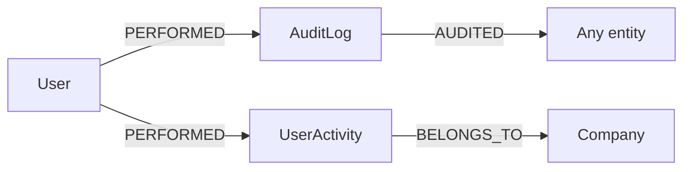

## Purpose

Two foundations under `packages/nestjs-neo4jsonapi/src/foundations/` write
append-only trails of what happened. `audit` records field-level changes to
entities — who changed what, from which value to which — and is driven from
inside `AbstractService`, so every module that inherits it gets an audit trail
for free. `user-activity` records coarse-grained actions a user took, through an
explicit call or an optional global interceptor, and writes them off the request
path via a queue. Remove `audit` and there is no per-field change history;
remove `user-activity` and there is no "what did this user do last Tuesday"
answer.

## Vocabulary

| Term | Meaning |
|---|---|
| Audit entry | An `:AuditLog` node describing one field change, one create, one delete or one read |
| Audited node | The entity the audit entry points at, via `AUDITED`. Polymorphic — any label |
| Action | `create`, `read`, `update`, `status_change` or `delete`; `status_change` is `update` on a field literally named `status` |
| Snapshot | The JSON of every descriptor field, written to `old_value` on delete |
| Activity | A `:UserActivity` node: a `category` plus an `action`, optionally naming an entity |
| Category / action | Open strings at package level. The package's own interceptor uses `ENTITY` with `CREATE`/`UPDATE`/`DELETE`; an app supplies its own taxonomy |
| Inert default | `UserActivityModule.forRoot()` with no config registers no interceptor and records nothing |

## Graph model

| Label | Key fields | Relationships | Declaring file |
|---|---|---|---|
| `AuditLog` | `action`, `entity_type`, `entity_id`, `field_name`, `old_value`, `new_value`, `ip_address`, `company_id` | `PERFORMED` ← `User` (one), `AUDITED` → any labelled node (one, optional) | `packages/nestjs-neo4jsonapi/src/foundations/audit/entities/audit.entity.ts` |
| `UserActivity` | `category`, `action`, `entityType`, `entityId`, `metadata` (stored as a JSON string) | `PERFORMED` ← `User` (one), `BELONGS_TO` → `Company` (one) — neither exposed on the wire | `packages/nestjs-neo4jsonapi/src/foundations/user-activity/entities/user-activity.ts` |

`AuditLog` is not a descriptor entity at all: it keeps the hand-written quartet
(`audit.entity.ts`, `audit.map.ts`, `audit.model.ts`, `audit.serialiser.ts`) and
carries its tenant as a **property**, `company_id`, rather than as a
`BELONGS_TO` edge. `AuditRepository.findByEntity` filters on that property;
`findByUser` does not filter by company at all.

`UserActivity` is a `defineEntity()` descriptor and is company-scoped by the
default, but its `relationships` block is empty on purpose — both edges exist in
Cypher and neither is serialised. `UserActivityRepository.createActivity()` is
the documented exception to `buildDefaultMatch()`: it runs in a worker with no
CLS company, so it matches `Company` by an explicit `$companyId` parameter.



Indexes created at boot: `AuditRepository.onModuleInit()` adds a uniqueness
constraint on `auditLog.id` plus `audit_entity` on `(entity_type, entity_id)`
and `audit_timestamp` on `(company_id, createdAt)`.
`UserActivityRepository.onModuleInit()` calls `super.onModuleInit()` for the
descriptor-derived constraint and then adds `userActivity_createdAt` and
`userActivity_category_action`.

## Backend

| Endpoint | Controller | Service | Repository | DTOs | Guards |
|---|---|---|---|---|---|
| `GET /audit-logs/:entityType/:entityId` | `packages/nestjs-neo4jsonapi/src/foundations/audit/controllers/audit.controller.ts` | `packages/nestjs-neo4jsonapi/src/foundations/audit/services/audit.service.ts` | `packages/nestjs-neo4jsonapi/src/foundations/audit/repositories/audit.repository.ts` | none | `JwtAuthGuard` on the class |
| `GET /users/:userId/audit-logs` | same | same | same | none | `JwtAuthGuard` |
| — (no routes) | — | `packages/nestjs-neo4jsonapi/src/foundations/user-activity/services/user-activity.service.ts` | `packages/nestjs-neo4jsonapi/src/foundations/user-activity/repositories/user-activity.repository.ts` | none | — |

`UserActivityModule` exposes no HTTP surface at all. Its service is the API.

**How audit entries get written.** `AbstractService`
(`packages/nestjs-neo4jsonapi/src/core/neo4j/abstracts/abstract.service.ts`)
takes an optional fifth constructor argument, `auditService`. When a subclass
passes one:

| Inherited method | What `AuditService` writes |
|---|---|
| `create()` | one `create` entry, after the repository write |
| `put()` | reads the entity first, then one entry **per changed field** |
| `patch()` | same as `put()` |
| `delete()` | reads the entity first, then one `delete` entry whose `old_value` is a JSON snapshot of every descriptor field |

`AuditService.diffChanges()` walks `descriptor.fieldNames` and then
`descriptor.relationships`, comparing stringified values; a relationship diff
records the related id, not the object. Every write is skipped silently when CLS
carries no `userId`, which is what keeps worker code from writing anonymous
audit rows.

**The `@Audit` decorator.**
`packages/nestjs-neo4jsonapi/src/common/decorators/audit.decorator.ts` exports
`Audit(meta, id)`, a method decorator that wraps the original handler, runs it,
finds the first argument carrying a `params` object, reads `params[id]` from it
and calls `this.auditService.logRead({ entityType: meta.labelName, entityId })`.
It is fire-and-forget: the promise is not awaited, and nothing happens when the
controller has no `auditService` property.

Four controller actions in the package carry it, all of them the `findById`
read:

| Controller | Decorator | Route param |
|---|---|---|
| `packages/nestjs-neo4jsonapi/src/foundations/assistant-action/controllers/assistant-action.controller.ts` | `@Audit(assistantActionMeta, "actionId")` | `actionId` |
| `packages/nestjs-neo4jsonapi/src/foundations/role/controllers/role.controller.ts` | `@Audit(roleMeta, "roleId")` | `roleId` |
| `packages/nestjs-neo4jsonapi/src/foundations/ai-connection/controllers/ai-connection.controller.ts` | `@Audit(aiConnectionMeta, "id")` | `id` |
| `packages/nestjs-neo4jsonapi/src/foundations/how-to/controllers/how-to.controller.ts` | `@Audit(howToMeta, "howToId")` | `howToId` |

All four inject `AuditService`. Only the assistant-action handler declares a
`@Req()` parameter, so it is the only one whose arguments contain an object with
`params` — see **Gaps and drift**.

**How activities get written.** `UserActivityService.record(input)` adds a job
to the configured queue and never throws; failures are logged so the caller's
request is never broken by the activity log. `UserActivityProcessor.process()`
rejects any job whose name is not the configured one, then opens a CLS scope,
sets `isAutomatedJob: true` plus `userId` and `companyId` from the job payload,
and calls `createActivity()`. Without that CLS seeding
`SecurityService.userHasAccess()` has no context to work from.

## Frontend

Thin, and honestly so. There is no user-activity frontend at all — no model, no
service, no components, no route. The audit trail has a model and a service but
no components and no page.

| Model | Service | Module factory | Routes | Components | Feature id |
|---|---|---|---|---|---|
| `packages/nextjs-jsonapi/src/features/audit-log/data/audit-log.ts` | `packages/nextjs-jsonapi/src/features/audit-log/data/audit-log.service.ts` | `packages/nextjs-jsonapi/src/features/audit-log/audit-log.module.ts` — wired in `apps/web/src/config/Bootstrapper.ts` as `AuditLog` | none | none | none |

`AuditLogService` exposes one method, `findActivityByEntity({ entityType,
entityId })`. Nothing in {{display}} calls it; it is there for an application
that wants to render a history panel.

`usePageTracker` (`packages/nextjs-jsonapi/src/hooks/usePageTracker.ts`) is the
only tracking hook the app mounts, in
`apps/web/src/features/common/components/details/LayoutDetails.tsx` beside
`useNotificationSync`. It runs inside a `PageTracker` leaf behind its own
`Suspense` with no fallback, because reading the pathname suspends during the
shell prerender. It is **not** an audit mechanism: it watches the pathname
and the document title, and keeps the last ten visited detail pages in a jotai
atom in the browser. It issues no request, and the pages it will consider are
limited to the `trackablePages` list passed to `configureJsonApi()` in
`apps/web/src/config/instrumentation-env.ts` — `Notification`, `Company` and `User`.

## Flows

**A field change becomes an audit entry.**

1. A controller calls its service's inherited `patch()`.
2. `AbstractService.patch()` reads the current entity through
   `repository.findById()` — only when an `auditService` was injected, so the
   extra read costs nothing for services without one.
3. The repository writes the change.
4. `AuditService.logUpdate()` diffs before against after over
   `descriptor.fieldNames` and `descriptor.relationships`.
5. For each difference, `AuditRepository.createEntry()` matches the acting
   `User` by the CLS `userId`, `CREATE`s an `:AuditLog`, links
   `(user)-[:PERFORMED]->(auditLog)`, then `OPTIONAL MATCH`es the audited node
   by id where `$entityType IN labels(audited)` and, when found, adds
   `(auditLog)-[:AUDITED]->(audited)`.
6. `GET /audit-logs/:entityType/:entityId` returns the entries, newest first,
   with the actor and the audited node side-loaded through the serialiser's
   dynamic relationship factory.

**A request becomes an activity.** Only when the interceptor is enabled.

1. `UserActivityInterceptor.intercept()` taps the successful response.
2. It bails on a missing `request.user.userId`/`companyId`, on a URL starting
   with `/health`, `/healthcheck`, `/metrics` or `/auth`, on `OPTIONS`, and on
   any method outside `POST`/`PUT`/`PATCH`/`DELETE` — which excludes every
   `GET`.
3. It infers `entityType` from the first URL segment and calls
   `UserActivityService.record()` with category `ENTITY`, the mapped action and
   `metadata: { method, path }`.
4. `record()` enqueues on the configured queue; the HTTP response has already
   been sent.
5. `UserActivityProcessor` picks the job up in the worker process, seeds CLS and
   calls `createActivity()`, which matches the `User` and the `Company` by
   explicit ids and writes the node plus both edges.

## Background jobs

| Queue | Job name | Processor | Trigger |
|---|---|---|---|
| `user-activity` (`QueueId.USER_ACTIVITY`) | `userActivity:record` by default, overridable through `UserActivityModuleConfig.jobName` | `packages/nestjs-neo4jsonapi/src/foundations/user-activity/processors/user-activity.processor.ts`, registered through `createWorkerProvider()` so it exists only in worker mode | `UserActivityService.record()`, called by the optional interceptor or by application code |

The `audit` foundation has no queue, no processor and no cron; every audit write
is synchronous and inline.

`@Processor()` is evaluated at class-decoration time, so the processor is bound
to the literal `QueueId.USER_ACTIVITY`. Overriding `queueId` in the module
config therefore moves the **producer only** — the app must then run its own
worker for that queue. The job name, by contrast, is read from
`USER_ACTIVITY_CONFIG` at construction, so both sides always agree on it.

## Permissions and gating

Neither module has a seeded `(Module)` node. `packages/shared/src/const/module.id.ts`
lists eight ids and neither `AuditLog` nor `UserActivity` is among them, so
`apps/api/src/rbac/permissions.ts` grants nothing for either. The frontend
`AuditLogModule` factory carries a `moduleId` of
`b7e2f4a1-9c3d-4e8b-a6d5-2f1c8e7b3a90`, which no migration seeds — a
`hasPermissionToModule` check against it has no `(Module)` node to resolve.

What is actually enforced:

| Caller | `GET /audit-logs/...` | `UserActivityService.record()` |
|---|---|---|
| Unauthenticated | 401 from `JwtAuthGuard` | not reachable — no HTTP surface |
| Any authenticated member | allowed; `findByEntity` is filtered by the CLS `company_id`, `findByUser` is filtered only by `userId` | n/a |
| Company administrator | identical to a member | n/a |
| Platform administrator | identical to a member | n/a |

Neither module declares a feature id, so no `HAS_FEATURE` edge gates either.
The permission engine itself is documented in
`docs/handbook/03-backend/rbac-and-permissions.md`.

## Configuration

Neither foundation reads an environment variable. `audit` has no configuration
at all. `user-activity` is configured in code, through the third argument of
`bootstrap()`:

```ts
bootstrap({
  appModules: [FeaturesModules],
  config: config,
  userActivity: {
    queueId: QueueId.USER_ACTIVITY,
    jobName: "userActivity:record",
    interceptorEnabled: true,
  },
});
```

`BootstrapOptions.userActivity` is declared in
`packages/nestjs-neo4jsonapi/src/bootstrap/bootstrap.options.ts` and passed
straight through to `FoundationsModule.forRoot({ userActivity })` in
`packages/nestjs-neo4jsonapi/src/bootstrap/app.module.factory.ts`, which calls
`UserActivityModule.forRoot()`. The defaults are in
`packages/nestjs-neo4jsonapi/src/foundations/user-activity/interfaces/user-activity.config.interface.ts`:
queue `user-activity`, job `userActivity:record`, `interceptorEnabled: false`.
{{display}}'s `apps/api/src/main.ts` passes no `userActivity` key, so the module
is registered and inert.

The module is `global: true` so `UserActivityService` reaches feature modules
without each of them importing (and re-instantiating) the dynamic module —
re-calling `forRoot()` per consumer would register a second worker provider and
a duplicate `APP_INTERCEPTOR`.

## Tests

| Spec | Covers |
|---|---|
| `packages/nestjs-neo4jsonapi/src/foundations/audit/__tests__/audit.controller.spec.ts` | the two read routes |
| `packages/nestjs-neo4jsonapi/src/foundations/audit/repositories/__tests__/audit.repository.spec.ts` | the Cypher writes and reads |
| `packages/nestjs-neo4jsonapi/src/foundations/audit/services/__tests__/audit.service.spec.ts` | the diff and snapshot logic |
| `packages/nestjs-neo4jsonapi/src/core/neo4j/abstracts/__tests__/abstract.service.spec.ts` | that `create`/`put`/`patch`/`delete` call the audit hooks |
| `packages/nestjs-neo4jsonapi/src/foundations/user-activity/__tests__/user-activity.module.spec.ts` | that the interceptor is registered only when opted into |
| `packages/nestjs-neo4jsonapi/src/foundations/user-activity/entities/__tests__/user-activity.descriptor.spec.ts` | the descriptor, including the `metadata` JSON round-trip |
| `packages/nestjs-neo4jsonapi/src/foundations/user-activity/interceptors/__tests__/user-activity.interceptor.spec.ts` | the skip rules |
| `packages/nestjs-neo4jsonapi/src/foundations/user-activity/processors/__tests__/user-activity.processor.spec.ts` | job-name rejection and CLS seeding |
| `packages/nestjs-neo4jsonapi/src/foundations/user-activity/repositories/__tests__/user-activity.repository.spec.ts` | the custom write |
| `packages/nestjs-neo4jsonapi/src/foundations/user-activity/services/__tests__/user-activity.service.spec.ts` | that `record()` never throws |

Nothing covers the `@Audit` decorator — there is no spec for
`audit.decorator.ts`, which is why the argument-shape defect below survived. The
frontend has no spec for `audit-log` at all, and {{display}} ships no test for
either module.

## Where to look

| File | Why |
|---|---|
| `packages/nestjs-neo4jsonapi/src/core/neo4j/abstracts/abstract.service.ts` | The four hook points — this is where audit actually happens |
| `packages/nestjs-neo4jsonapi/src/foundations/audit/services/audit.service.ts` | `diffChanges`, `snapshotEntity`, and the CLS `userId` guard |
| `packages/nestjs-neo4jsonapi/src/foundations/audit/repositories/audit.repository.ts` | The write, the polymorphic `AUDITED` match, and the three indexes |
| `packages/nestjs-neo4jsonapi/src/common/decorators/audit.decorator.ts` | Twenty lines that explain every read-audit surprise |
| `packages/nestjs-neo4jsonapi/src/foundations/audit/serialisers/audit.serialiser.ts` | How a polymorphic `audited` relationship is serialised |
| `packages/nestjs-neo4jsonapi/src/foundations/user-activity/user-activity.module.ts` | `forRoot`, why it is global, and the conditional `APP_INTERCEPTOR` |
| `packages/nestjs-neo4jsonapi/src/foundations/user-activity/interfaces/user-activity.config.interface.ts` | Every option, its default, and the queue-name caveat |
| `packages/nestjs-neo4jsonapi/src/foundations/user-activity/interceptors/user-activity.interceptor.ts` | Exactly what the global interceptor does and does not capture |
| `packages/nestjs-neo4jsonapi/src/foundations/user-activity/processors/user-activity.processor.ts` | The `cls.run()` + `isAutomatedJob` pattern every worker must copy |
| `packages/nextjs-jsonapi/src/features/audit-log/data/audit-log.service.ts` | The one frontend call, and the endpoint it builds |

## Gaps and drift

- **Three of the four `@Audit` decorators cannot fire.** The decorator looks for
  an argument with a `params` property. Only
  `assistant-action.controller.ts`'s `findById` declares `@Req()`; the `role`,
  `ai-connection` and `how-to` handlers receive only a `FastifyReply` and a
  string, neither of which carries `params`, so `paramId` is `undefined` and
  `logRead` is never called. The decorators are inert, not broken — nothing
  throws.
- **The frontend audit endpoint does not match the backend route.**
  `AuditLogService.findActivityByEntity` builds
  `audit-logs/activity/<entityType>/<entityId>` through `EndpointCreator` (`id:
  "activity"`, `childEndpoint`, `childId`), while `AuditController` declares
  `GET audit-logs/:entityType/:entityId`. The extra `activity` segment means the
  request cannot match. Nothing in {{display}} calls the method, so the mismatch
  is currently invisible.
- `AuditRepository.findByUser` applies no company filter. A caller who knows a
  user id can read that user's audit trail across companies.
- `AuditLog` carries its tenant as the plain property `company_id` rather than a
  `BELONGS_TO` edge, so it is the one entity in this chapter that
  `buildDefaultMatch()` could never scope.
- `AuditModule` deliberately does **not** import `UserModule`, using `userMeta`
  and `UserDescriptor` as value imports only; the module comment explains that
  importing it would re-register `UserController` and collide with an app that
  ships its own user foundation.
- Not examined: `AbstractRepository`'s own constraint derivation, the
  `DynamicRelationshipFactory` that renders the `audited` relationship, and the
  BullMQ retry/backoff defaults for the `user-activity` queue, which
  `UserActivityService.record()` leaves at the library default rather than
  setting `attempts` as the billing producers do.
