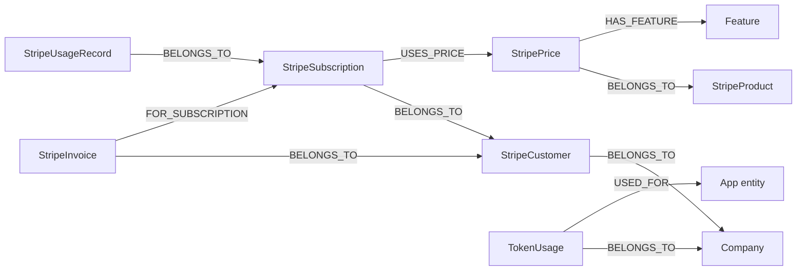

## Purpose

Eleven of the 43 foundations are about money. Ten `stripe*` directories under
`packages/nestjs-neo4jsonapi/src/foundations/` mirror Stripe's object model into
Neo4j, take webhooks, and turn a paid invoice into credits and features on a
`Company`; `tokenusage` records what every AI call cost and converts that cost
into the credits the subscription granted. Together they are the only place in
{{display}} where an external system writes to the graph. Remove them and the
application still runs — every Stripe service degrades to a startup warning when
`STRIPE_SECRET_KEY` is unset — but nothing meters usage or gates it.

## Vocabulary

| Term | Meaning |
|---|---|
| Billing facade | `BillingController`, mounted at `/billing`: setup intents, the customer portal and payment methods |
| Setup intent | A Stripe object that collects a payment method without charging it |
| Portal session | A one-time URL into Stripe's hosted billing portal |
| Trial price | The `StripePrice` row with `isTrial: true`. There is exactly one, and it decides the trial's token grant |
| Feature sync | Copying a price's `HAS_FEATURE` edges onto the paying company — additive, on `invoice.paid` |
| Token allocation | Resetting a company's monthly credits to the price's `token` value on payment. No rollover |
| Meter / meter event | Stripe's V2 usage-based billing primitives, used for metered prices |
| Credit | {{display}}'s billing unit: `max(minCreditsPerRecord, round4(cost / creditCost))` |
| Tier | The config block whose per-million-token rates price a call — base, vision, image, audio or embedder |
| Dimension | What a token-usage breakdown groups by: `company`, `user`, `operation` or `target` |
| Target label | An application Neo4j label the `USED_FOR` edge may point at, allowlisted by the app |

## Graph model

| Label | Key fields | Relationships | Declaring file |
|---|---|---|---|
| `StripeCustomer` | `stripeCustomerId`, `email`, `name`, `defaultPaymentMethodId`, `currency`, `balance`, `delinquent` | `BELONGS_TO` → `Company` (one) | `packages/nestjs-neo4jsonapi/src/foundations/stripe-customer/entities/stripe-customer.entity.ts` |
| `StripePaymentMethod` | Stripe payment-method projection | none persisted | `packages/nestjs-neo4jsonapi/src/foundations/stripe-customer/entities/stripe-payment-method.entity.ts` |
| `StripeProduct` | `stripeProductId`, `name`, `description`, `active`, `metadata` | `BELONGS_TO` ← `StripePrice` (many) | `packages/nestjs-neo4jsonapi/src/foundations/stripe-product/entities/stripe-product.entity.ts` |
| `StripePrice` | `stripePriceId`, `active`, `currency`, `unitAmount`, `priceType`, `recurringInterval(Count)`, `recurringUsageType`, `nickname`, `lookupKey`, `token`, `isTrial` | `BELONGS_TO` → `StripeProduct` (one), `HAS_FEATURE` → `Feature` (many) | `packages/nestjs-neo4jsonapi/src/foundations/stripe-price/entities/stripe-price.entity.ts` |
| `StripeSubscription` | `stripeSubscriptionId`, `status`, `currentPeriodStart/End`, `cancelAtPeriodEnd`, `canceledAt`, `trialStart/End`, `pausedAt`, `quantity` | `BELONGS_TO` → `StripeCustomer` (one), `USES_PRICE` → `StripePrice` (one), `CREATED_BY` → `User` (one) | `packages/nestjs-neo4jsonapi/src/foundations/stripe-subscription/entities/stripe-subscription.entity.ts` |
| `StripeInvoice` | `stripeInvoiceId`, `stripeInvoiceNumber`, `stripeHostedInvoiceUrl`, `stripePdfUrl`, `status`, amounts, `periodStart/End`, `dueDate`, `paidAt`, `attemptCount` | `BELONGS_TO` → `StripeCustomer` (one), `FOR_SUBSCRIPTION` → `StripeSubscription` (one) | `packages/nestjs-neo4jsonapi/src/foundations/stripe-invoice/entities/stripe-invoice.entity.ts` |
| `StripeUsageRecord` | `subscriptionId`, `meterId`, `meterEventName`, `quantity`, `timestamp`, `stripeEventId` | `BELONGS_TO` → `StripeSubscription` (one) | `packages/nestjs-neo4jsonapi/src/foundations/stripe-usage/entities/stripe-usage-record.entity.ts` |
| `StripeWebhookEvent` | `stripeEventId` (unique), `eventType`, `livemode`, `apiVersion`, `status`, `payload`, `processedAt`, `error`, `retryCount` | none | `packages/nestjs-neo4jsonapi/src/foundations/stripe-webhook/entities/stripe-webhook-event.entity.ts` |
| `TokenUsage` | `inputTokens`, `outputTokens`, `cachedInputTokens`, `cost`, `credits`, `tokenUsageType`, `model`, `provider` | `BELONGS_TO` → `Company` (one), `TRIGGERED_BY` → `User` (one), `USED_FOR` → any app label (one) | `packages/nestjs-neo4jsonapi/src/foundations/tokenusage/entities/tokenusage.ts` |

`StripePromotionCode` has no label at all: it is a response shape built from the
Stripe API on the fly (`packages/nestjs-neo4jsonapi/src/foundations/stripe-promotion-code/entities/stripe-promotion-code.entity.ts`).
The six token-usage reporting types are projections, not stored nodes.

Note the shape of the Stripe chain: `BELONGS_TO` is reused at every level and
does **not** always mean "belongs to a company" — a price belongs to a product,
an invoice to a customer, a usage record to a subscription. Only
`StripeCustomer` and `TokenUsage` carry a `BELONGS_TO` edge to `Company`.

## Backend

Every entity in one table — label, JSON:API type and the endpoint its meta
declares:

| Foundation | Label | Type | Endpoint |
|---|---|---|---|
| `stripe` | — (facade only) | — | `billing` |
| `stripe-customer` | `StripeCustomer` | `stripe-customers` | `stripe-customers` |
| `stripe-customer` | `StripePaymentMethod` | `stripe-payment-methods` | `stripe-payment-methods` |
| `stripe-product` | `StripeProduct` | `stripe-products` | `stripe-products` |
| `stripe-price` | `StripePrice` | `stripe-prices` | `stripe-prices` |
| `stripe-subscription` | `StripeSubscription` | `stripe-subscriptions` | `stripe-subscriptions` |
| `stripe-invoice` | `StripeInvoice` | `stripe-invoices` | `stripe-invoices` |
| `stripe-usage` | `StripeUsageRecord` | `stripe-usage-records` | `stripe-usage-records` |
| `stripe-promotion-code` | — | `stripe-promotion-codes` | `stripe-promotion-codes` |
| `stripe-webhook` | `StripeWebhookEvent` | `stripe-webhook` | `stripe-webhooks` |
| `stripe-trial` | — | — | — (queue only) |
| `tokenusage` | `TokenUsage` | `tokenusages` | `tokenusages` |

### The billing facade

`packages/nestjs-neo4jsonapi/src/foundations/stripe/controllers/billing.controller.ts`
is mounted at `/billing` and delegates everything to
`packages/nestjs-neo4jsonapi/src/foundations/stripe/services/billing.service.ts`:

| Route | Purpose | Guard |
|---|---|---|
| `POST /billing/setup-intent` | Collect a payment method; returns a client secret | `JwtAuthGuard` |
| `POST /billing/customers/portal-session` | One-time URL into Stripe's hosted portal | `JwtAuthGuard` |
| `GET /billing/payment-methods` | List the company's cards | `JwtAuthGuard` |
| `POST /billing/payment-methods/:paymentMethodId/default` | Set the default card | `JwtAuthGuard` |
| `DELETE /billing/payment-methods/:paymentMethodId` | Detach a card | **none** — see Gaps and drift |

Every handler takes the company from `req.user.companyId`, never from the body.
`StripeCustomerController` exposes the same three payment-method operations
again under `/stripe-customers/payment-methods*`, all behind `JwtAuthGuard`.

The Stripe client itself is `StripeService`
(`packages/nestjs-neo4jsonapi/src/foundations/stripe/services/stripe.service.ts`).
It `import()`s `stripe` dynamically in `onModuleInit()`, warns and stays `null`
when no secret key is configured, pins `apiVersion` only when
`STRIPE_API_VERSION` is set, and uses `maxNetworkRetries: 3` with a 30-second
timeout. `getClient()` throws when the key is missing, so a Stripe route in an
unconfigured app fails loudly while the rest of the app boots. Errors are
normalised by the `@HandleStripeErrors()` decorator in
`packages/nestjs-neo4jsonapi/src/foundations/stripe/errors/stripe.errors.ts`.

### The other controllers

| Controller | Routes beyond CRUD | Guards |
|---|---|---|
| `packages/nestjs-neo4jsonapi/src/foundations/stripe-product/controllers/stripe-product.controller.ts` | `POST /stripe-products/:id/archive`, `DELETE /stripe-products/:id/archive` (reactivate) | reads: `JwtAuthGuard` + `@Roles(Administrator, CompanyAdministrator)`; writes: `AdminJwtAuthGuard` + `@Roles(Administrator)` |
| `packages/nestjs-neo4jsonapi/src/foundations/stripe-price/controllers/stripe-price.controller.ts` | same archive/reactivate pair | same split |
| `packages/nestjs-neo4jsonapi/src/foundations/stripe-subscription/controllers/stripe-subscription.controller.ts` | `:id/cancel`, `:id/pause`, `:id/resume`, `:id/change-plan`, `:id/proration-preview`, `:id/sync` | `JwtAuthGuard` + `@Roles(Administrator, CompanyAdministrator)` |
| `packages/nestjs-neo4jsonapi/src/foundations/stripe-invoice/controllers/stripe-invoice.controller.ts` | `GET /stripe-invoices/upcoming` | `JwtAuthGuard` |
| `packages/nestjs-neo4jsonapi/src/foundations/stripe-usage/controllers/stripe-usage.controller.ts` | `GET meters`, `GET meters/:meterId/summaries`, `GET summary`, `POST` (report usage) | `JwtAuthGuard` on all but `GET meters` |
| `packages/nestjs-neo4jsonapi/src/foundations/stripe-promotion-code/controllers/stripe-promotion-code.controller.ts` | `POST /stripe-promotion-codes/validate` only | `JwtAuthGuard` on the class |
| `packages/nestjs-neo4jsonapi/src/foundations/stripe-webhook/controllers/stripe-webhook.controller.ts` | `POST /stripe-webhooks` | none — the signature **is** the authentication |

Most Stripe entities ship two services: `*-admin.service.ts` writes to Stripe
and mirrors the result into Neo4j, `*-api.service.ts` is the thin Stripe SDK
wrapper. `stripe-customer`, `stripe-invoice`, `stripe-product`, `stripe-usage`
and `stripe-subscription` have both; `stripe-price` ships only the admin half
and `stripe-promotion-code` only the API half. `stripe-subscription` adds
`feature-sync.service.ts` and `token-allocation.service.ts` beside its pair.

### Webhook ingest

`POST /stripe-webhooks` needs the exact bytes Stripe signed, which Fastify's
JSON parser would have consumed. `packages/nestjs-neo4jsonapi/src/bootstrap/raw-body.config.ts`
solves it with one `preParsing` hook, added by `setupRawBodyCapture(app)` in
`packages/nestjs-neo4jsonapi/src/bootstrap/bootstrap.ts` **before** routes are
registered. The hook does nothing unless the URL starts with an entry of
`RAW_BODY_ROUTES`, which holds exactly one value, `/stripe-webhooks`; for that
route it drains the payload stream into a `Buffer`, stores it on
`request.rawBody`, and returns a fresh `Readable` so the JSON parser still runs.
Raw-body capture is memory-intensive, which is why it is one allowlisted path
rather than a global setting.

The controller then, in order: rejects a missing `stripe-signature` header (400);
rejects a missing `rawBody` (400); calls
`StripeWebhookService.constructEvent(rawBody, signature)`, whose failure is
translated to 400; short-circuits with `{ received: true, duplicate: true }`
when `StripeWebhookEventRepository.findByStripeEventId()` already has the event;
persists the event as `pending`; and enqueues a job on the `billing-webhook`
queue named after the Stripe event type, with three attempts, exponential
backoff from one second, `removeOnComplete: true` and `removeOnFail: false`. It
answers 200 immediately — Stripe never waits for processing.

`StripeWebhookProcessor`
(`packages/nestjs-neo4jsonapi/src/foundations/stripe-webhook/processors/stripe-webhook.processor.ts`)
runs at concurrency 5 inside `cls.run()`, marks the event `processing`,
dispatches on the event type, and marks it `completed` or `failed` with the
error and an incremented retry count. The switch handles five groups:

| Event types | Handler |
|---|---|
| `customer.subscription.created` / `.updated` / `.deleted` | `handleSubscriptionEvent` |
| `customer.subscription.trial_will_end` | `handleTrialWillEndEvent` |
| `invoice.created` / `.finalized` / `.updated` / `.sent` / `.paid` / `.payment_failed` | `handleInvoiceEvent` |
| `customer.updated` / `.deleted` | `handleCustomerEvent` |
| `payment_intent.succeeded` / `.payment_failed` | `handlePaymentIntentEvent` |

Anything else is logged at debug and acknowledged.

### Subscription lifecycle

`handleSubscriptionEvent` reads the previous local state, syncs from Stripe
through `StripeSubscriptionAdminService.syncSubscriptionFromStripe()`, and then
decides the company's `isActiveSubscription` flag. It deliberately never sets it
to `true` — only a paid invoice does that. It sets it to `false` when the Stripe
status is `canceled`, `past_due`, `unpaid` or `incomplete_expired`, **or** when a
`trialing` subscription became `active` on a price whose amount is zero, which
is how Stripe reports a trial ending without a real payment. Either way it emits
`company:subscription_updated` to the company's socket room.

On `invoice.paid` the processor runs the two services that turn money into
capability:

- `packages/nestjs-neo4jsonapi/src/foundations/stripe-subscription/services/token-allocation.service.ts`
  — `allocateTokensOnPayment()` resets the company's monthly credits to the
  price's `token` value. Unused credits are lost; there is no rollover. It also
  marks `isActiveSubscription: true`.
- `packages/nestjs-neo4jsonapi/src/foundations/stripe-subscription/services/feature-sync.service.ts`
  — `syncFeaturesOnPayment()` skips non-`recurring` prices, reads the price's
  `HAS_FEATURE` edges, and calls `CompanyRepository.addFeatures()`. The operation
  is additive; it never removes a feature.

Trials are queue-driven so that registration never depends on Stripe.
`packages/nestjs-neo4jsonapi/src/foundations/auth/services/trial-queue.service.ts`
adds a `process_trial` job to the `trial` queue and swallows every failure —
"trial setup is non-critical for registration".
`packages/nestjs-neo4jsonapi/src/foundations/stripe-trial/processors/trial.processor.ts`
seeds CLS with the company and user and calls `TrialService.startTrial()`, which
resolves its Stripe collaborators lazily through `ModuleRef` because the Stripe
modules form a circular chain `forwardRef` alone cannot untangle. `startTrial()`
is idempotent twice over — it returns early if the company already has an active
subscription or an existing `StripeCustomer` — then finds the price with
`isTrial: true`, creates the customer, creates a subscription with
`trialPeriodDays: 14`, writes the price's `token` value as both the monthly and
the available credit balance, sets `aiEnabled` to `token > 0`, and marks the
subscription active.

Metered usage is separate from token usage and talks to Stripe's V2 Billing
Meters API:
`packages/nestjs-neo4jsonapi/src/foundations/stripe-usage/services/stripe-usage-api.service.ts`
reports meter events and lists meters and event summaries, while
`StripeUsageAdminService` mirrors each report into a local `StripeUsageRecord`
so the application can show a history Stripe would only aggregate.

Promotion codes are validated, never stored:
`StripePromotionCodeApiService.validatePromotionCode()` lists active promotion
codes by code with `expand: ["data.promotion.coupon"]` — the coupon hangs off
`promotion`, and expanding `data.coupon` is silently ignored by the API — then
returns a hand-built JSON:API document describing the discount, its duration and
any restriction that made it invalid.

### Token usage

`TokenUsageService.recordTokenUsage()` computes a cost from the tier that served
the call, converts it to credits, writes the `TokenUsage` node and emits
`tokenusage.recorded` so `CompanyService` can deduct the balance without
`tokenusage` ever importing `CompanyModule`. `computeCost()` clamps cached
tokens to at most the input count and prices them at the tier's cached rate,
falling back to the full input rate when the tier has none.

Two seams decide whether package-internal AI work is metered and gated, both
declared in `packages/nestjs-neo4jsonapi/src/common/tokens.ts`:

| Token | Injected by | Unbound behaviour |
|---|---|---|
| `TOKEN_USAGE_RECORDER` | `LLMService`, `EmbedderService`, `AudioLLMService` | falls back to the module-local `TokenUsageService` — usage is still recorded, but by the package's implementation, not the app's |
| `CREDIT_VALIDATOR` | assistant and operator controllers, and the chunk, embedding and community-summariser processors | **fails open** — `hasAvailableCreditsVia()` in `packages/nestjs-neo4jsonapi/src/common/helpers/credit-gate.ts` returns `true`, so work proceeds ungated |

Both are `@Optional()` on purpose, and both fail open. `hasAvailableCreditsVia`
turns the throwing contract into the boolean a processor needs: a 402
`NO_CREDITS` becomes `false` (defer the job), any other error is rethrown so a
Neo4j outage is never mistaken for an empty balance, and an unbound validator is
`true`. `isAiEnabledVia` is even more permissive — it returns `true` on any
thrown error, because wrongly reporting "no AI" would silently drop a paying
customer's work.

The credits formula and both seams are covered in full by
`docs/handbook/03-backend/token-usage-and-credits.md`; the short version is
`credits = max(minCreditsPerRecord, round4(cost / creditCost))` with `cost` in
euros, and `CREDIT_COST` unset or `0` disabling credits entirely.

The reporting surface is six read-only projections over the same nodes, three
cross-tenant and three self-service, each with its own descriptor and endpoint:

| Projection | Endpoint | Role |
|---|---|---|
| `TokenUsageAdminSummary` | `GET /tokenusages/administration/summary` | `@Roles(Administrator)` |
| `TokenUsageAdminTimeline` | `GET /tokenusages/administration/timeline` | `@Roles(Administrator)` |
| `TokenUsageAdminBreakdown` | `GET /tokenusages/administration/breakdown` | `@Roles(Administrator)` |
| `TokenUsageReportSummary` | `GET /tokenusages/reports/summary` | any authenticated user, own company only |
| `TokenUsageReportTimeline` | `GET /tokenusages/reports/timeline` | same |
| `TokenUsageReportBreakdown` | `GET /tokenusages/reports/breakdown` | same |

All six share the metric fields declared once in
`packages/nestjs-neo4jsonapi/src/foundations/tokenusage/entities/usage-metric.fields.ts`
— `cost`, `credits`, `tokensIn`, `tokensOut`, `cached`, `calls` — so the two
surfaces cannot drift apart. The self-service breakdown may group only by
`operation` or `target`, never by `company` (one row) or `user` (a colleague's
spend), and its metrics exclude `cost` by design.

Grouping by `target` is the one place an application label reaches the query
text. `packages/nestjs-neo4jsonapi/src/foundations/tokenusage/common/tokenusage.target-labels.ts`
defines the `TOKEN_USAGE_TARGET_LABELS` token an app binds from a `@Global()`
module; absent, the list is empty and `dimension=target` is rejected. Each entry
is either a bare label or `{ label, via, maxDepth }` for a rollup, and both the
label and each relationship type are re-checked against
`/^[A-Za-z_][A-Za-z0-9_]*$/` before interpolation. `buildTargetGrouping()` lives
beside them so both repositories emit identical Cypher, and collapses multi-path
matches with `head(collect(...))` so a reachable-twice entity is not counted
twice.

## Frontend

Stripe.js is heavy, so the package gives billing its **own entry point**:
`@carlonicora/nextjs-jsonapi/billing`, mapped to
`packages/nextjs-jsonapi/src/billing/index.ts`, which re-exports only the
billing components and contexts. Nothing in the main `/core` barrel pulls
`@stripe/stripe-js`.

| Model | Service | Module factory | Routes | Components | Feature id |
|---|---|---|---|---|---|
| `packages/nextjs-jsonapi/src/features/billing/data/Billing.ts` — a namespace model that throws on `createJsonApi()` | `packages/nextjs-jsonapi/src/features/billing/data/billing.service.ts` | `packages/nextjs-jsonapi/src/features/billing/modules/billing.module.ts` | `/settings?section=billing` | `BillingDashboardContainer`, `BillingDetailModal`, `BillingAlertBanner`, `StripeProvider` | none |
| `stripe-customer/data/stripe-customer.ts`, `payment-method.ts` | `stripe-customer.service.ts` | `stripe-customer.module.ts`, `stripe-payment-method.module.ts` | in the dashboard | `PaymentMethodsContainer`, `PaymentMethodsList`, `PaymentMethodCard`, `PaymentMethodForm`, `PaymentMethodEditor` | none |
| `stripe-subscription/data/stripe-subscription.ts` | `stripe-subscription.service.ts` | `stripe-subscription.module.ts` | in the dashboard | `SubscriptionsContainer`, `SubscriptionWizard` and its four steps, `PricingCard`, `ProrationPreview`, `CancelSubscriptionDialog` | none |
| `stripe-product/data/stripe-product.ts` | `stripe-product.service.ts` | `stripe-product.module.ts`, `pageUrl: /administration/products` | `/administration/products`, `/administration/products/[id]` | `ProductsListContainer`, `ProductContainer`, `ProductEditor`, `ProductArchiver` | none |
| `stripe-price/data/stripe-price.ts` | `stripe-price.service.ts` | `stripe-price.module.ts`, `pageUrl: /administration/prices` | `/administration/prices/[id]` | `PriceContainer`, `PricesList`, `PriceEditor`, `PriceArchiver` | none |
| `stripe-invoice/data/stripe-invoice.ts` | `stripe-invoice.service.ts` | `stripe-invoice.module.ts` | in the dashboard | `InvoicesContainer`, `InvoicesList`, `InvoiceDetails`, `InvoiceStatusBadge` | none |
| `stripe-usage/data/stripe-usage.ts` | `stripe-usage.service.ts` | `stripe-usage.module.ts` | in the dashboard | `UsageContainer`, `UsageHistoryTable`, `UsageSummaryCards` | none |
| `stripe-promotion-code/data/stripe-promotion-code.ts` | `stripe-promotion-code.service.ts` | `stripe-promotion-code.module.ts` | in the wizard | `PromoCodeInput` | none |
| the six token-usage projections | `packages/nextjs-jsonapi/src/features/tokenusage/data/TokenUsageAdminService.ts`, `TokenUsageReportService.ts` | `packages/nextjs-jsonapi/src/features/tokenusage/tokenusage.modules.ts` — one spread, six entries | `/tokenusage`, `/administration/token-usage` | `TokenUsageReportContainer`, `TokenUsageAdminContainer`, their filter bars, tiles, `TokenUsageTimelineChart`, `TokenUsageRankedBar`, `TokenUsageBreakdownTable` | none |

All of these paths are relative to `packages/nextjs-jsonapi/src/features/billing/`
except the last row.

`apps/web/src/config/Bootstrapper.ts` registers **nine** Stripe modules —
`StripeCustomer`, `StripePaymentMethod`, `StripeSubscription`, `StripeProduct`,
`StripePrice`, `StripeInvoice`, `Billing`, `StripeUsage`, `StripePromotionCode`
— and spreads `tokenUsageModules(moduleFactory)` for the six token-usage
entries. The spread is deliberate: registration is the app's job, six names is
six chances to forget one, and a forgotten name is not a compile error because
`FoundationModuleDefinitions` declares all six, so `Modules.X` typechecks and is
`undefined` at runtime.

`StripeProvider`
(`packages/nextjs-jsonapi/src/features/billing/components/providers/StripeProvider.tsx`)
caches the `loadStripe` promise per key and renders children untouched when no
publishable key is configured. {{display}} mounts it in exactly one place:
`apps/web/src/app/[locale]/(main)/(foundations)/settings/layout.tsx`, a client
layout that imports it statically. It used `next/dynamic` with `ssr: false`
before, which rendered nothing on the server and left every settings page out of
the prerendered shell; the layout loads only on settings routes, so
`@stripe/stripe-js` still stays out of every other page's bundle. `isStripeConfigured()` ships from the same file and gates both billing
sections of the settings rail.

Routes:

| Route | File | Notes |
|---|---|---|
| `/settings` | `apps/web/src/app/[locale]/(main)/(foundations)/settings/page.tsx` | `SettingsContainer` renders `BillingDashboardContainer` in the `Billing` section and `ProductsList` in the `StripeProduct` section |
| `/settings/[module]` | `apps/web/src/app/[locale]/(main)/(foundations)/settings/[module]/page.tsx` | redirect to `/settings?section=<module>`, preserving the query string — it exists for `TokenStatusIndicator`'s hard-coded `/settings/billing?action=subscribe` |
| `/tokenusage` | `apps/web/src/app/[locale]/(main)/(foundations)/tokenusage/page.tsx` | composes the package's report container; passes no `targetLabel` because the app declares no target labels |
| `/administration/token-usage` | `apps/web/src/app/[locale]/(admin)/administration/token-usage/page.tsx` | wrapped in `AdministrationProvider`, which supplies the `SharedContext` title |
| `/administration/products` | `apps/web/src/app/[locale]/(admin)/administration/products/page.tsx` | `ProductsListContainer` owns its own provider |
| `/administration/products/[id]` | `apps/web/src/app/[locale]/(admin)/administration/products/[id]/page.tsx` | awaits `requireAdministrator(locale)` first, then server-fetches and dehydrates the product; `notFound()` when it does not exist |
| `/administration/prices/[id]` | `apps/web/src/app/[locale]/(admin)/administration/prices/[id]/page.tsx` | same shape for a price |

There is deliberately **no** `/administration/prices` index. `StripePriceModule`
still declares `pageUrl: /administration/prices`, because that value drives
`generateUrl`/`rewriteUrl` for the detail route; prices are reached from their
product's page, not from a list of their own.

Both token-usage routes import from `@carlonicora/nextjs-jsonapi/tokenusage`,
the client subpath. The package ships no server entry for that feature on
purpose: tsup stamps `"use client"` only on its declared client entries, and
with `splitting: true` a package-side server page would land the provider and
container in a directive-less shared chunk, which Next then treats as Server
Components — every `createContext` in the transitive graph then fails to
compile.

## Flows

**A webhook becomes credits.**

1. Stripe posts to `POST /stripe-webhooks`. The `preParsing` hook in
   `raw-body.config.ts` captures `request.rawBody`.
2. `StripeWebhookController` verifies the signature, de-duplicates on
   `stripeEventId`, persists a `pending` `StripeWebhookEvent`, enqueues on
   `billing-webhook`, and returns 200.
3. `StripeWebhookProcessor` marks it `processing` and dispatches inside
   `cls.run()`.
4. For `invoice.paid`: the invoice is mirrored, `TokenAllocationService`
   resets the company's credits and sets `isActiveSubscription: true`, and
   `FeatureSyncService` adds the price's features to the company.
5. `WebSocketService.sendMessageToCompany(companyId, "company:subscription_updated", …)`
   pushes the change to every open tab of that company.
6. The event row is marked `completed`; a throw marks it `failed`, increments
   `retryCount` and lets BullMQ retry twice more.

**Signing up for a plan.**

1. `SubscriptionWizard` walks plan selection → payment method → review.
2. Payment-method collection calls `POST /billing/setup-intent` and confirms the
   client secret through Stripe Elements inside `StripeProvider`.
3. An optional promo code is checked with `POST /stripe-promotion-codes/validate`
   before the review step.
4. `POST /stripe-subscriptions` creates the subscription;
   `useConfirmSubscriptionPayment` handles any additional Stripe confirmation.
5. Stripe's `customer.subscription.created` and `invoice.paid` webhooks arrive
   and run the flow above. The UI does not grant anything itself.

**A trial.** Registration → `TrialQueueService.queueTrialCreation()` → the
`trial` queue → `TrialProcessor` → `TrialService.startTrial()` → Stripe customer
plus a 14-day subscription on the `isTrial` price → credits and `aiEnabled`
written directly. Three days before expiry Stripe sends
`customer.subscription.trial_will_end`, which `handleTrialWillEndEvent` turns
into a `trial-ending-reminder` email for every company administrator.

**An AI call becomes a row.** `LLMService` (or `EmbedderService`, or
`AudioLLMService`) finishes a call → resolves `TOKEN_USAGE_RECORDER`, falling
back to the local `TokenUsageService` → `recordTokenUsage()` computes the cost
from the tier, converts it to credits, writes the `TokenUsage` node with
`BELONGS_TO`, `TRIGGERED_BY` and any `USED_FOR` edge → emits
`tokenusage.recorded` → `CompanyService` deducts the balance → the row appears in
the next `/tokenusage` query.

## Background jobs

| Queue | Job name | Processor | Trigger |
|---|---|---|---|
| `billing-webhook` (`QueueId.BILLING_WEBHOOK`) | the Stripe event type, e.g. `invoice.paid` | `packages/nestjs-neo4jsonapi/src/foundations/stripe-webhook/processors/stripe-webhook.processor.ts`, concurrency 5, 60-second lock | `StripeWebhookController` |
| `trial` (`QueueId.TRIAL`) | `process_trial` — `JobName.process.trial` in `packages/nestjs-neo4jsonapi/src/config/enums/job.name.ts` | `packages/nestjs-neo4jsonapi/src/foundations/stripe-trial/processors/trial.processor.ts`, concurrency 5 | `TrialQueueService.queueTrialCreation()` from `AuthModule` |
| `email` (`QueueId.EMAIL`) | `billing-notification`, with a `jobType` discriminator | the app's email worker | `packages/nestjs-neo4jsonapi/src/foundations/stripe-webhook/services/stripe-webhook-notification.service.ts` |

The `billing-notification` job types are `payment-failure`,
`subscription-status-change`, `payment-success-customer`,
`payment-success-admin`, `trial-ending-reminder`, `trial-ended`,
`deletion-warning` and `subscription-cancelled`. Every producer wraps itself in
`try/catch` and logs rather than throws — a notification failure must never fail
a webhook — and the ones that run in a worker open their own `cls.run()` first.
Every job is queued with three attempts and exponential backoff from five
seconds. `tokenusage` registers no queue; it writes inline.

`StripeWebhookProcessor` and `TrialProcessor` are registered through
`createWorkerProvider()`, so they exist only in worker mode.

## Permissions and gating

No Stripe or token-usage module has a seeded `(Module)` node:
`packages/shared/src/const/module.id.ts` lists eight ids and none of them is a
billing module, so `apps/api/src/rbac/permissions.ts` grants nothing for any of
them. The frontend factories nonetheless carry hard-coded `moduleId` strings,
which no migration creates. What actually enforces access is the guard plus
`@Roles` on each route, and the `requireAdministrator(locale)` call every
`(admin)` page awaits — a non-administrator gets a 404 inside the app frame.

| Caller | Sees |
|---|---|
| Unauthenticated | `POST /stripe-webhooks` (signature-checked), `GET /stripe-usage-records/meters` and `DELETE /billing/payment-methods/:id` — the latter two carry no guard |
| Authenticated member | nothing in this chapter beyond the self-service `/tokenusages/reports/*` endpoints, scoped to their own company |
| Company administrator | the billing dashboard, subscriptions, invoices, payment methods, usage, and read-only product and price lists |
| Platform administrator | additionally the product and price writes and the three `/tokenusages/administration/*` endpoints |

`SettingsContainer` gates the client side twice over: the billing section needs
`isStripeConfigured()`, a non-administrator, and
`hasPermissionToModule({ module: Modules.Billing, action: Action.Read })`; the
product section needs `isStripeConfigured()`, an administrator, and the
equivalent check against `Modules.StripeProduct`. No module in this chapter
declares a feature id. The engine is in
`docs/handbook/03-backend/rbac-and-permissions.md`.

## Configuration

| Variable | Config key | Default | Read by |
|---|---|---|---|
| `STRIPE_SECRET_KEY` | `stripe.secretKey` | `""` | `StripeService.onModuleInit()` — empty disables every Stripe feature |
| `STRIPE_PUBLISHABLE_KEY` | `stripe.publishableKey` | `""` | `base.config.ts`; nothing in the package reads it back |
| `STRIPE_WEBHOOK_SECRET` | `stripe.webhookSecret` | `""` | `StripeWebhookService.constructEvent()` |
| `STRIPE_API_VERSION` | `stripe.apiVersion` | unset | `StripeService`; omitted from the client options when unset |
| `STRIPE_PORTAL_RETURN_URL` | `stripe.portalReturnUrl` | falls back to `APP_URL` | `StripePortalService` |
| `STRIPE_PORTAL_CONFIGURATION_ID` | `stripe.portalConfigurationId` | `""` | `StripePortalService` |
| `NEXT_PUBLIC_STRIPE_PUBLISHABLE_KEY` | — | unset | `apps/web/src/config/middleware-env.ts` → `configureJsonApi({ stripePublishableKey })` in `apps/web/src/config/instrumentation-env.ts` → `StripeProvider` |
| `CREDIT_COST` | `credits.creditCost` | `0` | `TokenUsageService.recordTokenUsage()` — `0` disables credits |
| `CREDIT_MINIMUM` | `credits.minCreditsPerRecord` | `0.1` | same; skipped when a caller passes `applyMinimum: false` |
| `AI_INPUT_COST_PER_1M_TOKENS` | `ai.inputCostPer1MTokens` | `0` | `computeCost()` for the base tier |
| `AI_OUTPUT_COST_PER_1M_TOKENS` | `ai.outputCostPer1MTokens` | `0` | same |
| `AI_CACHED_INPUT_COST_PER_1M_TOKENS` | `ai.cachedInputCostPer1MTokens` | falls back to the input rate | same |
| `VISION_INPUT_COST_PER_1M_TOKENS`, `VISION_OUTPUT_COST_PER_1M_TOKENS` | `ai.vision.*` | fall back to the `AI_*` rates | the vision tier |
| `IMAGE_INPUT_COST_PER_1M_TOKENS`, `IMAGE_OUTPUT_COST_PER_1M_TOKENS` | `ai.image.*` | `0` | the image tier |
| `AUDIO_INPUT_COST_PER_1M_TOKENS`, `AUDIO_OUTPUT_COST_PER_1M_TOKENS`, `AUDIO_COST_PER_MINUTE` | `ai.audio.*` | the first two fall back to the `AI_*` rates; the third `0` | `AudioLLMService` |
| `EMBEDDER_INPUT_COST_PER_1M_TOKENS` | `ai.embedder.inputCostPer1MTokens` | `0` | `EmbedderService`, which passes a `costOverride` |
| `DOCUMENT_AI_COST_PER_PAGE` | `ai.documentAi.costPerPage` | `0` | OCR billing, priced per page rather than per token |

All keys are assembled in
`packages/nestjs-neo4jsonapi/src/config/base.config.ts` and typed by
`packages/nestjs-neo4jsonapi/src/config/interfaces/config.stripe.interface.ts`
and `packages/nestjs-neo4jsonapi/src/config/interfaces/config.credits.interface.ts`.
`apps/api/src/config/config.ts` overrides none of them.

## Tests

Forty-six package specs cover this chapter, all `*.spec.ts` beside the code:

| Foundation | Specs |
|---|---|
| `stripe` | 6 — the billing controller and service, the three Stripe service wrappers, the error helper, plus fixtures and a mock client under `packages/nestjs-neo4jsonapi/src/foundations/stripe/__tests__/` |
| `stripe-customer` | 5 |
| `stripe-subscription` | 6 — including `feature-sync.service.spec.ts` and `token-allocation.service.spec.ts` |
| `stripe-webhook` | 5 — controller, processor, repository, service, notification service |
| `stripe-invoice`, `stripe-price`, `stripe-product`, `stripe-usage` | 4 each |
| `stripe-promotion-code`, `stripe-trial` | 1 each |
| `tokenusage` | 6 — both repositories, both services, the admin controller, the descriptor set |

On the frontend: two specs for the billing contexts
(`packages/nextjs-jsonapi/src/features/billing/contexts/__tests__/`) and five for
token usage (`packages/nextjs-jsonapi/src/features/tokenusage/components/__tests__/`,
`contexts/__tests__/` and `data/__tests__/`).

{{display}} ships no test of its own for any of this, and no e2e spec touches a
billing route. Specifically unprotected: the raw-body `preParsing` hook (a unit
test cannot exercise Fastify's parsing order), the settings-rail gating, the
subscription wizard end to end, and every interaction with a real Stripe
account. `packages/nestjs-neo4jsonapi/src/foundations/stripe/docs/TESTING.md`
describes the intended approach.

## Where to look

The package ships 5,495 lines of Stripe documentation under
`packages/nestjs-neo4jsonapi/src/foundations/stripe/docs/`, plus a 1,375-line
`README.md` and a 412-line `QUICKSTART.md` beside it. Read those rather than
expecting this chapter to restate them.

| File | Why |
|---|---|
| `packages/nestjs-neo4jsonapi/src/foundations/stripe/docs/ARCHITECTURE.md` | The module-by-module design, in the authors' own words |
| `packages/nestjs-neo4jsonapi/src/foundations/stripe/docs/WEBHOOKS.md` | Every supported event and what it does |
| `packages/nestjs-neo4jsonapi/src/foundations/stripe/docs/API.md` | The full endpoint reference |
| `packages/nestjs-neo4jsonapi/src/foundations/stripe/docs/EXAMPLES.md` | Worked flows, including the subscription wizard |
| `packages/nestjs-neo4jsonapi/src/foundations/stripe/docs/MIGRATIONS.md` | Moving an existing Stripe account onto this model |
| `packages/nestjs-neo4jsonapi/src/foundations/stripe/docs/TESTING.md` | Fixtures, the mock client, and how to test webhooks |
| `packages/nestjs-neo4jsonapi/src/foundations/stripe/QUICKSTART.md` | The shortest path from zero to a working checkout |
| `packages/nestjs-neo4jsonapi/src/bootstrap/raw-body.config.ts` | Thirty lines that make signature verification possible |
| `packages/nestjs-neo4jsonapi/src/foundations/stripe-webhook/processors/stripe-webhook.processor.ts` | Where a payment turns into credits and features |
| `packages/nestjs-neo4jsonapi/src/foundations/tokenusage/common/tokenusage.target-labels.ts` | The allowlist, the rollup traversal, and why both exist |

Also useful: `packages/nestjs-neo4jsonapi/src/foundations/stripe-subscription/README.md`
for the subscription state machine, and
`packages/nestjs-neo4jsonapi/src/common/tokens.ts` for the two seams.

## Gaps and drift

- **`DELETE /billing/payment-methods/:paymentMethodId` has no `@UseGuards`.**
  Every sibling route on `BillingController` carries `JwtAuthGuard`; this one
  does not, yet it reads `req.user.companyId`. Unauthenticated it will not find
  a company, but the route is reachable.
- **`GET /stripe-usage-records/meters` has no guard either**, while every other
  route on `StripeUsageController` does.
- **The publishable key has two spellings.** `base.config.ts` reads
  `STRIPE_PUBLISHABLE_KEY`; `.env.example` defines only
  `NEXT_PUBLIC_STRIPE_PUBLISHABLE_KEY`. The server-side value is unused today,
  so the mismatch is currently harmless.
- **Three Stripe variables are missing from `.env.example`**:
  `STRIPE_PUBLISHABLE_KEY`, `STRIPE_PORTAL_RETURN_URL` and
  `STRIPE_PORTAL_CONFIGURATION_ID`. So are every `AI_CACHED_*`, `IMAGE_*`,
  `AUDIO_*`, `EMBEDDER_INPUT_COST_PER_1M_TOKENS` and `DOCUMENT_AI_COST_PER_PAGE`
  rate.
- **`.env.example` mis-describes `CREDIT_MINIMUM`** as "the smallest purchasable
  top-up". `packages/nestjs-neo4jsonapi/src/config/interfaces/config.credits.interface.ts`
  defines it as the per-record credits floor. The code wins.
- **`StripePromotionCodeModule`'s frontend `moduleId` is not a UUID** — it
  contains the character `g`. Nothing resolves it today, so it is inert.
- `stripeWebhookEventMeta` sets `type: "stripe-webhook"` while its endpoint is
  `stripe-webhooks`; every other Stripe meta keeps the two identical.
- `FoundationsModule`'s module list carries a comment recording that
  `StripeCustomerModule` was once omitted from it, which 404'd the billing
  dashboard's first request. It is present now; the comment is history, not a
  live defect.
- `handleSubscriptionEvent` is the only place that decides
  `isActiveSubscription`, and it can only ever set it to `false`. An app that
  needs another activation path must add it; `TokenAllocationService` is the
  only writer of `true`.
- Not examined: the full bodies of the six Stripe docs files (5,495 lines), the
  `stripe-*-admin.service.ts` sync methods field by field, the proration
  preview's arithmetic, `StripeWebhookService.parseEvent()`, the wizard's four
  step components, and the two token-usage repositories' Cypher beyond the
  shared target grouping. The credits engine itself is
  `docs/handbook/03-backend/token-usage-and-credits.md`.
