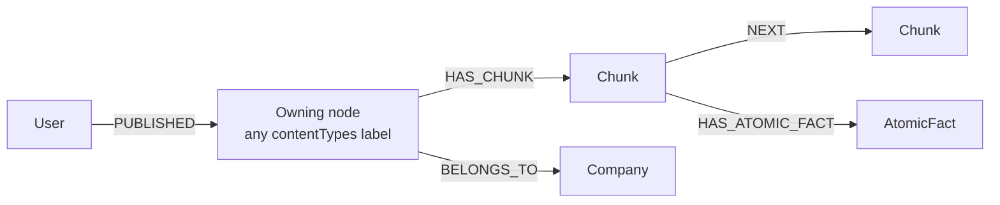

## Purpose

Four foundations under `packages/nestjs-neo4jsonapi/src/foundations/` turn a
file into something the graph can answer questions about: `s3` stores the bytes,
`chunker` reads them into text, `chunk` persists and embeds that text, and
`content` is the read-only cross-type view over whatever produced it. {{display}}
ships all four registered and serving HTTP. Without them there is no upload
surface, no document parsing, and nothing for the knowledge-graph foundations
described in [knowledge-graph-and-retrieval.md](knowledge-graph-and-retrieval.md)
to extract from.

## Vocabulary

| Term | Meaning |
|---|---|
| Content | A *virtual* aggregate over several Neo4j labels, not a label of its own. The label set comes from the `contentTypes` config key |
| Content type | One Neo4j label listed in `contentTypes.types`. The serialised `meta.contentType` is read off the matched node's first label |
| Content extension | `ContentExtensionConfig` — the five knobs that reshape the `Content` descriptor and its generated Cypher |
| Presigned upload | A time-limited `PUT` URL the browser uploads to directly; the API never sees the bytes |
| Signed download | A time-limited `GET` URL for a private object, or the plain public URL when `isPublic` is set |
| Chunk | One `:Chunk` node: a slice of extracted text, its embedding vector, and its position in the source document |
| Chunking strategy | `markdown-structural` (header-structural, no model calls) or `semantic` (embedding cosine-shift splitting) |
| Finalisation claim | A single-winner latch on the owning node, so only one of N per-chunk finalise jobs runs the wrap-up |

## Graph model

`S3` is declared as a `DataMeta` but never written: `S3Service` builds a
transient object with a fresh UUID and serialises it, so no `:S3` node exists in
Neo4j. `Content` has no label of its own either. Only `Chunk` is a real node
this chapter creates.

| Label | Key fields | Relationships | Declaring file |
|---|---|---|---|
| `Chunk` | `content`, `position`, `heading`, `embedding` (never serialised), `imagePath`, `nodeId`, `nodeType`, `aiStatus`, `dates`, `propagatedDates` (both stored as JSON strings) | `HAS_CHUNK` ← owning node (one, polymorphic), `NEXT` → `Chunk` (one), `HAS_ATOMIC_FACT` → `AtomicFact` (many) | `packages/nestjs-neo4jsonapi/src/foundations/chunk/entities/chunk.entity.ts` |
| `Content` (virtual) | `name`, `abstract`, `tldr`; meta `aiStatus`, `contentType`, `relevance` | `PUBLISHED` ← `User` as `owner` (one), `PUBLISHED` ← `User` as `author` (one, removable) | `packages/nestjs-neo4jsonapi/src/foundations/content/entities/content.ts` |
| `S3` (transient) | `url`, `storageType`, `contentType`, `blobType`, `acl` | none | `packages/nestjs-neo4jsonapi/src/foundations/s3/entities/s3.entity.ts` |

`ChunkRepository.onModuleInit` creates the constraint `chunk_id`, the vector
index `chunks` (dimensions from `ModelService.getEmbedderDimensions()`, cosine
similarity) and the fulltext index `chunk_content_search` on `chunk.content`.

The `source` relationship on `Chunk` is polymorphic: its discriminator walks the
matched node's labels and resolves the first one `modelRegistry` knows. A chunk
whose owner has no registered model throws on serialisation.

### The Content extension mechanism

`ContentModule.forRoot(extension)` builds the descriptor **once** at module
construction and publishes it through two injection tokens plus
`modelRegistry`. Every read path resolves the model with `getContentModel()`
rather than importing `ContentDescriptor.model`, because the registered model is
the *configured* one. The module is `global: true` so `ContentCypherService` can
be handed to `RelevancyService` from anywhere.

| Config key | Effect | Default |
|---|---|---|
| `additionalRelationships` | One extra descriptor relationship per entry, keyed by the related model's `nodeName`, plus an `OPTIONAL MATCH` and a RETURN alias | required, may be `[]` |
| `ownerMatchPattern` | Relationship types and direction for the owner edge | `MATCH (content)<-[:PUBLISHED]-(…)` |
| `requireTldr` | Restricts every read to records with a non-empty `tldr` | off |
| `metaFields` | One computed meta key per entry, hydrated by a verbatim extra Cypher clause | none |
| `serialiseAuthor` | Whether the `author` relationship is matched and serialised at all | `true` |

`apps/api/src/main.ts` passes `contentExtension: { additionalRelationships: [] }`
and `apps/api/src/config/config.ts` sets `contentTypes: { types: [] }`. Both are
deliberately empty: {{display}} has no content types yet. With an empty list
`ContentCypherService.getContentTypes()` falls back to the single literal label
`Content`, which matches nothing until you create such nodes — so
`GET /contents` returns an empty list on a fresh install until you fill
`contentTypes.types` with your own labels.

## Backend

| Endpoint | Controller | Service | Repository | DTOs | Guards |
|---|---|---|---|---|---|
| `GET /contents`, `GET /owners/:ownerId/contents`, `GET /authors/:authorId/contents`, `GET /contents/:contentId/relevance` | `packages/nestjs-neo4jsonapi/src/foundations/content/controllers/content.controller.ts` | `packages/nestjs-neo4jsonapi/src/foundations/content/services/content.service.ts` | `packages/nestjs-neo4jsonapi/src/foundations/content/repositories/content.repository.ts` | `packages/nestjs-neo4jsonapi/src/foundations/content/dtos/content.dto.ts` (reference shape only) | `JwtAuthGuard` |
| `GET /s3`, `GET /s3/sign`, `DELETE /s3` | `packages/nestjs-neo4jsonapi/src/foundations/s3/controllers/s3.controller.ts` | `packages/nestjs-neo4jsonapi/src/foundations/s3/services/s3.service.ts` | none | none — query parameters | `JwtAuthGuard` per route |
| `GET /chunks/:chunkId`, `POST /chunks/rebuild-embeddings`, `POST /chunks/rebuild-all-embeddings` | `packages/nestjs-neo4jsonapi/src/foundations/chunk/controllers/chunk.controller.ts` | `packages/nestjs-neo4jsonapi/src/foundations/chunk/services/chunk.service.ts` | `packages/nestjs-neo4jsonapi/src/foundations/chunk/repositories/chunk.repository.ts` | none | `JwtAuthGuard` |
| none — service only | — | `packages/nestjs-neo4jsonapi/src/foundations/chunker/services/chunker.service.ts` | — | — | — |

`Content` is read-only. There is no POST, PATCH or DELETE anywhere in the
module: the underlying records are created by whatever feature owns them, and
`Content` only projects them.

`ContentRepository` does not extend `AbstractRepository`. A multi-label
aggregate cannot use the inherited builders, which assume one `${labelName}`
match, so every method is hand-written and delegates its fragments to
`ContentCypherService` — `default()`, `tldrFilter()`, `ownerMatch()`,
`returnStatement()` and `userHasAccess()`. That same service instance is handed
to `RelevancyService` for `GET /contents/:contentId/relevance`.

`ChunkRepository.findPotentialChunks` is the retrieval entry point: it embeds
the question once, counts the in-scope chunks, then chooses between an exact
cosine scan over the scoped set and the `chunks` vector index with an
over-fetch. The threshold is `EXACT_SCAN_MAX_SCOPED_CHUNKS` (5,000) in
`packages/nestjs-neo4jsonapi/src/foundations/chunk/repositories/retrieval.constants.ts`.
The vector ranking is fused with a `chunk_content_search` fulltext ranking by
`reciprocalRankFusion` (k = 60) in
`packages/nestjs-neo4jsonapi/src/foundations/chunk/services/reciprocal-rank-fusion.ts`,
and the top 20 ids are rehydrated with their cosine scores.

### The S3 service surface

`S3Service` reloads its configuration at the top of every public method, so a
misconfigured `S3_TYPE` yields `null` rather than a boot failure. Five
`S3_TYPE` values are handled: `s3`, `digitalocean`, `hetzner`, `minio` and
`azure`.

| Purpose | Methods |
|---|---|
| Presigned upload | `generatePresignedUrl` — returns a JSON:API `s3` document carrying the URL plus the headers the browser must echo |
| Signed download | `findSignedUrl` (JSON:API document), `generateSignedUrl` (bare string) |
| Upload | `uploadFile`, `uploadToS3`, `uploadStream`, `uploadImageBuffer`, `uploadBufferWithKey`, `uploadToAzureFromBuffer` |
| Download | `downloadFileBuffer`, `downloadFileAsString`, `downloadFileAsBuffer`, `downloadFileAsStream`, `getObjectContent` |
| Listing | `listObjects` (all pages), `listObjectsPage` (one page with a continuation token) |
| Copy and delete | `copyFile`, `deleteFileFromS3`, `deleteFolderFromS3` |

Every one of them branches on `azure` and falls through to the AWS SDK v3
client otherwise. The Azure branch uses `@azure/storage-blob`: presigned uploads
become blob SAS tokens with `racw` permissions, a one-hour expiry and a
fifteen-minute backdated start for clock skew, and they require shared-key
credentials — a connection string that carries only a SAS throws. `listObjectsPage`
is the one method with no Azure implementation; it throws.

The S3 presign is a plain `PutObjectCommand` signed for 3,600 seconds, with
`ACL: public-read` added only when `isPublic` is set. The returned document
carries `blobType` (`BlockBlob`, Azure only) and `acl` (`public-read`,
non-Azure only) so the client can build the right request headers without
knowing which backend is in use.

`S3ServiceModule` provides `S3Service` and nothing else. Import it where you
need the service without mounting `GET /s3`; import `S3Module` when you want the
controller and the serialiser too. The split exists so that `S3Service` has
exactly one registration — two `InstanceWrapper`s for one token make every
`ModuleRef.get(token, { strict: false })` lookup depend on module registration
order.

### The chunker

`ChunkerService.generateContentStructureFromFile({ fileType, filePath })` is the
single entry point for a file; `generateContentStructureFromMarkdown` is the
entry point for text you already have. Both return LangChain `Document[]`.

Strategy selection happens once, in the constructor: `chunker.strategy ===
"semantic"` picks `SemanticSplitterService`, anything else picks
`MarkdownChunkingService`. The target size is `chunker.targetChars`, default
1,500. A hard ceiling of 24,000 characters (`MAX_CHUNK_CHARS`) is applied after
splitting, with a warning, so a splitter that fails to find a boundary cannot
blow the embedding model's context window.

| Extension | Handler | Backing dependency |
|---|---|---|
| `md` | `MarkdownChunkingService` or `SemanticSplitterService` | `@langchain/textsplitters` |
| `pdf` | `packages/nestjs-neo4jsonapi/src/foundations/chunker/services/types/pdf.service.ts` — layout and table extraction, OCR fallback for scans | `pdf-parse`, `pdf2pic`, `node-tesseract-ocr`, `sharp` |
| `docx` | `packages/nestjs-neo4jsonapi/src/foundations/chunker/services/types/docx.service.ts` | `jszip`, `fast-xml-parser` |
| `pptx`, `presentation` | `packages/nestjs-neo4jsonapi/src/foundations/chunker/services/types/pptx.service.ts` | `officeparser` |
| `xlsx`, `spreadsheet` | `packages/nestjs-neo4jsonapi/src/foundations/chunker/services/types/xlsx.service.ts` | `xlsx-republish` |
| `eml`, `msg` | `packages/nestjs-neo4jsonapi/src/foundations/chunker/services/types/email.service.ts` — body plus per-attachment recursion | `mailparser`, `@kenjiuno/msgreader` |
| `json`, `jsonl` | `packages/nestjs-neo4jsonapi/src/foundations/chunker/loaders/json.loader.ts` | none |
| `csv` | `CSVLoader` | `@langchain/community` |
| Images — `webp`, `jpg`, `jpeg`, `png`, `gif`, `bmp`, `tiff`, `tif`, `svg` | LLM vision description through `ModelService` | the AI layer |
| anything else | `packages/nestjs-neo4jsonapi/src/foundations/chunker/loaders/text.loader.ts` plus a `TokenTextSplitter` | `@langchain/textsplitters` |

OCR language comes from `chunker.ocrLanguage` (default `eng`) and is passed to
Tesseract per page; the corresponding language pack must be installed in the
image. A scan over twenty pages logs a slow-job warning and is not skipped.
`ImageExtractorService` pulls embedded images out of PDFs and DOCX files with
`pdfjs-dist` and `adm-zip`.

Page counts travel on chunk metadata. PDFs carry their real count; every other
format is estimated at 500 words per page, so per-page costs can be attributed
whatever the input was. When `ai.mock` is on, the whole method short-circuits to
a single mock document.

Three related services sit in `packages/nestjs-neo4jsonapi/src/core/` rather
than in the chunker, because they generate documents instead of reading them:
`core/blocknote` converts BlockNote/ProseMirror JSON to Markdown and back and to
DOCX, `core/document` builds DOCX from templates with `docx-templates`, and
`core/pdf` converts DOCX to PDF by shelling out to headless LibreOffice, which
must be on `$PATH`.

## Frontend

| Model | Service | Module factory | Routes | Components | Feature id |
|---|---|---|---|---|---|
| `packages/nextjs-jsonapi/src/features/content/data/content.ts` | `packages/nextjs-jsonapi/src/features/content/data/content.service.ts` | `packages/nextjs-jsonapi/src/features/content/content.module.ts` — wired as `Content` | none in `apps/web/src/app` | `ContentsList`, `ContentsListById`, `RelevantContentsList`, `useContentTableStructure` | none |
| `packages/nextjs-jsonapi/src/features/s3/data/s3.ts` | `packages/nextjs-jsonapi/src/features/s3/data/s3.service.ts` | `packages/nextjs-jsonapi/src/features/s3/s3.module.ts` — wired as `S3` | none | used inside `EditableAvatar`, `UserEditor`, `CompanyEditor`, `BlockNoteEditor` | none |
| `packages/nextjs-jsonapi/src/features/chunk/data/Chunk.ts` | none | `packages/nextjs-jsonapi/src/features/chunk/ChunkModule.ts` — wired as `Chunk` | none | rendered inside the assistant's citation tabs | none |

All three module factories are called in `apps/web/src/config/Bootstrapper.ts`,
so `Modules.Content`, `Modules.S3` and `Modules.Chunk` all resolve. None of them
has a page: the template mounts no `/contents` and no `/chunks` route, and the
`pageUrl` on each factory is only what `generateUrl` would build if you added
one.

The `S3` model exposes a `headers` getter that assembles `Content-Type`,
`x-ms-blob-type` and `x-amz-acl` from the serialised document, which is exactly
what the browser must send on the presigned `PUT`.

`Chunk.rehydrate` resolves its polymorphic `source` through
`resolveReferenceableModules()`, and `createJsonApi()` returns a deliberate stub
— chunks are read-only from the client.

## Flows

Uploading a file and making it searchable, end to end. `EditableAvatar` in
`packages/nextjs-jsonapi/src/components/EditableAvatar.tsx` is the shipped
example of steps 1 to 3.

1. The client calls `S3Service.getPreSignedUrl({ key, contentType, isPublic })`,
   which is `GET /s3?key=…&contentType=…`.
2. `S3Controller.getPresignedUrl` → `S3Service.generatePresignedUrl` signs a
   `PutObjectCommand` (or mints a blob SAS) and returns an `s3` JSON:API
   document.
3. The client `PUT`s the file straight at `s3.url` with `s3.headers`. The bytes
   never pass through the API.
4. The owning feature persists its own record — a node carrying one of the
   labels in `contentTypes.types` — and stores the object key on it.
5. That feature calls `ChunkerService.generateContentStructureFromFile({
   fileType, filePath })`. The chunker downloads the object to `/tmp`, dispatches
   on the extension, splits with the configured strategy, caps the chunk size and
   stamps the page count.
6. The feature calls `ChunkService.createChunks({ id, nodeType, data })`. This
   first clears any stale finalisation claim, then for each document calls
   `ChunkRepository.createChunk`, which **embeds the text before writing** via
   `EmbedderService.vectoriseText` and creates `(owner)-[:HAS_CHUNK]->(chunk)`
   plus a `NEXT` edge to the previous chunk. The chunk is written with
   `aiStatus: pending`.
7. The feature enqueues one `process_chunk` job per chunk on the `chunk` queue,
   carrying `companyId`, `userId`, `chunkId`, `contentId` and `contentType`
   (the Neo4j label). `HowToService._chunkAndQueue` in
   `packages/nestjs-neo4jsonapi/src/foundations/how-to/services/how-to.service.ts`
   is the shipped example of steps 5 to 7.
8. `ChunkProcessor` runs each job inside `cls.run()`, checks the AI and credit
   gates, and calls `ChunkService.generateGraph`. That marks the chunk
   `in_progress`, runs the graph-creator agent, writes key concepts, atomic facts
   and their relationships, stores the extracted dates, and marks the chunk
   `completed`.
9. `generateGraph` then enqueues one finalise job per chunk, on the queue named
   `contentType.toLowerCase()` with the job name from
   `jobNames.process[contentType]`. The owning feature's processor calls
   `ChunkRepository.claimContentFinalisation`, and only the single winner runs
   the wrap-up.
10. The chunk is now reachable from `ChunkRepository.findPotentialChunks` —
    vector plus fulltext, fused — and from the retrieval flows in
    [knowledge-graph-and-retrieval.md](knowledge-graph-and-retrieval.md).

Serving a chunk image back is the reverse of step 1: the `imagePath` field on
`ChunkDescriptor` has a `transform` that calls `S3Service.generateSignedUrl`
with a seven-day TTL, so the serialised chunk carries a usable URL rather than
an object key. This is why `ChunkDescriptor` declares `injectServices:
[S3Service]`.

Rebuilding every embedding is a separate, admin-triggered flow:
`POST /chunks/rebuild-all-embeddings` enqueues one job on `embedding-chunks` and
one on `embedding-keyconcepts`, and each processor drops and recreates its
vector index before re-embedding in batches of 100.

## Background jobs

| Queue | Job name | Processor | Trigger |
|---|---|---|---|
| `chunk` | `jobNames.process.chunk`, default `process_chunk` | `packages/nestjs-neo4jsonapi/src/foundations/chunk/processors/chunk.processor.ts` | One per chunk, enqueued by the feature that created them |
| `embedding-chunks` | `jobNames.process.rebuild_chunks`, default `embedding:rebuild_chunks` | `packages/nestjs-neo4jsonapi/src/foundations/chunk/processors/chunk.embedding.processor.ts` | `POST /chunks/rebuild-embeddings` and `POST /chunks/rebuild-all-embeddings` |
| `embedding-keyconcepts` | `jobNames.process.rebuild_keyconcepts`, default `embedding:rebuild_keyconcepts` | covered in [knowledge-graph-and-retrieval.md](knowledge-graph-and-retrieval.md) | `POST /chunks/rebuild-all-embeddings` |

The `chunk` queue is registered unconditionally by
`packages/nestjs-neo4jsonapi/src/core/queue/queue.module.ts`. The two
embedding-rebuild queues are registered **locally** by `ChunkModule` and
`KeyConceptModule`, so a consuming app gets the routes and the workers without
naming them in its own config.

`ChunkProcessor` runs with `concurrency: CHUNK_QUEUE_CONCURRENCY` and a
one-minute lock. That constant lives in
`packages/nestjs-neo4jsonapi/src/config/base.config.ts` and is read from the
environment at module load, not through `ConfigService`: `@Processor(queue, {
concurrency })` options are evaluated when the class is *decorated*, long before
Nest builds the config object. The `chunkQueues.concurrency` config field
reports the value in force but cannot change it. A non-numeric or non-positive
value falls back to 50 rather than producing `NaN`, which BullMQ would treat as
unbounded. Both embedding processors run with `concurrency: 1` and a
thirty-minute lock.

`apps/api/src/config/enums/queue.id.ts` declares exactly one queue — `chunk` —
and `apps/api/src/config/enums/job.name.ts` declares exactly one job name,
`process_chunk`. `apps/api/src/config/config.ts` passes `chunkQueues: {
queueIds: Object.values(QueueId) }`, so {{display}} adds nothing beyond what the
package already registers. Add a queue id here for every content type you
introduce: `ChunkService.selectQueue` resolves the finalise queue by convention
from `labelName.toLowerCase()` and throws a named error when it is missing.

Workers run only in worker mode. `createWorkerProvider` wraps both processors,
so the API process registers neither.

## Permissions and gating

`S3` is the only module in this chapter with a seeded `Module` node:
`ModuleId.S3` in `packages/shared/src/const/module.id.ts`, created by
`apps/api/src/neo4j.migrations/20250901_002.ts` and granted in
`apps/api/src/rbac/permissions.ts` — read for everyone, create/update/delete for
company administrators, full for platform administrators.

`Content` and `Chunk` carry a `moduleId` on their frontend module factories, but
no matching entry exists in `ModuleId`, no `Module` node is seeded, and no grant
appears in `permissions.ts`. `hasPermissionToModule({ module: Modules.Chunk })`
therefore has nothing to resolve against. Both controllers are protected by
`JwtAuthGuard` alone.

Company scoping is enforced in Cypher, not by a guard. `ContentDescriptor` sets
`isCompanyScoped: true`, and both `ContentRepository` and `ChunkRepository` pass
`SecurityService.userHasAccess` into every read. Neither module declares a
feature id, so neither is gated behind a company's `HAS_FEATURE` edge. See
[../03-backend/rbac-and-permissions.md](../03-backend/rbac-and-permissions.md)
for the engine.

## Configuration

| Variable | Config key | Default | Read by |
|---|---|---|---|
| `S3_TYPE` | `s3.type` | `""` | `S3Service._loadConfiguration` — one of `s3`, `digitalocean`, `hetzner`, `minio`, `azure` |
| `S3_ENDPOINT` | `s3.endpoint` | `""` | `S3Service` — ignored for `s3`, the connection string is `S3_ACCESS_KEY_ID` for `azure` |
| `S3_BUCKET` | `s3.bucket` | `""` | `S3Service` — the container name under `azure` |
| `S3_ACCESS_KEY_ID` | `s3.key` | `""` | `S3Service` |
| `S3_SECRET_ACCESS_KEY` | `s3.secret` | `""` | `S3Service` |
| `S3_REGION` | `s3.region` | `us-east-1` | `S3Service` |
| `CHUNKER_STRATEGY` | `chunker.strategy` | `markdown-structural` | `ChunkerService` constructor |
| `CHUNKER_TARGET_CHARS` | `chunker.targetChars` | `1500` | `ChunkerService`, `MarkdownChunkingService` |
| `OCR_LANGUAGE` | `chunker.ocrLanguage` | `eng` | `PdfService.extractPdfContent` |
| `CHUNK_QUEUE_CONCURRENCY` | `chunkQueues.concurrency` (read-only echo) | `50` | `CHUNK_QUEUE_CONCURRENCY` at module load |
| — | `contentTypes.types` | `[]` | `ContentRepository`, `ContentCypherService` |
| — | `chunkQueues.queueIds` | `[]` | `QueueModule.forRoot` |
| — | `jobNames.process` | `{}` | `ChunkProcessor`, `ChunkController`, `ChunkService` |

`.env.example` sets the six `S3_*` variables. The four chunker and concurrency
variables are read by `packages/nestjs-neo4jsonapi/src/config/base.config.ts`
but are not listed in `.env.example`; the defaults apply unless you add them.

## Tests

The package ships specs beside the code: `content.controller.spec.ts`,
`content.descriptor.spec.ts`, `content.repository.spec.ts`,
`content.cypher.service.spec.ts` and `content.service.spec.ts` under `content`;
`s3.controller.spec.ts` and `s3.service.spec.ts` under `s3`;
`chunker.service.spec.ts` under `chunker`; `chunk.controller.spec.ts`,
`chunk.descriptor.spec.ts`, `chunk.repository.spec.ts` and
`chunk.service.spec.ts` under `chunk`.

{{display}} itself tests none of this. `apps/api` and `apps/web` ship no unit or
component spec at all, and the Playwright suite under `apps/web/tests/` never
uploads a file. Do not assume the following are protected: the Azure branch of
any `S3Service` method; OCR of a scanned PDF; `eml`/`msg` attachment recursion;
the finalise-queue lookup for a content type you add; and the behaviour of
`GET /contents` once `contentTypes.types` is non-empty.

## Where to look

| File | Why |
|---|---|
| `packages/nestjs-neo4jsonapi/src/foundations/content/content.module.ts` | How `forRoot()` builds one descriptor and publishes it three ways |
| `packages/nestjs-neo4jsonapi/src/foundations/content/interfaces/content.extension.interface.ts` | The five extension knobs, each documented with its default |
| `packages/nestjs-neo4jsonapi/src/foundations/content/services/content.cypher.service.ts` | The Cypher fragments every `Content` read is assembled from |
| `packages/nestjs-neo4jsonapi/src/foundations/s3/services/s3.service.ts` | The whole storage surface, including every Azure divergence |
| `packages/nestjs-neo4jsonapi/src/foundations/s3/s3.service.module.ts` | Why `S3Service` has exactly one registration |
| `packages/nestjs-neo4jsonapi/src/foundations/chunker/services/chunker.service.ts` | Strategy selection, the format dispatch table and the size cap |
| `packages/nestjs-neo4jsonapi/src/foundations/chunk/services/chunk.service.ts` | `createChunks` and `generateGraph` — the whole ingest pipeline |
| `packages/nestjs-neo4jsonapi/src/foundations/chunk/repositories/chunk.repository.ts` | Index creation, ingest-time embedding, and hybrid retrieval |
| `packages/nestjs-neo4jsonapi/src/foundations/chunk/repositories/retrieval.constants.ts` | Every retrieval bound, each with the reasoning that set it |
| `apps/api/src/config/config.ts` | The app's whole contribution: one queue, no content types |

## Gaps and drift

- `contentTypes.types` is `[]` in `apps/api/src/config/config.ts`, so
  `getContentTypes()` falls back to the literal label `Content`, which no
  foundation ever writes. `GET /contents` is a working endpoint over an empty
  set until you configure it.
- `CHUNKER_STRATEGY`, `CHUNKER_TARGET_CHARS`, `OCR_LANGUAGE` and
  `CHUNK_QUEUE_CONCURRENCY` are read by `base.config.ts` but absent from
  `.env.example`.
- `ChunkerService` logs two `[CHUNKER-PORT]` lines, one at construction and one
  per file, described in their own comments as temporary validation logging.
- `ChunkService.propagateAndEmbedDates` is public and fully implemented, but no
  processor in the package calls it. Date propagation across a document's chunks
  therefore runs only if your own code invokes it.
- The chunker writes temporary files to `/tmp` with a UUID name and deletes them
  only on the email-attachment path. The main file path leaves them behind.
- `xlsx-republish`, `officeparser`, `node-tesseract-ocr`, `pdf2pic` and
  `libreoffice-convert` all depend on binaries or native builds that must exist
  in the runtime image; [../07-operations/docker.md](../07-operations/docker.md) owns that inventory.
- Not examined: the interiors of `PdfService`'s layout and table extractors, the
  `SemanticSplitterService` cosine-shift algorithm, `DocXService`'s numbering
  state machine, and the `core/document` DOCX generation path beyond its entry
  points.
