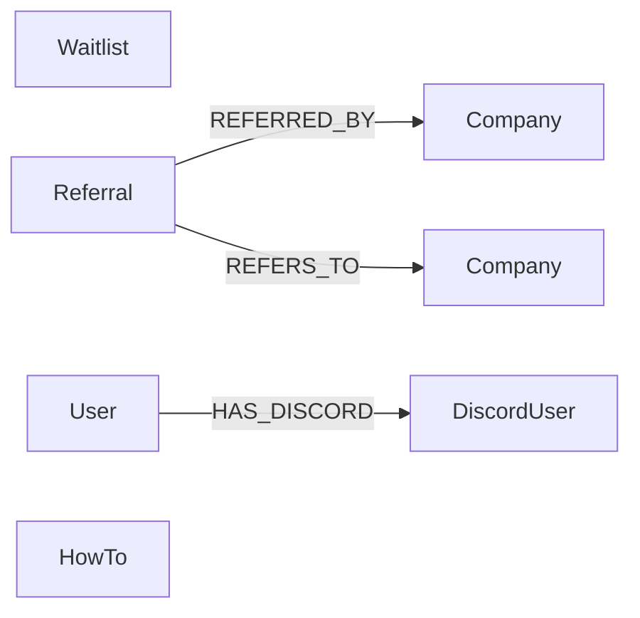

## Purpose

Four foundations under `packages/nestjs-neo4jsonapi/src/foundations/` cover how
people arrive at {{display}} and how they are helped once inside. `waitlist`
gates registration behind an invitation and holds the queue of people waiting
for one. `referral` lets an existing company invite another and rewards both.
`how-to` is the article store — the same rows serve the administration editor
and the public `/help` site. `discord` is an optional bot process. Only `how-to`
is load-bearing on day zero; the other three are inert until configured.

## Vocabulary

| Term | Meaning |
|---|---|
| Registration mode | `open`, `closed` or `waitlist` — the gate `AuthService.register()` applies |
| Confirmation code | A UUID emailed to a waitlist signup, valid until `confirmationCodeExpiration` |
| Invite code | A UUID emailed to a confirmed entry, valid seven days, redeemed at registration |
| Waitlist status | `pending` → `confirmed` → `invited` → `registered` |
| Referral code | A per-company string; the referred company's registration carries it |
| Completion | The moment a referral converts — a Stripe payment webhook, not the signup |
| How-to type | The article's category; the public site uses it as the `[mode]` URL segment |
| Help mode | One of `tutorial`, `how-to`, `reference`, `explanation` |
| Necord | The NestJS wrapper around `discord.js` that discovers decorated bot handlers |

## Graph model

| Label | Key fields | Relationships | Declaring file |
|---|---|---|---|
| `Waitlist` | `email`, `gdprConsent(At)`, `marketingConsent(At)`, `questionnaire`, `confirmationCode`, `confirmationCodeExpiration`, `confirmedAt`, `status`, `inviteCode`, `inviteCodeExpiration`, `invitedAt`, `registeredAt`, `userId` | none | `packages/nestjs-neo4jsonapi/src/foundations/waitlist/entities/waitlist.ts` |
| `Referral` | `status`, `completedAt`, `tokensAwarded` | `REFERRED_BY` → `Company` (one, wire key `referrer`), `REFERS_TO` → `Company` (one, wire key `referred`) | `packages/nestjs-neo4jsonapi/src/foundations/referral/entities/referral.ts` |
| `ReferralCode` | `referralCode` | none | `packages/nestjs-neo4jsonapi/src/foundations/referral/entities/referral-code.ts` |
| `ReferralStats` | `referralCode`, `completedReferrals`, `totalTokensEarned` | none | `packages/nestjs-neo4jsonapi/src/foundations/referral/entities/referral-stats.ts` |
| `HowTo` | `name`, `description`, `pages`, `abstract`, `tldr`, `aiStatus`, `howToType`, `slug`, `order`, `summary`, `tags`, `contextualKeys`, `draft`; computed `relevance` | none declared; chunks attach through the content pipeline | `packages/nestjs-neo4jsonapi/src/foundations/how-to/entities/how-to.ts` |
| `DiscordUser` | `name`, `discordId` | `HAS_DISCORD` ← `User` (one, wire key `users`) | `packages/nestjs-neo4jsonapi/src/foundations/discord-user/entities/discord-user.ts` |

Three of these set `isCompanyScoped: false` and mean it: `Waitlist` (the entry
exists before any company does), `ReferralCode` and `ReferralStats` (both are
projections keyed by code), and `HowTo` (articles are platform-wide, and the
public site serves them with no session). `Referral` and `DiscordUser` keep the
company-scoped default.

`ReferralCode` and `ReferralStats` have no label of their own in practice —
they are read-only projections the repository assembles and the descriptor
serialises; the persisted referral code lives on the `Company` node.

## Backend

| Endpoint | Controller | Service | Repository | DTOs | Guards |
|---|---|---|---|---|---|
| `POST /waitlists` (public) | `packages/nestjs-neo4jsonapi/src/foundations/waitlist/controllers/waitlist.controller.ts` | `packages/nestjs-neo4jsonapi/src/foundations/waitlist/services/waitlist.service.ts` | `packages/nestjs-neo4jsonapi/src/foundations/waitlist/repositories/waitlist.repository.ts` | `WaitlistPostDTO` | none |
| `GET /waitlists/confirm/:code` (public) | same | same | same | none | none |
| `GET /waitlists/invite/:code` (public) | same | same | same | none | none |
| `GET /waitlists` | same | same | same | none | `AdminJwtAuthGuard` + `@Roles(RoleId.Administrator)` |
| `GET /waitlists/stats` | same | same | same | none | `AdminJwtAuthGuard` + `@Roles` |
| `POST /waitlists/:id/invite` | same | same | same | none | `AdminJwtAuthGuard` + `@Roles` |
| `POST /waitlists/invite-batch` | same | same | same | `WaitlistInviteBatchDTO` | `AdminJwtAuthGuard` + `@Roles` |
| `GET /referrals/my-code` | `packages/nestjs-neo4jsonapi/src/foundations/referral/controllers/referral.controller.ts` | `packages/nestjs-neo4jsonapi/src/foundations/referral/services/referral.service.ts` | `packages/nestjs-neo4jsonapi/src/foundations/referral/repositories/referral.repository.ts` | none | `JwtAuthGuard` on the class |
| `POST /referrals/invite` | same | same | same | `ReferralInviteDTO` | `JwtAuthGuard` |
| `GET /referrals/stats` | same | same | same | none | `JwtAuthGuard` |
| `GET /howtos`, `GET /howtos/:howToId`, `POST /howtos`, `PUT /howtos/:howToId`, `DELETE /howtos/:howToId`, `POST /howtos/reindex`, `POST|DELETE /howtos/:howToId/related/:relatedId` | `packages/nestjs-neo4jsonapi/src/foundations/how-to/controllers/how-to.controller.ts` | `packages/nestjs-neo4jsonapi/src/foundations/how-to/services/how-to.service.ts` | `packages/nestjs-neo4jsonapi/src/foundations/how-to/repositories/how-to.repository.ts` | `HowToPostDTO`, `HowToPutDTO` | `JwtAuthGuard` on the class |
| `GET /public/howtos`, `GET /public/howtos/:howToType/:slug`, `GET /public/howtos/:howToType/:slug/related` | `packages/nestjs-neo4jsonapi/src/foundations/how-to/controllers/how-to.public.controller.ts` | same | same | none | **none** — deliberately unauthenticated |
| — (no routes) | — | `packages/nestjs-neo4jsonapi/src/foundations/discord/services/discord.service.ts` | — | — | — |

Three of the four modules are ordinary; `referral` is the exception. Every one
of its routes calls a private `checkEnabled()` that throws `NotFoundException`
when `REFERRAL_CONFIG.enabled` is false, so a disabled referral feature returns
404 rather than an error the client has to interpret.

`WaitlistController` is the only controller in {{display}} with three genuinely
public routes and four administrator-only ones on the same class — the guards
are per method, not on the class.

`HowToPublicController` carries no guard at all. It serves published articles
to anonymous visitors, which is what makes the `/help` site work without a
session.

`DiscordModule` is `@Global()` and provides exactly two things: `DiscordService`
— a thin wrapper over an optionally-injected `discord.js` `Client`, exposing
`getClient()`, `isReady()`, `isEnabled()` and `handleInteractionError()` — and
`DiscordErrorSerialiser`. It has no controller, no repository and no entity. The
identity half, linking a Discord account to a `User`, is `discord-user`; see
`docs/handbook/05-foundations/identity-and-tenancy.md`.

## Frontend

| Model | Service | Module factory | Routes | Components | Feature id |
|---|---|---|---|---|---|
| `packages/nextjs-jsonapi/src/features/waitlist/data/Waitlist.ts` | `packages/nextjs-jsonapi/src/features/waitlist/data/WaitlistService.ts` | `packages/nextjs-jsonapi/src/features/waitlist/waitlist.module.ts` — wired as `Waitlist` | `/administration/waitlist` → `apps/web/src/app/[locale]/(admin)/administration/waitlist/page.tsx` | `WaitlistList`, `WaitlistForm`, `WaitlistQuestionnaireRenderer`, `WaitlistHeroSection`, `WaitlistSuccessState`, `WaitlistConfirmation` | none |
| `packages/nextjs-jsonapi/src/features/waitlist/data/waitlist-stats.ts` | — | `packages/nextjs-jsonapi/src/features/waitlist/waitlist-stats.module.ts` — wired as `WaitlistStats` | none | rendered inside `WaitlistList` | none |
| `packages/nextjs-jsonapi/src/features/referral/data/ReferralService.ts` | same file | `packages/nextjs-jsonapi/src/features/referral/referral.module.ts` — wired as `Referral` | none | `ReferralWidget`, `ReferralDialog`, `ReferralCodeCapture` | none |
| `packages/nextjs-jsonapi/src/features/referral/data/ReferralStats.ts` | — | `packages/nextjs-jsonapi/src/features/referral/referral-stats.module.ts` — wired as `ReferralStats` | none | via `useReferralStats` | none |
| `packages/nextjs-jsonapi/src/features/how-to/data/HowTo.ts` | `packages/nextjs-jsonapi/src/features/how-to/data/HowToService.ts` | `packages/nextjs-jsonapi/src/features/how-to/HowToModule.ts` — wired as `HowTo`, `pageUrl: /administration/howtos`, `moduleId: 6f975207-0df3-4c0d-b541-ed5dc04487b2` | `/administration/howtos`, `/administration/howtos/[id]`, and the four `/help` routes below | `HowToListContainer`, `HowToContainer`, `HowToEditor`, `HowToDeleter`, `HowToCommand`, `HowToSelector` | none |

`HowToModule` is the only factory in this chapter that declares `inclusions`, a
`lists` field set limiting the list request to eleven attributes.

The public help site is composed in the app, not shipped as a container. The
package's `/help` entry point (`packages/nextjs-jsonapi/src/features/help/index.ts`)
exports client primitives — `HelpProvider`, `HelpHeader`, `HelpSideNav`,
`HelpArticleBody`, `HelpTOC`, `HelpHint`, `HelpAskAi`, `HelpSearchResultRow`,
`useHelpFilter`, `articleUrl`, `modeUrl` — while `/help/server`
(`packages/nextjs-jsonapi/src/features/help/server-entry.ts`) exports only
`HELP_MODES` and the article types, deliberately without a `"use client"`
directive so a server component can import the constant without pulling the
client bundle.

| Route | File | Notes |
|---|---|---|
| `/help` | `apps/web/src/app/[locale]/(public-help)/help/page.tsx` | lists the four modes and the first three `tutorial` articles by `order` |
| `/help/[mode]` | `apps/web/src/app/[locale]/(public-help)/help/[mode]/page.tsx` | 404s on a `mode` outside `HELP_MODES`; `generateStaticParams` prerenders every mode |
| `/help/[mode]/[slug]` | `apps/web/src/app/[locale]/(public-help)/help/[mode]/[slug]/page.tsx` | the article body plus its related articles |
| `/help/sitemap.xml` | `apps/web/src/app/help/sitemap.xml/route.ts` | XML-escapes every slug because they come from the database; built per request after `connection()`; lives outside `[locale]` so it answers at `/help/sitemap.xml`, the URL `robots.ts` advertises |

All four read through
`apps/web/src/app/[locale]/(public-help)/help/_data/publicHowTo.ts`, which wraps
`ServerJsonApiGet` with a class key of `{ ...Modules.HowTo, cache: "help" }`.
None of the four exports `revalidate`. A `cache` key sends the read through
`cachedServerGet`, which runs under `"use cache"` without a token; `"help"` is
not a preset cache profile, so it becomes `cacheTag("help")` with
`cacheLife("max")` — one tag to revalidate after an article edit. The reads sit
behind `connection()`, so `next build` never calls the API (see the app shell
page); at run time the help pages need the public help routes, which
`apps/api/src/main.ts` turns on with `howTo: { publicRoutes: true }`. The sitemap route imports `@/config/env` first and explains why: it
dereferences `Modules.HowTo` at module scope, and Next collects a route
handler's config during the production build without running
`instrumentation.ts`, so nothing else would have called `bootstrap()`.

The chrome around those pages is the app's, under
`apps/web/src/features/essentials/how-to/components/`: `HelpSidebar`,
`HelpPageChrome`, `HelpHeaderActions`, `HelpQuickLinks` and `AppHowToCommand`.
`apps/web/src/app/[locale]/(public-help)/help/layout.tsx` is synchronous: it
calls `ServerSession.read()` and hands the promise to `SessionProvider` and
`SocketProvider` without awaiting it, so the help pages stay prerenderable.
`HelpSidebar` sits behind `Suspense`, and its user footer unwraps the session
with `useSession()` behind its own boundary, rendering nothing for an anonymous
visitor.

## Flows

**Waitlist signup to registered user.**

1. `POST /waitlists` with `gdprConsent: true` — the controller rejects anything
   else with 400 before the service is called.
2. `WaitlistService.createEntry()` stores the entry as `pending` with a
   `confirmationCode`, then sends the `waitlistConfirmation` email with a link
   to `<APP_URL>en/waitlist/confirm/<code>`.
3. `GET /waitlists/confirm/:code` validates the code and its expiry, rejects a
   non-`pending` entry, flips the status to `confirmed`, and calls
   `notifyAdminsOfConfirmation()`.
4. That helper looks up every platform administrator through
   `UserRepository.findPlatformAdministrators()` and sends each one a
   `waitlistAdminNotification` email linking to
   `<APP_URL>en/administration/waitlist`. Failures are logged, never thrown.
5. An administrator opens `/administration/waitlist` and invites, one entry at a
   time (`POST /waitlists/:id/invite`) or in bulk (`POST /waitlists/invite-batch`).
6. `invite()` refuses anything that is not `confirmed`, mints a seven-day
   `inviteCode`, and sends `waitlistInvitation` linking to
   `<APP_URL>en/register?invite=<code>`.
7. The register form reads `getRegistrationMode()`; in `waitlist` mode with an
   invite it validates the code against `GET /waitlists/invite/:code` before
   showing the form, and without one it shows a "join the waitlist" panel.
8. `AuthService.register()` re-validates the code server-side, and on success
   calls `WaitlistService.markAsRegistered({ inviteCode, userId })`, which sets
   the status to `registered`.

The three Handlebars templates this flow sends are shipped by the app, not the
package: `apps/api/templates/email/en/waitlistConfirmation.hbs`,
`apps/api/templates/email/en/waitlistAdminNotification.hbs` and
`apps/api/templates/email/en/waitlistInvitation.hbs`, all composed with
`apps/api/templates/email/header.hbs` and `apps/api/templates/email/footer.hbs`.
Every send passes the literal locale `"en"`.

**Referral, when enabled.**

1. `GET /referrals/my-code` returns (creating on first call) the signed-in
   company's referral code.
2. `POST /referrals/invite` emails an invitation through the `email` queue,
   subject to `inviteCooldownSeconds` — fourteen days by default — so the same
   address cannot be invited repeatedly.
3. The recipient arrives with `?ref=<code>`. `ReferralCodeCapture` stores it in
   the `referral_code` cookie for `cookieDays` days.
4. On registration, `RegistrationReferralHook` — bound to the `REGISTRATION_HOOK`
   token by `ReferralModule.createModule()` — creates the `Referral` node
   linking referrer and referred companies.
5. When the referred company pays, `StripeWebhookProcessor` resolves the
   optional `REFERRAL_COMPLETION_HANDLER` token, which `ReferralModule` binds
   with `useExisting: ReferralService`, and the referral completes: `status`,
   `completedAt` and `tokensAwarded` are written and `rewardTokens` (1000 by
   default) are credited to both companies.
6. `GET /referrals/stats` and `useReferralStats` render the running total.

**A how-to article, from editor to public page.**

1. An administrator saves an article at `/administration/howtos/[id]`;
   `HowToService.queueHowToForProcessing()` converts the BlockNote JSON to
   Markdown and calls `_chunkAndQueue()`.
2. That deletes prior chunks, chunks the Markdown through `ChunkerService`,
   creates the chunks, and enqueues one `process_chunk` job per chunk on the
   `chunk` queue.
3. `ChunkService` processes each chunk and, on the last one, selects the next
   queue by convention — `labelName.toLowerCase()`, so `HowTo` → `howto` — and
   adds the job name from `jobNames.process.HowTo`.
4. `HowToProcessor` takes a single-winner latch through
   `ChunkRepository.claimContentFinalisation()`, so duplicate finalise jobs are
   harmless, and moves `aiStatus` to `Completed`. It runs inside `cls.run()`
   with `isAutomatedJob: true`.
5. The public site reads the finished article through `GET
   /public/howtos/:howToType/:slug`, cached under the `help` tag.
6. `POST /howtos/reindex` replays step 1 for every article — needed because rows
   seeded by a raw-Cypher migration have no chunks.

## Background jobs

| Queue | Job name | Processor | Trigger |
|---|---|---|---|
| `howto` (`QueueId.HOWTO`) | `jobNames.process.HowTo`, falling back to `"process_howto"` | `packages/nestjs-neo4jsonapi/src/foundations/how-to/processors/how-to.processor.ts`, registered through `createWorkerProvider()` | `ChunkService` after the last chunk of a `HowTo` completes |
| `chunk` (`QueueId.CHUNK`) | `jobNames.process.chunk` — `process_chunk` in {{display}} | the chunk foundation's processors | `HowToService._chunkAndQueue()` |
| `email` (`QueueId.EMAIL`) | `billing-notification` and the referral invite | the app's email worker | `ReferralService` invites |

The `howto` queue is registered unconditionally by
`packages/nestjs-neo4jsonapi/src/core/queue/queue.module.ts`, alongside `chunk`,
`company` and `trial`, so an app never has to list it.

`waitlist` has no queue and sends its emails inline through `EmailService`.
`discord` has no queue; the bot is a long-lived connection, not a job.

## Permissions and gating

| Module | Module id | Seeded | RBAC grant |
|---|---|---|---|
| `HowTo` | `6f975207-0df3-4c0d-b541-ed5dc04487b2` | yes — `packages/shared/src/const/module.id.ts` and `apps/api/src/neo4j.migrations/20250901_002.ts` | `default: [perm.read]`, `RoleId.Administrator: perm.full` in `apps/api/src/rbac/permissions.ts` |
| `Waitlist`, `WaitlistStats` | none on the factory | no | none — the API guards the routes directly |
| `Referral`, `ReferralStats` | none on the factory | no | none — the API guards the routes directly |
| `DiscordUser` | none | no | none |

Roles come from `packages/shared/src/const/roles.id.ts` and
`packages/shared/src/const/system.roles.id.ts`.

What each caller sees:

- **Unauthenticated** — `POST /waitlists`, the two waitlist code lookups, and
  all three `GET /public/howtos*` routes. Nothing else.
- **Any authenticated member** — the three referral routes (404 while referral
  is disabled), `GET /howtos` and `GET /howtos/:id`.
- **Company administrator** — the same. Nothing in this chapter is gated on
  `RoleId.CompanyAdministrator`.
- **Platform administrator** — additionally every `/waitlists` administration
  route, and the write half of `/howtos`, whose methods carry
  `@Roles(RoleId.Administrator)`.

`/administration/waitlist` and `/administration/howtos` both sit in the
`(admin)` route group, and each page awaits `requireAdministrator(locale)`
before rendering: no session redirects to login, a non-administrator gets the
in-frame 404. The engine is
documented in `docs/handbook/03-backend/rbac-and-permissions.md`, the client gate
in `docs/handbook/04-frontend/access-control.md`.

No module in this chapter declares a feature id, so nothing here is gated behind
a company's `HAS_FEATURE` edge.

## Configuration

| Variable | Config key | Default | Read by |
|---|---|---|---|
| `NEXT_PUBLIC_REGISTRATION_MODE` | `auth.registrationMode` | `open` | `packages/nestjs-neo4jsonapi/src/config/base.config.ts`, then `AuthService`, `AuthGoogleService` and `AuthDiscordService`; `REGISTRATION_MODE` is accepted as a fallback name |
| `NEXT_PUBLIC_REGISTRATION_MODE` | — | `open` | `ENV.REGISTRATION_MODE` in `apps/web/src/config/middleware-env.ts`, passed to `configureLogin()` in `apps/web/src/config/instrumentation-env.ts` |
| `APP_URL` | `app.url` | — | every waitlist email link, and the referral link base |
| `NEXT_PUBLIC_DISCORD_CLIENT_ID` | `discord.clientId` | `""` | OAuth login button and the OAuth flow |
| `DISCORD_CLIENT_SECRET` | `discord.clientSecret` | `""` | the OAuth flow |
| `DISCORD_TOKEN` | `discord.token` | `""` | `app.module.factory.ts` — **the bot exists only when this is set** |
| `DISCORD_DEV_GUILD_ID` | `discord.devGuildId` | `""` | Necord's `development` guild list; falsy means global command registration |

Both tiers read the same variable for the registration mode, which is why it
carries the `NEXT_PUBLIC_` prefix even on the API.

`waitlist`, `referral` and `how-to` read nothing else from the environment.
Referral is configured in code, through `bootstrap({ referral })` →
`FoundationsModule.forRoot({ referral })` → `ReferralModule.forRoot()`;
`packages/nestjs-neo4jsonapi/src/foundations/referral/interfaces/referral.config.interface.ts`
declares `enabled: false`, `rewardTokens: 1000` and
`inviteCooldownSeconds: 1209600`, and `forRootAsync` is available when the values
must come from `ConfigService`.

The two frontend features are configured by calling a package function at
startup:

| Function | Exported from | Called in |
|---|---|---|
| `configureWaitlist` | `packages/nextjs-jsonapi/src/features/waitlist/config/waitlist.config.ts` | `apps/web/src/config/waitlist.config.ts`, imported for side effect by `apps/web/src/config/instrumentation-env.ts` |
| `configureReferral` | `packages/nextjs-jsonapi/src/features/referral/config.ts` | nowhere in {{display}} — the defaults apply, so `isReferralEnabled()` is false |

`apps/web/src/config/waitlist.config.ts` is the per-app definition point for the
hero copy, the benefits list and the questionnaire; the shipped file is a
placeholder to rewrite, with a `useCase` select and a `referralSource` text
field.

The Discord bot's wiring lives in
`packages/nestjs-neo4jsonapi/src/bootstrap/app.module.factory.ts`: `NecordModule`
and `DiscordModule` are appended only when `modeConfig.enableCronJobs` **and**
`baseConfig.discord.token` are both truthy — that is, worker mode with a token.
The intents requested are `Guilds`, `GuildMessages` and `GuildVoiceStates`.
Both are added **after** `options.appModules` so Necord can discover the app's
decorated handlers.

## Tests

| Area | Specs |
|---|---|
| `referral` | `packages/nestjs-neo4jsonapi/src/foundations/referral/__tests__/referral.controller.spec.ts`, `referral.module.spec.ts`, `referral.service.spec.ts` |
| `how-to` | `packages/nestjs-neo4jsonapi/src/foundations/how-to/repositories/how-to.repository.spec.ts`, `packages/nestjs-neo4jsonapi/src/foundations/how-to/services/how-to.service.spec.ts` |
| `discord` | `packages/nestjs-neo4jsonapi/src/foundations/discord/services/__tests__/discord.service.spec.ts` |
| `discord-user` | `packages/nestjs-neo4jsonapi/src/foundations/discord-user/repositories/__tests__/discord-user.repository.spec.ts`, `packages/nestjs-neo4jsonapi/src/foundations/discord-user/services/__tests__/discord-user.service.spec.ts` |
| `waitlist` | **none** |
| frontend `help` | seven specs under `packages/nextjs-jsonapi/src/features/help/components/__tests__/` plus `packages/nextjs-jsonapi/src/features/help/contexts/HelpContext.spec.tsx` |
| frontend `how-to` | `packages/nextjs-jsonapi/src/features/how-to/data/HowTo.spec.ts` |
| frontend `referral` | `packages/nextjs-jsonapi/src/features/referral/__tests__/config.spec.ts`, `referral-cookie.spec.ts` |
| frontend `waitlist` | **none** |

The waitlist is the largest untested surface in this chapter: nothing protects
the duplicate-email check, the confirmation-code expiry, the
`confirmed`-only invite precondition, the seven-day invite window, or the
administrator notification fan-out. {{display}} ships no test of its own for any
of these four foundations, and no e2e spec covers the `/help` routes.

## Where to look

| File | Why |
|---|---|
| `packages/nestjs-neo4jsonapi/src/foundations/waitlist/services/waitlist.service.ts` | The whole signup-to-registered lifecycle, including every email it sends |
| `packages/nestjs-neo4jsonapi/src/foundations/waitlist/controllers/waitlist.controller.ts` | Which routes are public and which are administrator-only |
| `packages/nestjs-neo4jsonapi/src/foundations/referral/referral.module.ts` | `forRoot`/`forRootAsync`, and the two tokens that wire referral into auth and Stripe |
| `packages/nestjs-neo4jsonapi/src/foundations/referral/interfaces/referral.config.interface.ts` | Every referral option and its default |
| `packages/nestjs-neo4jsonapi/src/foundations/how-to/services/how-to.service.ts` | BlockNote → Markdown → chunks → queue, plus `reindex` |
| `packages/nestjs-neo4jsonapi/src/foundations/how-to/controllers/how-to.public.controller.ts` | The three unauthenticated routes the help site depends on |
| `packages/nestjs-neo4jsonapi/src/bootstrap/app.module.factory.ts` | The exact condition under which the Discord bot exists |
| `apps/web/src/config/waitlist.config.ts` | The per-app hero, benefits and questionnaire definition |
| `apps/web/src/app/[locale]/(public-help)/help/_data/publicHowTo.ts` | The three public reads and the `help` cache tag |
| `apps/web/src/features/essentials/how-to/components/HelpSidebar.tsx` | How the app composes the package's help primitives into a shell |

## Gaps and drift

- **`/waitlist` does not exist.** The confirmation email links to
  `<APP_URL>en/waitlist/confirm/<code>` and the register form links to
  `/waitlist`, but `apps/web/src/app/[locale]` ships no such route. An app
  turning on `waitlist` mode must add the public signup and confirmation pages
  itself, from `WaitlistHeroSection`, `WaitlistForm` and `WaitlistConfirmation`
  — all exported, none mounted.
- **The `howto` finalise job cannot be named.** `ChunkService` looks up
  `jobNames.process["HowTo"] ?? jobNames.process["howto"]` and throws when
  neither exists; `apps/api/src/config/enums/job.name.ts` declares only
  `chunk`. The queue itself is registered, so the failure appears at the end of
  the chunk pipeline rather than at boot. Add a `HowTo`/`howto` entry before
  saving an article whose content should be indexed.
- `apps/api/src/config/enums/queue.id.ts` lists only `CHUNK`, so
  `chunkQueues.queueIds` never mentions `howto`, `trial`, `email` or
  `billing-webhook`. Three of those are registered centrally by `QueueModule`;
  `email` is not.
- `WaitlistService` hard-codes the `"en"` locale and the `en/` URL prefix in
  every email it sends, so a localised app sends English links.
- The frontend `referral` feature is never configured, so
  `isReferralEnabled()` is false and `ReferralWidget`, `ReferralDialog` and
  `ReferralCodeCapture` render nothing even if the backend module is enabled.
  Turning referral on means both `bootstrap({ referral })` and a
  `configureReferral()` call.
- `WaitlistPostDataDTO` requires `@IsUUID() id`, so a public signup must supply
  a client-generated UUID — the JSON:API convention, but easy to miss when the
  form is hand-written.
- `HowToDescriptor` declares no relationships, yet the controller exposes
  `POST|DELETE /howtos/:howToId/related/:relatedId` and the public controller
  serves `/related`. The edge is written by repository Cypher and never appears
  on the wire as a relationship.
- Not examined: `ReferralRepository`'s Cypher in detail, the reward credit path
  inside `ReferralService` beyond the token it is bound to, the Handlebars
  template bodies, `HelpContext` and the AI-assisted help search, and every
  `discord.js` interaction handler — {{display}} ships none, so the bot connects
  and does nothing.
