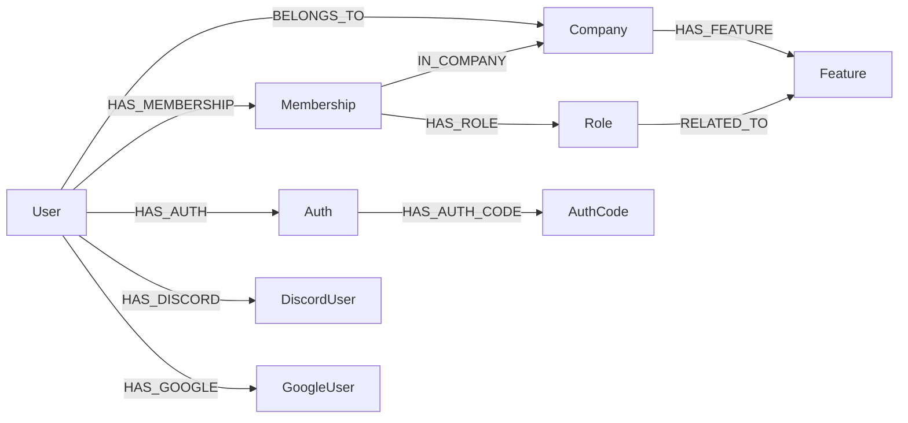

## Purpose

Seven foundations decide who the caller is and which tenant's data they see:
`company`, `user`, `membership`, `role`, `auth`, `discord-user` and
`google-user`, all under
`packages/nestjs-neo4jsonapi/src/foundations/`. `Company` is the tenant root
that every other entity in {{display}} hangs off; `User` is the account;
`Membership` is the edge container that makes a user's roles company-specific;
`Auth` is the session. Remove any of them and the application has no way to
answer "which company is this request for", which is the question
`buildDefaultMatch()` injects into almost every Cypher query in the codebase.

## Vocabulary

| Term | Meaning |
|---|---|
| Tenant root | `Company`. The only identity entity with `isCompanyScoped: false` because it *is* the scope |
| Membership | A `:Membership` node between a user and a company, holding that user's roles for that company |
| Platform membership | A membership with **no** `IN_COMPANY` edge. Its roles apply everywhere; the seeded administrator holds one |
| Alias descriptor | A second `DataMeta` over the same entity — `owner`, `author`, `assignee` all read and write `:User` nodes |
| Company selection | The step between a valid password and a session, taken when the user belongs to more than one company |
| Selection token | A short-lived JWT that authenticates only `GET /auth/companies` and `POST /auth/company-selection/:companyId` |
| Refresh token | The `Auth` record's own `id`, exposed as a virtual field, exchanged for a fresh access token |

## Graph model

| Label | Key fields | Relationships | Declaring file |
|---|---|---|---|
| `Company` | `name`, `ownerEmail`, `monthlyCredits`, `availableMonthlyCredits`, `availableExtraCredits`, `aiEnabled`, `referralCode`, `scheduledDeletionAt` | `HAS_FEATURE` → `Feature` (many), `HAS_MODULE` → `Module` (many) | `packages/nestjs-neo4jsonapi/src/foundations/company/entities/company.ts` |
| `User` | `email` (unique), `name`, `password`, `avatar`, `isActive`, `isDeleted`, `code`, `codeExpiration`, `termsAcceptedAt` | `BELONGS_TO` → `Company` (one), `HAS_MEMBERSHIP` → `Role` (many, serialisation-only), `RELATED_TO` → `Module` (many) | `packages/nestjs-neo4jsonapi/src/foundations/user/entities/user.ts` |
| `Membership` | `id` only — no fields at all | `HAS_MEMBERSHIP` ← `User` (one), `IN_COMPANY` → `Company` (one), `HAS_ROLE` → `Role` (many) | `packages/nestjs-neo4jsonapi/src/foundations/membership/entities/membership.ts` |
| `Role` | `name`, `description`, `isSelectable` | `RELATED_TO` → `Feature` (one, wire key `requiredFeature`) | `packages/nestjs-neo4jsonapi/src/foundations/role/entities/role.ts` |
| `Auth` | `token`, `expiration`; virtual `refreshToken` | `HAS_AUTH` ← `User` (one) | `packages/nestjs-neo4jsonapi/src/foundations/auth/entities/auth.ts` |
| `AuthCode` | `expiration` | `HAS_AUTH_CODE` ← `Auth` (one) | `packages/nestjs-neo4jsonapi/src/foundations/auth/entities/auth.code.ts` |
| `PendingAuth` | `pendingToken`, `expiresAt`, `availableMethods`, `preferredMethod` | none | `packages/nestjs-neo4jsonapi/src/foundations/auth/entities/pending-auth.ts` |
| `DiscordUser` | `name`, `discordId` | `HAS_DISCORD` ← `User` (one), `BELONGS_TO` → `Company` | `packages/nestjs-neo4jsonapi/src/foundations/discord-user/entities/discord-user.ts` |
| `GoogleUser` | `name`, `googleId` | `HAS_GOOGLE` ← `User` (one), `BELONGS_TO` → `Company` | `packages/nestjs-neo4jsonapi/src/foundations/google-user/entities/google-user.ts` |

`Company`, `Membership`, `Auth`, `AuthCode` and `PendingAuth` all set
`isCompanyScoped: false`, each for its own reason. `Company` is the scope, so a
default `true` would inject a meaningless `(company)-[:BELONGS_TO]->(company)`
self-join. `Membership` must stay unscoped or a `BELONGS_TO` filter would hide
platform memberships, which is the shape the seeded administrator depends on.
`Auth`, `AuthCode` and `PendingAuth` are all read before any company exists in
CLS — login, refresh and the 2FA challenge all run pre-scope.

`PendingAuth` is never persisted. No `:PendingAuth` node is ever written; the
login flow hands a plain object to `JsonApiService.buildSingle`, and the
descriptor exists purely to describe the JSON:API shape of the 2FA challenge.

The uniqueness constraints are created in each repository's `onModuleInit`:
`user_email` on `User.email`, `role_id`, `membership_id`, `auth_id` and
`authcode_id`.

### Company, the tenant root

`CompanyDescriptor` carries the credit and subscription fields the billing
foundations write — `monthlyCredits`, `availableMonthlyCredits`,
`availableExtraCredits`, `aiEnabled`, `isActiveSubscription` — and the address
and fiscal blocks. Two fields are deliberately kept off the wire:
`ownerEmail` (`excludeFromJsonApi: true`, because it leaks an address to every
company reader) and the whole of `password` on `User`.

`CompanyService.handleTokenUsageRecorded` listens for
`TOKEN_USAGE_RECORDED_EVENT` and decrements the running credit balance, wrapped
in a `try`/`catch` that never throws back into the emitter — an LLM call must
not fail because a credit write did. `updateTokensAndAiFlag` emits the
foundation's own event, `COMPANY_AI_DISABLED_EVENT` (`"company.ai_disabled"`,
payload `{ companyId }`), declared in
`packages/nestjs-neo4jsonapi/src/foundations/company/events/company.events.ts`.
Nothing in the package consumes it; it exists so an application can discard a
credit backlog when a plan stops carrying AI, without the library needing to know
about that application.

### User and its three aliases

`packages/nestjs-neo4jsonapi/src/foundations/user/entities/user.meta.ts` exports
four metas over one label. `userMeta` is the real one; `ownerMeta`,
`assigneeMeta` and `authorMeta` copy it and change only `endpoint` and
`nodeName` — `owners`/`owner`, `assignees`/`assignee`, `authors`/`author`.
`defineEntityAlias` in
`packages/nestjs-neo4jsonapi/src/common/helpers/define-entity.ts` clones the
descriptor and swaps the model, so fields, transforms, virtual fields and
relationships are shared by reference.

What an alias buys: a relationship endpoint that reads as the role it plays. A
task whose author and assignee are both users would otherwise expose two
relationships of identical JSON:API type, and neither the client's
`modelRegistry` (keyed by `nodeName`) nor the URL would distinguish them.
`UserModule.onModuleInit` registers all four models, so
`GET /tasks/:id/assignees` resolves and serialises without a second entity, a
second table or a second serialiser.

The `role` relationship on `User` is marked `readOnly: true`. There is no
single-hop `(user)-[:HAS_MEMBERSHIP]->(:Role)` edge in the graph — roles are
reached through `Membership` — so the inherited generic methods would silently
return no roles on read and write a bogus edge on create. `readOnly` makes
`findByRelated`, `addToRelationship` and `removeFromRelationship` reject it with
a 400 instead.

`avatar` carries an async `transform` that calls
`S3Service.generateSignedUrl`, which is why `UserDescriptor` declares
`injectServices: [S3Service]`.

### Membership, and why it is query-only

`MembershipModule` registers a repository and a serialiser and **no
controller**. There is no `/memberships` endpoint. The repository exists only to
create the `membership_id` constraint. Everything that reads or writes
membership does so through the Cypher fragments in
`packages/nestjs-neo4jsonapi/src/foundations/membership/queries/membership.query.ts`,
which are the only sanctioned path:

| Helper | Kind | What it does |
|---|---|---|
| `membershipRoleMatch` | read | `OPTIONAL MATCH` for the caller's roles in `$companyId` plus platform roles |
| `membershipRoleMatchRequired` | read | The same as a hard `MATCH`, filtered by a role id, for queries that select *by* role |
| `grantCompanyRoles` | write | `MERGE`s the (user, company) membership and grants `$roleIds` |
| `grantPlatformRole` | write | Ensures the user's platform membership (no `IN_COMPANY`) and grants `$roleId` |

The file states the invariant the whole model rests on: every code path that
deletes a `BELONGS_TO` edge, a user, or a company must also `DETACH DELETE` the
matching `Membership` nodes. An orphaned membership whose company vanished reads
as a platform membership, which is a privilege escalation.

`grantCompanyRoles` avoids `MERGE (ms)-[:HAS_ROLE]->(:Role {id: roleId})`
deliberately: `FOREACH` cannot contain a `MATCH`, and the naive `MERGE` would
create a phantom `Role` node for an id that does not exist. It uses
`OPTIONAL MATCH` plus a guarded `FOREACH` instead.

## Backend

Every path below is relative to
`packages/nestjs-neo4jsonapi/src/foundations/`, spelled in full in the
per-module tables.

**company** — controller
`packages/nestjs-neo4jsonapi/src/foundations/company/controllers/company.controller.ts`,
service `CompanyService`, repository `CompanyRepository`, DTOs under
`packages/nestjs-neo4jsonapi/src/foundations/company/dtos/`.

| Endpoint | Guard |
|---|---|
| `GET /companies` | `AdminJwtAuthGuard` |
| `POST /companies` | `AdminJwtAuthGuard` |
| `GET /companies/:companyId` | `JwtAuthGuard` |
| `PUT /companies/:companyId` | `JwtAuthGuard` |
| `PUT /companies/:companyId/configurations` | `JwtAuthGuard` |
| `DELETE /companies/:companyId` | `JwtAuthGuard` |
| `DELETE /companies/:companyId/self-delete` | `JwtAuthGuard` |

**user** — controller
`packages/nestjs-neo4jsonapi/src/foundations/user/controllers/user.controller.ts`
(`@UseGuards(JwtAuthGuard)` at class level), services `UserService` and
`UserCypherService`, repository `UserRepository`, DTOs under
`packages/nestjs-neo4jsonapi/src/foundations/user/dtos/`. Endpoints:
`GET /users`, `GET /users/:userId`, `GET /users/me/full`,
`GET /users/email/:email`, `GET /companies/:companyId/users`, `POST /users`,
`PUT /users/:userId`, `PATCH /users/:userId` (reactivate),
`PATCH /users/:userId/avatar`, `PATCH /users/:userId/rates`,
`POST /users/:userId/send-invitation-email`, `DELETE /users/:userId`, plus the
three role-membership routes `GET /roles/:roleId/users`,
`POST /roles/:roleId/users/:userId` and `DELETE /roles/:roleId/users/:userId`,
and the relevance route `GET /contents/:contentId/user-relevance`.

**membership** — no controller, no endpoint, no DTO. Repository
`packages/nestjs-neo4jsonapi/src/foundations/membership/repositories/membership.repository.ts`
exists only to create the constraint.

**role** — controllers
`packages/nestjs-neo4jsonapi/src/foundations/role/controllers/role.controller.ts`
and
`packages/nestjs-neo4jsonapi/src/foundations/role/controllers/role.user.controller.ts`,
service `RoleService`, repository `RoleRepository`, DTOs under
`packages/nestjs-neo4jsonapi/src/foundations/role/dtos/`. Endpoints:
`GET /roles`, `POST /roles`, `GET /roles/:roleId`, `PUT /roles/:roleId`,
`DELETE /roles/:roleId` and `GET /users/:userId/roles`, all behind
`JwtAuthGuard`.

**auth** — four controllers under
`packages/nestjs-neo4jsonapi/src/foundations/auth/controllers/`, services
`AuthService`, `AuthDiscordService`, `AuthGoogleService`,
`PendingRegistrationService` and `TrialQueueService`, repository
`AuthRepository`, DTOs under
`packages/nestjs-neo4jsonapi/src/foundations/auth/dtos/`.

| Endpoint | Controller file | Guard |
|---|---|---|
| `POST /auth`, `POST /auth/login`, `POST /auth/register`, `POST /auth/refreshtoken/:refreshToken`, `POST /auth/forgot`, `GET /auth/validate/:code`, `POST /auth/reset/:code`, `POST /auth/invitation/:code`, `POST /auth/activate/:code`, `POST /auth/oauth/complete` | `packages/nestjs-neo4jsonapi/src/foundations/auth/controllers/auth.controller.ts` | none — pre-session |
| `DELETE /auth` | the same file | `JwtAuthGuard` |
| `GET /auth/companies`, `POST /auth/company-selection/:companyId` | `packages/nestjs-neo4jsonapi/src/foundations/auth/controllers/auth.company.controller.ts` | `AnyScopeAuthGuard` |
| `GET /auth/discord`, `GET /auth/callback/discord` | `packages/nestjs-neo4jsonapi/src/foundations/auth/controllers/auth.discord.controller.ts` | none |
| `GET /auth/google`, `GET /auth/callback/google` | `packages/nestjs-neo4jsonapi/src/foundations/auth/controllers/auth.google.controller.ts` | none |

**discord-user** and **google-user** — no controllers. Each ships a repository
and a service, consumed by `AuthDiscordService` and `AuthGoogleService`
respectively.

Two controller decisions are worth reading before you subclass anything.
`AuthCompanyController` exists as a separate controller because consumers
subclass `AuthController` to override individual flows, and NestJS re-registers
every inherited route under the subclass prefix — a `@Get("companies")` added to
`AuthController` would collide with `CompanyController`'s root-mounted
`GET /companies` and crash Fastify with `FST_ERR_DUPLICATED_ROUTE` at boot.
`AuthDiscordController` and `AuthGoogleController` use an empty `@Controller()`
with the meta interpolated into each `@Get()` because `authMeta` is still
uninitialised when a class-level decorator argument evaluates.

`Auth`, `AuthCode` and `PendingAuth` are registered with `modelRegistry` but
deliberately **not** with the graph descriptor registry: `token` and
`pendingToken` are live credentials, and a catalog entry would make them
readable by agent tooling.

### Notable Cypher

`AuthRepository.createSession` branches on "holds the Administrator role and has
no company" to build a session without a company in scope. That is the shape the
seeded platform administrator has, and
`apps/api/src/neo4j.migrations/20250901_004.ts` grants it through the library's
own `grantPlatformRole` rather than hand-written Cypher so the seed cannot drift
from the model the rest of the codebase reads.

## Frontend

`packages/nextjs-jsonapi/src/features/` ships four of the seven as feature
directories — `user`, `company`, `role`, `auth`. `membership`, `discord-user`
and `google-user` have no frontend counterpart at all; the OAuth sign-in button
lives inside the `auth` feature.

| Feature directory | Model / service | Module factory | Routes | Components | Wired in Bootstrapper |
|---|---|---|---|---|---|
| `packages/nextjs-jsonapi/src/features/user/` | `User`, `UserService` | `UserModule`, `AuthorModule` | `/users`, `/users/[id]`, `/administration/users` | `UserContainer`, `UsersListContainer`, `PlatformUsersContainer`, `UserEditor`, `UserSelector`, `UserAvatar` | yes, as `User` and `Author` |
| `packages/nextjs-jsonapi/src/features/company/` | `Company`, `CompanyService` | `CompanyModule` | `/administration/companies`, `/administration/companies/[id]` | `CompaniesListContainer`, `AdminCompanyContainer`, `CompanyEditor`, `CompanyDeleter` | yes, as `Company` |
| `packages/nextjs-jsonapi/src/features/role/` | `Role`, `RoleService` | `RoleModule` | `/roles`, `/roles/[id]` | `RolesList`, `RoleContainer`, `RoleDetails`, `UserRoleAdd` | yes, as `Role` |
| `packages/nextjs-jsonapi/src/features/auth/` | `Auth`, `AuthService` | `AuthModule` | `/login`, `/register`, `/logout`, `/activation/[code]`, `/invitation/[code]`, `/reset/[code]` | `Login`, `Register`, `ForgotPassword`, `ResetPassword`, `AcceptInvitation`, `ActivateAccount`, `Logout`, `GoogleSignInButton` | yes, as `Auth` |

The module factories are
`packages/nextjs-jsonapi/src/features/user/user.module.ts`,
`packages/nextjs-jsonapi/src/features/user/author.module.ts`,
`packages/nextjs-jsonapi/src/features/company/company.module.ts`,
`packages/nextjs-jsonapi/src/features/role/role.module.ts` and
`packages/nextjs-jsonapi/src/features/auth/auth.module.ts`.

`UserModule` declares `moduleId` `04cfc677-0fd2-4f5e-adf4-2483a00c0277`,
`CompanyModule` `f9e77c8f-bfd1-4fd4-80b0-e1d891ab7113` and `RoleModule`
`9f6416e6-7b9b-4e1a-a99f-833191eca8a9` — the same UUIDs
`packages/shared/src/const/module.id.ts` exports, which is what makes
`ServerSession.checkPermission({ module: Modules.User })` resolve to the seeded
`:Module` node. `AuthorModule` reuses the `User` model and the `User` module id
under `pageUrl: "/authors"`. `AuthModule` declares no `moduleId` and no
`feature`: the auth routes are not permission-gated, they are pre-session.

None of the four declares a `feature` key, so none of them is gated behind a
company's `HAS_FEATURE` edge.

The routes {{display}} mounts:

| Route | Page file | What it does |
|---|---|---|
| `/users` | `apps/web/src/app/[locale]/(main)/(foundations)/users/page.tsx` | `ServerSession.checkPermission` for read, then `UsersListContainer` inside `UserProvider` |
| `/users/[id]` | `apps/web/src/app/[locale]/(main)/(foundations)/users/[id]/page.tsx` | Server-fetches the user with a `cache()`d `UserService.findById`, dehydrates it into `CompanyProvider` and `UserProvider` |
| `/roles` | `apps/web/src/app/[locale]/(main)/(foundations)/roles/page.tsx` | `RolesList` inside `RoleProvider`; no permission check on the list |
| `/roles/[id]` | `apps/web/src/app/[locale]/(main)/(foundations)/roles/[id]/page.tsx` | Fetches the role, then `checkPermission` with the role as `data` |
| `/administration/users` | `apps/web/src/app/[locale]/(admin)/administration/users/page.tsx` | `requireAdministrator(locale)`, then `PlatformUsersContainer` — lists across all companies, because a platform administrator has no company and the company-scoped container would render empty |
| `/administration/companies` | `apps/web/src/app/[locale]/(admin)/administration/companies/page.tsx` | `requireAdministrator(locale)`, then `CompaniesListContainer`, which owns its own provider because a server component cannot pass `Modules.Company` down |
| `/administration/companies/[id]` | `apps/web/src/app/[locale]/(admin)/administration/companies/[id]/page.tsx` | `requireAdministrator(locale)`, then server-fetches the company and dehydrates it into `CompanyProvider`; no `checkPermission`, since only an administrator gets past the gate |

Extending the `User` entity with your own fields does not mean forking
`UserController`. `EXTEND-USER.md` at the repository root documents the model
registry replacement pattern: register a descriptor with the same `nodeName`
(`"user"`) from your own module and it replaces the package's, so the existing
`/users` routes start serving your extended shape. Read
[EXTEND-USER.md](../../../EXTEND-USER.md) before adding anything to the user
entity.

## Flows

### Registration

1. `Register` (`packages/nextjs-jsonapi/src/features/auth/components/forms/Register.tsx`)
   collects name, company name, email, password and the GDPR consents.
2. `AuthService.register` posts to `/auth/register` through `callApi()`.
3. `AuthController.register` validates `AuthPostRegisterDTO` and calls
   `AuthService.register`.
4. The service checks `baseConfig.auth.allowRegistration` and
   `registrationMode`. `"closed"` throws 403. `"waitlist"` requires an
   `inviteCode` and validates it through `WaitlistService`, or throws 501 when
   that module is absent.
5. `UserService.expectNotExists` rejects a duplicate email.
6. `CompanyRepository.createByName` creates the tenant.
7. `UserRepository.createUser` creates the user with a hashed password and
   `roleIds: [RoleId.CompanyAdministrator]`, writing the membership through
   `grantCompanyRoles`.
8. `companyId` and `userId` are written into CLS, then the optional registration
   hook (`packages/nestjs-neo4jsonapi/src/foundations/auth/interfaces/registration-hook.interface.ts`) fires for referral
   attribution, guarded so a hook failure cannot fail the registration.
9. An activation email goes out with a link to `/activation/<code>`. Delivery is
   wrapped in `try`/`catch` and logged on failure — by this point the company,
   the user and the membership are committed, and retrying would trip
   `expectNotExists`.
10. `POST /auth/activate/:code` calls `AuthService.activateAccount`, which
    activates the user, queues trial creation on the `trial` queue when
    `TrialQueueService` is present, and notifies platform administrators.

### Login

1. `Login` posts to `/auth/login`; `AuthService.login` in
   `packages/nextjs-jsonapi/src/features/auth/data/auth.service.ts` inspects the
   raw response type, because this endpoint is polymorphic.
2. The backend `AuthService.login` rejects a missing user, a deleted user, an
   inactive user, or a failed `checkPassword` — the first two cases returning
   identical wording so the endpoint does not confirm which emails exist.
3. If `TwoFactorService` is present and the user has 2FA enabled, the response is
   a `PendingAuth` resource (`type: "two-factor-challenge"`) carrying a pending
   JWT, and the flow continues in the two-factor chapter.
4. `AuthRepository.countUserCompanies` decides the next hop. More than one
   company and the response is an `Auth` resource with
   `requiresCompanySelection: true` and a `selectionToken` — **no session is
   created**.
5. Otherwise `setLastLogin` runs and `createToken` mints the session, returning
   `token`, the virtual `refreshToken`, and the user with roles, company,
   features and modules included.
6. The client's token handler stores token, refresh token, user id, company id,
   role ids, feature ids and per-module permissions.

### Company selection

1. The client holds only a selection token. `GET /auth/companies` passes
   `AnyScopeAuthGuard`, which accepts either a full session token or a selection
   token.
2. `AuthService.findCompanies` reads `userId` from CLS and returns the companies
   the user may act for.
3. `POST /auth/company-selection/:companyId` calls `AuthService.selectCompany`,
   which re-reads the user scoped to that company and throws 403 unless
   `user.company.id` matches the requested id.
4. `createToken` mints the real, company-scoped session carrying that company's
   roles.

### Invitation acceptance

1. An administrator creates the user through `POST /users` with
   `sendInvitationEmail: true`, or calls
   `POST /users/:userId/send-invitation-email` later. Either path writes a
   one-time `code` with a `codeExpiration` and mails a link to
   `/invitation/<code>`.
2. `AcceptInvitation`
   (`packages/nextjs-jsonapi/src/features/auth/components/forms/AcceptInvitation.tsx`)
   collects a password and posts to `/auth/invitation/:code`.
3. `AuthService.acceptInvitation` resolves the user by code, rejects an expired
   code with 400, hashes the password and calls
   `AuthRepository.acceptInvitation`.
4. The user logs in normally from there — acceptance issues no session of its
   own.

### Token refresh

Refresh is the application's job, not the package's. `apps/web/src/proxy.ts`
decodes the access token, and when it is missing or close to expiry it calls
`{API_URL}auth/refreshtoken/<refreshToken>` itself and re-sets the `token`
cookie on the response. It does this before anything else, so a failed refresh
counts as no session: the proxy clears both session cookies and, on a
non-public path, redirects to `/login` with a `callbackUrl`. The frontend
package never refreshes.

## Background jobs

Two queues, both driven from this chapter.

| Queue | Job name | Processor | Trigger |
|---|---|---|---|
| `company` | `deleteCompany` | `packages/nestjs-neo4jsonapi/src/foundations/company/processors/company.processor.ts` | `CompanyService.deleteFullCompany` adds the job; the processor runs `cls.run()`, sets `companyId` and `userId` from the job data, then calls `CompanyRepository.delete` |
| `trial` | queued by `TrialQueueService` | consumed by the Stripe trial foundation | `AuthService.activateAccount`, once the account is live |

`CompanyProcessor` is registered through `createWorkerProvider`, so it exists
only in worker mode. An application that needs S3 cleanup, audit entries or
extra relationship teardown on deletion provides a `CompanyDeletionHandler`
under the `COMPANY_DELETION_HANDLER` token
(`packages/nestjs-neo4jsonapi/src/foundations/company/interfaces/company-deletion-handler.interface.ts`); without one, the
default simple deletion runs. The handler interface also carries a
`DeletionReason` — `"trial_expired"`, `"subscription_cancelled"` or
`"immediate_deletion"` — used to pick the notification email.

## Permissions and gating

Four of the eight module ids `apps/api/src/rbac/module-id.map.json` seeds belong
to this chapter: `Auth`, `Company`, `Role` and `User`. The two roles
`packages/shared/src/const/system.roles.id.ts` declares are `Administrator` and
`CompanyAdministrator`, both seeded by
`apps/api/src/neo4j.migrations/20250901_001.ts` as `Administrators`
(`isSelectable: false`) and `Company Administrator` (`isSelectable: true`).

The matrix in `apps/api/src/rbac/permissions.ts` grants, for this chapter:

| Module | `default` | `CompanyAdministrator` | `Administrator` |
|---|---|---|---|
| `Auth` | full | — | full |
| `User` | read, update scoped to `id` | create, update, delete | full |
| `Role` | read | — | full |
| `Company` | read | create, update, delete | full |

`perm.update("id")` is the self-scope: an ordinary member may update the user
whose `id` matches their own, and no other.

Guard usage in this chapter:

| Guard | File | Used by |
|---|---|---|
| `JwtAuthGuard` | `packages/nestjs-neo4jsonapi/src/common/guards/jwt.auth.guard.ts` | `UserController` (class-level), `RoleController`, most of `CompanyController` |
| `AdminJwtAuthGuard` | `packages/nestjs-neo4jsonapi/src/common/guards/jwt.auth.admin.guard.ts` | `GET /companies` and `POST /companies` |
| `AnyScopeAuthGuard` | `packages/nestjs-neo4jsonapi/src/common/guards/jwt.auth.any-scope.guard.ts` | Both company-selection routes |

The engine behind these grants — the DSL, the reconciler, scoped permissions —
is documented in `docs/handbook/03-backend/rbac-and-permissions.md`; the
client-side gate is in `docs/handbook/04-frontend/access-control.md`.

## Configuration

| Variable | Config key | Default | Read by |
|---|---|---|---|
| `JWT_SECRET` | `jwt.secret` | `""` | Session signing, every guard |
| `JWT_EXPIRES_IN` | `jwt.expiresIn` | `"1h"` in `packages/nestjs-neo4jsonapi/src/config/base.config.ts`, `"1d"` in `.env.example` | Access token lifetime |
| `ALLOW_REGISTRATION` | `auth.allowRegistration` | `true` unless set to `"false"` | `AuthService.register` |
| `NEXT_PUBLIC_REGISTRATION_MODE` / `REGISTRATION_MODE` | `auth.registrationMode` | `"open"` | `AuthService.register`; accepts `open`, `closed`, `waitlist` |
| `NEXT_PUBLIC_DISCORD_CLIENT_ID` | `discord.clientId` | `""` | `AuthDiscordService`, and the sign-in button on the web side |
| `DISCORD_CLIENT_SECRET` | `discord.clientSecret` | `""` | `AuthDiscordService.exchangeCodeForToken` |
| `NEXT_PUBLIC_GOOGLE_CLIENT_ID` / `GOOGLE_CLIENT_ID` | `google.clientId` | `""` | `AuthGoogleService`, `GoogleSignInButton` |
| `GOOGLE_CLIENT_SECRET` | `google.clientSecret` | `""` | `AuthGoogleService.exchangeCodeForToken` |
| `APP_URL` | `app.url` | — | The activation and invitation links built in `AuthService.register` and `UserService.sendInvitationEmail` |

Defaults are declared in
`packages/nestjs-neo4jsonapi/src/config/base.config.ts`; the app's overrides go
in `apps/api/src/config/config.ts`. The Discord and Google blocks in
`.env.example` also record the redirect URIs each provider console must be given:
`{API_URL}/auth/callback/discord` and `{API_URL}/auth/callback/google`.

## Tests

The backend package carries specs beside the code, run by
`packages/nestjs-neo4jsonapi/vitest.config.ts`:

| Foundation | Specs |
|---|---|
| `company` | four: the controller, the repository, the service and the descriptor |
| `user` | five: the controller, the repository, `UserService`, `UserCypherService` and the descriptor |
| `membership` | one — `packages/nestjs-neo4jsonapi/src/foundations/membership/entities/__tests__/membership.descriptor.spec.ts`, the descriptor only |
| `role` | four: both controllers, the repository and the service |
| `auth` | nine, under `packages/nestjs-neo4jsonapi/src/foundations/auth/__tests__/`, `packages/nestjs-neo4jsonapi/src/foundations/auth/repositories/__tests__/` and `packages/nestjs-neo4jsonapi/src/foundations/auth/services/__tests__/` |
| `discord-user`, `google-user` | two each: a repository spec and a service spec |

The frontend package runs jsdom plus React Testing Library, and its `include`
accepts both `*.spec.*` and `*.test.*`. For this chapter that is four files:
`packages/nextjs-jsonapi/src/features/user/contexts/__tests__/CurrentUserContext.spec.tsx`,
`packages/nextjs-jsonapi/src/features/auth/components/forms/__tests__/Logout.spec.tsx`,
`packages/nextjs-jsonapi/src/features/auth/utils/__tests__/clearClientStorage.spec.ts`
and
`packages/nextjs-jsonapi/src/features/company/hooks/useSubscriptionStatus.test.ts`.

What is not tested: the Cypher fragments in the membership query file have no spec of
their own, the membership invariant (delete the membership whenever the
`BELONGS_TO` edge, the user or the company goes) is enforced by convention
rather than by a test, and neither app ships a single unit or component spec —
`apps/api` and `apps/web` both pass their suites through `passWithNoTests`.

## Where to look

| File | Why |
|---|---|
| `packages/nestjs-neo4jsonapi/src/foundations/membership/queries/membership.query.ts` | The four Cypher helpers and the invariant the whole role model rests on |
| `packages/nestjs-neo4jsonapi/src/foundations/user/entities/user.ts` | The descriptor, the `readOnly` role relationship and the three aliases |
| `packages/nestjs-neo4jsonapi/src/foundations/company/entities/company.ts` | The tenant root, and why `isCompanyScoped: false` |
| `packages/nestjs-neo4jsonapi/src/foundations/auth/services/auth.service.ts` | Login, registration, company selection, reset, invitation and activation in one file |
| `packages/nestjs-neo4jsonapi/src/foundations/auth/controllers/auth.company.controller.ts` | The company-selection routes and why they are not on `AuthController` |
| `packages/nestjs-neo4jsonapi/src/foundations/company/processors/company.processor.ts` | Company deletion on the `company` queue, wrapped in `cls.run()` |
| `packages/nestjs-neo4jsonapi/src/common/helpers/define-entity.ts` | `defineEntity` and `defineEntityAlias` |
| `apps/api/src/neo4j.migrations/20250901_004.ts` | The seeded platform administrator and why its membership has no `IN_COMPANY` edge |
| `apps/web/src/proxy.ts` | `PUBLIC_PATHS`, the login gate and the app-owned token refresh |
| `EXTEND-USER.md` | The supported way to add fields and relationships to `User` |

## Gaps and drift

- **No company-selection UI.** The backend returns
  `requiresCompanySelection` and a `selectionToken`, and serves
  `GET /auth/companies` and `POST /auth/company-selection/:companyId`, but
  `packages/nextjs-jsonapi/src/` contains no reference to any of the three
  strings. A user who belongs to more than one company cannot complete login in
  {{display}} as shipped without building that screen.
- `JWT_EXPIRES_IN` disagrees between `.env.example` (`"1d"`) and the fallback in
  `packages/nestjs-neo4jsonapi/src/config/base.config.ts` (`"1h"`). The env file wins at runtime; the fallback only
  applies when the variable is unset.
- `UserService.sendInvitationEmail` hard-codes the `en` locale segment in the
  invitation link and passes `"en"` as the email locale, ignoring the caller's
  language. `UserService.createUser` builds the same `en` link but does pass
  `params.language` to the mailer.
- `MembershipModule` registers a serialiser for an entity that has no controller
  and never reaches the wire.
- Not examined: `UserCypherService`, the reset-password and forgot-password
  email templates, `AuthRepository` in full, the OAuth callback state handling in
  `AuthDiscordService` and `AuthGoogleService`, and the whole two-factor path
  that `AuthService.login` delegates to — that is the two-factor chapter.
