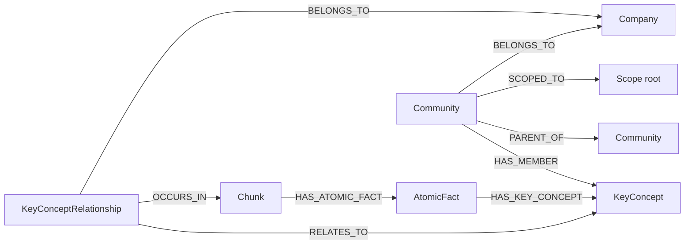

## Purpose

Four foundations under `packages/nestjs-neo4jsonapi/src/foundations/` hold the
GraphRAG side of {{display}}: `atomicfact` and `keyconcept` are the extracted
knowledge, `community` is the clustered summary layer above them, and
`relevancy` is the "what else is like this" query that rides on the same edges.
None of them is something you call directly — they are written by the ingest
pipeline described in [content-and-storage.md](content-and-storage.md) and read
by the retrieval agents. Remove them and a chunk is just text with a vector: no
concept graph, no community summaries, no relevance ranking.

GraphRAG — retrieval-augmented generation over a graph rather than over a flat
vector store — is the pattern all four implement.

## Vocabulary

| Term | Meaning |
|---|---|
| Atomic fact | One indivisible statement with exactly one verb, extracted from a chunk. Its id is the MD5 of its own content, so identical statements deduplicate |
| Key concept | A named entity or term. Globally unique **by value** across the whole database — `KeyConcept.value` carries a uniqueness constraint |
| Key-concept relationship | A reified `:KeyConceptRelationship` node joining two concepts, carrying a `weight` that counts co-occurrences |
| Community | A Louvain cluster of key concepts, later given a title, a narrative summary, a rating and its own embedding |
| Scope root | The node a retrieval run is confined to. Communities carry a `SCOPED_TO` edge to theirs |
| Stale community | A community whose membership changed since its last summary. The cron picks these up |
| Relevancy | A score from 0 to 100 counting how much of a source's concept footprint another record shares |
| RRF | Reciprocal rank fusion — merges a vector ranking and a fulltext ranking into one list |

## Graph model

| Label | Key fields | Relationships | Declaring file |
|---|---|---|---|
| `AtomicFact` | `content` | `HAS_ATOMIC_FACT` ← `Chunk` (one), `HAS_KEY_CONCEPT` → `KeyConcept` (many) | `packages/nestjs-neo4jsonapi/src/foundations/atomicfact/entities/atomic.fact.entity.ts` |
| `KeyConcept` | `value` (unique), `description`, `embedding` | `HAS_KEY_CONCEPT` ← `AtomicFact` (many), `RELATES_TO` ← `KeyConceptRelationship` (many), `HAS_MEMBER` ← `Community` (one) | `packages/nestjs-neo4jsonapi/src/foundations/keyconcept/entities/key.concept.entity.ts` |
| `KeyConceptRelationship` | `key1`, `key2` (the two concept values, sorted), `weight` | `RELATES_TO` → `KeyConcept` (two), `OCCURS_IN` → `Chunk` (many), `BELONGS_TO` → `Company` | created inline in `packages/nestjs-neo4jsonapi/src/foundations/keyconcept/repositories/keyconcept.repository.ts` |
| `Community` | `name`, `summary`, `embedding`, `level`, `rating`, `memberCount`, `isStale`, `staleSince`, `lastProcessedAt`, `pendingCredits` | `HAS_MEMBER` → `KeyConcept` (many), `PARENT_OF` → `Community` (many), `SCOPED_TO` → scope root (one), `BELONGS_TO` → `Company` | `packages/nestjs-neo4jsonapi/src/foundations/community/entities/community.entity.ts` |

None of the four is a `defineEntity()` descriptor. All four use the older
`DataMeta` plus explicit mapper and serialiser shape, which is why their
directories carry a `*.map.ts` and a `*.model.ts` rather than a single entity
file.

`KeyConcept` is deduplicated globally by value — `MERGE (keyconcept:KeyConcept
{value: $value})` — and carries no `BELONGS_TO` edge. Two tenants that both
mention the same term share one node. This is the single most important fact in
this chapter: every query that reaches atomic facts through key concepts has to
confine its results to the run's scope root first, or a shared concept fans the
answer out across tenants. `AtomicFactRepository.findAtomicFactsByKeyConcepts`
does exactly that with `AgentScopeFilterService`.

`AtomicFact` ids are content hashes, so re-extracting the same sentence from a
second chunk reuses the node and adds a second `HAS_ATOMIC_FACT` edge.

### Indexes

Each repository creates its own in `onModuleInit`.

| Index or constraint | Kind | Created by |
|---|---|---|
| `atomicfact_id` | uniqueness on `AtomicFact.id` | `packages/nestjs-neo4jsonapi/src/foundations/atomicfact/repositories/atomicfact.repository.ts` |
| `keyconcept_id` | uniqueness on `KeyConcept.id` | `packages/nestjs-neo4jsonapi/src/foundations/keyconcept/repositories/keyconcept.repository.ts` |
| `keyconcept_value` | uniqueness on `KeyConcept.value` | same |
| `keyconcepts` | vector, cosine, dimensions from `ModelService.getEmbedderDimensions()` | same |
| `community_id` | uniqueness on `Community.id` | `packages/nestjs-neo4jsonapi/src/foundations/community/repositories/community.repository.ts` |
| `communities` | vector, cosine, same dimensions | same |
| `chunks` | vector, cosine | `ChunkRepository` — see [content-and-storage.md](content-and-storage.md) |
| `chunk_content_search` | fulltext on `Chunk.content` | same |

Atomic facts carry **no** embedding. There is no vector index over them and no
relevance signal to order them by, which is why the cap on how many one
retrieval run may pull (`MAX_ATOMIC_FACTS`, 150) is documented as a spend bound
rather than a ranking.

## Backend

| Endpoint | Controller | Service | Repository | DTOs | Guards |
|---|---|---|---|---|---|
| `POST /keyconcepts/rebuild-embeddings` | `packages/nestjs-neo4jsonapi/src/foundations/keyconcept/controllers/keyconcept.controller.ts` | none — enqueues directly | `packages/nestjs-neo4jsonapi/src/foundations/keyconcept/repositories/keyconcept.repository.ts` | none | `JwtAuthGuard` |
| none | — | `packages/nestjs-neo4jsonapi/src/foundations/atomicfact/services/atomicfact.service.ts` | `packages/nestjs-neo4jsonapi/src/foundations/atomicfact/repositories/atomicfact.repository.ts` | — | — |
| none | — | `packages/nestjs-neo4jsonapi/src/foundations/community/services/community.service.ts` | `packages/nestjs-neo4jsonapi/src/foundations/community/repositories/community.repository.ts` | — | — |
| none | — | `packages/nestjs-neo4jsonapi/src/foundations/relevancy/services/relevancy.service.ts` | `packages/nestjs-neo4jsonapi/src/foundations/relevancy/repositories/relevancy.repository.ts` | — | — |

One HTTP route across four foundations. Everything else is a service other
modules call.

`CommunityService` is an empty class: a constructor taking `JsonApiService` and
`CommunityRepository`, and no methods. `CommunityModule` declares no controller.
Every caller — the detector, the summariser, the DRIFT agent — reaches for
`CommunityRepository` directly.

`RelevancyService` is generic over the entity type and takes the caller's own
Cypher service as a duck-typed `cypherService: any`, from which it uses
`userHasAccess()` and `returnStatement()`. `ContentController` is the shipped
caller, on `GET /contents/:contentId/relevance`. The four query shapes live in
`packages/nestjs-neo4jsonapi/src/foundations/relevancy/queries/relevance.ts`:
content-to-content, author-to-author, content-to-author and author-to-content.
The score is the summed co-occurrence count over the source's key concepts and
key-concept relationship weights, normalised to a 0–100 percentage of the
source's own footprint and clamped at 100. It surfaces as `meta.relevance` on
the serialised record, computed from the `totalScore` column.

### Where the agents come in

`AtomicFactModule`, `KeyConceptModule` and `CommunityModule` hold the data;
the reasoning lives under `packages/nestjs-neo4jsonapi/src/agents/`. The agents
themselves are documented in [../06-ai/agents.md](../06-ai/agents.md), and the
package's overall agent shape in
[../02-framework/nestjs-neo4jsonapi/agents-and-graphrag.md](../02-framework/nestjs-neo4jsonapi/agents-and-graphrag.md).
Only the parts that write or read these four labels belong here.

| Agent | Touches | Module |
|---|---|---|
| Graph creator | Writes atomic facts, key concepts, their relationships and dates | `packages/nestjs-neo4jsonapi/src/agents/graph.creator/graph.creator.module.ts` |
| Community detector | Runs Louvain, creates and assigns communities, marks them stale | `packages/nestjs-neo4jsonapi/src/agents/community.detector/community.detector.module.ts` |
| Community summariser | Titles, summarises, rates and embeds a stale community | `packages/nestjs-neo4jsonapi/src/agents/community.summariser/community.summariser.module.ts` |
| Contextualiser | Reads key concepts, atomic facts, chunk neighbours | `packages/nestjs-neo4jsonapi/src/agents/contextualiser/contextualiser.module.ts` |
| DRIFT | Reads communities by vector, then drills into chunks | `packages/nestjs-neo4jsonapi/src/agents/drift/drift.module.ts` |
| Responder | Routes a question to the graph, contextualiser or DRIFT branch | `packages/nestjs-neo4jsonapi/src/agents/responder/responder.module.ts` |

`AgentsModule` in `packages/nestjs-neo4jsonapi/src/agents/agents.modules.ts`
wires eight agent modules. `CommunityModule` is not in
`STATIC_FOUNDATION_MODULES`; it reaches the app as a transitive import of the
detector, summariser and DRIFT modules.

### Community detection

`CommunityDetectorService.detectCommunities()` deletes every existing community
for the company, checks that Neo4j exposes GDS, counts the key concepts, then
for each scope root projects a graph of `KeyConcept` nodes joined by
`KeyConceptRelationship` weights and calls `gds.louvain.stream` with
`relationshipWeightProperty: 'weight'`. Clusters smaller than
`minCommunitySize` (3) are dropped. Each surviving cluster becomes a
`:Community` with a placeholder name, `isStale: true`, a `HAS_MEMBER` edge per
member and a `SCOPED_TO` edge to its partition's root. `PARENT_OF` edges are
built between levels afterwards.

Only one resolution level runs: `louvainResolutions` is `[1.0]`, because
OpenGDS does not accept a resolution parameter. If GDS is absent the whole pass
logs a warning and returns — detection is optional, not fatal.

`detectAndAssignCommunities(contentId, label)` is the incremental entry point:
with zero communities it runs full detection, otherwise it calls
`assignKeyConceptsToCommunities`, which finds the content's orphan concepts,
picks the highest-affinity community *within the same scope root*, adds the
member, and marks the affected communities stale. A concept with no related
community stays orphaned until the next full detection.

Nothing in the package calls `detectAndAssignCommunities`. It is the seam an
application wires into its own post-ingest finalisation.

### Community summarisation

`CommunitySummariserService.generateSummary` reads the member concepts with
their descriptions and the weighted relationships between them, formats both as
text, and makes one `LLMService.call` with `temperature: 0.3` against a Zod
schema of `{ title, summary, rating }`. The prompt is overridable through
`prompts.communitySummariser`. The title is truncated to 50 characters, the
title plus summary are embedded, and `updateSummary` writes name, summary,
embedding and rating while clearing `isStale`, `staleSince` and
`pendingCredits` and stamping `lastProcessedAt`.

Both the model call and the embedding are billed to the community itself, under
`TokenUsageType.CommunitySummariser` — a cron-driven agent has no calling agent
to inherit attribution from.

## Frontend

Very little of this surfaces. There is no `atomicfact`, `keyconcept`,
`community` or `relevancy` feature in `packages/nextjs-jsonapi/src/features/`,
no model, no service and no component.

| Model | Service | Module factory | Routes | Components | Feature id |
|---|---|---|---|---|---|
| `packages/nextjs-jsonapi/src/features/chunk/data/Chunk.ts` | none | `packages/nextjs-jsonapi/src/features/chunk/ChunkModule.ts` — wired as `Chunk` in `apps/web/src/config/Bootstrapper.ts` | none | citation tabs under `packages/nextjs-jsonapi/src/features/assistant-message/components/parts/tabs/` | none |
| `packages/nextjs-jsonapi/src/features/content/data/content.ts` | `packages/nextjs-jsonapi/src/features/content/data/content.service.ts` — `findRelevant` calls `GET /contents/:id/relevance` | `packages/nextjs-jsonapi/src/features/content/content.module.ts` — wired as `Content` | none | `RelevantContentsList` | none |

That is the whole client surface: a chunk you can render as a citation, and a
relevance list. The concept graph, the atomic facts and the communities are
never shown to a user. They reach the browser only indirectly, as the answer an
agent produced from them.

## Flows

### Extraction — chunk to graph

1. `ChunkProcessor` picks up a `process_chunk` job and calls
   `ChunkService.generateGraph`.
2. The chunk is marked `in_progress` and its text is handed to
   `GraphCreatorService.generateGraph`, wrapped in
   `retryGraphGenerationWithFallback` (three attempts, one-second base delay).
3. The graph creator returns a `ChunkAnalysisInterface`: atomic facts each with
   their key concepts, key-concept relationships, key-concept descriptions and
   extracted dates. Unintelligible text — OCR garbage, punctuation runs — is
   rejected by the prompt and comes back as empty arrays.
4. `KeyConceptRepository.createOrphanKeyConcepts` merges every distinct concept
   value, embedding each new one; `updateKeyConceptDescriptions` fills in the
   descriptions.
5. `AtomicFactService.createAtomicFact` hashes each fact's content to an id,
   merges the `:AtomicFact` node, links it to the chunk with `HAS_ATOMIC_FACT`,
   and links each of its concepts with `HAS_KEY_CONCEPT`.
6. `KeyConceptService.addKeyConceptRelationships` merges one
   `:KeyConceptRelationship` per pair, sorted so the pair is order-independent,
   incrementing `weight` on every re-occurrence and linking it to both concepts,
   to the chunk with `OCCURS_IN` and to the company.
7. The dates are stored on the chunk as a JSON string, then the chunk is marked
   `completed` and the finalise job for its owning entity is enqueued.

Every embedding this pass triggers is attributed to the entity being ingested,
through `buildEmbedderAttribution({ entityId, entityIdentifier })`.

Deleting the source reverses it: `ChunkService.deleteChunks` first calls
`resizeKeyConceptRelationshipsWeightOnChunkDeletion` per chunk, then deletes the
chunks, then `deleteDisconnectedAtomicFacts`, which in turn calls
`deleteDisconnectedKeyConcepts`.

### Retrieval — question to sources

`ResponderService.run` in
`packages/nestjs-neo4jsonapi/src/agents/responder/services/responder.service.ts`
is the entry point. A planner node chooses among three branches, each of which
can be switched off deployment-wide through `responder.branches` in `packages/nestjs-neo4jsonapi/src/config/interfaces/config.responder.interface.ts` or per call;
either side saying no wins.

The **contextualiser** branch is a LangGraph state machine whose nodes live in
`packages/nestjs-neo4jsonapi/src/agents/contextualiser/nodes/`:

1. `question_refiner` rewrites the question.
2. `rational_plan` produces a plan.
3. `chunk_vector` embeds the question once and calls
   `ChunkRepository.findPotentialChunks` — exact cosine over the scoped set
   below 5,000 chunks, the `chunks` vector index with over-fetch above it, fused
   by RRF with a `chunk_content_search` fulltext ranking.
4. From there the graph walks conditionally between `key_concepts`
   (`KeyConceptRepository.findPotentialKeyConcepts`, capped at
   `MAX_KEY_CONCEPTS` = 10 after reranking), `atomic_facts`
   (`AtomicFactRepository.findAtomicFactsByKeyConcepts`, capped at
   `MAX_ATOMIC_FACTS` = 150), `chunks` and `neighbouring_nodes`
   (`KeyConceptRepository.findNeighboursByKeyConcepts`).
5. `answer` assembles a notebook, ordered best-score-first and trimmed to
   `NOTEBOOK_BUDGET_CHARS` (80,000). `MAX_LLM_CALLS_PER_RUN` (12) is the hard
   backstop on provider calls for the whole run.

The **DRIFT** branch, in
`packages/nestjs-neo4jsonapi/src/agents/drift/services/drift.search.service.ts`,
starts from the community layer instead:

1. `hyde` writes a hypothetical answer.
2. `community_search` embeds it and calls `CommunityRepository.findByVector`,
   which **fails closed on scope** — in a scoped run only communities carrying a
   `SCOPED_TO` edge to that exact root are eligible, because a community with no
   such edge predates the partition and is assumed to mix roots.
3. `primer_answer` answers from the community summaries.
4. `followup` drills from the primer into chunks, looping conditionally.
5. `synthesis` merges the primer and the follow-ups.

Both branches return sources that become `CITES` and `REFERENCES` edges on the
assistant message — see [assistant-and-actions.md](assistant-and-actions.md).

### Relevance

`ContentController` calls `RelevancyService.findRelevant`, which passes
`ContentCypherService` to `RelevancyRepository.findById`. The Cypher walks from
the source's chunks out through atomic facts to key concepts and key-concept
relationships, back down to every other record that shares them, sums the
counts and weights, normalises against the source's own footprint and orders
descending with the standard `{CURSOR}` pagination.

## Background jobs

| Queue | Job name | Processor | Trigger |
|---|---|---|---|
| `embedding-keyconcepts` | `jobNames.process.rebuild_keyconcepts`, default `embedding:rebuild_keyconcepts` | `packages/nestjs-neo4jsonapi/src/foundations/keyconcept/processors/keyconcept.embedding.processor.ts` | `POST /keyconcepts/rebuild-embeddings` and `POST /chunks/rebuild-all-embeddings` |
| `community-summariser` | `process-stale` | `packages/nestjs-neo4jsonapi/src/agents/community.summariser/processors/community.summariser.processor.ts` | `CommunitySummariserCron`, every ten minutes |

`KeyConceptModule` registers `embedding-keyconcepts` locally, so the route and
the worker travel with the module. `CommunitySummariserModule` registers
`QueueId.COMMUNITY_SUMMARISER`. Both processors run with `concurrency: 1`;
the key-concept one holds a thirty-minute lock, the summariser five minutes.

`CommunitySummariserCron` uses `@Cron(CronExpression.EVERY_10_MINUTES)`. It
reads `findAllStaleCommunities()` and enqueues one job per stale community. The
AI-enabled check sits in the cron, not only in the processor, and deliberately
so: in the no-credits case the processor sets `pendingCredits`, which drops the
community out of the stale query, but the AI-free branch writes nothing at all,
so without the cron-side filter the same job would be re-queued every ten
minutes forever.

Both the cron and the processor are wrapped in `createWorkerProvider`, so
neither exists in the API process.

`isAutomatedJob` matters here. `ChunkEmbeddingProcessor` and
`KeyConceptEmbeddingProcessor` both set `cls.set("isAutomatedJob", true)`
alongside `companyId` and `userId`, which makes `SecurityService` return an
empty access predicate rather than trying to resolve a user's permissions.
`ChunkProcessor` and `CommunitySummariserProcessor` set only `companyId` (and
`userId` in the chunk case) and do **not** set the flag.

## Permissions and gating

No module id, no feature id, no RBAC grant. None of the four foundations appears
in `packages/shared/src/const/module.id.ts`, none is seeded by
`apps/api/src/neo4j.migrations/20250901_002.ts`, and none is granted in
`apps/api/src/rbac/permissions.ts`. The single route,
`POST /keyconcepts/rebuild-embeddings`, is protected by `JwtAuthGuard` and
nothing else — any authenticated user can trigger a full re-embedding.

Tenancy is enforced in Cypher instead, by two mechanisms that both matter:

- `SecurityService.userHasAccess` and the `AI_SOURCE_QUERY` provider constrain
  which source records a retrieval run may reach.
- `AgentScopeFilterService` confines the run to its scope root. This is the gate
  that matters most on the key-concept join, because key concepts are global.

`Community.findByVector` fails closed: an unscoped community is excluded from a
scoped run rather than included. `Community` itself does carry `BELONGS_TO`
when a company id is in CLS; `KeyConcept` and `AtomicFact` do not.

See [../03-backend/rbac-and-permissions.md](../03-backend/rbac-and-permissions.md)
for the permission engine and
[../01-architecture/multi-tenancy-and-security.md](../01-architecture/multi-tenancy-and-security.md)
for CLS scoping.

## Configuration

| Variable | Config key | Default | Read by |
|---|---|---|---|
| — | `prompts.communitySummariser` | the prompt constant in `community.summariser.service.ts` | `CommunitySummariserService` |
| — | `prompts.graphCreator` | the prompt constant in `graph.creator.service.ts` | `GraphCreatorService` |
| — | `responder.branches.graph`, `responder.branches.contextualiser`, `responder.branches.drift` | all enabled | `resolveAllowedBranches` in `responder.service.ts` |
| — | `jobNames.process.rebuild_keyconcepts` | `embedding:rebuild_keyconcepts` | `KeyConceptController`, `KeyConceptEmbeddingProcessor` |
| `AI_EMBEDDER_*` and the rest of the `ai` block | `ai.*` | see [../06-ai/llm-layer.md](../06-ai/llm-layer.md) | `ModelService`, `EmbedderService` |

`apps/api/src/config/config.ts` sets none of these, so {{display}} runs every
branch with the package's own prompts.

The retrieval bounds are not configuration at all. They are exported constants
in
`packages/nestjs-neo4jsonapi/src/foundations/chunk/repositories/retrieval.constants.ts`
— `EXACT_SCAN_MAX_SCOPED_CHUNKS`, `CHUNK_VECTOR_OVERFETCH`,
`KEYCONCEPT_VECTOR_OVERFETCH`, `MAX_ATOMIC_FACTS`, `MAX_LLM_CALLS_PER_RUN`,
`MAX_KEY_CONCEPTS`, `NOTEBOOK_BUDGET_CHARS` — each carrying the measurement that
set it. Changing one means editing the package.

Community detection needs Neo4j with the Graph Data Science plugin. Nothing in
`.env.example` configures it; `checkGdsAvailability()` probes at run time and
skips detection when it is missing.

## Tests

The package ships `atomicfact.repository.spec.ts`, `atomicfact.service.spec.ts`,
`keyconcept.repository.spec.ts`, `keyconcept.service.spec.ts`,
`keyconcept.embedding.processor.spec.ts`, `community.repository.spec.ts`,
`community.service.spec.ts`, `relevancy.repository.spec.ts` and
`relevancy.service.spec.ts` beside the code, plus
`community.detector.service.spec.ts`, `community.summariser.service.spec.ts`,
`community.summariser.cron.spec.ts` and node-level specs under
`packages/nestjs-neo4jsonapi/src/agents/contextualiser/nodes/__tests__/` and
`packages/nestjs-neo4jsonapi/src/agents/drift/nodes/__tests__/`.

{{display}} tests none of it. Do not assume these are protected: the Louvain
projection against a real GDS install; the `PARENT_OF` hierarchy builder; the
end-to-end quality of an extraction (the graph creator's output is only ever
mocked); the RRF fusion against real data; or that any retrieval bound is
still the right number for your data.

## Where to look

| File | Why |
|---|---|
| `packages/nestjs-neo4jsonapi/src/foundations/keyconcept/repositories/keyconcept.repository.ts` | The global-by-value merge, the relationship reification and the weight arithmetic |
| `packages/nestjs-neo4jsonapi/src/foundations/atomicfact/repositories/atomicfact.repository.ts` | The scoped key-concept join, with the reasoning for the scope filter |
| `packages/nestjs-neo4jsonapi/src/foundations/chunk/repositories/retrieval.constants.ts` | Every retrieval bound and the measurement behind it |
| `packages/nestjs-neo4jsonapi/src/foundations/community/repositories/community.repository.ts` | Community creation, staleness, and the fail-closed vector search |
| `packages/nestjs-neo4jsonapi/src/foundations/relevancy/queries/relevance.ts` | The four relevance query shapes, in full Cypher |
| `packages/nestjs-neo4jsonapi/src/agents/graph.creator/services/graph.creator.service.ts` | The extraction prompt and output schema — what an atomic fact actually is |
| `packages/nestjs-neo4jsonapi/src/agents/community.detector/services/community.detector.service.ts` | GDS projection, Louvain, partitioning and incremental assignment |
| `packages/nestjs-neo4jsonapi/src/agents/community.summariser/cron/community.summariser.cron.ts` | Why the AI check sits in the cron and not only in the processor |
| `packages/nestjs-neo4jsonapi/src/agents/contextualiser/services/contextualiser.service.ts` | The node graph and its conditional edges |
| `packages/nestjs-neo4jsonapi/src/agents/drift/services/drift.search.service.ts` | The community-first retrieval path |

## Gaps and drift

- `CommunityService` has a constructor and no methods. It is registered and
  exported, and nothing calls it.
- `CommunityDetectorService.detectAndAssignCommunities` and
  `markAffectedCommunitiesStale` have no caller inside the package. Communities
  are only ever detected if an application invokes the detector itself, which
  means the summariser cron finds nothing to do on a stock install.
- `louvainResolutions` is `[1.0]` and `buildHierarchy` builds `PARENT_OF` edges
  between levels, but with one level there is never a second level to parent.
  The hierarchy code is unreachable as configured.
- `KeyConcept` carries no `BELONGS_TO` edge while `KeyConceptRelationship` does.
  Concept-level isolation depends entirely on the scope filters in the query
  layer, not on the graph.
- `ChunkService.deleteChunks` calls `deleteDisconnectedAtomicFacts` for the
  whole database, not for the deleted subgraph.
- Community detection requires the GDS plugin, which no template configuration
  file mentions and no health check reports on.
- Not examined: the interiors of the contextualiser's six node services, the
  DRIFT node services, `GraphCatalogService` and `AgentScopeFilterService`, the
  reranking model calls, and the token-usage ledger these agents write to
  (covered in [billing-and-token-usage.md](billing-and-token-usage.md)).
