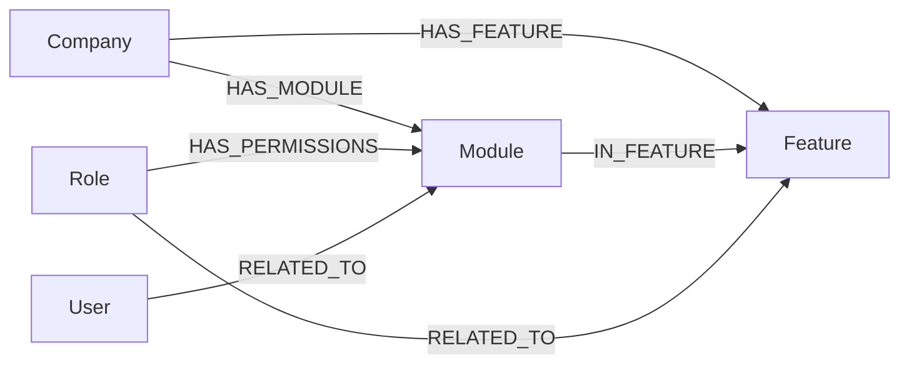

## Purpose

Three foundations — `module`, `feature` and `rbac` under
`packages/nestjs-neo4jsonapi/src/foundations/` — hold the *data* an access
decision is made from. `Feature` is the per-company capability flag, `Module` is
the unit a permission is granted on, and the `rbac` foundation exposes both
plus the role-to-module grants as read endpoints so an administration UI can
show them. This chapter describes those three modules as they sit on disk and
in the graph. The RBAC **engine** — the `defineRbac()` DSL, the reconciler,
`MODULE_USER_PATHS`, the generators and how a permission is actually evaluated —
is documented in `docs/handbook/03-backend/rbac-and-permissions.md`, and is not
repeated here.

## Vocabulary

| Term | Meaning |
|---|---|
| Module | A `:Module` node: the unit a create/read/update/delete grant attaches to. Identified by UUID, never by name |
| Feature | A `:Feature` node: a capability a company opts into. `isCore: true` means every company has it |
| Permission mapping | One `HAS_PERMISSIONS` edge, flattened for the wire as `{ roleId, moduleId, permissions }` |
| Module paths | The BFS relationship paths a scoped permission may name for a module, read from `MODULE_USER_PATHS` |
| Default permissions | The JSON array stored on the `:Module` node itself, applying to every role |
| Effective permissions | Default permissions unioned with the role's `HAS_PERMISSIONS`, computed in Cypher |
| Dev matrix endpoint | `GET`/`PUT /_dev/rbac/matrix`, mounted only when `devMode` is true |

## Graph model

| Label | Key fields | Relationships | Declaring file |
|---|---|---|---|
| `Module` | `name`, `permissions` (a JSON string of `{type, value}` objects) | `IN_FEATURE` → `Feature` (many-to-one), `HAS_PERMISSIONS` ← `Role` | `packages/nestjs-neo4jsonapi/src/foundations/module/entities/module.entity.ts` |
| `Feature` | `name`, `isCore` | `IN_FEATURE` ← `Module` (many), `HAS_FEATURE` ← `Company` | `packages/nestjs-neo4jsonapi/src/foundations/feature/entities/feature.ts` |

`Module` is the one entity in this chapter that is **not** descriptor-driven. It
predates `defineEntity()` and is still assembled by hand from four files:
`module.entity.ts` for the type, `module.map.ts` for the mapper,
`module.meta.ts` for the meta and `module.model.ts` to glue them together, with a
hand-written `module.serialiser.ts`. `mapModule` parses the `permissions`
property from JSON and folds the `{type, value}` array into an object keyed by
action.

`Feature` uses `defineEntity()` with `isCompanyScoped: false`. Features are
global RBAC building blocks seeded once for the platform — there is no
`(Feature)-[:BELONGS_TO]->(Company)` edge. A company opts in through a separate
`HAS_FEATURE` edge, which is what `FeatureRepository.findByCompany` reads.
Leaving the default `true` in place would make the inherited
`buildDefaultMatch()` require an edge that never exists, silently returning zero
rows.

`ModulePaths` and `PermissionMapping` are **not node labels**. Both are
projections assembled in `RbacRepository` from the `HAS_PERMISSIONS` edges and
the `MODULE_USER_PATHS` map, and handed to a serialiser so the frontend can
consume them through the normal JSON:API pipeline. Nothing writes a
`:ModulePaths` or `:PermissionMapping` node.

| Entity | Shape | Declaring file |
|---|---|---|
| `PermissionMapping` | `roleId`, `moduleId`, `permissions: { create, read, update, delete }` | `packages/nestjs-neo4jsonapi/src/foundations/rbac/entities/permission-mapping.entity.ts` |
| `ModuleRelationshipPaths` | `moduleId`, `paths: string[]` | `packages/nestjs-neo4jsonapi/src/foundations/rbac/entities/module-paths.entity.ts` |



## Backend

### module

`ModuleModule`
(`packages/nestjs-neo4jsonapi/src/foundations/module/module.module.ts`) mounts
**no controller** and exposes **no endpoint**. It provides `ModuleSerialiser`
and `ModuleRepository`, and registers `ModuleModel` with `modelRegistry` so
other modules can include `:Module` resources in their own responses.
`ModuleRepository` has exactly one method — an `onModuleInit` that creates the
`module_id` uniqueness constraint.

The module's real contribution is the Cypher in
`packages/nestjs-neo4jsonapi/src/foundations/module/queries/feature.module.query.ts`,
which three other subsystems reuse verbatim:

| Export | What it does |
|---|---|
| `modulePermissionResolutionQuery` | Unions the module's own default permissions with the collected role `HAS_PERMISSIONS`, resolving each action to `true`, a scope string, or `false`, and returns a virtual node via `apoc.create.vNode` so the caller sees a `:Module` carrying effective permissions |
| `featureModuleQuery` | The regular-user path: company → `HAS_FEATURE` (or `isCore`) → `IN_FEATURE` → modules, with the caller's roles read through the membership pattern |
| `adminModuleQuery` | The administrator path: the platform membership (no `IN_COMPANY`) → role → `HAS_PERMISSIONS` → modules |

`featureModuleQuery` is consumed by `AuthRepository` (three call sites, so a
session carries its modules), `UserRepository`,
`RbacPermissionRepository` and the agent layer's `UserModulesRepository`.
`adminModuleQuery` is used by `UserRepository` when the caller is a platform
administrator. One query, one definition of "effective permission" — that is
the point.

`ModuleSerialiser` puts `name` in attributes and the whole permissions object in
`meta`, which is why the frontend `Module` model reads
`data.jsonApi.meta.permissions` rather than an attribute.

### feature

`FeatureModule`
(`packages/nestjs-neo4jsonapi/src/foundations/feature/feature.module.ts`) mounts
`FeatureController` with a single route.

| Endpoint | Controller | Service | Repository | DTOs | Guards |
|---|---|---|---|---|---|
| `GET /features` | `packages/nestjs-neo4jsonapi/src/foundations/feature/controllers/feature.controller.ts` | `FeatureService` | `FeatureRepository` | `packages/nestjs-neo4jsonapi/src/foundations/feature/dtos/feature.dto.ts` | `AdminJwtAuthGuard`, `JwtAuthGuard` |

`FeatureService` extends `AbstractService` and adds `find` and `findByCompany`.
The DTO file carries only the relationship-reference shapes (`FeatureDTO`,
`FeatureDataDTO`, `FeatureDataListDTO`) other modules use to link features —
there is no create or update DTO, because features are seeded by migration, not
by an endpoint.

### rbac

`RbacModule` is a **dynamic module**. It is absent from
`STATIC_FOUNDATION_MODULES`, so `FoundationsModule.forRoot()` never registers
it; the application registers it itself. In {{display}} that happens in
`apps/api/src/features/features.modules.ts`:

```ts
RbacModule.register({
  moduleUserPaths: MODULE_USER_PATHS,
  rbac,
  devMode: process.env.NODE_ENV !== "production",
})
```

`register()` provides `MODULE_USER_PATHS_TOKEN` (from
`packages/nestjs-neo4jsonapi/src/foundations/rbac/rbac.constants.ts`) and
`RBAC_MATRIX_TOKEN` (from
`packages/nestjs-neo4jsonapi/src/foundations/rbac/rbac.tokens.ts`), wires
`RbacReconcilerService` through `createWorkerProvider` so it runs in worker mode
only, and mounts `RbacDevController` **only** when `devMode` is true.

| Endpoint | Controller | Service | Repository | Guards |
|---|---|---|---|---|
| `GET /rbac/permission-mappings` | `packages/nestjs-neo4jsonapi/src/foundations/rbac/controllers/rbac.controller.ts` | `RbacService` | `RbacRepository` | `AdminJwtAuthGuard`, `JwtAuthGuard` |
| `GET /rbac/module-paths` | `packages/nestjs-neo4jsonapi/src/foundations/rbac/controllers/rbac-module-paths.controller.ts` | `RbacService` | `RbacRepository` | `AdminJwtAuthGuard`, `JwtAuthGuard` |
| `GET /_dev/rbac/matrix` | `packages/nestjs-neo4jsonapi/src/foundations/rbac/controllers/rbac-dev.controller.ts` | — reads the injected tokens directly | — | none |
| `PUT /_dev/rbac/matrix` | the same file | — | — | none |

The two production endpoints are pure reads.
`RbacRepository.findPermissionMappings` matches
`(role:Role)-[perm:HAS_PERMISSIONS]->(module:Module)` and excludes
`SystemRoles.Administrator`, because the administrator's grants are a constant
rather than something an administration screen should display as editable.
`findModuleRelationshipPaths` matches every `:Module`, lowercases and
de-spaces its name, and looks the result up in the injected `MODULE_USER_PATHS`
record, returning `[]` for a miss.

`RbacDevController` is a development tool, not an API. `GET` returns the
in-memory matrix plus the module-paths map, normalising the DSL's callable
`perm.*` tokens into plain `{ action, scope }` objects because `JSON.stringify`
drops functions. `PUT` serialises a matrix back to formatted TypeScript through
`serializeMatrixToTs` and **writes it to a file on the API host's disk**,
resolving a relative `outputPath` against the directory containing
`pnpm-workspace.yaml`. Both endpoints speak JSON:API so the frontend can use
`callApi()` rather than a bespoke fetch, and both carry no guard — which is
exactly why they must never be mounted in production.

A second, configuration-free module sits beside it. `RbacPermissionModule`
(`packages/nestjs-neo4jsonapi/src/foundations/rbac/rbac-permission.module.ts`)
provides `RbacPermissionService.can(userId, moduleId, action)` and nothing else.
It exists separately because `RbacModule` requires app-level configuration and
therefore cannot be imported by library modules — the MCP module among them —
that only need the permission check.

## Frontend

The frontend package ships a complete RBAC administration UI, exported from
`packages/nextjs-jsonapi/src/components/index.ts` and
`packages/nextjs-jsonapi/src/contexts/index.ts`.

| Component | File | Role |
|---|---|---|
| `RbacProvider` | `packages/nextjs-jsonapi/src/features/rbac/contexts/RbacContext.tsx` | Owns the matrix state, the dirty tracking, the save handler and the breadcrumb/title wiring. Takes `roleNames`, `moduleNames` and `outputPath` |
| `RbacContainer` | `packages/nextjs-jsonapi/src/features/rbac/components/RbacContainer.tsx` | The module-by-module grid: one row per role, four action columns |
| `RbacByRoleContainer` | `packages/nextjs-jsonapi/src/features/rbac/components/RbacByRoleContainer.tsx` | The same data pivoted: one role at a time across every module |
| `RbacPermissionCell` | `packages/nextjs-jsonapi/src/features/rbac/components/RbacPermissionCell.tsx` | One cell. Renders granted, denied, scoped, or "inherit from default", and rings amber when dirty |
| `RbacPermissionPicker` | `packages/nextjs-jsonapi/src/features/rbac/components/RbacPermissionPicker.tsx` | A single controlled Base UI popover the container anchors to whichever cell was clicked |

`RbacPermissionPicker` is deliberately a singleton. An earlier design mounted one
popover per cell — roughly 2,600 of them — which was slow and made clicks
unreliable across overlapping outside-click listeners. The container now holds
`activePicker` state and drives one instance's `open` and `anchor` props; cells
are plain clickable elements.

Three module registrations back it, all declared in
`packages/nextjs-jsonapi/src/features/rbac/rbac.module.ts` and all present in
`apps/web/src/config/Bootstrapper.ts`:

| Module factory | Registered as | Model | Endpoint it drives |
|---|---|---|---|
| `PermissionMappingModule` | `PermissionMapping` | `PermissionMapping` | `rbac/permission-mappings` |
| `ModulePathsModule` | `ModulePaths` | `ModulePaths` | `rbac/module-paths` |
| `RbacMatrixModule` | `RbacMatrix` | `RbacMatrixModel` | `_dev/rbac/matrix` |

`RbacMatrixModule` is the odd one out: its `name` is the URL path of a dev
**singleton** endpoint rather than a plural collection, and it declares no
`pageUrl` and no `moduleId`. `RbacService` in
`packages/nextjs-jsonapi/src/features/rbac/data/RbacService.ts` is what actually
calls it — `fetchMatrix()` on `GET`, `saveMatrix()` on `PUT` — and its class
header says plainly that the routes 404 in production, so callers must guard
with a dev-mode check. The whole administration UI therefore only works against
an API started with `devMode: true`.

The `module` and `feature` frontend features are thinner.
`packages/nextjs-jsonapi/src/features/module/` ships the `Module` model — whose
`rehydrate` reads permissions from `meta` — and `ModuleModule`;
`packages/nextjs-jsonapi/src/features/feature/` ships the `Feature` model,
`FeatureService`, `FeatureModule` and a `FormFeatures` component. Both module
factories are registered in `apps/web/src/config/Bootstrapper.ts`.

The routes {{display}} mounts:

| Route | Page file | What it does |
|---|---|---|
| `/administration/rbac` | `apps/web/src/app/[locale]/(admin)/administration/rbac/page.tsx` | Awaits `requireAdministrator(locale)` — login without a session, the in-frame 404 for anyone without `RoleId.Administrator` — then renders `RbacContainer` inside `RbacProvider` |
| `/administration/rbac/roles` | `apps/web/src/app/[locale]/(admin)/administration/rbac/roles/page.tsx` | The same guard, rendering `RbacByRoleContainer` |

Both pages invert `RoleId` and `ModuleId` from
`packages/shared/src/const/roles.id.ts` and
`packages/shared/src/const/module.id.ts` into UUID-to-name maps and pass them to
the provider, along with `outputPath` `apps/api/src/rbac/permissions.ts`. That
is what lets the backend serialiser emit `RoleId.X` and `ModuleId.X` references
into the generated file instead of raw UUIDs.

## Flows

### Reading effective permissions for a session

1. `AuthService.createToken` calls into `AuthRepository`.
2. The repository's Cypher embeds `featureModuleQuery`.
3. That fragment resolves the caller's roles through the membership pattern,
   matches every `:Feature` the company has via `HAS_FEATURE` or that carries
   `isCore: true`, then every `(:Module)-[:IN_FEATURE]->(feature)`.
4. `modulePermissionResolutionQuery` collects the `HAS_PERMISSIONS` edges from
   those roles, unions them with the module's own default permissions, and
   resolves each action — `true` wins outright, otherwise the first scope string
   wins, otherwise `false`.
5. `apoc.create.vNode` returns a virtual `:Module` carrying the resolved
   permissions, which `ModuleSerialiser` puts in `meta`.
6. The client's token handler stores `{ id, permissions }` per module.

### Editing the matrix in the browser

1. `RbacProvider` mounts and calls `RbacService.fetchMatrix()`.
2. `GET /_dev/rbac/matrix` returns the in-memory `RbacMatrix` and the
   `MODULE_USER_PATHS` map. This is the injected configuration, not the graph —
   the endpoint never reads Neo4j.
3. Clicking a cell opens the single `RbacPermissionPicker`, anchored to it. The
   picker offers grant, deny, inherit, and the module's relationship paths as
   scope suggestions.
4. `updateCell` and `clearCell` mutate provider state. Absence of a token *is*
   deny; there is no `false` token in the matrix.
5. Save calls `RbacService.saveMatrix()`, which `PUT`s the matrix,
   `roleNames`, `moduleNames` and `outputPath`.
6. `RbacDevController.putMatrix` runs `serializeMatrixToTs` and writes
   `apps/api/src/rbac/permissions.ts` on the API host.
7. Nothing in the graph has changed yet. The reconciler applies the file on the
   next worker boot.

## Background jobs

No queue and no cron belongs to this chapter. The one piece of deferred work is
`RbacReconcilerService`
(`packages/nestjs-neo4jsonapi/src/foundations/rbac/services/rbac-reconciler.service.ts`),
an `OnApplicationBootstrap` hook registered through `createWorkerProvider` — so
it runs once per worker start and never in an API process. It preflights that
every role and module id in the matrix exists in Neo4j before applying anything.
The reconciler's behaviour is documented in
`docs/handbook/03-backend/rbac-and-permissions.md`.

## Permissions and gating

`apps/api/src/neo4j.migrations/20250901_002.ts` seeds eight `:Module` nodes,
every one of them `IN_FEATURE` the single `Common` feature
(`17036fb0-060b-4c83-a617-f32259819783`, `isCore: true`) seeded by
`apps/api/src/neo4j.migrations/20250901_001.ts`:

| Module | UUID |
|---|---|
| `Auth` | `035fe8a6-d467-40c0-9d1d-6a87f0dd286e` |
| `Company` | `f9e77c8f-bfd1-4fd4-80b0-e1d891ab7113` |
| `Feature` | `025fdd23-2803-4360-9fd9-eaa3612c2e23` |
| `Notification` | `9259d704-c670-4e77-a3a1-a728ffc5be3d` |
| `Role` | `9f6416e6-7b9b-4e1a-a99f-833191eca8a9` |
| `S3` | `db41ba46-e171-4324-8845-99353eba8568` |
| `User` | `04cfc677-0fd2-4f5e-adf4-2483a00c0277` |
| `HowTo` | `6f975207-0df3-4c0d-b541-ed5dc04487b2` |

The same eight, by the same UUIDs, are exported from
`packages/shared/src/const/module.id.ts` and mirrored in
`apps/api/src/rbac/module-id.map.json`.

The matrix in `apps/api/src/rbac/permissions.ts` covers all eight and declares
three permission tiers per module: `default`, which applies to every role, plus
the two seeded roles.

| Tier | Source |
|---|---|
| `default` | The `default` key of each `ModuleBlock`; stored on the `:Module` node itself |
| `CompanyAdministrator` | `2e1eee00-6cba-4506-9059-ccd24e4ea5b0`, seeded as `Company Administrator` with `isSelectable: true` |
| `Administrator` | `53394cb8-1e87-11ef-8b48-bed54b8f8aba`, seeded as `Administrators` with `isSelectable: false`; holds `perm.full` on every module |

`packages/shared/src/const/system.roles.id.ts` declares only those two role ids,
and `packages/shared/src/const/roles.id.ts` re-exports them unchanged as
`RoleId`. `default` is a tier in the matrix, not a `:Role` node — there are two
roles in the graph and three rows in every matrix block.

### Every MODULE_USER_PATHS entry is empty

`apps/api/src/features/rbac/module-relationships.map.ts` maps all eight module
UUIDs to `[]`. The file is generated by `pnpm generate:rbac-paths`, which walks
the entity graph breadth-first looking for relationship paths from a module's
entity back to `:User`; with only the eight framework modules seeded and one
app feature shipped, it finds none.

The consequence is concrete. `RbacRepository.findModuleRelationshipPaths` returns
`paths: []` for every module, so `GET /rbac/module-paths` carries no suggestions
and `RbacPermissionPicker` offers no relationship scopes to pick from. Scoped
permissions still work — `perm.update("id")` on the `User` module is in the
shipped matrix, and `"id"` is a self-scope that was never part of the
BFS-discovered set — but any *relationship-based* scope has to be typed by hand
and will not be validated against the map until the generator has something to
find. The `RbacMatrix` type is written to accept `string` scopes for exactly this
reason: narrowing per module would collapse an empty path set to `never` and
reject every scoped token.

## Configuration

This chapter reads one environment variable, and only indirectly.

| Variable | Config key | Default | Read by |
|---|---|---|---|
| `NODE_ENV` | — | unset | `apps/api/src/features/features.modules.ts` passes `devMode: process.env.NODE_ENV !== "production"` to `RbacModule.register`, which decides whether `RbacDevController` is mounted |

Everything else this chapter needs is injected configuration rather than
environment: `moduleUserPaths` and `rbac` are TypeScript values passed to
`RbacModule.register()`. Note that the `devMode` expression is one of the few
direct `process.env` reads in app code; domain code reaches configuration
through `ConfigService`.

`BootstrapOptions` also declares an `rbac` field
(`packages/nestjs-neo4jsonapi/src/bootstrap/bootstrap.options.ts`) documented as
the matrix the reconciler reads at bootstrap. {{display}} does not use it — the
matrix goes in through `RbacModule.register()` instead.

## Tests

| Area | Coverage |
|---|---|
| `rbac/dsl` | Three specs under `packages/nestjs-neo4jsonapi/src/foundations/rbac/dsl/__tests__/` covering `perm`, the resolver and `toPermissionsJson` |
| `rbac` services | `packages/nestjs-neo4jsonapi/src/foundations/rbac/services/__tests__/rbac-reconciler.spec.ts`, plus `rbac.service.spec.ts` and `rbac-permission.service.spec.ts` beside their sources |
| `rbac` repository | `packages/nestjs-neo4jsonapi/src/foundations/rbac/repositories/rbac.repository.spec.ts` |
| `rbac` serializer | `packages/nestjs-neo4jsonapi/src/foundations/rbac/serializer/__tests__/matrix-to-ts.spec.ts` |
| `module` | `packages/nestjs-neo4jsonapi/src/foundations/module/repositories/__tests__/module.repository.spec.ts` — the constraint, and nothing else |
| `feature` | Four: the controller, the repository, the service and the descriptor |

What is not covered: `feature.module.query.ts` has no spec at all, so the union
logic in `modulePermissionResolutionQuery` — the single most load-bearing piece
of Cypher in the access path — is verified only through the repositories that
embed it. `RbacDevController` has no spec, including the file write. And the
frontend RBAC UI has no component spec: `packages/nextjs-jsonapi/src/features/rbac/`
contains no `*.spec.tsx` or `*.test.tsx` file.

## Where to look

| File | Why |
|---|---|
| `packages/nestjs-neo4jsonapi/src/foundations/module/queries/feature.module.query.ts` | The three Cypher exports every access path reuses |
| `packages/nestjs-neo4jsonapi/src/foundations/rbac/rbac.module.ts` | `register()`, the two DI tokens, worker-only reconciliation and the `devMode` controller |
| `packages/nestjs-neo4jsonapi/src/foundations/rbac/repositories/rbac.repository.ts` | Both read queries, and the administrator exclusion |
| `packages/nestjs-neo4jsonapi/src/foundations/rbac/controllers/rbac-dev.controller.ts` | The unguarded dev endpoints that write a source file |
| `packages/nestjs-neo4jsonapi/src/foundations/feature/entities/feature.ts` | The descriptor, and why features are global |
| `packages/nestjs-neo4jsonapi/src/foundations/module/entities/module.map.ts` | How the `permissions` JSON string becomes an object |
| `packages/nextjs-jsonapi/src/features/rbac/contexts/RbacContext.tsx` | The matrix state, dirty tracking and save handler |
| `packages/nextjs-jsonapi/src/features/rbac/data/RbacService.ts` | The two dev-endpoint calls and the production-404 warning |
| `apps/api/src/rbac/permissions.ts` | The shipped matrix: eight modules, three tiers each |
| `apps/api/src/features/rbac/module-relationships.map.ts` | The generated path map, currently eight empty arrays |

## Gaps and drift

- Every `MODULE_USER_PATHS` entry is `[]`, so the module-paths endpoint and the
  permission picker's scope suggestions carry nothing until the generator has an
  app entity graph to walk.
- `apps/api/src/neo4j.migrations/20250901_003.ts` grants
  `CompanyAdministrator` full permissions on two module UUIDs —
  `78567a47-baa8-47ed-890f-de48574a9cba` and
  `e029e271-2896-43ad-87ef-19ab35363936` — that appear in no module map, in no
  seeded module, and in no matrix. The `permissionQuery` is a `MATCH`-based
  upsert, so these grants are written against modules that do not exist.
- `BootstrapOptions.rbac` is declared but the template never passes it; the
  matrix arrives through `RbacModule.register()` instead.
- `RbacDevController` carries no guard. Its `PUT` writes an arbitrary path
  resolved against the workspace root. It is gated only by `devMode`, which is
  derived from `NODE_ENV`, so an API started without `NODE_ENV=production`
  exposes an unauthenticated file write.
- `Module` is the last hand-rolled entity in this part of the package — four
  files plus a hand-written serialiser where every sibling uses
  `defineEntity()`.
- Not examined: the DSL internals (`define-rbac.ts`, `perm.ts`, `resolver.ts`,
  `to-permissions-json.ts`), `RbacReconcilerService`'s diffing and apply
  phases, `serializeMatrixToTs`, `dumpRbacMatrix` and the
  `pnpm generate:rbac-paths` generator — all of which belong to
  `docs/handbook/03-backend/rbac-and-permissions.md`.
