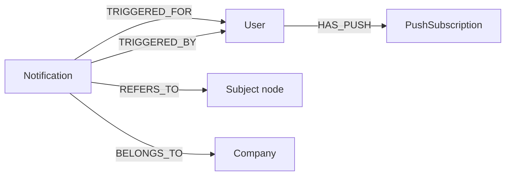

## Purpose

Two foundations under `packages/nestjs-neo4jsonapi/src/foundations/` deliver
in-app and out-of-app alerts: `notification` stores a per-recipient alert as a
Neo4j node and serves the bell list, and `push` stores a browser's Web Push
subscription and sends payloads to it through VAPID. {{display}} ships both
registered and mounted; what it does **not** ship is a producer — nothing in
either package writes a notification for a domain event, so the bell is empty
until the application calls `NotificationRepository.createNotification()` itself.

## Vocabulary

| Term | Meaning |
|---|---|
| Recipient | The user a notification is for — the `TRIGGERED_FOR` edge |
| Actor | The user whose action caused it — the `TRIGGERED_BY` edge, optional |
| Subject | The node the notification is about — a `REFERS_TO` edge. At least one is **required** for the notification to be visible |
| Bell list | `GET /notifications`, the recipient-scoped, non-archived feed behind the header bell |
| Idempotency key | A unique string on a notification node that turns a repeated create into a no-op |
| Endpoint (push) | The browser-supplied push URL. Globally unique, and the identity of a `PushSubscription` node |
| VAPID | Voluntary Application Server Identification — the key pair that authenticates {{display}} to the browser's push service |

## Graph model

| Label | Key fields | Relationships | Declaring file |
|---|---|---|---|
| `Notification` | `notificationType`, `isRead`, `message`, `actionUrl`; plus untyped `isArchived` and `idempotencyKey` written by the repository | `TRIGGERED_FOR` → `User` (one), `TRIGGERED_BY` → `User` (one, wire key `actor`), `REFERS_TO` → any labelled node (many), `BELONGS_TO` → `Company` (one) | `packages/nestjs-neo4jsonapi/src/foundations/notification/entities/notification.ts` |
| `PushSubscription` | `endpoint`, `p256dh`, `auth` | `HAS_PUSH` ← `User` (many) | written by `packages/nestjs-neo4jsonapi/src/foundations/push/repositories/push.repository.ts` |

`Notification` is company-scoped: `NotificationDescriptor` leaves
`isCompanyScoped` at its `true` default, so every write carries a `BELONGS_TO`
edge and every read joins the CLS-bound `company` variable. `PushSubscription`
is deliberately not — a subscription belongs to a browser, not to a tenant, and
`PushRepository.deleteByEndpoint()` is unscoped so a worker with no CLS context
can still prune a dead endpoint.

Only two of the three declared attributes on `Notification` are required
(`notificationType`, `isRead`); `message` and `actionUrl` are optional, and
`isArchived`/`idempotencyKey` never appear in the descriptor at all — they are
set directly in Cypher by `archive()` and `createIdempotent()`.

## Backend

| Endpoint | Controller | Service | Repository | DTOs | Guards |
|---|---|---|---|---|---|
| `GET /notifications` | `packages/nestjs-neo4jsonapi/src/foundations/notification/controllers/notification.controller.ts` | `packages/nestjs-neo4jsonapi/src/foundations/notification/services/notification.service.ts` | `packages/nestjs-neo4jsonapi/src/foundations/notification/repositories/notification.repository.ts` | none — `isArchived` is a bare query param | `JwtAuthGuard` on the class |
| `GET /notifications/:notificationId` | same | same | same | none | `JwtAuthGuard` |
| `PATCH /notifications` | same | same | same | `NotificationPatchListDTO` | `JwtAuthGuard` |
| `POST /notifications/:notificationId/archive` | same | same | same | none | `JwtAuthGuard` |
| `POST /push` | `packages/nestjs-neo4jsonapi/src/foundations/push/controllers/push.controller.ts` | `packages/nestjs-neo4jsonapi/src/foundations/push/services/push.service.ts` | `packages/nestjs-neo4jsonapi/src/foundations/push/repositories/push.repository.ts` | `PushSubscriptionDTO` (a plain interface, **not** a validated class) | `JwtAuthGuard` on the method |

Neither module uses `createCrudHandlers()`. The notification repository is
entirely hand-written Cypher and says so in its own class comment: the bell
query filters on `EXISTS { MATCH (notification)-[:REFERS_TO]->() }`, so a
notification created without a subject is invisible to the very list it was
created for. `buildDefaultMatch()` is not called anywhere in the file; scoping
comes from matching the CLS-bound `company` variable that `initQuery()` seeds.

Two read methods, two different scopes, and they are not equivalent:

- `findForUser` is company- **and** user-scoped — it additionally matches
  `-[:TRIGGERED_FOR]->(user:User {id: $userId})-[:BELONGS_TO]->(company)`.
- `findByIdForUser` is company-scoped only. It takes and binds `userId` but its
  Cypher never references `$userId`, so any member of the same company can read
  any colleague's notification by id. The repository comment records this as
  pre-existing behaviour preserved verbatim.

`NotificationRepository.onModuleInit()` does not call `super.onModuleInit()`. It
creates the `notification_id` and `notification_idempotency_key` uniqueness
constraints and deliberately creates **no** fulltext index, so notifications are
not searchable.

Two creators exist, both named away from the inherited `create` because their
signatures are incompatible with `AbstractRepository.create`:

- `createNotification({ notificationType, userId, actorId?, targets? })` —
  validates every target node with `validateExistingNodes()`, checks each
  caller-supplied Neo4j label against `/^[A-Za-z_][A-Za-z0-9_]*$/` before
  interpolating it, then writes one `REFERS_TO` group per distinct label through
  `updateRelationshipQuery`.
- `createIdempotent({ ..., idempotencyKey })` — a `MERGE` on the idempotency key
  backed by the uniqueness constraint, followed by a read-back that compares the
  stored id with the generated one to report `{ created: true | false }`.

`PushService` is inert unless VAPID is configured: its constructor reads the
`vapid` config block and sets `_isActive = false` when either key is missing, so
`registerSubscription()` and `sendNotification()` both return immediately.
`sendNotification()` prunes an endpoint on HTTP 404 or 410 (permanently gone)
and logs anything else. The create query is an upsert — `MERGE` on the endpoint,
`MERGE` on the `HAS_PUSH` edge — because the same browser endpoint is shared by
every account signed in on that browser.

## Frontend

| Model | Service | Module factory | Routes | Components | Feature id |
|---|---|---|---|---|---|
| `packages/nextjs-jsonapi/src/features/notification/data/notification.ts` | `packages/nextjs-jsonapi/src/features/notification/data/notification.service.ts` | `packages/nextjs-jsonapi/src/features/notification/notification.module.ts` — wired in `apps/web/src/config/Bootstrapper.ts` as `Notification` | `/notifications` → `apps/web/src/app/[locale]/(main)/(foundations)/notifications/page.tsx` | `NotificationsListContainer`, `NotificationsList`, `NotificationMenuItem`, `NotificationToast`, `NotificationModal`, `NotificationErrorBoundary` | none |
| `packages/nextjs-jsonapi/src/features/push/data/push.ts` | `packages/nextjs-jsonapi/src/features/push/data/push.service.ts` | `packages/nextjs-jsonapi/src/features/push/push.module.ts` — wired as `Push` | none | `PushNotificationProvider` | none |

The context is `NotificationContextProvider` in
`packages/nextjs-jsonapi/src/features/notification/contexts/NotificationContext.tsx`.
It holds the list, coalesces concurrent `loadNotifications()` calls into one
`GET /notifications` through an in-flight ref, treats anything older than five
minutes as stale, and skips the initial load entirely for a user holding the
administrator role. There is no server-side unread count: `NotificationModal`
derives `unreadCount` and `unreadIds` client-side from `notifications.filter(n
=> !n.isRead)`, and marks exactly those ids read when the popover closes.

Three providers must wrap any tree that shows notifications, below a
`SessionProvider` whose session promise `SocketProvider` also takes. `(main)` and
`(admin)` mount them through one component,
`apps/web/src/features/common/components/session/AppShell.tsx`:
`SessionProvider` → `ViewportProvider` → `SocketProvider` →
`CurrentUserProvider` → `OnboardingProviderWrapper` →
`PushNotificationProvider` → `NotificationContextProvider`.
`apps/web/src/app/[locale]/(public-help)/help/layout.tsx` repeats the chain
without `ViewportProvider` and with `OnboardingProviderWrapper` above
`CurrentUserProvider`; the relative order of the notification providers is the
same.

`useNotificationSync` (`packages/nextjs-jsonapi/src/hooks/useNotificationSync.ts`)
is the bridge between the socket and the list: it drains
`useSocketContext().socketNotifications` into `addSocketNotifications` and
clears the socket buffer. {{display}} calls it once, in
`apps/web/src/features/common/components/details/LayoutDetails.tsx`.

`PushNotificationProvider` is a one-line wrapper over `usePushNotifications`
(`packages/nextjs-jsonapi/src/hooks/usePushNotifications.ts`). The hook
registers a **different** service worker per environment, both at scope `/`, so
the subscription is identical either way:

| Environment | Worker registered | Source |
|---|---|---|
| Production (`NODE_ENV === "production"`) | `/sw.js` | `apps/web/src/app/sw.ts`, compiled by Serwist through `apps/web/src/app/serwist/[path]/route.ts` and published at `/sw.js` by a `beforeFiles` rewrite in `apps/web/next.config.js` |
| Anything else | `/sw-dev.js` | `apps/web/public/sw-dev.js` — push only, no `fetch` handler, so it cannot cache stale dev chunks |

The hook then requests `Notification.permission` only when it is still
`default`, converts `NEXT_PUBLIC_VAPID_PUBLIC_KEY` from URL-safe base64,
subscribes through `PushManager`, hashes the subscription into
`sessionStorage` under `push_registered_<userId>` and posts to `POST /push` only
when that hash changed. It skips registration entirely for administrators.

## Flows

**Creating and reading a notification.** Nothing in either package performs step
1; it is the application's entry point into this chapter.

1. Application code calls
   `NotificationRepository.createNotification({ notificationType, userId, actorId, targets })`.
   Supply at least one `target`, or the row will never appear in the bell.
2. The repository validates the target nodes and labels, `CREATE`s the
   `Notification`, and writes `TRIGGERED_FOR`, `TRIGGERED_BY` and one
   `REFERS_TO` group per label.
3. To reach the browser immediately, the application emits over the socket:
   `WebSocketService.sendMessageToUser(userId, "notification", payload)` in
   `packages/nestjs-neo4jsonapi/src/core/websocket/services/websocket.service.ts`.
   In a multi-process deployment the same call publishes through
   `packages/nestjs-neo4jsonapi/src/core/redis/services/redis.messaging.service.ts`,
   and the instance holding the socket re-emits it from the `redis.notification`
   event handler.
4. `useSocket` listens for the `notification` event, rehydrates the payload with
   `rehydrate(Modules.Notification, …)` and pushes it into
   `socketNotifications`.
5. `useNotificationSync` moves it into `NotificationContext`; the bell in
   `UserSidebarFooter` re-renders with a new unread count.
6. Opening and closing `NotificationModal` issues
   `PATCH /notifications` with the unread ids, which `markAsRead` writes as
   `SET notification.isRead = true`.
7. `POST /notifications/:id/archive` sets `isArchived = true`, which removes the
   row from the default list (`isArchived IS null`) and puts it in the
   `?isArchived=true` list.

**Delivering the same event to the operating system.**

1. On mount, `usePushNotifications` registers the service worker, subscribes and
   posts the subscription to `POST /push`.
2. `PushService.registerSubscription()` looks the endpoint up, and on a miss
   `PushRepository.create()` upserts the `PushSubscription` node and `MERGE`s
   `HAS_PUSH` from the current user.
3. Application code calls `PushRepository.findByUserId({ userId })` and passes
   the rows to `PushService.sendNotification({ pushSubscriptions, title,
   message, url })`.
4. `web-push` signs the payload with the VAPID key pair and posts it to each
   endpoint; the browser's push service wakes the service worker, which shows
   the system notification.
5. A 404 or 410 response deletes that `PushSubscription` node so the endpoint is
   never retried.

## Background jobs

Neither foundation registers a queue, a processor or a cron. Notification writes
and push sends are synchronous. The billing chapter's `email` queue is the only
place in the package where an alert is deferred, and that is an email rather
than a notification — see `docs/handbook/01-architecture/notifications-and-email.md`.

## Permissions and gating

`Notification` is the one module in this chapter with a seeded `(Module)` node:
`9259d704-c670-4e77-a3a1-a728ffc5be3d`, declared in
`packages/shared/src/const/module.id.ts`, seeded by
`apps/api/src/neo4j.migrations/20250901_002.ts` and granted in
`apps/api/src/rbac/permissions.ts` as `default: [perm.read, perm.update]` with
`perm.full` for `RoleId.Administrator`. The frontend module factory carries the
same id, so `hasPermissionToModule({ module: Modules.Notification, … })` resolves.

`Push` is registered with `moduleId: ""`, so it has no RBAC identity at all; the
only gate on `POST /push` is `JwtAuthGuard`. Neither module declares a feature
id, so no `HAS_FEATURE` edge gates either of them.

Scope, restated because the two read paths differ: an authenticated member sees
only their own notifications in the list, but can fetch any notification of
their own company by id. Nothing here is reachable unauthenticated. The engine
behind `hasPermissionToModule` is documented in
`docs/handbook/03-backend/rbac-and-permissions.md` and its client half in
`docs/handbook/04-frontend/access-control.md`.

## Configuration

| Variable | Config key | Default | Read by |
|---|---|---|---|
| `VAPID_PUBLIC_KEY` | `vapid.publicKey` | `""` | `PushService` constructor — empty disables the whole module |
| `VAPID_PRIVATE_KEY` | `vapid.privateKey` | `""` | `PushService` constructor |
| `VAPID_EMAIL` | `vapid.email` | `""` | `PushService` constructor, sent as `mailto:` in `setVapidDetails` |
| `NEXT_PUBLIC_VAPID_PUBLIC_KEY` | — | none | `ENV.VAPID_PUBLIC_KEY` in `apps/web/src/config/middleware-env.ts`, consumed by `usePushNotifications` |

All four are declared in `.env.example` under `WEB PUSH - VAPID`. The three
server-side keys are assembled in
`packages/nestjs-neo4jsonapi/src/config/base.config.ts` and typed by
`packages/nestjs-neo4jsonapi/src/config/interfaces/config.vapid.interface.ts`.
The browser key is a separate variable and must be kept equal to
`VAPID_PUBLIC_KEY` by hand — nothing checks that they agree.

## Tests

Six package specs cover this chapter, all `*.spec.ts` beside the code:

| Spec |
|---|
| `packages/nestjs-neo4jsonapi/src/foundations/notification/controllers/notification.controller.spec.ts` |
| `packages/nestjs-neo4jsonapi/src/foundations/notification/repositories/__tests__/notification.repository.spec.ts` |
| `packages/nestjs-neo4jsonapi/src/foundations/notification/services/__tests__/notification.service.spec.ts` |
| `packages/nestjs-neo4jsonapi/src/foundations/push/controllers/push.controller.spec.ts` |
| `packages/nestjs-neo4jsonapi/src/foundations/push/repositories/__tests__/push.repository.spec.ts` |
| `packages/nestjs-neo4jsonapi/src/foundations/push/services/__tests__/push.service.spec.ts` |

On the frontend there is one:
`packages/nextjs-jsonapi/src/features/notification/contexts/__tests__/NotificationContext.spec.tsx`.
There is no spec for `usePushNotifications`, none for `useNotificationSync`, and
none for `NotificationModal`.

{{display}} itself ships no test for either module. Specifically unprotected:
the service-worker choice per environment, the `sessionStorage` de-duplication
of push registrations, the socket-to-list bridge, and the unread-count
derivation. All are browser behaviour that only a real run exercises.

## Where to look

| File | Why |
|---|---|
| `packages/nestjs-neo4jsonapi/src/foundations/notification/repositories/notification.repository.ts` | Every notification query, and the class comment explaining why `buildDefaultMatch()` is absent |
| `packages/nestjs-neo4jsonapi/src/foundations/notification/entities/notification.ts` | The descriptor, and the narrowed-extend instructions for adding attributes |
| `packages/nestjs-neo4jsonapi/src/foundations/notification/controllers/notification.controller.ts` | The four routes and their cache invalidation |
| `packages/nestjs-neo4jsonapi/src/foundations/push/services/push.service.ts` | VAPID setup, the send loop and the 404/410 pruning |
| `packages/nestjs-neo4jsonapi/src/foundations/push/repositories/push.repository.ts` | Why the subscription upsert is keyed on the endpoint rather than the user |
| `packages/nextjs-jsonapi/src/features/notification/contexts/NotificationContext.tsx` | List state, request coalescing, the five-minute staleness rule |
| `packages/nextjs-jsonapi/src/hooks/usePushNotifications.ts` | Permission prompt, key conversion, per-environment worker |
| `packages/nextjs-jsonapi/src/hooks/useNotificationSync.ts` | The socket-to-context bridge, in fifteen lines |
| `apps/web/src/features/common/components/session/AppShell.tsx` | The provider order `(main)` and `(admin)` share |
| `apps/web/src/features/common/components/navigations/UserSidebarFooter.tsx` | Where the bell is mounted |

## Gaps and drift

- `NotificationController.findById` reads `request.user.id`, while every other
  method in the same controller reads `request.user.userId`. `JwtAuthGuard`
  puts `userId` on the request, so the value passed to `findByIdForUser` is
  `undefined`. It happens not to matter, because that repository method never
  references `$userId` — but the two defects hide each other.
- `pushMeta.labelName` is `Push`, while every query in `PushRepository` matches
  the label `PushSubscription`. `PushModel` is registered in the model registry
  under the `push` node name and its mapper is only ever fed rows from those
  queries, so the mismatch is inert today and would bite the first person who
  writes a descriptor-driven query for it.
- `PushService.register` on the frontend calls `callApi` with
  `overridesJsonApiCreation: true`. `CLAUDE.md` forbids that flag in application
  code; the package uses it here because `POST /push` accepts a raw browser
  subscription object rather than a JSON:API document.
- `PushSubscriptionDTO` is a TypeScript interface, not a `class-validator` DTO,
  so `POST /push` performs no request validation at all.
- No package code emits the `notification` socket event that `useSocket`
  listens for, and no package code calls `createNotification` or
  `sendNotification`. Both producers are the application's to write.
- Not examined: the socket handshake and room membership in
  `packages/nestjs-neo4jsonapi/src/core/websocket/gateways/event.gateway.ts`,
  the Serwist configuration in `apps/web/src/app/sw.ts` beyond which worker is
  registered, and the toast rendering in
  `packages/nextjs-jsonapi/src/features/notification/components/notifications/Notification.tsx`.
  The queue and email half of alerting is covered by
  `docs/handbook/01-architecture/notifications-and-email.md`, and the PWA detail
  by `docs/handbook/04-frontend/realtime-notifications-pwa.md`.
