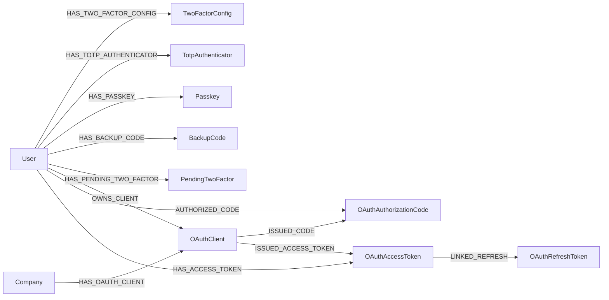

## Purpose

Two foundations under `packages/nestjs-neo4jsonapi/src/foundations/` harden and
extend the front door. `two-factor` adds a second step to {{display}}'s own
login — TOTP codes, WebAuthn passkeys and single-use backup codes. `oauth`
points the other way entirely: it makes {{display}} an **OAuth 2.1
authorization server**, so third-party applications can be issued tokens to act
on a user's behalf against this API.

The distinction matters and is easy to get backwards. Signing *in* with Discord
or Google is provider sign-in and belongs to the `auth` foundation, documented
in [identity-and-tenancy.md](identity-and-tenancy.md). Nothing in this chapter
authenticates a user against somebody else's identity provider.

## Vocabulary

| Term | Meaning |
|---|---|
| TOTP | Time-based one-time password. Six digits, SHA-1, thirty-second period, generated by an authenticator app |
| Authenticator | One enrolled TOTP app. A user may have several; each is a `:TotpAuthenticator` with its own encrypted secret |
| Passkey | A WebAuthn credential — a key pair held by the device, verified against a stored public key and a signature counter |
| Backup code | One of ten single-use 8-hex-character recovery codes, stored bcrypt-hashed |
| Pending session | A `:PendingTwoFactor` node holding the in-flight challenge and its attempt count |
| Pending JWT | A five-minute token of `type: "pending_2fa"` issued after a valid password and before the second factor. Accepted by nothing except the verification endpoints |
| Relying party | The WebAuthn term for the service a passkey is bound to. Configured through `WEBAUTHN_RP_ID`, `WEBAUTHN_RP_NAME` and `WEBAUTHN_ORIGIN` |
| Issuer | The TOTP counterpart of the relying party name — the label an authenticator app prints beside the entry. Metadata in the QR code only; it takes no part in generating or validating a code |
| Authorization server | The OAuth role {{display}} plays: it issues codes and tokens for its own resources |
| Client | A registered third-party application. Confidential (holds a secret) or public (cannot) |
| PKCE | Proof Key for Code Exchange, RFC 7636. A per-request verifier and its hash, defeating code interception |
| Rotation | Issuing a fresh refresh token on every refresh and revoking the old one |

## Graph model

Every label in this chapter is `isCompanyScoped: false`. Two-factor records hang
off `:User` and are read before any company is in CLS; OAuth clients and tokens
carry their own explicit company id instead.

| Label | Key fields | Relationships | Declaring file |
|---|---|---|---|
| `TwoFactorConfig` | `isEnabled`, `preferredMethod`, `backupCodesCount` | `HAS_TWO_FACTOR_CONFIG` ← `User` | `packages/nestjs-neo4jsonapi/src/foundations/two-factor/entities/two-factor-config.ts` |
| `TotpAuthenticator` | `name`, `secret` (AES-256-GCM, never serialised), `verified`, `lastUsedAt` | `HAS_TOTP_AUTHENTICATOR` ← `User` | `packages/nestjs-neo4jsonapi/src/foundations/two-factor/entities/totp-authenticator.ts` |
| `Passkey` | `name`, `credentialId`, `publicKey`, `counter`, `transports`, `backedUp`, `lastUsedAt` — the first four never serialised | `HAS_PASSKEY` ← `User` | `packages/nestjs-neo4jsonapi/src/foundations/two-factor/entities/passkey.ts` |
| `BackupCode` | `codeHash` (bcrypt, never serialised), `usedAt` | `HAS_BACKUP_CODE` ← `User` | `packages/nestjs-neo4jsonapi/src/foundations/two-factor/entities/backup-code.ts` |
| `PendingTwoFactor` | `challenge` (never serialised), `challengeType`, `expiration`, `attemptCount` | `HAS_PENDING_TWO_FACTOR` ← `User` | `packages/nestjs-neo4jsonapi/src/foundations/two-factor/entities/pending-two-factor.ts` |
| `OAuthClient` | `clientId` (unique), `clientSecretHash`, `name`, `description`, `redirectUris`, `allowedScopes`, `allowedGrantTypes`, `isConfidential`, `isActive`, `accessTokenLifetime`, `refreshTokenLifetime` | `OWNS_CLIENT` ← `User`, `HAS_OAUTH_CLIENT` ← `Company` | `packages/nestjs-neo4jsonapi/src/foundations/oauth/entities/oauth.client.entity.ts` |
| `OAuthAuthorizationCode` | `codeHash` (unique), `expiresAt`, `redirectUri`, `scope`, `state`, `codeChallenge`, `codeChallengeMethod`, `isUsed` | `ISSUED_CODE` ← `OAuthClient`, `AUTHORIZED_CODE` ← `User` | `packages/nestjs-neo4jsonapi/src/foundations/oauth/entities/oauth.authorization.code.entity.ts` |
| `OAuthAccessToken` | `tokenHash` (unique), `scope`, `expiresAt`, `isRevoked`, `grantType`, `clientId`, `userId`, `companyId` | `ISSUED_ACCESS_TOKEN` ← `OAuthClient`, `HAS_ACCESS_TOKEN` ← `User`, `LINKED_REFRESH` → `OAuthRefreshToken` | `packages/nestjs-neo4jsonapi/src/foundations/oauth/entities/oauth.access.token.entity.ts` |
| `OAuthRefreshToken` | `tokenHash` (unique), `scope`, `expiresAt`, `isRevoked`, `rotationCounter` | `LINKED_REFRESH` ← `OAuthAccessToken` | `packages/nestjs-neo4jsonapi/src/foundations/oauth/entities/oauth.refresh.token.entity.ts` |

Codes and tokens are stored as SHA-256 hashes. The plaintext is returned once
and never persisted, which is why revocation and introspection both look the
value up by hash.

`OAuthRepository.onModuleInit` creates five uniqueness constraints —
`oauth_client_id`, `oauth_client_clientid`, `oauth_access_token_hash`,
`oauth_refresh_token_hash`, `oauth_auth_code_hash` — and three indexes:
`oauth_client_owner` on `OAuthClient.ownerId` and expiry indexes on both token
labels. The two-factor repositories create no constraints of their own.

### The eight response-shape descriptors

`TwoFactorModule` registers thirteen models, but only five of them are ever
written to Neo4j. The other eight exist purely to give a response a JSON:API
shape, exactly as `PendingAuth` does in the auth foundation.

| Label | Wire type and endpoint | What it carries |
|---|---|---|
| `TotpSetup` | `totp-setup` | `secret`, `qrCodeUri`, `qrCodeDataUrl` |
| `TwoFactorStatus` | `two-factor-status` | `isEnabled`, `preferredMethod`, a `methods` object of three booleans, `backupCodesCount` |
| `TwoFactorChallenge` | `two-factor-challenge` | `method`, `pendingId`, `availableMethods`, `options` |
| `TwoFactorVerification` | `two-factor-verification` | `success`, `userId` |
| `BackupCodesCount` | `backup-codes-count` | `count` |
| `BackupCodesGeneration` | `backup-codes-generation` | `codes` (plaintext, once), `count` |
| `PasskeyRegistrationOptions` | `passkey-registration-options` | `pendingId`, the WebAuthn `options` blob |
| `PasskeyAuthenticationOptions` | `passkey-authentication-options` | `pendingId`, the WebAuthn `options` blob |

The five persisted ones — `BackupCode`, `Passkey`, `PendingTwoFactor`,
`TotpAuthenticator`, `TwoFactorConfig` — use `backup-codes`, `passkeys`,
`pending-two-factors`, `totp-authenticators` and `two-factor-configs`.

## Backend

### Two-factor

| Endpoint | Controller | Service | Repository | DTOs | Guards |
|---|---|---|---|---|---|
| `POST /auth/totp/setup`, `POST /auth/totp/verify-setup`, `GET /auth/totp/authenticators`, `DELETE /auth/totp/authenticators/:authenticatorId` | `packages/nestjs-neo4jsonapi/src/foundations/two-factor/controllers/totp.controller.ts` | `packages/nestjs-neo4jsonapi/src/foundations/two-factor/services/totp.service.ts` | `packages/nestjs-neo4jsonapi/src/foundations/two-factor/repositories/totp-authenticator.repository.ts` | `totp-setup.dto.ts`, `totp-verify.dto.ts` | `JwtAuthGuard` on the class |
| `POST /auth/passkey/register/options`, `POST /auth/passkey/register/verify`, `GET /auth/passkeys`, `PATCH /auth/passkeys/:passkeyId`, `DELETE /auth/passkeys/:passkeyId` | `packages/nestjs-neo4jsonapi/src/foundations/two-factor/controllers/passkey.controller.ts` | `packages/nestjs-neo4jsonapi/src/foundations/two-factor/services/passkey.service.ts` | `packages/nestjs-neo4jsonapi/src/foundations/two-factor/repositories/passkey.repository.ts` | `passkey-options.dto.ts`, `passkey-verify.dto.ts` | `JwtAuthGuard` on the class |
| `GET /auth/two-factor/status`, `POST /auth/two-factor/enable`, `POST /auth/two-factor/disable`, `POST /auth/backup-codes/generate`, `POST /auth/backup-codes/regenerate`, `GET /auth/backup-codes/count` | `packages/nestjs-neo4jsonapi/src/foundations/two-factor/controllers/two-factor.controller.ts` | `packages/nestjs-neo4jsonapi/src/foundations/two-factor/services/two-factor.service.ts` | `two-factor-config.repository.ts`, `backup-code.repository.ts` | `two-factor-verify.dto.ts` | `JwtAuthGuard` per route |
| `POST /auth/two-factor/challenge`, `POST /auth/two-factor/verify/totp`, `POST /auth/two-factor/verify/passkey/options`, `POST /auth/two-factor/verify/passkey`, `POST /auth/two-factor/verify/backup` | same controller | same service | `pending-two-factor.repository.ts` | same | **`PendingAuthGuard`** |

The guard split is the whole design. Enrolment and management need a real
session, so they use `JwtAuthGuard`. The five verification routes run *between*
a valid password and a session, so they use `PendingAuthGuard` in
`packages/nestjs-neo4jsonapi/src/foundations/two-factor/guards/pending-auth.guard.ts`,
which verifies the JWT signature, insists the payload's `type` is exactly
`pending_2fa`, and attaches the decoded payload to `request.pendingAuth`. A
full access token fails that check, and so does a pending token on any other
route.

`TwoFactorService` orchestrates and delegates. It caps attempts per method —
five for TOTP, three for passkey, three for backup — and reads the pending
session TTL from `twoFactor.pendingTtl`, defaulting to 300 seconds.

`TotpService` uses `otpauth` with SHA-1, six digits and a thirty-second period,
generates a 20-byte secret, and renders the provisioning URI to a data-URL QR
code with `qrcode`. Secrets are encrypted at rest by `TotpEncryptionService`
with AES-256-GCM keyed from `TOTP_ENCRYPTION_KEY`.

`PasskeyService` wraps `@simplewebauthn/server` —
`generateRegistrationOptions`, `verifyRegistrationResponse`,
`generateAuthenticationOptions`, `verifyAuthenticationResponse` — and stores the
challenge for five minutes on a `:PendingTwoFactor` node.

`BackupCodeService` issues ten codes of eight hex characters, bcrypt-hashed at
ten rounds. `generateCodes` refuses if unused codes already exist;
`regenerateCodes` replaces the set. Plaintext is returned exactly once.

### OAuth

Five controllers, each with a distinct job.

| Controller | Routes | Purpose |
|---|---|---|
| `packages/nestjs-neo4jsonapi/src/foundations/oauth/controllers/oauth.authorize.controller.ts` | `GET /oauth/authorize`, `GET /oauth/authorize/info`, `POST /oauth/authorize/approve`, `POST /oauth/authorize/deny` | The authorization-code flow. All four require `JwtAuthGuard` — the user must already be logged into {{display}} |
| `packages/nestjs-neo4jsonapi/src/foundations/oauth/controllers/oauth.token.controller.ts` | `POST /oauth/token`, `POST /oauth/revoke` | Token issuance for all three grants, and RFC 7009 revocation. No guard — the client authenticates with its own credentials |
| `packages/nestjs-neo4jsonapi/src/foundations/oauth/controllers/oauth.registration.controller.ts` | `POST /oauth/register` | RFC 7591 dynamic client registration. Returns 404 when `oauth.enabled` is false |
| `packages/nestjs-neo4jsonapi/src/foundations/oauth/controllers/oauth.discovery.controller.ts` | `GET /.well-known/oauth-authorization-server`, `GET /.well-known/oauth-protected-resource` | RFC 8414 and RFC 9728 metadata. Unauthenticated by definition |
| `packages/nestjs-neo4jsonapi/src/foundations/oauth/controllers/oauth.management.controller.ts` | `GET /oauth/clients`, `POST /oauth/clients`, `GET /oauth/clients/:clientId`, `PATCH /oauth/clients/:clientId`, `DELETE /oauth/clients/:clientId`, `POST /oauth/clients/:clientId/regenerate-secret` | A developer managing their own registered applications. `JwtAuthGuard` on the class |

`GET /oauth/authorize` does **not** render a consent page. It validates the
request and redirects straight back to `redirect_uri` with a code, or with
`error` and `error_description` per RFC 6749 §4.1.2.1, preserving `state` in
both cases. The browser-facing consent screen is a web-app route that calls
`GET /oauth/authorize/info` and then `approve` or `deny` — which is why the
discovery document advertises the *app* URL as `authorization_endpoint` and the
*API* URL for everything else.

PKCE is enforced where it matters: `OAuthService.initiateAuthorization` requires
a code challenge when the client is public **and**
`oauth.requirePkceForPublicClients` is not explicitly false. The default is on.
`OAuthPkceService` generates verifiers of 43 to 128 unreserved characters and
supports `S256` and `plain`; the discovery document advertises `S256` only.

`refreshTokenGrant` validates the client, validates the refresh token, rejects a
client mismatch, allows the scope to narrow but never to widen, **revokes the
old refresh token**, then issues a new access token and — when
`oauth.rotateRefreshTokens` is not false — a new refresh token. Rotation is on
by default. `revokeToken` always reports success, even for a token that never
existed, so the endpoint cannot be used to fish for valid values.

Authorization codes are single-use (`isUsed`) and short-lived
(`oauth.authorizationCodeLifetime`, 600 seconds).

### Guarding your own endpoints with OAuth

Two guards and one decorator, all exported:

- `OAuthTokenGuard` in
  `packages/nestjs-neo4jsonapi/src/foundations/oauth/guards/oauth.token.guard.ts`
  requires a valid OAuth bearer token. It validates the token, compares its
  space-separated scope string against whatever `@OAuthScopes(...)` declared —
  401 for a missing or invalid token, 403 for insufficient scope — then sets
  `userId`, `companyId`, `oauthClientId`, `oauthScopes` and `authType: "oauth"`
  in CLS and attaches a user object to the request.
- `@OAuthScopes(...scopes)` in
  `packages/nestjs-neo4jsonapi/src/common/decorators/oauth.scopes.decorator.ts`
  is a `SetMetadata` shim under the key `oauth_scopes`. Every listed scope must
  be present; it is an AND, not an OR.
- `JwtOrOAuthGuard` in
  `packages/nestjs-neo4jsonapi/src/common/guards/jwt.or.oauth.guard.ts` tries
  OAuth first on anything shaped like a bearer token, and falls back to
  `JwtAuthGuard` — resolved through `ModuleRef` with `strict: false` — when the
  token does not validate as OAuth. It exists so an endpoint can accept both a
  first-party session and a third-party token without being written twice.

The scope vocabulary is a fixed `const` object in
`packages/nestjs-neo4jsonapi/src/foundations/oauth/constants/oauth.scopes.ts`,
with a human name and a description for each entry, both consumed by the consent
screen.

## Frontend

The two-factor client surface lives inside the package's `auth` feature rather
than in a feature of its own, and is registered as **fourteen** separate module
factories in `apps/web/src/config/Bootstrapper.ts` — one per response shape,
because each needs its own model for rehydration.

| Model | Service | Module factory | Routes | Components | Feature id |
|---|---|---|---|---|---|
| `packages/nextjs-jsonapi/src/features/auth/data/two-factor-status.ts`, `totp-setup.ts`, `totp-verify.ts`, `totp-verify-login.ts`, `totp-authenticator.ts`, `passkey.ts`, `passkey-registration-options.ts`, `passkey-registration-verify.ts`, `passkey-rename.ts`, `passkey-verify-login.ts`, `passkey-authentication-options.ts`, `two-factor-enable.ts`, `two-factor-challenge.ts`, `backup-code-verify.ts` | `packages/nextjs-jsonapi/src/features/auth/data/two-factor.service.ts` | `two-factor-status.module.ts`, `totp-setup.module.ts`, `totp-verify.module.ts`, `totp-verify-login.module.ts`, `totp-authenticator.module.ts`, `passkey.module.ts`, `passkey-registration-options.module.ts`, `passkey-registration-verify.module.ts`, `passkey-rename.module.ts`, `passkey-verify-login.module.ts`, `passkey-authentication-options.module.ts`, `two-factor-enable.module.ts`, `two-factor-challenge.module.ts`, `backup-code-verify.module.ts` — all under `packages/nextjs-jsonapi/src/features/auth/`, all wired | none of their own | see below | none |
| `packages/nextjs-jsonapi/src/features/oauth/data/oauth.ts` | `packages/nextjs-jsonapi/src/features/oauth/data/oauth.service.ts` | `packages/nextjs-jsonapi/src/features/oauth/oauth.module.ts` — wired as `OAuth` | `/settings/oauth`, `/settings/oauth/new`, `/settings/oauth/[clientId]`, `/oauth/authorize`, `/oauth/success`, `/oauth/error` | see below | none |

Two-factor components, all under
`packages/nextjs-jsonapi/src/features/auth/components/two-factor/`:
`TwoFactorSettings` (the settings panel), `TotpSetupDialog` and `TotpInput`,
`TotpAuthenticatorList`, `PasskeySetupDialog`, `PasskeyButton` and
`PasskeyList`, `BackupCodesDialog`, and `DisableTwoFactorDialog`.
`SecurityContainer` under `components/containers/` wraps `TwoFactorSettings`.
The login-time challenge is `TwoFactorChallenge` under `components/forms/`,
rendered by `Login` and `AuthContext`.

OAuth components, under `packages/nextjs-jsonapi/src/features/oauth/components/`:
`OAuthClientList`, `OAuthClientCard`, `OAuthClientForm`, `OAuthClientDetail`,
`OAuthClientSecretDisplay`, `OAuthRedirectUriInput` and `OAuthScopeSelector`;
plus the consent set under `components/consent/` — `OAuthConsentScreen`,
`OAuthConsentHeader`, `OAuthScopeList` and `OAuthConsentActions`. The hooks
`useOAuthClients`, `useOAuthClient` and `useOAuthConsent` come from the
package's `/client` entry point; the components from `/components`.

Routes `apps/web` mounts:

| Route | File | What it does |
|---|---|---|
| `/settings/oauth` | `apps/web/src/app/[locale]/(main)/(foundations)/settings/oauth/page.tsx` | The client list, via `OAuthClientListContainer` |
| `/settings/oauth/new` | `apps/web/src/app/[locale]/(main)/(foundations)/settings/oauth/new/page.tsx` | Create a client |
| `/settings/oauth/[clientId]` | `apps/web/src/app/[locale]/(main)/(foundations)/settings/oauth/[clientId]/page.tsx` | One client's detail and secret regeneration |
| `/oauth/authorize` | `apps/web/src/app/[locale]/(auth)/oauth/authorize/page.tsx` plus its `OAuthAuthorizeClient.tsx` | The consent screen. A server component that checks `ServerSession.isLogged()` and redirects to login with a callback URL that carries the whole incoming query string, repeated parameters included. The proxy lists `/oauth` in `PUBLIC_PATHS`, so this check is the consent screen's only login gate |
| `/oauth/success` | `apps/web/src/app/[locale]/(auth)/oauth/success/page.tsx` | Post-approval landing |
| `/oauth/error` | `apps/web/src/app/[locale]/(auth)/oauth/error/page.tsx` | Error landing |

`apps/web/src/features/common/components/containers/OAuthClientListContainer.tsx`
is mounted twice: as the Developer section of the settings rail in
`SettingsContainer.tsx`, and as the body of `/settings/oauth`. It therefore
renders no `RoundPageContainer` and no title of its own — inside the rail that
would nest a second header on top of the pane's own. Its navigation targets are
absolute `/settings/oauth…` paths, because the detail and create routes sit in
the `(foundations)` route group and route groups do not appear in URLs. The
settings-rail entry is role-gated on Administrator, not on a module permission.

## Flows

### Enrolling a TOTP authenticator

1. `TwoFactorSettings` calls `TwoFactorService.setupTotp({ id, name,
   accountName })` → `POST /auth/totp/setup`.
2. `TotpService.generateSecret` mints a 20-byte secret, builds the provisioning
   URI, renders the QR code, encrypts the secret and writes an unverified
   `:TotpAuthenticator`.
3. `TotpSetupDialog` shows the QR code; the user types the first six digits.
4. `TwoFactorService.verifyTotpSetup` → `POST /auth/totp/verify-setup` marks the
   authenticator `verified`.
5. `TwoFactorService.enable({ id, preferredMethod })` →
   `POST /auth/two-factor/enable` writes the `:TwoFactorConfig`.
6. `BackupCodesDialog` calls `POST /auth/backup-codes/generate`; the ten
   plaintext codes are displayed once and never retrievable again.

### Logging in with a second factor

1. `POST /auth` with email and password. `AuthService` checks the password,
   then asks `TwoFactorService.getConfig(userId)`.
2. With 2FA enabled it calls `createPendingSession`, reads the available
   methods, and calls `SecurityService.signPendingJwt({ userId, pendingId })` —
   a **five-minute** token carrying `pending: true` and `type: "pending_2fa"`.
3. The response is a `PendingAuth` document with `pendingToken`, `expiresAt`,
   `availableMethods` and `preferredMethod`. No session is issued.
4. `TwoFactorChallenge` posts `POST /auth/two-factor/challenge` with that token
   under `PendingAuthGuard` to start the chosen method.
5. The user verifies through `POST /auth/two-factor/verify/totp`,
   `/verify/passkey` (preceded by `/verify/passkey/options`) or
   `/verify/backup`.
6. On success the real session is issued and the pending session is consumed.
   On failure the attempt counter on the `:PendingTwoFactor` node increments,
   and the method's cap — five for TOTP, three for the other two — ends the
   attempt.

The five-minute pending-JWT lifetime in `signPendingJwt` and the
`TWO_FACTOR_PENDING_TTL` default of 300 seconds are separate values that happen
to agree. Raising one without the other leaves either a live database session
whose token has expired, or a live token whose session has gone.

### A third party getting a token

1. The client sends the user's browser to `/oauth/authorize` on the **web app**
   with `client_id`, `redirect_uri`, `scope`, `state`, `response_type=code` and,
   for a public client, `code_challenge` plus `code_challenge_method=S256`.
2. The proxy lets the request through, because `/oauth` is a public path. The
   page itself checks `ServerSession.isLogged()`; if not, it redirects to login
   with the whole query string, repeated parameters included, preserved in the
   callback URL.
3. `useOAuthConsent` calls `GET /oauth/authorize/info`, which returns the client
   and the scopes it is asking for. `OAuthScopeList` renders each scope's name
   and description from the scope constants.
4. The user approves. `POST /oauth/authorize/approve` mints an
   `:OAuthAuthorizationCode` — hashed, single-use, ten minutes — and returns the
   redirect URL. Deny returns an error redirect instead.
5. The client exchanges the code at `POST /oauth/token` with
   `grant_type=authorization_code` and its `code_verifier`. The server checks
   that the code is unused and unexpired, that `redirect_uri` matches, and that
   the verifier hashes to the stored challenge.
6. An access token and a refresh token are returned; only their hashes are
   stored, joined by `LINKED_REFRESH`.
7. The client calls the API with `Authorization: Bearer …` against endpoints
   guarded by `OAuthTokenGuard` or `JwtOrOAuthGuard`.
8. On expiry it calls `POST /oauth/token` with `grant_type=refresh_token`. The
   old refresh token is revoked and, with rotation on, a new one is issued.
9. Either side can call `POST /oauth/revoke`, which always reports success.

## Background jobs

No queue, no processor and no cron in either foundation. Expired
`:PendingTwoFactor` nodes, expired `:OAuthAuthorizationCode` nodes and expired
tokens are all filtered out by their `expiresAt` at read time; nothing sweeps
them, so they accumulate.

## Permissions and gating

Neither foundation has a module id. Neither appears in
`packages/shared/src/const/module.id.ts`, neither is seeded by
`apps/api/src/neo4j.migrations/20250901_002.ts`, and neither is granted in
`apps/api/src/rbac/permissions.ts`. Access is decided entirely by guards.

| Caller | Two-factor | OAuth |
|---|---|---|
| Unauthenticated | Nothing. Every route needs either a session or a pending token | `POST /oauth/token`, `POST /oauth/revoke`, `POST /oauth/register` and both `.well-known` documents |
| Holding a pending JWT | Only the five `POST /auth/two-factor/verify/…` and `/challenge` routes | Nothing |
| Ordinary member | Enrolment and management of their own factors, keyed on the CLS `userId` | Their own registered clients through `/oauth/clients`, and the consent flow |
| Company administrator | Same as a member — 2FA is per-user, not per-company | Same, plus the settings rail's Developer section, which is gated on the Administrator role |

Every two-factor repository query is anchored on `MATCH (user:User {id:
$userId})` followed by the relationship, so a user can only ever reach their own
records. `OAuthClient` reads are anchored on `OWNS_CLIENT` from the caller.

`oauth.enabled` gates registration only: `POST /oauth/register` returns 404 when
it is false. The authorize, token and management controllers do not check it, so
with `OAUTH_ENABLED` unset — the default — a client created by hand still works
end to end.

See [../03-backend/rbac-and-permissions.md](../03-backend/rbac-and-permissions.md)
for the permission engine, and
[identity-and-tenancy.md](identity-and-tenancy.md) for the login flow these
routes slot into, Discord and Google sign-in included.

## Configuration

| Variable | Config key | Default | Read by |
|---|---|---|---|
| `TOTP_ENCRYPTION_KEY` | `twoFactor.totpEncryptionKey` | `""` | `TotpEncryptionService` — 64 hex characters |
| `TOTP_ISSUER` | `twoFactor.totpIssuer` | `WEBAUTHN_RP_NAME`, then `Application` | `TotpService` — the label authenticator apps show |
| `WEBAUTHN_RP_ID` | `twoFactor.webauthnRpId` | `localhost` | `PasskeyService` — must match the domain |
| `WEBAUTHN_RP_NAME` | `twoFactor.webauthnRpName` | `Application` | `PasskeyService` — shown in the browser dialog |
| `WEBAUTHN_ORIGIN` | `twoFactor.webauthnOrigin` | `["http://localhost:3000"]` | `PasskeyService` — comma-separated, must match the frontend URL exactly |
| `TWO_FACTOR_PENDING_TTL` | `twoFactor.pendingTtl` | `300` | `TwoFactorService` |
| `OAUTH_ENABLED` | `oauth.enabled` | `false` | `OAuthRegistrationController` |
| `OAUTH_AUTHORIZATION_CODE_LIFETIME` | `oauth.authorizationCodeLifetime` | `600` | `OAuthService.initiateAuthorization` |
| `OAUTH_ACCESS_TOKEN_LIFETIME` | `oauth.accessTokenLifetime` | `3600` | `OAuthTokenService` |
| `OAUTH_REFRESH_TOKEN_LIFETIME` | `oauth.refreshTokenLifetime` | `604800` | `OAuthTokenService` |
| `OAUTH_REQUIRE_PKCE_FOR_PUBLIC_CLIENTS` | `oauth.requirePkceForPublicClients` | `true` | `OAuthService.initiateAuthorization` |
| `OAUTH_ROTATE_REFRESH_TOKENS` | `oauth.rotateRefreshTokens` | `true` | `OAuthService.refreshTokenGrant` |
| `API_URL` | `api.url` | — | `OAuthDiscoveryController` for every API-side endpoint |
| `APP_URL` | `app.url` | — | `OAuthDiscoveryController` for the browser-facing `authorization_endpoint` |

`.env.example` sets all five two-factor variables, with
`WEBAUTHN_ORIGIN=http://{{name}}.test:4051` matching the web port. It sets none
of the six `OAUTH_*` variables; the defaults in
`packages/nestjs-neo4jsonapi/src/config/base.config.ts` apply, which means
`oauth.enabled` is false out of the box. Both `OAUTH_*` clauses that flip a
default use `!== "false"`, so PKCE enforcement and refresh rotation stay on
unless explicitly disabled.

`apps/api/src/config/config.ts` overrides none of this.

## Tests

The OAuth foundation ships specs beside the code:
`oauth.authorize.controller.spec.ts`, `oauth.token.controller.spec.ts`,
`oauth.management.controller.spec.ts`, `oauth.registration.controller.spec.ts`,
`oauth.discovery.controller.spec.ts`, `oauth.service.spec.ts`,
`oauth.client.service.spec.ts`, `oauth.token.service.spec.ts` and
`oauth.pkce.service.spec.ts`. `JwtOrOAuthGuard` has
`packages/nestjs-neo4jsonapi/src/common/guards/__tests__/jwt.or.oauth.guard.spec.ts`.

The two-factor foundation ships **none**. There is no spec anywhere under
`packages/nestjs-neo4jsonapi/src/foundations/two-factor/` — no service spec, no
controller spec, no guard spec. The AES-256-GCM secret encryption, the WebAuthn
verification path, the bcrypt backup-code comparison, the attempt caps and
`PendingAuthGuard`'s type check are all untested in the package.

{{display}} adds one unit spec:
`apps/web/src/app/__tests__/oauth-authorize.test.tsx` checks that a signed-out
visit to `/oauth/authorize` is sent to login with every query parameter in the
callback URL. `apps/api` ships no spec, the other `apps/web` unit specs touch
OAuth only to check that the proxy lets `/oauth` paths through, and of the
Playwright specs under `apps/web/tests/` — `login.spec.ts`,
`auth-guards.spec.ts`, `auth-api-contract.spec.ts`,
`users-api-contract.spec.ts`, `users-management.spec.ts`, the two smoke specs
and the PWA spec — none exercises 2FA or OAuth. Do not assume any of the
following is protected: a real passkey ceremony; the pending-JWT lifetime
against the pending-session TTL; the browser round-trip from login back to the
consent screen; or the refresh-rotation race when two clients refresh the same
token.

## Where to look

| File | Why |
|---|---|
| `packages/nestjs-neo4jsonapi/src/foundations/two-factor/two-factor.module.ts` | The thirteen descriptors, five repositories, five services and one guard, all in one list |
| `packages/nestjs-neo4jsonapi/src/foundations/two-factor/guards/pending-auth.guard.ts` | The whole pending-token contract, in one short file |
| `packages/nestjs-neo4jsonapi/src/foundations/two-factor/services/two-factor.service.ts` | Method availability, attempt caps and pending-session lifecycle |
| `packages/nestjs-neo4jsonapi/src/foundations/two-factor/services/passkey.service.ts` | Every `@simplewebauthn/server` call and the challenge storage around it |
| `packages/nestjs-neo4jsonapi/src/foundations/auth/services/auth.service.ts` | Where login branches into the pending flow, and what the client receives |
| `packages/nestjs-neo4jsonapi/src/foundations/oauth/services/oauth.service.ts` | All six grant and consent operations, with their RFC error codes |
| `packages/nestjs-neo4jsonapi/src/foundations/oauth/controllers/oauth.discovery.controller.ts` | Why `authorization_endpoint` points at the web app and everything else at the API |
| `packages/nestjs-neo4jsonapi/src/foundations/oauth/guards/oauth.token.guard.ts` | Scope checking and exactly what lands in CLS |
| `packages/nestjs-neo4jsonapi/src/common/guards/jwt.or.oauth.guard.ts` | How one endpoint accepts both a session and a third-party token |
| `apps/web/src/app/[locale]/(auth)/oauth/authorize/OAuthAuthorizeClient.tsx` | The consent screen as the app actually mounts it |

## Gaps and drift

- The `two-factor` foundation has no tests at all, while `oauth` has nine spec
  files. The untested half is the one holding encrypted secrets and bcrypt
  hashes.
- `TotpService.issuer` read a hard-coded product name until 2026-09-11. It now
  reads `twoFactor.totpIssuer`, which resolves `TOTP_ISSUER`, then
  `WEBAUTHN_RP_NAME`, then `Application`. Changing it re-labels only newly
  generated QR codes: the issuer is metadata in the otpauth URI and takes no
  part in the HMAC, so existing enrolments keep validating.
- `OAuthService.introspectToken` is implemented and the discovery document
  advertises an `introspection_endpoint`, but no controller declares a route for
  it. `POST /oauth/introspect` returns 404.
- `OAuth2Scopes` ships nine fixed scopes, four of which name resources — two
  photograph scopes and two roll scopes — that no foundation in this package
  defines. They are unusable placeholders in a generated app; the vocabulary is
  a compile-time constant, so adding your own means editing the package.
- `.env.example` lists none of the six `OAUTH_*` variables, so `oauth.enabled`
  is false on a fresh install and `POST /oauth/register` returns 404 with no
  obvious cause.
- Nothing deletes expired `:PendingTwoFactor` nodes, used authorization codes or
  expired tokens. There is no cron and no TTL in Neo4j.
- The template's web app mounts no route for `TwoFactorSettings` or
  `SecurityContainer`. Fourteen two-factor module factories are registered in
  `Bootstrapper.ts` and the API routes are live, but the user has no page to
  reach them from — `UserProfileContainer` renders `UserContent` only.
- Not examined: the interiors of `OAuthTokenService`'s hashing and validation,
  `OAuthClientService`'s secret generation and bcrypt comparison, the WebAuthn
  counter-regression check, the DTO validation rules on either side, and the MCP
  server that `oauth-protected-resource` advertises.
