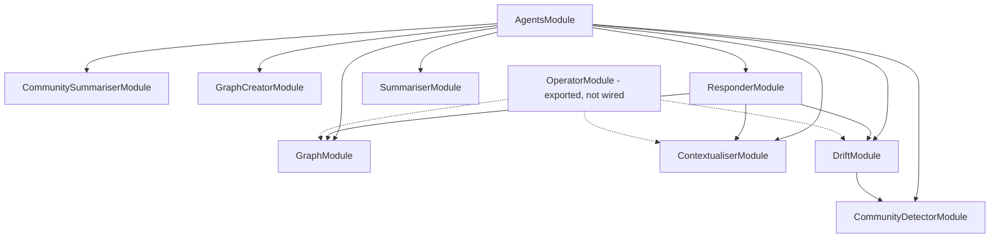

**This is a seed page.** It documents the agents {{display}} was handed on day
zero — all nine of them live in
`packages/nestjs-neo4jsonapi/src/agents/`, none of them in `apps/api/src`, and
the application declares no agent of its own. What the author adds is: a
per-agent page for every agent this application writes, using the skeleton at
the end of this page; the `chat` blocks on the entity descriptors that decide
what the packaged agents can see; and, if the app contributes tools, an entry in
the contribution table. Nothing on this page needs deleting as the app grows —
it describes machinery the app keeps.

## What `AgentsModule` wires

`packages/nestjs-neo4jsonapi/src/agents/agents.modules.ts` imports and re-exports
eight modules. `bootstrap()` adds it to the application module unless
`agents: false` is passed, so a fresh app has all eight providers resolvable
without importing anything.

`OperatorModule` is the ninth. It is exported from
`packages/nestjs-neo4jsonapi/src/agents/index.ts`, and therefore from the
package root, but `AgentsModule` does not import it and `bootstrap()` never
mounts it. To use the operator an app imports `OperatorModule` into its own
module graph — typically from the aggregator at
`apps/api/src/features/features.modules.ts`. Two consequences come with it:

- it declares `OperatorController`, which mounts the operator routes; an app
  that already serves those paths will collide;
- it holds a `forwardRef` cycle with the package's assistant module, because the
  controller needs the assistant service while the assistant module needs the
  operator service. Importing it anywhere resolves the cycle the same way, but
  the app must not try to break it by importing only halves of it.

## Graph

`packages/nestjs-neo4jsonapi/src/agents/graph/` — the entity-traversal agent and
the tool layer every other agent borrows from.

`GraphModule` is `@Global()`, because the core retrieval layer has to ask "is
this node inside the run's scope root?" and the answer is compiled from the
catalogue, which sits above core. The global `SCOPE_PREDICATE_SOURCE` token is
that one-way seam.

| Provider | Role |
|---|---|
| `GraphCatalogService` | Compiles every registered descriptor into the LLM-facing catalogue at `onApplicationBootstrap` |
| `GraphDescriptorRegistry` | The descriptor source the catalogue reads |
| `GraphSearchService` | Three-tier resolution — exact, fuzzy, semantic — with the score-margin and literal-summary rules that decide when a candidate is unambiguous |
| `GraphIndexManager` | Creates the fulltext and vector indexes for every chat-enabled entity at bootstrap, sized to the embedder's dimensions |
| `ScopeGuard`, `ScopePredicateService`, `buildScopePattern` | Scope enforcement, described below |
| `ToolFactory` and five tools | `resolve_entity`, `describe_entity`, `search_entities`, `read_entity`, `traverse` |
| `RelatedEdgesService`, `ToolFieldFormatterService` | Polymorphic `RELATES_TO` traversal, and value formatting (money in minor units gets a `<name>_formatted` sibling) |

Main types: `UserContext`, `ToolCallRecord`, `MatchMode`, `RunSearchParams`. The
prompt kernel is `GRAPH_NODE_SYSTEM_PROMPT_BASE` with
`renderGraphNodeSystemPrompt`. No cron, no checkpointer.

## GraphCreator

`packages/nestjs-neo4jsonapi/src/agents/graph.creator/` — knowledge extraction.
`GraphCreatorService.generateGraph({ content })` makes one LLM call per chunk of
text and returns a `ChunkAnalysisInterface`: atomic facts, key-concept
relationships, key-concept descriptions and dates, plus token counts.

One prompt drives one call whose schema demands all three collections at once,
so an app overriding `prompts.graphCreator` must **compose** on top of the
default rather than replace it — a facts-only prompt leaves the other two fields
uninstructed and they come back empty. Three field descriptions are overridable
separately through `prompts.graphCreatorSchemaDescriptions`, because a
description travels inline with the field it governs, which is where a model
actually reads it. `buildGraphCreatorOutputSchema` and `isValidKeyConcept` are
exported so an evaluation issues the same contract and the same post-extraction
gate production issues. No cron, no checkpointer.

## Contextualiser

`packages/nestjs-neo4jsonapi/src/agents/contextualiser/` — the multi-hop GraphRAG
retriever. `ContextualiserService.run(params)` executes a LangGraph state graph
over six node services: question refiner, rational plan, key concepts, atomic
facts, chunks and chunk vectors. `selectInitialNode` sends a first turn straight
to the rational plan and every follow-up through the refiner first.

The run is bounded twice — an absolute superstep ceiling so a routing bug cannot
loop forever, and a separate LLM-call budget that bounds spend. Main types:
`ContextualiserContextState`, `ContextualiserResponseInterface`,
`RetrievalSourceEntry` and the `RETRIEVAL_SOURCES` / `CONTEXTUALISER_TOOLS`
constants. It is a sub-agent: it takes a `CallerAttributionState` and bills the
caller. No cron, no checkpointer.

## Drift

`packages/nestjs-neo4jsonapi/src/agents/drift/` — community-based retrieval for
questions no single chunk answers. `DriftSearchService.search(params)` runs five
nodes: HyDE (a hypothetical document embedded and searched with), community
search against community summaries, a primer answer that also proposes follow-up
questions, iterative follow-up, and synthesis.

`DriftMigrationService.migrateAll()` is the backfill: it walks every company and
detects communities over existing key concepts, leaving the summaries to the
cron below. Main types: `DriftSearchResult`, `DriftConfig`, `DriftContextState`,
`FollowUpAnswer`, `MigrationResult`. Like the contextualiser it is a sub-agent
that bills its caller. No cron of its own, no checkpointer.

## CommunityDetector

`packages/nestjs-neo4jsonapi/src/agents/community.detector/` — graph clustering,
no LLM call at all. `CommunityDetectorService.detectCommunities()` deletes the
company's existing communities, checks that the graph data-science procedures
are available, and runs Louvain at a single resolution with a minimum community
size of three. `detectAndAssignCommunities(contentId, label)` is the incremental
form for one piece of content. It optionally consults the catalogue and the
scope-predicate source, so detection respects a scope root when one is compiled.
No cron, no checkpointer.

## CommunitySummariser

`packages/nestjs-neo4jsonapi/src/agents/community.summariser/` — the only agent
in the package that **owns a cron**. `CommunitySummariserCron.handleStaleCommunities`
runs every ten minutes, finds stale communities, and enqueues one job per
community on the `COMMUNITY_SUMMARISER` queue, which
`CommunitySummariserProcessor` consumes and `CommunitySummariserService`
summarises.

The cron is registered through `createWorkerProvider`, so it exists only in the
worker process. It filters on the optional `CREDIT_VALIDATOR` seam before
enqueuing: the processor's own gate stops the model call, but only this filter
stops the enqueue — and without it the same job is re-queued every ten minutes
forever. No checkpointer.

## Responder

`packages/nestjs-neo4jsonapi/src/agents/responder/` — the orchestrator.
`ResponderService.run(params)` is a state graph over a planner node, a graph
node, and the two sub-agents: the contextualiser and DRIFT. The planner decides,
per turn, which of the three branches to run and emits a refined question.

A branch runs only when the deployment-wide toggle and the per-call toggle both
allow it (`resolveAllowedBranches`), both defaulting to true. The graph node caps
itself at fifteen tool iterations and a sixty-second wall clock, and — when
`responder.graph.requireTraversalBeforeAnswer` is on — retries a turn that
answered without traversing, using `RETRY_INSTRUCTION`. Branch toggles, the
graph branch's model tier and reasoning effort are configured through
`ConfigResponderInterface`. Main types: `ResponderResponseInterface`,
`EntityReference`, `UnifiedTrace`, `BranchToggles`. No cron, no checkpointer.

## Summariser

`packages/nestjs-neo4jsonapi/src/agents/summariser/` — map/combine summarisation.
`SummariserService.summarise({ chunks })` fans out one map call per chunk at a
concurrency of `SUMMARISER_MAP_CONCURRENCY` (8), combines the results, and
produces a separate TL;DR that `packages/nestjs-neo4jsonapi/src/agents/summariser/utils/tldr.sanitizer.ts` cleans. Three prompts
(`map`, `combine`, `tldr`) and two behaviour switches (the empty-content
sentinel and TL;DR sanitising) are configurable. It returns `content`, `tldr`
and token counts. No cron, no checkpointer.

## Operator

`packages/nestjs-neo4jsonapi/src/agents/operator/` — the write-capable,
durably-checkpointed agent. `OperatorService.run(params)` compiles a graph of
`agent ⇄ tools → finalise`: the agent node is exactly one `LLMService.callStep`
with every tool bound; the tools node executes the returned calls; the finalise
node makes one structured `LLMService.call` for the answer and its suggested
questions. References and citations are collected from the tool-call recorder,
never from the model.

Destructive calls are handled first and freeze the run with LangGraph's
`interrupt()` until the user approves or denies — at most one destructive call
per pass, the rest returning a "not executed" message the model must re-issue.
Read-only tool errors come back as `Tool error: …` messages so the model
self-corrects; they are never thrown.

`OperatorCheckpointerService` **is** the checkpointer: a Redis-backed
LangGraph saver when a Redis connection is configured — it needs the JSON and
search command families — and an in-memory saver otherwise. Checkpoints expire
one day after the approval does, so a pending approval never outlives the state
it would resume. `operator.approvalTtlDays` defaults to 7.

`OperatorToolRegistry` composes each turn's tool set: the five graph tools, two
retrieval tools, the generic entity write tools (built only when a reachable
catalogued type declares `chat.writable`), a test-only destructive tool outside
production, and every app contribution registered under `OPERATOR_TOOLS`. Main
types: `OperatorRunResult`, `OperatorContextState`, `OperatorFinalAnswer`,
`OperatorCitation`.

## Writing your own agent

### Tools: `AbstractTools` and `@Tool`

A tool provider extends `AbstractTools<TRecord>`
(`packages/nestjs-neo4jsonapi/src/core/llm/abstracts/abstract.tools.ts`) and
decorates methods with `@Tool({ name, description, schema })` from
`packages/nestjs-neo4jsonapi/src/common/decorators/tool.decorator.ts`. The
decorator stores its metadata on the constructor keyed by method name;
`getToolsAsObject` then binds each method to the instance and wraps it in a
LangChain `DynamicStructuredTool`, stringifying any non-string return value.

Two surfaces come out of that:

- `this.tools` — an object keyed by **method** name, typed by `TRecord`, so a
  caller picks individual tools with autocomplete;
- `getTools()` — every decorated method as an array, for passing a whole
  provider at once.

The type parameter buys nothing at runtime; it exists so `tools.searchDocuments`
is checked rather than guessed. Because the method is bound to the instance,
every injected dependency is available through `this`.

### Inject `LLMService`, never subclass it

Every packaged agent injects `LLMService` and calls one of its five entry
points. None of them subclasses it, and none reimplements the retry, the
bounding, the structured-output analysis or the usage recording — those are the
service's contract, and an agent that reimplements any of them opts out of the
failover chain and the token ledger at the same time. Pick the entry point that
matches the guarantee you need (see [the LLM layer](llm-layer.md)) and pass
`modelWeight` to choose a tier.

### The two contribution tokens

| Token | Interface | Built | Registered for |
|---|---|---|---|
| `OPERATOR_TOOLS` | `OperatorToolContribution` — `build(ctx: OperatorRetrievalContext, recorder: ToolCallRecord[]): OperatorToolDefinition` | Once per operator turn | The operator agent |
| `MCP_TOOLS` | `McpToolContribution` — `build(ctx: McpUserContext): McpToolDefinition[]` | Once per MCP request | The MCP server |

Both are multi-provider symbols an app binds in its own module. Both are built
per request rather than per process, so a contributed tool can apply company
scoping and module visibility from the caller's context instead of capturing it
at startup.

An `OperatorToolDefinition` carries the LangChain tool, a `destructive` flag,
and — mandatory when destructive — a `summarise(args)` that renders the line
shown on the approval card. An `McpToolDefinition` carries a name, a description,
a plain JSON Schema input, a `readOnly` flag that becomes the protocol's
`readOnlyHint`, and an `execute(input, ctx)`. The MCP registry rejects a
contribution that reuses a built-in or another contribution's name.

The reference implementation to copy is
`packages/nestjs-neo4jsonapi/src/agents/operator/tools/operator-test-action.tool.ts`:
thirty-five lines, a Zod input schema, the tool body routed through
`ToolFactory.capture` so the call lands in the per-turn audit trail,
`destructive: true`, and a one-line `summarise`. It is registered only outside
production, which is also the pattern for gating a contribution by environment.

### Prompts are configuration

No agent prompt is edited in place. Every one has a default in the package and
an override slot on `ConfigPromptsInterface`
(`packages/nestjs-neo4jsonapi/src/config/interfaces/config.prompts.interface.ts`):
`graphCreator` and its three schema descriptions, the four `contextualiser`
prompts, `responder` and its two schema descriptions, `responderTemperature`,
`graphNodeDomain`, `planner`, `operator`, the three `summariser` prompts, and
five DRIFT-related prompts. Each agent reads its slot in its constructor and
falls back to the package default.

The app supplies them by switching `apps/api/src/config/config.ts` from
spreading the prebuilt `baseConfig` to calling
`createBaseConfig({ appName, prompts })` and spreading that. Every default is
re-exported from `packages/nestjs-neo4jsonapi/src/agents/prompts/index.ts`, so
an override can compose on top of one rather than replace it blind.

`graphNodeDomain` is the composable case, and the one to copy. The graph node's
kernel prompt names no domain at all, because the same package serves
completely unrelated products. `renderGraphNodeSystemPrompt(graphMap, domain)`
fills five slots — `role`, `dataConventions`, `disambiguation`, `depth`,
`outputRules` — from the app's configuration, leaving the kernel intact for
every slot the app omits. Replacements are done with a function rather than a
string so app-supplied text containing `$&` or `$1` cannot mangle the prompt.
`describeDomainLayer(domain)` reports which slots were supplied and which fell
back to the kernel, which belongs in a boot log.

### Caller attribution

A sub-agent bills the **caller's** ledger, not its own. `ContextualiserService.run`
and `DriftSearchService.search` both accept an optional
`CallerAttributionState`, and `packages/nestjs-neo4jsonapi/src/agents/common/usage-attribution.ts`
turns it into the triple `LLMService` wants:

1. the run's **scope root** when the turn has one and its Neo4j label is known;
2. otherwise the **assistant thread**, which every turn has;
3. otherwise nothing, and `persistUsage` writes no record.

The translation matters because the agents carry the scope as a JSON:API type
while a usage record's edge is matched on the Neo4j label. Passing the type
through verbatim writes a record whose edge matches nothing — it *looks*
attributed and bills against no entity. `resolveScopeLabel` goes through the
model registry and warns loudly on a miss, and the two sub-agents log
proportionately: a caller that named nothing is opting out and gets a debug
line; a caller that named something unresolvable is a fault and gets a warning.

An app-written agent that calls a packaged sub-agent must pass its attribution
down, or that sub-agent's entire spend goes unrecorded.

## The entity catalogue

What the agents can see is not configured in the agents. It is compiled from the
`chat` block on each entity descriptor
(`packages/nestjs-neo4jsonapi/src/common/interfaces/entity.schema.interface.ts`)
by `GraphCatalogService` at `onApplicationBootstrap`.

The gate is the descriptor's top-level `description`: **an entity without one is
invisible to every agent**, whatever its `chat` block says. With one, the `chat`
block shapes what the tools do with it.

| Key | Type | Compiles into |
|---|---|---|
| `summary` | `(data) => string` | The one-line rendering used in `resolve_entity`, `search_entities` and `traverse` results |
| `textSearchFields` | `string[]` | The fields the `text` parameter of `search_entities` searches, and what `GraphIndexManager` builds the fulltext index over |
| `list` | `string[]` | The stage-one fields emitted in declaration order; everything else is reported as available on `read_entity` |
| `scope` | `"self"` or a relationship key | One hop of the scope chain; the catalogue walks the chain to a root at boot |
| `writable` | `boolean` | Whether the operator's generic write tools may mutate this type. No type declares it, no write tool is built |
| `related` | `boolean` | Compiles a polymorphic chat-only `RELATES_TO` traversal, both directions |

A `bridge: { materialiseTo: [...] }` block is separate from `chat` and also
LLM-facing: a junction record's listed relationships are auto-fetched one hop
and inlined, with a `__materialised` array naming what was filled, so the model
does not traverse what it already has.

Two things the catalogue derives beyond presentation: filterable and sortable
fields (from each field's type), and the money marker — a field declared with a
money kind is described as an integer in minor units, and every record carrying
it also carries a `<name>_formatted` string the model is told to quote.

### Scope enforcement an app cannot switch off

`ScopeGuard` (`packages/nestjs-neo4jsonapi/src/agents/graph/services/scope.guard.ts`)
is the single place a scope predicate is built or applied, so "which root is
this run confined to" has exactly one answer. Every agent data-access point goes
through it.

Its rule is fail-closed: **in a scoped run, a type with no compiled scope chain
is out of scope.** Records of such a type are dropped and the drop is logged.
The alternative — treating an unscoped type as universally visible — is a
cross-scope leak, which is the whole failure the guard exists to prevent. There
is no configuration flag that relaxes this, and an app cannot opt a type out; it
either declares a `chat.scope` chain that reaches the root or its records never
appear in a scoped run.

Company scoping is separate and older: it reaches the repositories through CLS,
not through the agents at all.

## Turning the agents off, and the MCP server on

`bootstrap({ agents: false })` omits `AgentsModule` from the application module
(`packages/nestjs-neo4jsonapi/src/bootstrap/app.module.factory.ts`). Nothing
else changes — the LLM layer is a separate global module and stays available, so
an app can keep making model calls while supplying all of its own agents. The
template passes neither `agents` nor `mcp`, so it gets the eight agents and no
MCP server.

`bootstrap({ mcp: true })` mounts `McpModule`, a stateless Streamable HTTP MCP
server on POST /mcp:

- every request is authenticated by the OAuth token guard, which populates the
  CLS user and company, then handed a **fresh** protocol server and transport
  bound to that user;
- GET and DELETE are rejected with 405 — a stateless server exposes no
  notification channel and has no session to terminate;
- the tool list is the five graph read tools, a document-retrieval tool, four
  generic entity write tools, and every `MCP_TOOLS` contribution, all filtered
  through the caller's module visibility;
- writes go through the same services HTTP writes go through, so auditing is
  identical.

| Config key | Env | Default |
|---|---|---|
| `mcp.enabled` | `MCP_ENABLED` | off — and it is `BootstrapOptions.mcp`, not this key, that mounts the module |
| `mcp.serverName` | `MCP_SERVER_NAME` | a package-supplied placeholder; always set it |
| `mcp.instructions` | `MCP_INSTRUCTIONS` | unset |
| `mcp.promotedEntities` | `MCP_PROMOTED_ENTITIES` | empty; comma-separated entity types that get their own named tools |

## The page skeleton for an agent you add

Every agent this application writes gets one page in this section, with these
H2 headings in this order. A heading with nothing to say says so in one line
rather than being dropped — an agent with no failure modes recorded yet is a
different statement from an agent whose failure modes were never considered.

| Heading | Contains |
|---|---|
| `## Purpose` | What the agent does and what it is *not* for, in two to four sentences |
| `## Trigger` | What starts a run: an endpoint, a queue job, a cron, another agent |
| `## Inputs` | The `run` parameters, their types, and which are optional |
| `## The graph it reads` | Labels and relationships it touches, the `chat` blocks it depends on, and its scope chain |
| `## Prompt` | Which `ConfigPromptsInterface` slot overrides it, what the default asserts, and what an override must preserve |
| `## Output schema` | The Zod schema, field by field, and what each field is used for downstream |
| `## Cost` | Calls per run, the tier each uses, the `tokenUsageType` written, and what it is attributed to |
| `## Failure modes` | What it does on a provider failure, an empty retrieval, a scope miss and a schema rejection |
| `## Tests` | Where its specs are and what is deliberately untested |
| `## Where to look` | The ten most useful files |

## Where to look

| File | What it holds |
|---|---|
| `packages/nestjs-neo4jsonapi/src/agents/agents.modules.ts` | The eight modules a fresh app gets. |
| `packages/nestjs-neo4jsonapi/src/agents/index.ts` | Everything the package exports, including the unwired operator. |
| `packages/nestjs-neo4jsonapi/src/core/llm/abstracts/abstract.tools.ts` | `AbstractTools`, `tools` and `getTools()`. |
| `packages/nestjs-neo4jsonapi/src/common/decorators/tool.decorator.ts` | The `@Tool` decorator and its metadata shape. |
| `packages/nestjs-neo4jsonapi/src/agents/operator/interfaces/operator.tool.interface.ts` | `OPERATOR_TOOLS` and the contribution contract. |
| `packages/nestjs-neo4jsonapi/src/mcp/interfaces/mcp.tool.interface.ts` | `MCP_TOOLS` and the MCP tool contract. |
| `packages/nestjs-neo4jsonapi/src/config/interfaces/config.prompts.interface.ts` | Every prompt slot an app may override. |
| `packages/nestjs-neo4jsonapi/src/agents/graph/prompts/graph.node.system.prompt.ts` | The kernel prompt and its five domain slots. |
| `packages/nestjs-neo4jsonapi/src/agents/graph/services/graph.catalog.service.ts` | How a descriptor becomes something an agent can see. |
| `packages/nestjs-neo4jsonapi/src/agents/common/usage-attribution.ts` | Caller attribution and the type-to-label translation. |

## Gaps and drift

- `OperatorModule` is exported from the package barrel and never imported by
  `AgentsModule` or `bootstrap()`. Either the export or the omission is
  unintentional; the code as it stands means the operator is opt-in by import.
- No entity in the template declares a `chat` block or a top-level
  `description`, so on day zero the catalogue is empty, `GraphIndexManager`
  creates no index, the graph tools have nothing to resolve and the write tools
  are never built. The agents are wired and inert until the app describes its
  entities.
- The package's default MCP server name is the slug of the application the
  package was first written for. It is a default, not behaviour, but
  `MCP_SERVER_NAME` should always be set.
- `MCP_ENABLED` is read into config and is not what mounts the module —
  `bootstrap({ mcp: true })` is. An app that sets only the variable gets no MCP
  server.
- The `@Tool` decorator's own JSDoc example, and several agent docblocks, use
  domain vocabulary from other applications. They are comments.
- Not examined here: the individual node services of the contextualiser, DRIFT
  and responder beyond their names and order; the Cypher inside
  `GraphSearchService` and `CommunityDetectorService`; the assistant foundation
  that fronts the responder over HTTP; the checkpointer's Redis command
  detection; the promoted-entity MCP factory.
