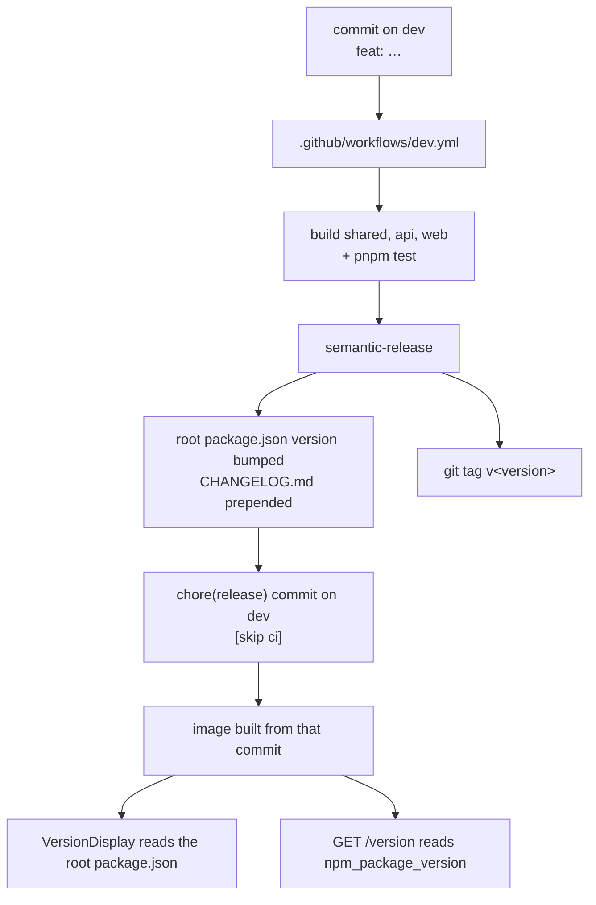

{{display}} versions itself with `semantic-release`, driven entirely by commit
messages. Nobody edits a version number by hand; the only input is what is
written in the subject line of each commit.

## `.releaserc`

The whole configuration is one file at the repository root.

### Branch and tag

| Setting | Value |
|---|---|
| `branches` | a single entry, `dev` |
| `tagFormat` | `v${version}` |

Only `dev` releases. There is no `main`, no `next`, no prerelease channel and no
maintenance branch. `.github/workflows/dev.yml` is the only workflow that runs
`semantic-release`, and it triggers on `push` to `dev`, so the two agree.

### Commit types and the bump each produces

`@semantic-release/commit-analyzer` uses the `conventionalcommits` preset with an
explicit `releaseRules` list. Every type in the list produces a release:

| Rule | Release |
|---|---|
| `breaking: true` | **major** |
| `feat` | **minor** |
| `fix` | patch |
| `docs` | patch |
| `style` | patch |
| `refactor` | patch |
| `test` | patch |
| `build` | patch |
| `ci` | patch |
| `chore` | patch |
| `perf` | patch |

This is deliberately more generous than the preset's default, where `docs`,
`style`, `test`, `ci` and `chore` produce nothing. Here **every** conventional
commit ships a version. A documentation fix on `dev` is a patch release.

### The two no-release markers

| Rule | Effect |
|---|---|
| `subject: "*\\[skip release\\]*"` | `release: false` — any commit whose **subject** contains `[skip release]` |
| `type: "wip"` | `release: false` — the `wip` type |

Those are the only two ways to land a conventional commit on `dev` without
producing a version. A commit that matches neither, and matches no type in the
table above, simply contributes nothing on its own — but a release triggered by
any other commit in the same push still includes it in the notes.

### The five plugins, in order

| Plugin | What it does here |
|---|---|
| `@semantic-release/commit-analyzer` | Decides the bump, using the rules above. |
| `@semantic-release/release-notes-generator` | Renders the notes, with an explicit `presetConfig.types` list that gives every type a titled section. |
| `@semantic-release/changelog` | Prepends those notes to `CHANGELOG.md`. |
| `@semantic-release/npm` | `npmPublish: false`. It updates the version in the root `package.json` and **does not publish**. The repository is `"private": true`, and this app is shipped as a container, not as a package. |
| `@semantic-release/git` | Commits the result. |

The notes sections, from `presetConfig.types`: 🚀 Features (`feat`), 🐛 Bug
Fixes (`fix`), 📚 Documentation (`docs`), 💎 Styles (`style`), 📦 Code
Refactoring (`refactor`), 🚨 Tests (`test`), 🛠 Build System (`build`), ⚙️
Continuous Integration (`ci`), ♻️ Chores (`chore`), ⚡ Performance Improvements
(`perf`).

**The git plugin commits exactly two files:**

```
assets:  ["CHANGELOG.md", "package.json"]
message: "chore(release): ${nextRelease.version} [skip ci]\n\n${nextRelease.notes}"
```

Two details in that message matter. `[skip ci]` stops the release commit —
itself a push to `dev` — from re-triggering `.github/workflows/dev.yml` and
looping. And the subject is a `chore`, which under the rules above would
otherwise be a patch release in its own right.

The two assets are also the whole footprint of a release: **the root
`package.json` version and `CHANGELOG.md`, nothing else**. No app manifest, no
package manifest, no lockfile.

## Conventional commits in practice

The format is `type(scope): subject`, with an optional body and footer.

```
feat(search): add cursor pagination to the results endpoint
fix(auth): reject a refresh token whose user was deleted
docs(handbook): document the e2e boot order
chore(deps): update library versions
perf(neo4j): skip the pagination COUNT query when total is unused
```

A breaking change is declared in the footer, or with a `!` after the scope:

```
feat(api)!: remove the deprecated /users/me alias

BREAKING CHANGE: clients must call /users/{id} with the session's own id.
```

Either form sets `breaking: true` and produces a major.

To land work on `dev` without a release:

```
wip: half of the invoice importer
chore: bump the lockfile [skip release]
```

Scopes are free text. The repository does not validate them, and no commitlint
hook is installed — `.husky/` contains only the two gates below. Conventions are
therefore enforced by review, not by tooling.

## The changelog

`CHANGELOG.md` ships in the template as an **empty file, zero bytes**. That is
correct and deliberate: a scaffolded app has no history, and
`@semantic-release/changelog` prepends to whatever is there. The first release
writes the first entry.

## The local gates

`.husky/` holds two hooks, each one line.

| Hook | Runs | What it covers |
|---|---|---|
| `.husky/pre-commit` | `pnpm lint` | `turbo run lint` across every workspace, then `node scripts/check-dep-drift.js`. |
| `.husky/pre-push` | `pnpm build` then `pnpm test` | `turbo run build` and `turbo run test` across every workspace. |

Two consequences:

- **`pnpm lint` includes the dependency-drift check**, so the five invariants in
  `scripts/check-dep-drift.js` — including rule 5, which compares
  `versions.production.json` against the submodules' own versions — gate every
  commit.
- **`pre-push` runs `pnpm build`**, which runs `next build`. That writes a
  production build into the directory a running `next dev` shares. Pushing
  beside a running dev server leaves the dev server serving 404s on every
  route. `scripts/dev.sh` detects it on the next `pnpm dev` and clears the
  directory, and the environments page describes the mechanism.

`.github/workflows/dev.yml` sets `HUSKY: "0"` for the release step, so the git
plugin's commit does not re-run `pre-commit` inside CI.

## How a version reaches the running application



Three things to know about the last two steps:

- `apps/web/src/features/common/components/navigations/VersionDisplay.tsx` **imports the root `package.json` directly** and renders
  its `version` in the sidebar footer. The value is bundled by `next build`, so
  the number in the UI is the version of the commit the image was built from.
- `GET /version` reads `process.env.npm_package_version`, which is set by npm or
  pnpm when a process starts through a package script. `api-production`'s `CMD`
  is a bare `node dist/main`, so a container reports the fallback `1.0.0`
  instead.
- Nothing in `.github/workflows/` builds or pushes an image. The step from a
  tagged commit to a running container happens outside this repository.

## The framework packages release separately

`@carlonicora/nestjs-neo4jsonapi` and `@carlonicora/nextjs-jsonapi` have their
own repositories, their own versions and their own release cycles. This
repository consumes them **twice**, and adopting a new version means moving both
halves.

| Half | What it is | How it moves |
|---|---|---|
| The **submodule** | `packages/nestjs-neo4jsonapi` and `packages/nextjs-jsonapi`, tracked on `master` by `.gitmodules`. Resolves `workspace:*` in development and in the development Docker stages. | `git submodule update --remote`, then rebuild the package. |
| The **pin** | `versions.production.json`. Substituted for `workspace:*` by `scripts/apply-production-versions.js` in the production Docker stages and in both CI workflows. | `pnpm sync:versions`, or the daily PR. |

They are checked against each other. Rule 5 of `scripts/check-dep-drift.js`
compares every entry in `versions.production.json` against the `version` field in
that submodule's own `package.json`, and `pnpm lint` runs it — so a mismatch
fails `pre-commit`.

That check makes the two halves interlock in a specific way:

- **Bumping the submodule alone** leaves the pin behind. `pnpm lint` fails until
  `pnpm sync:versions` is run, because `scripts/sync-production-versions.js` derives the
  pin from the submodule's manifest.
- **Bumping the pin alone** — which is exactly what the daily
  `.github/workflows/check-library-updates.yml` PR does — leaves the submodule
  behind, and fails the same check for the mirror-image reason. That PR is a
  *notification*, not a finished change: merging it requires bumping the
  submodules in the same branch.

The sequence for adopting a package version:

1. `git submodule update --remote packages/nestjs-neo4jsonapi` (or the other).
2. `pnpm install`, then build the package so `apps/*` consume the new `dist`.
3. `pnpm sync:versions` — rewrites `versions.production.json` from the
   submodule's own version.
4. `pnpm lint` — rules 1 through 4 catch the peer, overlap and override fallout
   a package bump usually brings with it; rule 5 confirms the pin.
5. `pnpm build` and `pnpm test`.
6. Commit both the submodule pointer and `versions.production.json` **in one
   commit**, so no revision of `dev` ever has the two halves disagreeing.

[`DEPENDENCY_UPGRADE_GUIDE.md`](../../../DEPENDENCY_UPGRADE_GUIDE.md) covers the
upgrade work itself — which majors are deferred and what each one needs.

## Where to look

| File | What it gives you |
|---|---|
| `.releaserc` | Branch, tag format, release rules, note sections, plugins. |
| `.github/workflows/dev.yml` | The only workflow that releases, and the `HUSKY: "0"` it sets. |
| `.github/workflows/check-library-updates.yml` | The daily pin-only PR. |
| `.husky/pre-commit` | `pnpm lint`. |
| `.husky/pre-push` | `pnpm build` and `pnpm test`. |
| `package.json` | The version `semantic-release` bumps, and the `lint`/`sync:versions` scripts. |
| `CHANGELOG.md` | Empty in the template; the first release fills it. |
| `versions.production.json` | The npm pin, half of a package adoption. |
| `.gitmodules` | The submodules, tracked on `master` — the other half. |
| `scripts/check-dep-drift.js` | Rule 5, which keeps the two halves honest. |

## Gaps and drift

- `.releaserc` assigns a patch release to every conventional type including
  `docs`, `style`, `test`, `ci` and `chore`. Version numbers therefore move for
  changes that do not alter the running application. That is a decision, not a
  defect, but it makes the version a poor signal of behavioural change.
- No `commitlint` hook is installed, so a commit that is not conventional is
  accepted locally and simply produces no release.
- The release commit touches only the root `package.json`. `apps/api`,
  `apps/web` and `packages/shared` keep their own, independent versions, which
  nothing bumps.
- **pnpm-lock.yaml** is not in the git plugin's `assets`. A release that changed
  dependencies would leave the lockfile uncommitted — in practice nothing in the
  release changes it.
- Not examined: whether any deployment pipeline consumes the `v${version}` tag.
  Nothing in this repository does.
